# 00 · Course Overview and Setup — Companion Guide

> Plain-language companion to [`00_course_overview_and_setup.ipynb`](00_course_overview_and_setup.ipynb). Read a section here, then run the
> matching section of the notebook. All numbers below were computed with the script
> [`figures/scripts/make_figures_00.py`](figures/scripts/make_figures_00.py); all charts are its output.

The script re-implements the notebook's tiny network in NumPy (same architecture, same loss, same Adam
optimizer, same PyTorch-style initialisation, same `make_moons` seeds), so you can compare its numbers with
the ones your notebook prints. They will agree closely but not to the last digit, because PyTorch draws
its random initial weights from a different random number generator. Timing numbers in Section 3 are from
one run on one shared machine; yours will differ, and the shape of the curves is what matters.

## At a glance

**What you learn**

- What deep learning is, how it differs from classical machine learning, and when it is the wrong tool.
- How the course is organised (18 notebooks, 7 parts, about 36 hours) and how to pace it.
- How to check that Python, PyTorch, the GPU and the plotting library are ready before you need them.
- The three ingredients of every deep learning system (model, loss, optimizer) and the five-line training loop.
- How to read a decision boundary, a loss curve and an experiment log, and what model width, learning rate and noise do.
- The notation and the tensor shape conventions that every later notebook relies on.

**Where this is used in the real world**

- Phone cameras: portrait mode separates the subject from the background with a neural network that learned its own features from millions of photos, the representation-learning idea of Section 1.
- Google Translate switched from a hand-engineered statistical system to a neural network in 2016; the "features are learned, not designed" story of Section 1 is why.
- Fraud flags, spam filters and click-through-rate predictors in large recommender systems are, at their core, the same binary classifier as the two-moons example of Section 4: features in, a logit out, binary cross-entropy as the loss.
- Every ML team runs a "smoke test" (tiny data, one epoch) before a multi-day training job; that is exactly the `FAST_RUN` convention of Section 2.
- Inference servers such as NVIDIA Triton and TorchServe batch incoming requests together because a GPU is slow on many tiny jobs and fast on one big one, the lesson of the timed matrix multiplication in Section 3.
- Experiment trackers (TensorBoard, MLflow, Weights and Biases) are the industrial version of the four-row experiment log of Section 5.

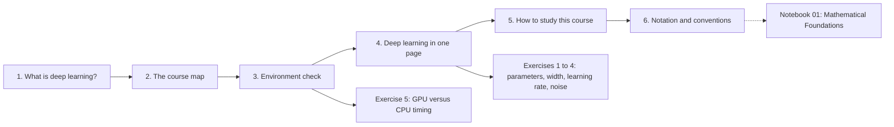

## 1. What is deep learning?

### In plain words

Classical machine learning asks a person to decide which properties of the input matter (the counts of
certain words in an e-mail, the edges in a picture) and then fits a simple model to those hand-made numbers.
Deep learning hands both jobs to the computer: a neural network is a stack of simple layers, each of which
turns its input into a slightly more abstract description, and training adjusts all of them at once so that
the final description makes the task easy. Nobody designs the edge detectors in an image network; they appear
because they help. That is why the field is also called representation learning. It pays off when there is a
lot of data with internal structure (images, sound, text, molecules, game states) and enough compute to
train on it, and it is the wrong tool for a small table of unrelated columns, for cause-and-effect questions,
or for decisions that need a proof.

### Sample data

The nine milestones of the notebook's timeline, with the number of years since the previous one (computed
by the script from the years).

| Year | Milestone | Years since previous |
|-----:|-----------|---------------------:|
| 1958 | Perceptron (Rosenblatt) | - |
| 1986 | Backpropagation (Rumelhart et al.) | 28 |
| 1998 | LeNet-5 (LeCun et al.) | 12 |
| 2012 | AlexNet (Krizhevsky et al.) | 14 |
| 2015 | ResNet, BatchNorm, Adam | 3 |
| 2017 | Transformer (Vaswani et al.) | 2 |
| 2018 | BERT / GPT | 1 |
| 2020 | Diffusion models, scaling laws, GPT-3 | 2 |
| 2023 | LLM era | 3 |

### Worked example

The notebook says the milestones cluster. Check it with the gaps:

1. The three gaps before 2012 are 28, 12 and 14 years; their mean is 18.0 years.
2. The five gaps from 2012 onwards are 3, 2, 1, 2 and 3 years; their mean is 2.2 years.
3. So the pace of decisive ideas sped up by a factor of about 18.0 / 2.2, roughly eight. The notebook's
   explanation is that each advance lowered the cost of the next: GPUs made big networks trainable, big
   networks made pre-training worthwhile, pre-training made Transformers dominant, Transformers made scaling
   laws visible.

### Chart

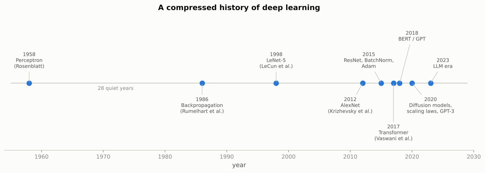

*Notice the 28 empty years on the left and six milestones squeezed into the eleven years after 2012.*

### Real-world examples

- AlphaFold 2 (2020) predicts the 3-D shape of a protein from its amino-acid sequence with a Transformer-style network; it is a textbook case of "rich internal structure plus lots of data".
- Speech recognition on phones replaced decades of hand-designed acoustic features with networks that learn them, which is why dictation became usable around 2012 to 2015.
- The opposite case: for credit scoring with legal explanation requirements, banks mostly keep logistic regression or gradient-boosted trees, exactly the "scarce, tabular, needs a justification" situation where the notebook says deep learning is the wrong tool.
- Weather forecasting still runs physics simulations for the core prediction; neural networks are added for post-processing because the physical structure is known and the "learn it from data" advantage is smaller.

### Examples for every subsection

- **1.1 A short history.** The 1969 proof that a single perceptron cannot compute XOR stalled the field for over a decade; the fix (hidden layers trained by backpropagation) was published in 1986, and you will reproduce both the failure and the fix in Notebook 02. The same pattern, a limitation followed by a structural fix, repeats with vanishing gradients and the LSTM (1997), depth and residual connections (2015), and recurrence and attention (2017).

### Common pitfalls

- Thinking "deep learning" means "artificial intelligence". It is one sub-field of machine learning, which is one route towards AI.
- Reaching for a neural network on a 20-column spreadsheet with 2 000 rows; gradient-boosted trees usually win there and are easier to explain.
- Expecting a model trained on one kind of data to behave sensibly on another: deep networks fail silently and confidently under distribution shift (Notebook 16).

## 2. The course map

### In plain words

Eighteen notebooks, seven parts, numerical order. Part I builds the mathematics and a network from scratch
so that PyTorch never feels like magic; Part II is about training reliably and organising code; Parts III
and IV are the two big application areas, vision and language; Part V generates data instead of
classifying it; Part VI learns by trial and error; Part VII makes models fast, deployable and trustworthy
and ends with capstone projects. The time estimates are for a careful first pass with every cell run, and
you should budget the same again for exercises. Two schedules are suggested: eight weeks at about nine
hours a week, or sixteen weeks at four to five hours a week.

### Sample data

The time estimates from the notebook's course map, summed per part by the script.

| Part | Notebooks | Minutes | Hours |
|------|-----------|--------:|------:|
| I Foundations | 00 to 03 | 405 | 6.75 |
| II Training | 04, 05 | 270 | 4.50 |
| III Vision | 06, 07 | 270 | 4.50 |
| IV Sequences and language | 08 to 10 | 390 | 6.50 |
| V Generative | 11, 12 | 270 | 4.50 |
| VI Reinforcement learning | 13 | 120 | 2.00 |
| VII Engineering and practice | 14 to 17 | 450 | 7.50 |

### Worked example

The notebook's cell "computes rather than asserts" the schedule. Step by step:

1. Total of the 18 estimates: 2175 minutes, which is 2175 / 60 = 36.25 hours. The notebook's "about thirty-six hours" is this number.
2. Spread over eight weeks: 36.25 / 8 = 4.53 hours of reading per week, plus about the same for exercises, which gives the "8 to 10 hours per week" of the eight-week intensive.
3. Week by week on the eight-week plan: week 1 (00, 01, 02) 285 min = 4.75 h; week 2 (03, 04) 270 min = 4.50 h; week 3 (05, 06) 4.50 h; week 4 (07, 08) 240 min = 4.00 h; week 5 (09, 10) 4.50 h; week 6 (11, 12) 4.50 h; week 7 (13, 14) 4.00 h; week 8 (15, 16, 17) 330 min = 5.50 h.
4. The lightest week is 4.00 h and the heaviest 5.50 h, so the plan is close to evenly loaded; that is why each 150-minute notebook (04, 06, 09, 12) is paired with a shorter neighbour.

### Chart

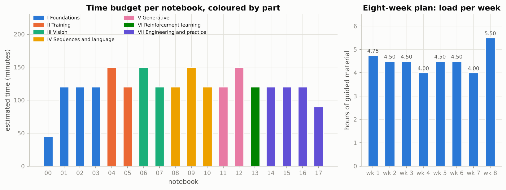

*Four notebooks are 150-minute ones and they never share a week; the week bars stay between 4.0 and 5.5 hours.*

### Real-world examples

- Teams at companies that train large models keep a "tiny config" of every experiment that runs end to end in minutes; it catches bugs before a GPU-week is spent. `FAST_RUN` is that habit, built into every notebook.
- Free hosted notebooks (Google Colab, Kaggle Notebooks) give a GPU with a time limit; the same "quick pass first, full budget later" trade-off applies there.
- Shared dataset caches are standard practice: torchvision stores downloaded datasets once and reuses them, and the Hugging Face hub caches models in your home folder, which is exactly what the `data/` folder convention does for this course.

### Examples for every subsection

- **2.1 Suggested schedules.** If you can give the course five hours a week, choose the sixteen-week plan: Notebooks 00 and 01 share week 1, 02 to 15 take one week each, 16 and 17 share week 16, and the capstone project continues afterwards.
- **2.2 How exercises and solutions work.** Exercise 1 of this notebook asks you to count parameters; write your own `count_parameters` in a fresh cell, run it, and only then open the solution cell that follows the exercise.
- **2.3 The FAST_RUN convention.** In this notebook the main training loop runs 200 epochs under `FAST_RUN = True` and 1000 otherwise; the printed accuracies in the prose refer to the 1000-epoch budget.
- **2.4 The data folder.** `DATA_DIR = Path("../data")` is created by the setup cell; MNIST, FashionMNIST and CIFAR-10 together take about half a gigabyte there, downloaded once.
- **2.5 Hardware expectations.** A laptop CPU with 8 GB of RAM runs everything; a 4 GB NVIDIA GPU makes Parts III to VII comfortable; the course does not test the Apple `mps` backend, so Apple Silicon users run on the CPU.

### Common pitfalls

- Reading the notebooks without running them. The estimates assume you run every cell and read every interpretation.
- Rushing Part I. The mathematics of Notebook 01 and the from-scratch network of Notebook 02 are what make Notebook 04 and beyond understandable.
- Forgetting that the prose quotes full-budget numbers. Under `FAST_RUN` your accuracies will be a little lower; that is expected.

## 3. Environment check

### In plain words

Most "the code does not work" problems in a deep learning course are environment problems: a package that
is missing, a Jupyter kernel that points at a different Python than the one you installed into, or a CPU-only
PyTorch build on a machine with a GPU. The section checks the versions of the core libraries, whether PyTorch
can see a CUDA GPU and how much memory is free, how fast a matrix multiplication runs on the CPU and the GPU,
whether matplotlib can typeset labels, and which optional libraries are present. The matrix-multiplication
timing also teaches the first lesson of GPU computing: a GPU is fast on large, regular work and slow on many
tiny jobs, which is why training processes data in batches.

### Sample data

NumPy matrix multiplication of two $n \times n$ matrices on the CPU of the machine that produced the
figures (mean of 5 timed repeats after one warm-up; the notebook times the same thing with PyTorch). A
multiplication of two $n \times n$ matrices costs about $2n^3$ floating-point operations.

| $n$ | Work $2n^3$ (GFLOP) | float32 seconds | float64 seconds | float32 GFLOP/s | float64 GFLOP/s | float64 / float32 |
|----:|------:|------:|------:|------:|------:|------:|
| 64 | 0.0005 | 0.000011 | 0.000016 | 45.7 | 32.0 | 1.43 |
| 128 | 0.0042 | 0.000067 | 0.000239 | 62.6 | 17.5 | 3.57 |
| 256 | 0.0336 | 0.000179 | 0.000358 | 187.8 | 93.7 | 2.00 |
| 512 | 0.2684 | 0.001634 | 0.005451 | 164.2 | 49.2 | 3.34 |
| 1024 | 2.1475 | 0.011080 | 0.032430 | 193.8 | 66.2 | 2.93 |
| 2048 | 17.1799 | 0.113444 | 0.295197 | 151.4 | 58.2 | 2.60 |

### Worked example

1. Work: for $n = 256$, $2n^3 = 2 \times 256^3 = 33\,554\,432$ operations, or 0.0336 GFLOP. For $n = 512$ it is 0.2684 GFLOP, eight times more, because $2^3 = 8$.
2. Throughput: 0.0336 GFLOP in 0.000179 s is 0.0336 / 0.000179 = 187.8 GFLOP/s. That is the "GFLOP/s (fastest)" column of the notebook's table.
3. Scaling: going from $n = 512$ to $n = 1024$ the float32 time went from 0.001634 s to 0.011080 s, a ratio of 6.78 against the ideal 8.00. A little under eight is normal (the notebook says so): bigger multiplications use the cache better, and timings on a shared machine are noisy.
4. Small is wasteful: at $n = 64$ the CPU reaches only 45.7 GFLOP/s, a quarter of what it reaches at $n = 1024$. The fixed cost of a call dominates tiny jobs. On a GPU this effect is far stronger, which is what Exercise 5 measures.
5. Precision: float64 took between 1.43 and 3.57 times as long as float32 in this run; the notebook's "about twice as long for large matrices" is the usual value, and the reason deep learning uses float32 (and smaller formats, Notebook 14) rather than NumPy's default float64.

### Chart

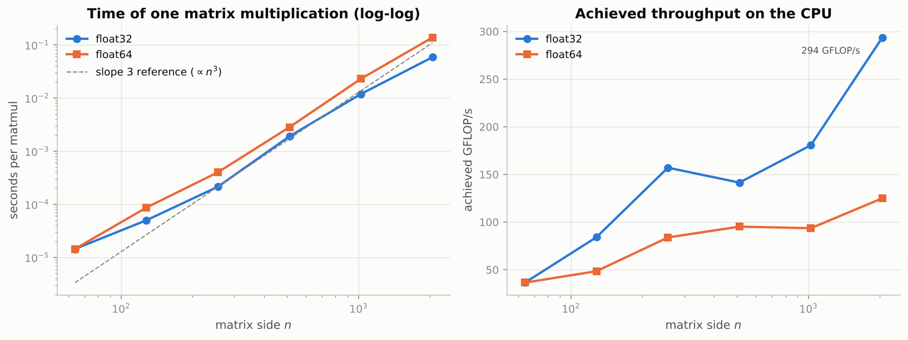

*On the left both curves follow the dashed slope-3 line for large $n$; on the right small matrices waste most of the machine.*

### Real-world examples

- Before launching a multi-GPU job, engineers run a matrix-multiplication benchmark to confirm each card reaches its rated TFLOP/s; a card that is throttled or mis-wired shows up immediately.
- Compute capability 8.0 (the Ampere generation, such as the A100) is what made bfloat16 training mainstream; that is why the notebook's GPU check prints it and why Notebook 14 cares.
- Pinned environment files such as `environment.yml` are how teams make "it works on my machine" reproducible; CI systems build the environment from scratch on every change.
- Dynamic batching in inference servers exists because of the overhead-versus-size curve above: a server waits a few milliseconds to collect requests and runs them as one big matrix multiplication.

### Examples for every subsection

- **3.1 Versions of the core libraries.** `version_of("sklearn")` returns the scikit-learn version string or `None`; if it returns `None`, the fix is `conda env create -f environment.yml` and selecting that environment's kernel. The printed `executable` path must contain `dl-course` (or `dl-course-cpu`).
- **3.2 CUDA and the GPU.** On a laptop with an RTX-class card the cell prints the CUDA build version, the cuDNN version, the card name, its total memory, its compute capability and the memory free right now; a browser with hardware acceleration can already be using a few hundred megabytes of it.
- **3.3 A timed matrix multiplication on CPU and GPU.** Without `torch.cuda.synchronize()` a GPU timing would measure only the time to *launch* the multiplication, a few microseconds, and report an absurd throughput; the warm-up call absorbs the one-off cost of loading kernels.
- **3.4 A matplotlib test plot.** The test plots $\sin(x)$, $\cos(x)$ and $\tanh(x)$ with TeX labels and a legend; if the labels render as `$\sin(x)$` literally, matplotlib's maths text is broken; if nothing appears, the inline backend is not active.
- **3.5 Optional libraries.** `transformers`, `datasets` and `peft` are needed only in Notebook 10, `gymnasium` in 13, `optuna` in 14, `onnx` and `onnxruntime` in 15; you can finish Parts I to III with none of them installed.

### Common pitfalls

- Timing GPU code without synchronising: the clock stops before the work is done.
- Judging a GPU by a tiny benchmark: at $n = 256$ it can be slower than the CPU; from $n = 1024$ it wins by one or two orders of magnitude.
- Installing into one environment and running the kernel of another; the `executable` line printed by the cell is the quickest diagnosis.

## 4. Deep learning in one page

### In plain words

Every system in the course has three parts. The model is a function with adjustable numbers (parameters)
that maps an input to a prediction; in deep learning it is a stack of layers, each a weighted sum followed
by a simple bend such as ReLU. The loss is a single number that says how wrong a prediction is; smaller is
better. The optimizer is the rule that changes the parameters to reduce the loss, almost always a form of
gradient descent: compute, for every parameter, the direction in which the loss grows, and step a little
the other way. Training repeats five lines: forward pass, loss, zero the old gradients, backward pass,
optimizer step. The section runs this on 1000 points shaped like two interleaved crescents, draws the
curved boundary the network learned, explains every line, and then adds the one thing a real project must
have, a test set the model never saw.

### Sample data

The first six rows of `make_moons(n_samples=1000, noise=0.2, random_state=42)`, the very points the
notebook trains on (the script uses the same seed), together with what the trained network says about
them. A logit above zero means "class 1".

| Row | $x_1$ | $x_2$ | True label | Logit | $P(\text{class 1})$ | Predicted |
|----:|------:|------:|-----------:|------:|------:|----------:|
| 0 | -0.112 | 0.520 | 1 | +0.500 | 0.622 | 1 |
| 1 | 1.143 | -0.343 | 1 | +8.261 | 1.000 | 1 |
| 2 | 0.796 | -0.011 | 1 | -1.227 | 0.227 | 0 |
| 3 | 0.112 | -0.552 | 1 | +13.847 | 1.000 | 1 |
| 4 | -0.816 | 0.544 | 0 | -15.539 | 0.000 | 0 |
| 5 | 0.663 | -0.084 | 1 | -0.040 | 0.490 | 0 |

The set has 500 points of each class; $x_1$ runs from -1.44 to 2.57 and $x_2$ from -1.00 to 1.48. Rows 2
and 5 sit in the overlap region between the moons and are classified wrongly even after training: with
noise 0.2 some points are on the wrong side, which is why 100% accuracy is neither reachable nor desirable.

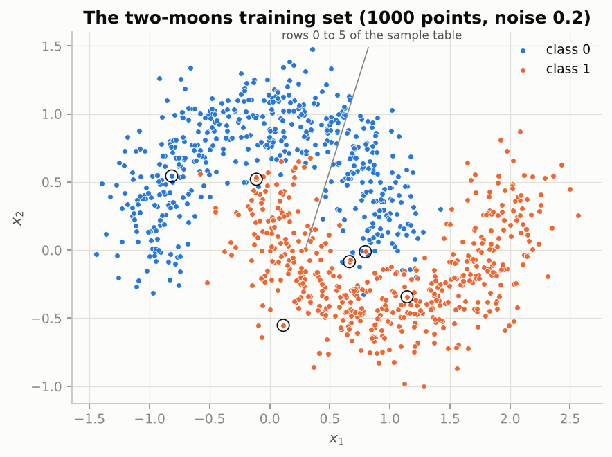

*The six sample rows are circled; no straight line separates the blue and orange crescents (the best straight cut the script found by random search reaches 0.869 training accuracy).*

### Worked example

**One step of the loop, by hand.** To see the three ingredients with numbers small enough to check on
paper, the script uses a miniature network 2 → 2 → 1 with hand-typed weights, one input point
$x = [1.0, 0.5]$ with true label $y = 1$, and learning rate $\eta = 0.1$.

- Weights: $W_1 = [[1.0, -1.0], [0.5, 1.0]]$, $b_1 = [0.0, -0.5]$, $W_2 = [[2.0, -1.0]]$, $b_2 = [0.1]$.
- Forward pass, hidden layer: $z_1 = W_1 x + b_1 = [1.0 - 0.5 + 0.0,\; 0.5 + 0.5 - 0.5] = [0.5, 0.5]$; ReLU leaves positive numbers alone, so $h = [0.5, 0.5]$.
- Forward pass, output: logit $= W_2 h + b_2 = 2.0 \times 0.5 - 1.0 \times 0.5 + 0.1 = 0.6000$.
- Probability and loss: $p = \sigma(0.6) = 0.6457$; binary cross-entropy for a true label of 1 is $-\log p = 0.4375$.
- Backward pass: the derivative of the loss with respect to the logit is $p - y = -0.3543$ (this is the one formula worth remembering; Notebook 01 derives it). Then $\partial \text{loss} / \partial W_2 = (p - y)\, h = [-0.1772, -0.1772]$ and $\partial \text{loss} / \partial b_2 = -0.3543$. Passing the signal back through $W_2$ gives $\partial \text{loss} / \partial h = (p - y)\, W_2 = [-0.7087, 0.3543]$; both hidden units were active (ReLU mask $[1, 1]$), so the same numbers are the gradient with respect to $z_1$; the outer product with $x$ gives $\partial \text{loss} / \partial W_1 = [[-0.7087, -0.3543], [0.3543, 0.1772]]$ and $\partial \text{loss} / \partial b_1 = [-0.7087, 0.3543]$.
- Update (plain gradient descent): every parameter moves against its gradient by $\eta$ times the gradient, so $W_2$ becomes $[2.0177, -0.9823]$, $b_2$ becomes $0.1354$, $W_1$ becomes $[[1.0709, -0.9646], [0.4646, 0.9823]]$ and $b_1$ becomes $[0.0709, -0.5354]$.
- Check: the new logit is 1.0532, the new probability 0.7414 and the new loss 0.2992, down from 0.4375. One step, one point, and the prediction already moved towards the truth. The notebook does the same thing 1000 times for 1000 points at once, with Adam instead of plain gradient descent.

**The learning rate on a bowl.** With $J(\theta) = (\theta - 3)^2$, gradient $2(\theta - 3)$ and start
$\theta = 0$: at $\eta = 0.1$ the iterates are 0.000, 0.600, 1.080, 1.464, 1.771, 2.017, ... and after
8 steps $J$ is still 0.2533 (slow but safe); at $\eta = 0.8$ they are 0.000, 4.800, 1.920, 3.648, 2.611,
3.233, ... overshooting the minimum at 3 each time but settling, with $J = 0.002539$ after 8 steps; at
$\eta = 1.05$ they are 0.000, 6.300, -0.630, 6.993, -1.392, 7.832, ... and $J$ grows to 41.35. These are the
"too small, good, divergent" regimes of Exercise 3 in their purest form.

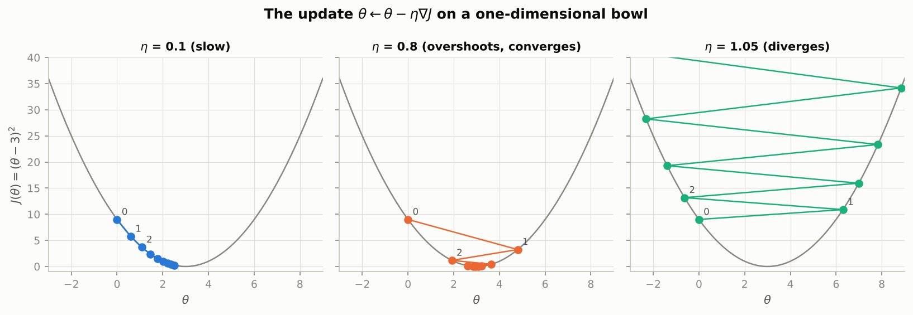

*Same bowl, same start, three step sizes: creeping, bouncing but converging, and blowing up.*

**The full example.** The script's NumPy copy of the notebook's model (2 → 32 → 32 → 1, 1185 parameters,
Adam with learning rate 0.01, 1000 full-batch epochs) reaches a final training loss of 0.0441 and a test
loss of 0.0920 on a fresh set of 1000 points (seed 43); training accuracy 0.979, test accuracy 0.969, a gap
of +0.010. The loss along the way: epoch 1: 0.7121 (train) / 0.6821 (test); epoch 10: 0.4298 / 0.3948;
epoch 50: 0.0972 / 0.0994; epoch 100: 0.0562 / 0.0743; epoch 200: 0.0529 / 0.0764; epoch 500: 0.0476 /
0.0802; epoch 1000: 0.0441 / 0.0920. The training loss first drops below 0.2 at epoch 30. The test loss is
lowest (0.0734) at epoch 108 and then creeps up while the training loss keeps falling: the network has
started fitting individual noisy points, which the test accuracy barely notices yet. Far from the data the
network is sure of itself: at $x = [3.0, 2.0]$ it predicts $P(\text{class 1}) = 1.0000$ and at
$x = [-2.0, -1.5]$ it predicts 0.0000, the over-confidence the notebook warns about.

### Chart

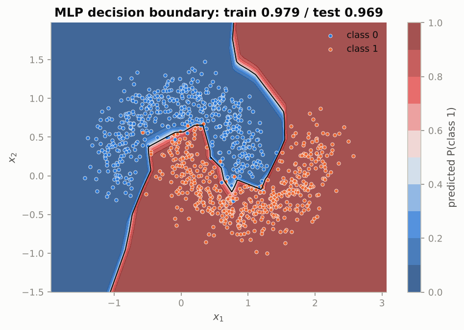

*The black line is where the predicted probability is exactly one half; it snakes between the moons instead of wrapping around individual noisy points, and the colours saturate far from any data.*

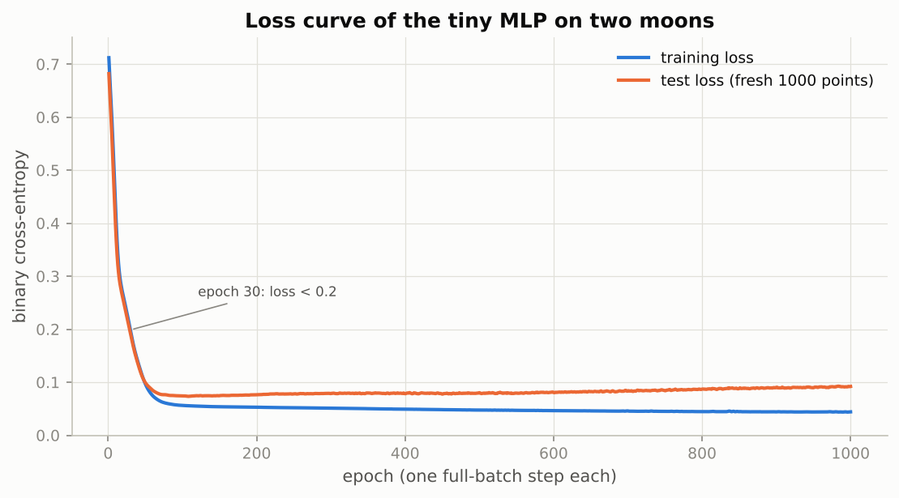

*Fast progress in the first few dozen epochs, then slow refinement; the test loss bottoms out near epoch 108 while the training loss keeps inching down.*

### Real-world examples

- A credit-card fraud flag is a binary classifier with a handful of features per transaction (amount, time since last purchase, distance from home) and a probability out; banks threshold that probability exactly like the 0.5 line in the plot, except that they move the threshold to trade missed fraud against false alarms.
- Spam filters are trained with the same binary cross-entropy loss; a "logit above zero means spam" rule is the same as `(logits > 0)` in the notebook.
- Click-through-rate models in large recommender systems are multi-layer perceptrons over user and item features; the forward-loss-backward-step loop is identical, only run on billions of rows in mini-batches.
- Hospital early-warning scores (will this patient deteriorate in the next 24 hours?) are small MLPs or gradient-boosted models over vital signs; the training-versus-test gap of Section 4.6 is the question every such model must answer before deployment.

### Examples for every subsection

- **4.1 The three ingredients.** In the hand example the model is $W_1, b_1, W_2, b_2$ (9 numbers), the loss is $-\log p = 0.4375$, and the optimizer step moves each of the 9 numbers by $0.1$ times its gradient.
- **4.2 The training loop, in words.** Forward: $x \to z_1 \to h \to$ logit $0.6$. Loss: $0.4375$. Backward: $p - y = -0.3543$ flows back to every weight. Step: $W_2 \leftarrow [2.0177, -0.9823]$. The notebook's five code lines are these four arrows plus zeroing the old gradients.
- **4.3 A complete example in twenty-five lines.** `make_moons` gives `X_np` of shape `(1000, 2)` and `y_np` of shape `(1000,)`; the model `nn.Sequential(nn.Linear(2, 32), nn.ReLU(), nn.Linear(32, 32), nn.ReLU(), nn.Linear(32, 1))` has 1185 parameters; with Adam at `lr=1e-2` the NumPy twin reaches training accuracy 0.979.
- **4.4 Looking at what the network learned.** The plot evaluates the model on a 300 × 300 grid (90 000 points) under `torch.no_grad()`; the contour at probability 0.5 is the decision boundary, and rows 2 and 5 of the sample table lie on its wrong side.
- **4.5 Every line explained.** `y.unsqueeze(1)` turns `(1000,)` into `(1000, 1)` so that it matches the model's output; forgetting it makes `BCEWithLogitsLoss` complain about shapes. `optimizer.zero_grad()` is needed because PyTorch adds new gradients to old ones.
- **4.6 A reusable training helper and a proper test set.** `train_mlp` re-seeds before building the model so that two runs differ only in the setting you changed; on the fresh test set (seed 43) the NumPy twin scores 0.969 against 0.979 on the training points, a gap of 0.010.

### Common pitfalls

- Feeding probabilities to `BCEWithLogitsLoss`: it expects raw logits and applies the sigmoid itself, in a numerically stable way.
- Forgetting `optimizer.zero_grad()`: gradients accumulate and the steps become garbage.
- Celebrating 100% training accuracy on noisy data: it means the model memorised the noise; compare with a held-out set.
- Trusting confident predictions far from the training data: the colours saturate there because nothing constrains the network, not because it knows.

## 5. How to study this course

### In plain words

Deep learning is empirical: the theory tells you what should happen and the experiment tells you what
does, and the gap between the two is where the learning is. So predict before you run, change the knobs
(learning rate, width, epochs, noise) and watch the effect, and write down what you changed and what
happened, because memory misattributes results. Learn to read error messages from the last line upward,
know that a GPU only matters from Notebook 06 onwards, and keep the short list of environment problems
that explain most failures.

### Sample data

The notebook's experiment log: four runs of the two-moons MLP for 300 epochs, two widths times two learning
rates, as computed by the script's NumPy twin.

| hidden | lr | epochs | final loss | train acc | test acc |
|-------:|------:|-------:|-----------:|----------:|---------:|
| 4 | 0.001 | 300 | 0.4702 | 0.764 | 0.768 |
| 4 | 0.01 | 300 | 0.2488 | 0.875 | 0.894 |
| 32 | 0.001 | 300 | 0.1159 | 0.964 | 0.959 |
| 32 | 0.01 | 300 | 0.0512 | 0.980 | 0.970 |

### Worked example

**Reading the log.** Two comparisons, each holding one knob fixed:

1. Width, at learning rate 0.001: going from 4 to 32 hidden units drops the final loss from 0.4702 to 0.1159 and lifts test accuracy from 0.768 to 0.959. At learning rate 0.01: 0.2488 to 0.0512 and 0.894 to 0.970. The wider network reaches a lower loss in both cases.
2. Learning rate, at width 32: going from 0.001 to 0.01 drops the loss from 0.1159 to 0.0512 within the same 300 epochs. The larger step gets there faster. At width 4 the same move halves the loss (0.4702 to 0.2488).
3. Without the log you would have to remember four pairs of numbers; with it, each row is a fact.

**Reading a learning-rate sweep (Exercise 3).** Width 32, 1000 epochs, learning rates from 0.0001 to 1:

| lr | loss at epoch 100 | final loss | lowest loss | highest loss | share of epochs 500 to 1000 where the loss went up | test acc |
|------:|------:|------:|------:|------:|------:|------:|
| 0.0001 | 0.6807 | 0.2961 | 0.2961 | 0.712 | 0.00 | 0.896 |
| 0.001 | 0.3197 | 0.0552 | 0.0552 | 0.712 | 0.00 | 0.972 |
| 0.01 | 0.0562 | 0.0441 | 0.0437 | 0.712 | 0.46 | 0.969 |
| 0.1 | 0.0504 | 0.0485 | 0.0308 | 0.712 | 0.43 | 0.970 |
| 1 | 0.2508 | 0.0470 | 0.0469 | 130 | 0.29 | 0.972 |

At 0.0001 the loss is still 0.6807 after 100 epochs (barely below the starting 0.712) and ends at 0.2961:
too small, the budget runs out first. At 0.001 and 0.01 the curve falls smoothly to the floor, with 0.01
getting there ten times sooner. At 0.1 the curve is jagged: the loss went up in 43% of the late epochs and
spikes are visible in the chart. At 1 the first epochs throw the loss to 130, far worse than at
initialisation; Adam's per-parameter step size keeps it finite and, in this NumPy run, the network recovers
later, which is why its final accuracy is still good. Judge the learning rate by the *shape* of the
curve, not by the final number alone.

**Reading an error message (5.4).** Feeding `torch.randn(8, 3)` to a model whose first layer is
`nn.Linear(2, 32)` fails with "mat1 and mat2 shapes cannot be multiplied (8x3 and 2x32)": `8x3` is the
input (8 points, 3 features), `2x32` is the transposed weight of the first layer (2 inputs, 32 outputs), and
the inner numbers 3 and 2 do not match. The last line names the layer and the shapes; print
`x.shape, x.dtype, x.device` just before the failing line and the bug is found.

### Chart

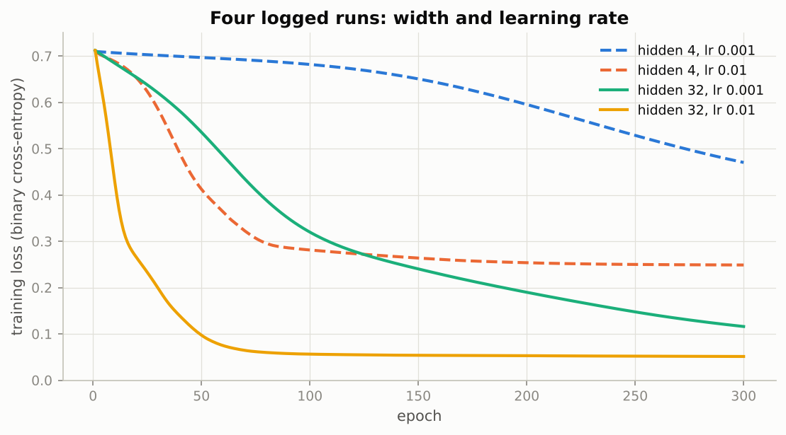

*Dashed curves are the width-4 network, solid the width-32 one; the larger learning rate (orange, yellow) reaches the floor far sooner than the smaller (blue, green).*

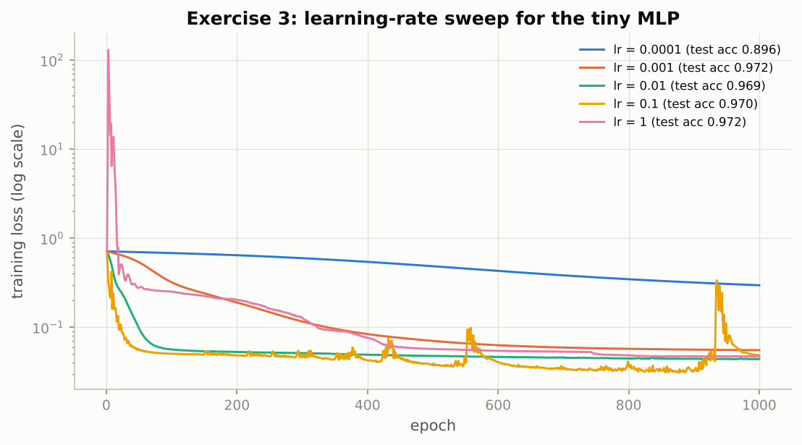

*Flat-but-falling means too small, smooth and fast means good, jagged means too large, and the pink spike to 130 at the start is what "divergent" looks like before Adam recovers.*

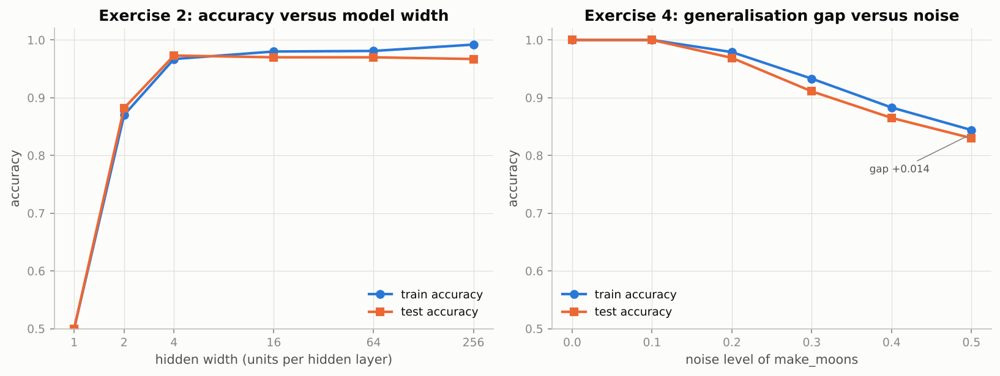

*Left: width 1 is stuck at chance in this run, width 2 can only make a straight-ish cut (0.882), and from width 4 upwards the test accuracy sits at about 0.97. Right: both accuracies fall as the moons overlap, and the training curve pulls slightly ahead.*

### Real-world examples

- Experiment trackers (TensorBoard, MLflow, Weights and Biases) store exactly the fields of the notebook's log, plus the git commit, the seed and the library versions, for thousands of runs.
- The "learning-rate range test" used in practice (Notebook 04) is the sweep above run automatically: increase the learning rate during one short run and watch where the loss stops falling.
- Hyperparameter search services (Optuna in Notebook 14, cloud AutoML products) automate "change the knobs and log the result"; they only work because every run is recorded.
- Searching an error message verbatim is standard engineering practice; nearly every PyTorch message has a public thread with the fix.

### Examples for every subsection

- **5.1 Active reading.** Before running the shape cell of Section 6, predict that `torch.zeros(64, 3, 32, 32).numel()` is 196 608; if you predicted 6 144 (forgetting the batch), that is the moment to slow down.
- **5.2 Change the hyperparameters.** Halving the learning rate from 0.01 to 0.005 in `train_mlp` and doubling it to 0.02 are two runs that take seconds; the table above shows that 0.001 to 0.01 cut the 300-epoch loss from 0.1159 to 0.0512.
- **5.3 Keep an experiment log.** `log_run(hidden=32, lr=1e-2, epochs=300, final_loss=0.0512, train_acc=0.980, test_acc=0.970)` appends one dictionary; `pd.DataFrame(experiment_log)` shows all runs as a table.
- **5.4 How to read error messages.** "expected scalar type Long but found Float" from `nn.CrossEntropyLoss` means the labels were passed as floats; the fix is `labels.long()`.
- **5.5 When to use a GPU.** Notebook 06 trains a ResNet on CIFAR-10 (50 000 images); on a CPU with the full budget that is the "twenty minutes becomes two" case, so run it with `FAST_RUN = True` locally or on a hosted GPU.
- **5.6 Common environment problems and their fixes.** `torch.version.cuda` printing `None` on a machine with an NVIDIA GPU means the CPU-only build is installed; recreate the environment from `environment.yml`.

### Common pitfalls

- Changing two knobs at once and attributing the effect to one of them.
- Judging a learning rate by the final accuracy alone; the run at learning rate 1 above ends well but spent its first epochs at a loss of 130.
- Logging results in your head. Four runs are already enough to mix up.

## 6. Notation and conventions

### In plain words

The course uses one notation for mathematics and one set of shape rules for code, so that a symbol or a
tensor shape always means the same thing. Scalars are lower-case letters (Greek for hyperparameters such as
the learning rate $\eta$), vectors are bold lower-case column vectors, matrices are bold upper-case, and
$\theta$ is all the parameters of a model stacked into one vector. In code the first axis is almost always
the batch; images are `(batch, channels, height, width)`; sequences are `(batch, time, features)`; class
labels are a plain integer vector `(batch,)`; a classifier's output is logits, not probabilities, and the
loss takes those logits. Two conventions trip people up: a linear layer is written $\mathbf{W}\mathbf{x} + \mathbf{b}$
in mathematics but computed as $\mathbf{X}\mathbf{W}^\top + \mathbf{b}$ in code, because code keeps one
example per row; and a gradient always has the same shape as the thing it is taken with respect to.

### Sample data

The six example tensors of the notebook's shape cell, as reproduced by the script.

| Kind of data | Shape | Axes | Elements | dtype |
|--------------|-------|-----:|---------:|-------|
| tabular | (64, 784) | 2 | 50,176 | float32 |
| images | (64, 3, 32, 32) | 4 | 196,608 | float32 |
| sequence | (64, 50, 128) | 3 | 409,600 | float32 |
| tokens | (64, 50) | 2 | 3,200 | int64 |
| labels | (64,) | 1 | 64 | int64 |
| loss | () | 0 | 1 | float32 |

### Worked example

1. Elements are the product of the shape: $64 \times 784 = 50\,176$ for the tabular batch; $64 \times 3 \times 32 \times 32 = 196\,608$ for the image batch; $64 \times 50 \times 128 = 409\,600$ for the sequence batch. A zero-dimensional tensor has shape `()` and one element.
2. Memory: in float32 every element is 4 bytes, so the image batch takes 768 KiB and the sequence batch 1600 KiB. Notebook 14 uses this arithmetic to predict GPU memory before running.
3. The batched linear layer: $\mathbf{X}$ of shape (64, 784) times $\mathbf{W}^\top$ of shape (784, 256) plus $\mathbf{b}$ of shape (256,), broadcast over the 64 rows, gives (64, 256). The inner numbers (784 and 784) must agree; that is the rule the error message of Section 5.4 enforces. The multiplication costs $64 \times 784 \times 256 = 12\,845\,056$ multiply-adds.
4. `nn.Linear(784, 256).weight` has shape (256, 784), that is `(out_features, in_features)`, so the layer computes `X @ weight.T + bias`; the notebook checks with `torch.allclose` that this manual formula matches the layer's output.

### Chart

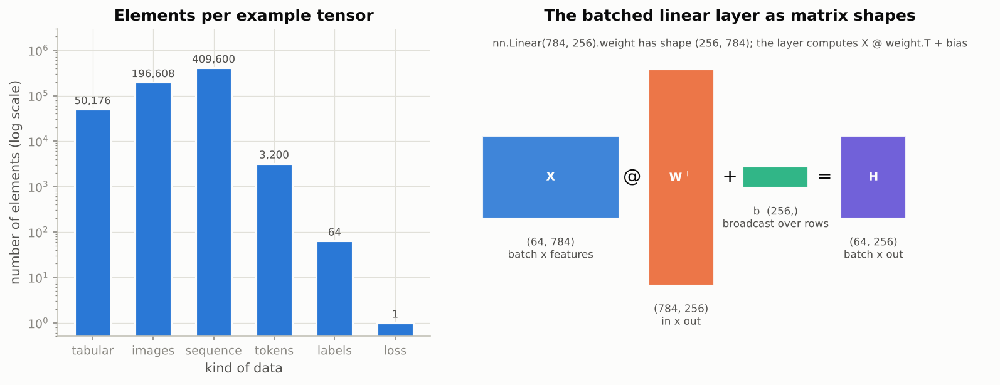

*Left: six orders of magnitude between a scalar loss and a sequence batch, on a log axis; right: the inner dimensions of X and W-transposed must match, the bias is broadcast over rows.*

### Real-world examples

- PyTorch is channels-first but image libraries (PIL, OpenCV, matplotlib) are height-width-channels; the `permute` between them is the single most common bug in vision data pipelines and the reason the table says so explicitly.
- Hugging Face Transformers return sequences as `(batch, time, features)`, the course's `batch_first=True` convention, so the two fit together without reshaping.
- Exporting a model to ONNX (Notebook 15) requires fixing the input shape convention once; serving systems then reject tensors with the wrong layout at the door.
- Production code bases increasingly annotate tensor shapes in comments or with shape-checking libraries, which is the "shapes as tuples with named axes in comments" habit of this section.

### Examples for every subsection

- **6.1 Mathematical notation.** $\hat{y} = f_\theta(\mathbf{x})$ reads "the prediction is the model, with its current parameters, applied to the input"; the update rule $\theta \leftarrow \theta - \eta \nabla_\theta J$ reads "move every parameter against its gradient, scaled by the learning rate", exactly what moved $W_2$ from $[2.0, -1.0]$ to $[2.0177, -0.9823]$ in Section 4.
- **6.2 Shape conventions in code.** Class labels for a 10-class problem are `torch.zeros(64, dtype=torch.long)`, not a `(64, 10)` one-hot matrix; `nn.CrossEntropyLoss` wants `(batch, classes)` logits and `(batch,)` integer labels.

### Common pitfalls

- Passing float labels to `nn.CrossEntropyLoss` ("expected scalar type Long but found Float").
- Confusing `weight.shape == (out, in)` with the mathematical $\mathbf{W} \in \mathbb{R}^{m \times n}$ mapping $n$ inputs to $m$ outputs: they are the same matrix; code just stores one example per row and multiplies by the transpose.
- Giving matplotlib a `(channels, height, width)` image; it needs `(height, width, channels)`.

## Exercises in plain words

- **Exercise 1 (warm-up): counting parameters.** Count the adjustable numbers in the 2 → 32 → 32 → 1 model by hand and with a function. Useful because parameter counts drive memory and training time, and the hidden-to-hidden layer dominates. Hint: each `nn.Linear(n_in, n_out)` has `n_out * n_in` weights plus `n_out` biases; the script's twin confirms 1185 for width 32 and 66 817 for width 256.
- **Exercise 2: the effect of model width.** Train widths 1, 2, 4, 16, 64 and 256 and draw the six boundaries. Useful because it shows underfitting (too little capacity) and that extra capacity is often simply unused. Hint: use `train_mlp`, `accuracy` and `plot_decision_boundary` with `ax=` in a 2 × 3 grid; expect a jump between widths 1 and 4 and a plateau near 0.97 after that. With one hidden unit the network can die (constant output, 0.500 accuracy in the NumPy run), so do not panic if width 1 is at chance.
- **Exercise 3: the effect of the learning rate.** Sweep 0.0001 to 1 and plot the five loss curves on a log axis. Useful because the learning rate is the single most important hyperparameter and the curve shapes are a diagnostic you will use forever. Hint: `plt.yscale("log")`; describe each curve as too small, good, too large or divergent before you look at the accuracies.
- **Exercise 4: the effect of dataset noise.** Train at noise levels 0.0 to 0.5 with separate train and test seeds and plot both accuracies. Useful because it separates two effects: overlap that no model can fix (the Bayes error) and overfitting (the gap). Hint: at noise 0.0 both sets are the same 1000 points, so both accuracies are 1.000; the NumPy run gives test accuracies 1.000, 1.000, 0.969, 0.911, 0.865, 0.830 and gaps of at most +0.022.
- **Exercise 5 (challenge): GPU versus CPU across matrix sizes.** Time `time_matmul` for $n$ from 64 to 2048 on the CPU and, if present, the GPU, on log-log axes with GFLOP/s. Useful because it shows where the GPU starts to pay off and why batching exists. Hint: the solution must run without a GPU, so build the list of (label, device, dtype) configurations from `device.type`; without a GPU compare float32 with float64 and expect roughly a factor of two for large $n$.

## Quick reference

| Concept | Formula or rule | In one sentence |
|---------|-----------------|-----------------|
| Model | $\hat{y} = f_\theta(x)$ | A function with adjustable parameters $\theta$ that maps inputs to predictions. |
| Linear layer | $\mathbf{h} = \mathbf{W}\mathbf{x} + \mathbf{b}$, in code `X @ W.T + b` | A weighted sum plus a bias; `nn.Linear` stores `weight` as `(out, in)`. |
| ReLU | $\mathrm{ReLU}(z) = \max(0, z)$ | The bend that stops a stack of linear layers collapsing into one. |
| Sigmoid | $\sigma(z) = 1 / (1 + e^{-z})$ | Turns a logit into a probability; logit above 0 means probability above one half. |
| Binary cross-entropy | $-[y \log p + (1 - y)\log(1 - p)]$ | The loss for yes/no problems; `BCEWithLogitsLoss` computes it stably from the logit. |
| Average loss | $J(\theta) = \frac{1}{N}\sum_i \mathcal{L}(f_\theta(x_i), y_i)$ | Training means making $J$ small. |
| Gradient of BCE at the logit | $\partial \mathcal{L} / \partial z = p - y$ | The error signal that backpropagation sends backwards. |
| Gradient descent | $\theta \leftarrow \theta - \eta \nabla_\theta J$ | Step against the gradient; $\eta$ is the learning rate. |
| Training iteration | forward, loss, `zero_grad`, `backward`, `step` | Five lines; one pass over all data is an epoch. |
| Parameters of `nn.Linear(n_in, n_out)` | $n_{\text{out}} n_{\text{in}} + n_{\text{out}}$ | The 2 → 32 → 32 → 1 model has 64 + 32 + 1024 + 32 + 32 + 1 = 1185. |
| Matrix multiplication cost | $2n^3$ FLOPs for $n \times n$ | Doubling $n$ multiplies the work by eight. |
| Throughput | GFLOP/s $= 2n^3 / (\text{seconds} \times 10^9)$ | Small matrices waste the hardware; batch work to use it. |
| Tensor shapes | `(batch, features)`, `(batch, C, H, W)`, `(batch, time, features)` | Batch first, channels before space, integer labels, logits into the loss. |
| Generalisation gap | train accuracy minus test accuracy | The first number to ask for after any training accuracy. |

## Glossary

- **Autograd**: PyTorch's engine that records operations on tensors and computes gradients automatically during `backward()`.
- **Backpropagation**: the chain rule applied layer by layer from the loss back to every parameter, in one backward sweep.
- **Bayes error**: the smallest error rate any classifier can reach on data whose classes overlap; the noisier the moons, the larger it is.
- **Decision boundary**: the set of inputs where the model is exactly undecided (probability one half); the black line in the plot.
- **Epoch**: one pass through the whole training set; in the full-batch example, one epoch is one step.
- **FAST_RUN**: the per-notebook switch that shrinks every training budget so a CPU finishes in minutes.
- **Hyperparameter**: a setting chosen by you (learning rate, width, epochs, noise) rather than learned by the optimizer.
- **Learning rate**: the step size of gradient descent; too small is slow, too large oscillates or diverges.
- **Logit**: the raw score a classifier outputs before the sigmoid or softmax; the loss functions take logits.
- **Loss**: a single non-negative number measuring how wrong a prediction is; training minimises its average.
- **Mini-batch**: a subset of the data used for one gradient step; large enough to use the hardware, small enough to fit in memory.
- **MLP (multi-layer perceptron)**: a stack of linear layers separated by element-wise non-linearities such as ReLU.
- **Overfitting**: fitting the noise of the training set; shows up as a gap between training and test accuracy.
- **Representation learning**: learning the features and the decision rule together from data, the defining trait of deep learning.
- **Synchronise (CUDA)**: wait for the GPU to finish queued work; required before reading a clock when timing GPU code.
