# 01 · Mathematical Foundations — Companion Guide

> Plain-language companion to [`01_mathematical_foundations.ipynb`](01_mathematical_foundations.ipynb). Read a section here, then run the
> matching section of the notebook. All numbers below were computed with the script
> [`figures/scripts/make_figures_01.py`](figures/scripts/make_figures_01.py); all charts are its output.

## At a glance

**What you learn**

- How vectors, matrices and tensors are stored as arrays, and how to read a matrix as a rule that moves every point of the plane at once.
- How the singular value decomposition finds the few directions that matter in a matrix or a dataset, which gives image compression and principal component analysis.
- What a derivative, a gradient and a Jacobian are, how the chain rule multiplies them, and why reading the product backwards is backpropagation.
- Why gradient descent lowers the loss, how the learning rate and the curvature decide whether it converges, and why momentum helps in long narrow valleys.
- Where mean-squared error and cross-entropy come from (maximum likelihood), and what entropy and KL divergence measure.
- How floating-point numbers fail (overflow, underflow, cancellation), and how broadcasting and vectorisation make NumPy and PyTorch code fast.

**Where this is used in the real world**

- Recommender systems: the matrix-factorisation models made famous by the Netflix Prize approximate a huge user-by-film rating table by a low-rank product, exactly the Section 1.8 idea.
- Population genetics: plotting the first two principal components of a genotype matrix is the standard first look at a cohort; for European samples the PCA map famously resembles the map of Europe (Novembre et al., 2008).
- Search and chat assistants: embedding similarity is a dot product or cosine similarity (Section 1.2), and the attention scores inside a transformer are batched matrix products (Section 1.4).
- Medical screening: Bayes' rule (Section 4.3) is why a positive result for a rare disease is usually followed by a confirmatory test rather than treatment.
- Every classifier, from spam filters to image recognisers, is trained with the cross-entropy loss, computed from logits with the log-sum-exp trick (Sections 4.4 to 4.6).
- Mixed-precision training on GPUs and TPUs relies on float16 and bfloat16 (Section 5.1); loss scaling exists only because float16 overflows at 65,504.
- LoRA fine-tuning of large language models adds a low-rank update to each weight matrix, a direct use of the Eckart-Young idea.

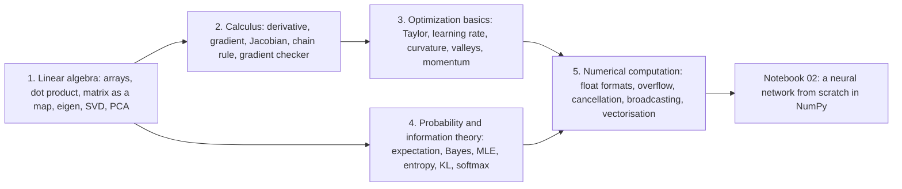

## 1. Linear algebra

### In plain words

A matrix is usually introduced as a table of numbers, but the useful picture is that a matrix is a *rule for moving points*: multiply any point of the plane by a 2 by 2 matrix and it lands somewhere else, and the rule can stretch, rotate, shear or flip but never bend. The columns of the matrix are where the two basis arrows land, the determinant says how much areas grow, and the singular value decomposition (SVD) says in which directions the rule stretches most and least. Every layer of a neural network applies such a rule to its input (and a batch of inputs is handled by one matrix-matrix product), so this picture is what you will use to reason about shapes, about what a layer can represent, and about why a nearly singular matrix is dangerous. Applied to a centred data table, the same SVD finds the directions in which the data vary most: that is principal component analysis (PCA), and keeping only the top directions is the best low-rank approximation of the data.

### Sample data

A hand-typed 2 by 2 matrix and four points of the plane (used for 1.1 to 1.8):

$$
\mathbf{A} = \begin{pmatrix} 2 & 1 \\ 0.5 & 1.5 \end{pmatrix}, \qquad
\mathbf{p}_1 = (1, 0),\; \mathbf{p}_2 = (0, 1),\; \mathbf{p}_3 = (1, 1),\; \mathbf{p}_4 = (-1, 0.5).
$$

A hand-typed data matrix of 4 samples and 3 features (used for 1.9, PCA):

| sample | feature 1 | feature 2 | feature 3 |
|---|---|---|---|
| 1 | 2.0 | 1.0 | 0.5 |
| 2 | 3.0 | 2.0 | 1.5 |
| 3 | 4.0 | 2.0 | 1.0 |
| 4 | 5.0 | 3.0 | 2.0 |

### Worked example

**Part A: what the matrix does to the points.** Each output coordinate is a dot product of one row of $\mathbf{A}$ with the point. For $\mathbf{p}_3 = (1, 1)$: row 1 gives $2 \cdot 1 + 1 \cdot 1 = 3$, row 2 gives $0.5 \cdot 1 + 1.5 \cdot 1 = 2$, so $\mathbf{A}\mathbf{p}_3 = (3, 2)$. The script prints all four:

| point | $\mathbf{x}$ | $\mathbf{A}\mathbf{x}$ | stretch $\lVert \mathbf{A}\mathbf{x} \rVert / \lVert \mathbf{x} \rVert$ |
|---|---|---|---|
| $\mathbf{p}_1$ | (1, 0) | (2, 0.5) | 2.0616 |
| $\mathbf{p}_2$ | (0, 1) | (1, 1.5) | 1.8028 |
| $\mathbf{p}_3$ | (1, 1) | (3, 2) | 2.5495 |
| $\mathbf{p}_4$ | (-1, 0.5) | (-1.5, 0.25) | 1.3601 |

Note that $\mathbf{A}\mathbf{p}_1$ and $\mathbf{A}\mathbf{p}_2$ are the two columns of $\mathbf{A}$. The determinant is $2 \cdot 1.5 - 1 \cdot 0.5 = 2.5$, so every area grows 2.5 times. The singular values are $\sigma_1 = 2.5583$ and $\sigma_2 = 0.9772$: no point is stretched by more than 2.5583 or less than 0.9772 (check the last column of the table), and $\sigma_1 \sigma_2 = 2.5 = |\det \mathbf{A}|$. The eigenvalues are 2.5 and 1: there are two directions that are only stretched, not turned.

**Part B: PCA of the 4 by 3 table through the SVD.** Step 1, centre: the column means are $(3.5, 2, 1.25)$, so the centred matrix is

$$
\mathbf{X}_c = \begin{pmatrix} -1.5 & -1 & -0.75 \\ -0.5 & 0 & 0.25 \\ 0.5 & 0 & -0.25 \\ 1.5 & 1 & 0.75 \end{pmatrix}.
$$

Step 2, SVD: the singular values are $2.7931, 0.6698, 0$ (the third is zero: the centred rows lie in a plane). Their squares $7.8014, 0.4486, 0$ add up to $8.25$, which is the sum of all squared entries of $\mathbf{X}_c$. Step 3, variance explained: $7.8014 / 8.25 = 0.9456$ for the first component and $0.0544$ for the second; the variance along each component is $\sigma_i^2 / (N - 1) = 2.6005, 0.1495, 0$. Step 4, the first principal direction is $\mathbf{v}_1 = (0.7895, 0.5002, 0.3556)$: all three features move together, feature 1 most. Step 5, scores (coordinates in the new basis): on PC 1 the four samples sit at $-1.9512, -0.3059, 0.3059, 1.9512$, on PC 2 at $0.0734, -0.4679, 0.4679, -0.0734$. Step 6, reconstruct with one component: the relative error is $0.2332 = \sqrt{1 - 0.9456}$, as Eckart-Young predicts, and adding the mean back gives rows $(1.959, 1.024, 0.556)$, $(3.259, 1.847, 1.141)$, $(3.741, 2.153, 1.359)$, $(5.041, 2.976, 1.944)$, close to the original table with 4 + 3 + 1 numbers instead of 12.

### Chart

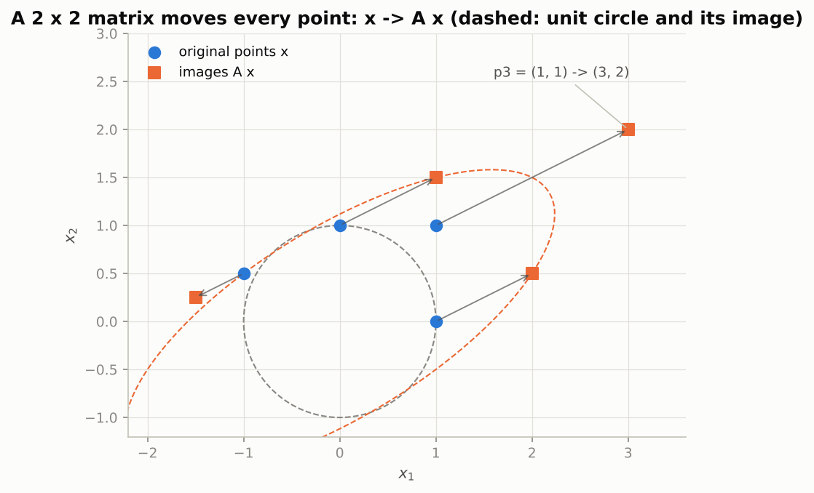

*What to see: the grey unit circle becomes the orange ellipse whose semi-axes are the singular values 2.56 and 0.98, and every arrow stretches by a factor between those two numbers.*

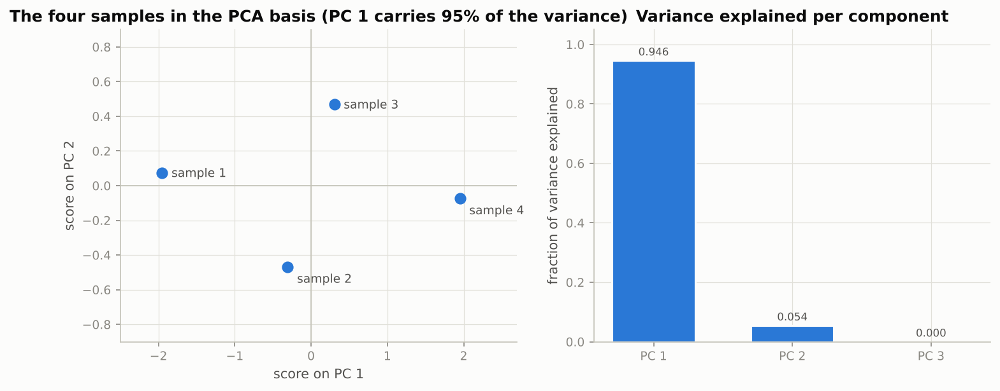

*What to see: the four samples line up almost on the PC 1 axis, which is why one component already explains 94.6% of the variance.*

### Real-world examples

- Netflix-style recommenders factorise a sparse ratings matrix into a low-rank product of user and item vectors; a user's predicted rating is a dot product (Sections 1.2 and 1.8).
- Eigenfaces (Turk and Pentland, 1991) applied PCA to face images: the leading components are blurry face-like patterns, exactly like the digit components in Section 1.9, and were used for face recognition.
- Transformers compute attention as batched matrix products of shape `(batch, heads, tokens, tokens)`, the stacked product of Section 1.4; GPUs are built around this one operation.
- Spectral normalisation in GAN discriminators estimates the largest singular value of each weight matrix with one step of power iteration (Section 1.7) at every training step.

### Examples for every subsection

- **1.1 Scalars, vectors, matrices and tensors.** A 32 by 32 colour photo is an array of shape `(3, 32, 32)`; a batch of 64 of them has shape `(64, 3, 32, 32)` and 196,608 numbers. A bug such as "expected `(n, 1)` but got `(n,)`" is found by printing `.shape`.
- **1.2 The dot product and geometry.** With $\mathbf{a} = (3, 1)$ and $\mathbf{b} = (1, 2)$, as in the notebook, $\mathbf{a}^\top \mathbf{b} = 5$ and the angle is 45 degrees; a music service scores how well a song matches your taste with the same dot product between embedding vectors.
- **1.3 The matrix–vector product as a linear map.** $\mathbf{A}\mathbf{p}_3 = (3, 2)$ above; a rotation by 30 degrees has determinant 1 (areas unchanged), the rank-1 matrix in the notebook has determinant 0 (the plane is flattened onto a line).
- **1.4 The matrix–matrix product and batching.** A layer with 3 inputs and 4 outputs applied to a batch of 5 is one `(5, 3) @ (3, 4)` product giving `(5, 4)`; bracketing $\mathbf{A}(\mathbf{B}\mathbf{v})$ instead of $(\mathbf{A}\mathbf{B})\mathbf{v}$ saves a factor of about $n/2$ in arithmetic.
- **1.5 Transpose, identity and inverse.** To solve $\mathbf{A}\mathbf{x} = \mathbf{b}$ use `np.linalg.solve`; for the nearly singular matrix $[[1, 1], [1, 1 + 10^{-9}]]$ the inverse has entries of size $10^9$ and a rounding error of $10^{-9}$ in $\mathbf{b}$ changes $\mathbf{x}$ by about 1.
- **1.6 Norms, and why they matter for regularisation.** For $\mathbf{x} = (3, -4, 0.5)$ the norms are $\ell_1 = 7.5$, $\ell_2 = 5.025$, $\ell_\infty = 4$; the Lasso uses the $\ell_1$ penalty to select a handful of genes out of thousands by driving the other weights to exactly zero.
- **1.7 Eigenvalues and eigenvectors.** $[[2, 1], [1, 2]]$ stretches the diagonal direction by 3 and the anti-diagonal by 1; PageRank is the dominant eigenvector of the web's link matrix, found by power iteration.
- **1.8 The singular value decomposition and low-rank approximation.** The notebook's 427 by 640 photo at rank 20 keeps 7.8% of the numbers with a relative error of 0.136; LoRA adds a rank-8 or rank-16 update to 4096 by 4096 weight matrices.
- **1.9 Principal component analysis, derived from the SVD.** The 4 by 3 table above needs one number per sample for 94.6% of its variance; the 64-pixel digits need about 21 components for 90%.

### Common pitfalls

- A 1-D array of shape `(n,)` is neither a row nor a column; `v @ v` is a scalar while `col @ row` is an `n` by `n` matrix. Reshape explicitly when you need one or the other.
- "Rank" means two things: the number of axes of a tensor and the number of independent columns of a matrix. The notebook always says "matrix rank" for the second.
- Never form `np.linalg.inv(A) @ b`; use `np.linalg.solve(A, b)`. And remember that a determinant near zero means the inverse is enormous, not harmless.
- PCA on features with different units is dominated by the feature with the largest spread; standardise the columns first unless the units agree.

## 2. Calculus

### In plain words

Training asks one question millions of times: if this weight is nudged a little, how much does the loss move? The derivative answers it for one input, and the right way to picture it is as the slope of the straight line that hugs the curve at that point; the error of that straight line shrinks with the square of the step, so for small steps the line is all you need. With many inputs the slopes collect into the gradient, which points uphill in the steepest direction and is perpendicular to the contour lines, and with many outputs they collect into a table called the Jacobian. Chaining functions multiplies Jacobians, and because the loss is a single number the backward pass only ever multiplies a vector by a matrix, which is why backpropagation is cheap. Finite differences, which estimate a slope from two nearby function values, are too expensive to train with but perfect for testing a hand-derived gradient, and a gradient checker with a relative-error threshold is the tool that keeps Notebook 02 honest.

### Sample data

The function $f(x) = x^3 - 2x$ near $x_0 = 1$, where $f(1) = -1$, $f'(1) = 3 \cdot 1^2 - 2 = 1$ and $f''(1)/2 = 3$ (hand-typed), and the logit vector $\mathbf{z} = (1, 2, 0.5, -1)$ with true class 2 for the softmax example:

| $h$ | $f(1 + h)$ | linear prediction $f(1) + f'(1) h$ | remainder | remainder / $h^2$ |
|---|---|---|---|---|
| 0.5 | 0.375000 | -0.500000 | 0.875000 | 3.500 |
| 0.1 | -0.869000 | -0.900000 | 0.031000 | 3.100 |
| 0.01 | -0.989699 | -0.990000 | 0.000301 | 3.010 |

### Worked example

**The tangent line.** Dividing the step by 10 divides the remainder by about 100 (0.031 to 0.000301), and remainder / $h^2$ tends to $f''(1)/2 = 3$. That is the whole content of "the derivative is the best linear approximation".

**Central differences.** Estimate $f'(1) = 1$ from two function values. The forward difference $(f(1 + h) - f(1)) / h$ and the central difference $(f(1 + h) - f(1 - h)) / (2h)$ give these absolute errors:

| $h$ | forward error | central error |
|---|---|---|
| $10^{-1}$ | 3.10e-01 | 1.00e-02 |
| $10^{-2}$ | 3.01e-02 | 1.00e-04 |
| $10^{-3}$ | 3.00e-03 | 1.00e-06 |
| $10^{-4}$ | 3.00e-04 | 1.00e-08 |
| $10^{-5}$ | 3.00e-05 | 9.54e-11 |
| $10^{-6}$ | 3.00e-06 | 8.23e-11 |
| $10^{-7}$ | 3.00e-07 | 5.84e-10 |
| $10^{-8}$ | 1.61e-08 | 6.08e-09 |
| $10^{-10}$ | 8.27e-08 | 8.27e-08 |
| $10^{-12}$ | 8.89e-05 | 8.89e-05 |

The forward error falls like $h$ (one decade per decade), the central error like $h^2$ (two decades per decade), until rounding noise of size about $10^{-16} / h$ takes over. The best central step is $h = 10^{-6}$ with error 8.2e-11; the notebook's default $h = 10^{-5}$ is almost as good (9.5e-11). Below $10^{-8}$ both schemes get worse, not better.

**The softmax Jacobian and the cross-entropy gradient.** With $\mathbf{z} = (1, 2, 0.5, -1)$: $e^{\mathbf{z}} = (2.7183, 7.3891, 1.6487, 0.3679)$, the sum is $12.1239$, so $\mathbf{p} = (0.2242, 0.6095, 0.136, 0.0303)$, which sums to 1. The Jacobian $\partial p_i / \partial z_j = p_i(\delta_{ij} - p_j)$ is

| | $z_1$ | $z_2$ | $z_3$ | $z_4$ |
|---|---|---|---|---|
| $p_1$ | 0.1739 | -0.1366 | -0.0305 | -0.0068 |
| $p_2$ | -0.1366 | 0.2380 | -0.0829 | -0.0185 |
| $p_3$ | -0.0305 | -0.0829 | 0.1175 | -0.0041 |
| $p_4$ | -0.0068 | -0.0185 | -0.0041 | 0.0294 |

Every row sums to zero (probabilities must keep summing to one), the table is symmetric, and the finite-difference Jacobian agrees to 3.7e-11. For true class 2 the cross-entropy is $-\log 0.6095 = 0.4952$ and its gradient with respect to the logits is $\mathbf{p} - \mathbf{y} = (0.2242, -0.3905, 0.136, 0.0303)$: push the correct logit up, the others down, by exactly the probability mass that is in the wrong place (finite differences agree to 6.0e-11). Saturation: for $\mathbf{z} = (10, 0, 0, 0)$, $\mathbf{p} = (0.9999, 0.0001, 0.0001, 0.0001)$ and the largest Jacobian entry is 1.36e-4, so no logit can move the probabilities much.

### Chart

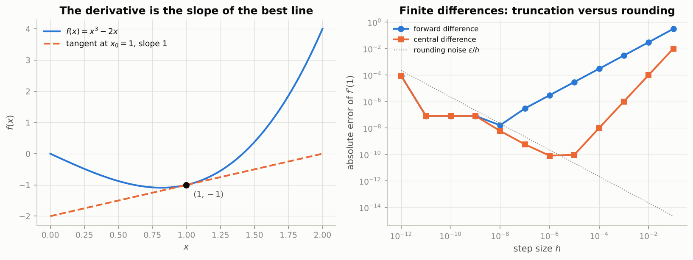

*What to see: on the right the central-difference error falls twice as steeply as the forward one until both hit the dotted rounding-noise line near $h = 10^{-6}$.*

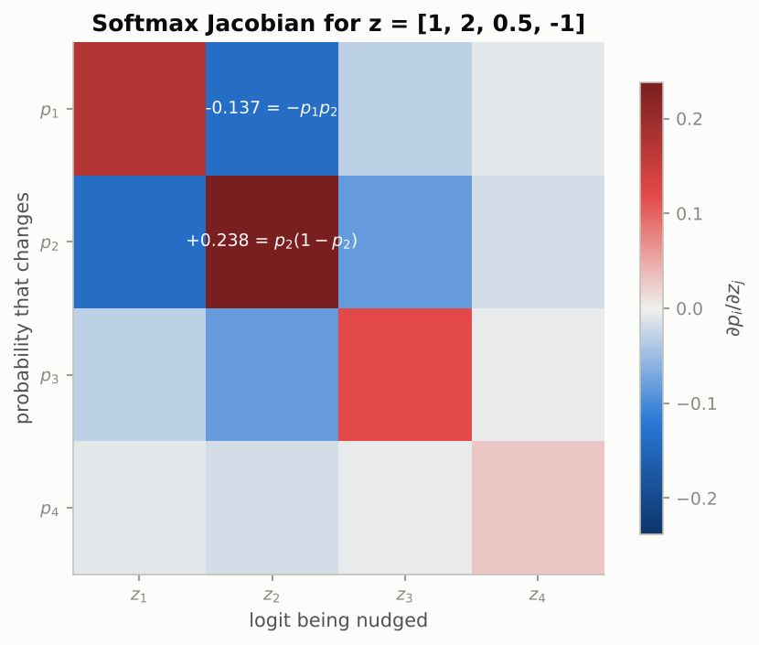

*What to see: red diagonal, blue off-diagonal; raising one logit raises its own probability and lowers all the others, and the row of the least likely class is almost white.*

### Real-world examples

- PyTorch's autograd (Notebook 03) is the chain rule of Section 2.4 evaluated right to left as vector-Jacobian products; `loss.backward()` is literally that product chain.
- The Stanford CS231n course requires students to gradient-check every hand-written layer with the relative-error recipe of Section 2.6; the same check is a standard unit test in research code.
- The gradient $\mathbf{p} - \mathbf{y}$ is what a classifier's last layer receives on every training step, from spam filters to ImageNet models.
- Finite differences are used in production to differentiate black-box simulators (for example a physics engine) when no analytic gradient is available, at the cost of one evaluation per parameter.

### Examples for every subsection

- **2.1 The derivative as the best linear approximation.** With $h = 0.01$ the straight line predicts $-0.990000$ and the truth is $-0.989699$; the remainder of $0.000301$ is $3 h^2$.
- **2.2 Numerical differentiation with central differences.** At $h = 10^{-3}$ the forward scheme is off by 3.00e-03 and the central scheme by 1.00e-06; in `float32` the sweet spot moves to about $h = 5 \times 10^{-3}$ and the best error to about $10^{-4}$, which is why checks are done in `float64`.
- **2.3 Partial derivatives, the gradient, and steepest ascent.** For the notebook's $f = x_1^2 + 3x_2^2 + x_1 x_2$ at $(1.5, -1)$ the gradient is $(2, -4.5)$ with length 4.924, and the rate of change in a direction is $4.924 \cos\theta$.
- **2.4 The Jacobian and the chain rule in matrix form.** For $\mathbf{H} = \mathbf{X}\mathbf{W} + \mathbf{b}$ with upstream gradient $\mathbf{G}$, the three backward lines are `G @ W.T`, `X.T @ G` and `G.sum(axis=0)`; the notebook verifies them to about $10^{-10}$.
- **2.5 Gradients of three expressions you will meet constantly.** $\nabla_{\mathbf{w}} \mathbf{x}^\top \mathbf{w} = \mathbf{x}$; $\nabla_{\mathbf{w}} \lVert \mathbf{X}\mathbf{w} - \mathbf{y} \rVert^2 = 2\mathbf{X}^\top(\mathbf{X}\mathbf{w} - \mathbf{y})$, zero at the least-squares fit; and the softmax Jacobian table above.
- **2.6 A gradient checker.** A gradient missing the factor 2 scores a relative error of 0.333, one that is 1% too small scores 5e-3, and a correct one scores about $10^{-10}$; anything above $10^{-3}$ is a bug.

### Common pitfalls

- Finite differences are a test, not a training method: a million parameters need two million forward passes.
- Do not shrink $h$ below about $10^{-6}$; rounding noise grows as $h$ shrinks, as the table shows.
- Gradients have the shape of the variable they are taken with respect to. If `dW.shape != W.shape`, something is transposed.
- A relative error of $10^{-5}$ is "suspicious", not "fine": look for a ReLU kink at the test point or a `float32` evaluation somewhere.

## 3. Optimization basics

### In plain words

Gradient descent is the rule "step a little against the gradient, repeat", and it works for one reason: the first term of the Taylor expansion is negative along that direction, so a small enough step must lower the loss. The second term, the curvature, grows with the square of the step and sets a ceiling: on a bowl with curvature $\lambda$ the iterates shrink by the factor $1 - \eta\lambda$ per step, so the learning rate must stay below $2/\lambda_{\max}$ or the iterates explode. Real losses are not round bowls but long curved valleys with steep walls (the Rosenbrock function is the classic toy), and the step that is safe on the walls is painfully slow along the floor; the ratio of steepest to gentlest curvature, the condition number, measures that tension. Momentum keeps a running velocity that builds up where gradients agree and cancels where they alternate, cutting the number of steps from about the condition number to about its square root. Non-convex losses add local minima, saddle points and plateaus, and the noise of mini-batch gradients is part of why training escapes them.

### Sample data

A one-dimensional bowl $J(\theta) = 5\theta^2$ (curvature $\lambda = 10$, so the stability limit is $\eta < 2/10 = 0.2$), started at $\theta_0 = 1$ with three learning rates; and the Rosenbrock function $f(x, y) = (1 - x)^2 + 100(y - x^2)^2$ started at $(-1, 1.5)$, where the loss is 29 and the gradient is $(196, 100)$.

| step $t$ | $\eta = 0.02$ (factor +0.80) | $\eta = 0.15$ (factor -0.50) | $\eta = 0.21$ (factor -1.10) |
|---|---|---|---|
| 0 | +1.0000 | +1.0000 | +1.0000 |
| 1 | +0.8000 | -0.5000 | -1.1000 |
| 2 | +0.6400 | +0.2500 | +1.2100 |
| 3 | +0.5120 | -0.1250 | -1.3310 |
| 4 | +0.4096 | +0.0625 | +1.4641 |
| 5 | +0.3277 | -0.0312 | -1.6105 |
| 6 | +0.2621 | +0.0156 | +1.7716 |

### Worked example

**The learning rate on a bowl.** The update is $\theta \leftarrow \theta - \eta \cdot 10\theta = (1 - 10\eta)\theta$. With $\eta = 0.02$ the factor is $0.8$: slow, monotone, after 12 steps $\theta = 0.06872$ and the loss is 2.36e-02. With $\eta = 0.15$ the factor is $-0.5$: the sign flips every step but the size halves, after 12 steps $\theta = 0.00024$ and the loss is 2.98e-07, the best of the three. With $\eta = 0.21$ the factor is $-1.1$: each step is 10% larger than the last, after 12 steps $\theta = 3.13843$ and the loss is 49.25, larger than where we started. The threshold between the last two is exactly $\eta = 0.2 = 2/\lambda$.

**The Rosenbrock valley.** At the minimum $(1, 1)$ the Hessian has eigenvalues $1001.6$ and $0.3994$, a condition number of 2508, so the stable learning rate is below $2/1002 = 2.0 \times 10^{-3}$. Three runs of 3000 steps from $(-1, 1.5)$:

| learning rate | loss at step 10 | step 100 | step 1000 | step 3000 | final point | distance to (1, 1) |
|---|---|---|---|---|---|---|
| $5 \times 10^{-4}$ | 4.766 | 4.635 | 3.169 | 0.2373 | (0.5135, 0.2612) | 0.8846 |
| $10^{-3}$ | 4.743 | 4.477 | 0.9474 | 0.03122 | (0.8235, 0.6774) | 0.3678 |
| $3 \times 10^{-3}$ | diverges: the loss is 1.3e+33 after 6 steps | | | | | |

Both safe runs fall from loss 29 to about 4.7 in ten steps (down the wall) and then crawl along the floor; doubling the learning rate roughly halves the remaining distance. The unsafe rate is above the $2/\lambda_{\max}$ limit on the wall and blows up at once.

**Momentum on an ill-conditioned bowl.** On $J = \tfrac12(\theta_1^2 + 50\theta_2^2)$ (condition number 50) with $\eta = 1/\lambda_{\max} = 0.02$, plain gradient descent shrinks the slow coordinate by $0.98$ per step; momentum with $\beta = 0.9$ contracts by $\sqrt{0.9} = 0.949$ per step:

| step | gradient descent loss | momentum loss |
|---|---|---|
| 0 | 8.25 | 8.25 |
| 50 | 2.65e-01 | 2.63e-02 |
| 100 | 3.52e-02 | 4.71e-05 |
| 200 | 6.19e-04 | 1.88e-09 |
| 300 | 1.09e-05 | 1.80e-13 |

Momentum reaches the loss that gradient descent needs 300 steps for after 106 steps, and after 300 steps it is eight orders of magnitude ahead.

### Chart

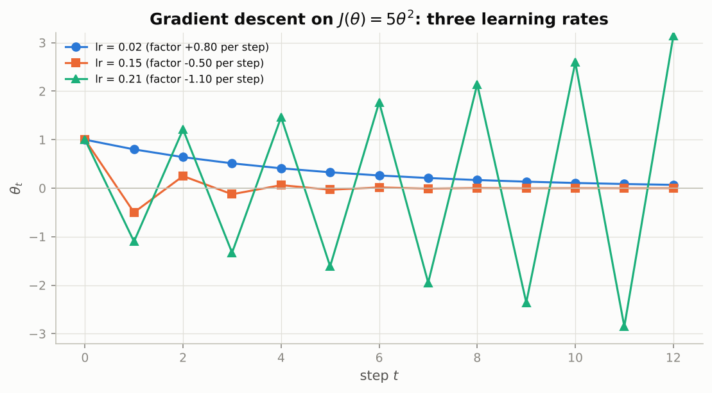

*What to see: the blue run creeps, the orange run zigzags but shrinks, the green run zigzags and grows; the only difference is the learning rate.*

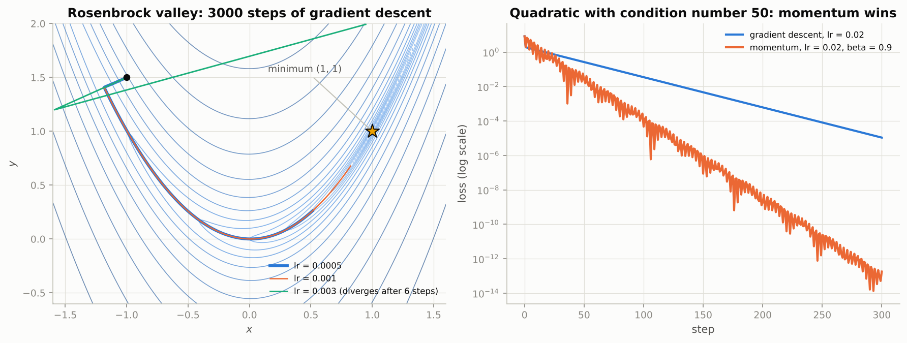

*What to see: on the left both safe runs follow the curved valley floor and stop short of the star; on the right the momentum curve falls much faster even though it wobbles.*

### Real-world examples

- Learning-rate sweeps in practice (and tools such as an "LR finder") are the Section 3.2 picture: the loss curve is flat for tiny rates, smooth for good ones, noisy near the limit and `nan` beyond it.
- Every ResNet trained on ImageNet uses SGD with momentum $0.9$, the Section 3.5 recipe, because plain gradient descent would need far too many steps on such ill-conditioned losses.
- Dauphin et al. (2014) argued that saddle points, not local minima, are the main obstacle in training deep networks, which motivated optimizers that keep moving when the gradient is tiny.
- Preconditioned solvers in scientific computing and adaptive optimizers such as Adam both attack the condition number by rescaling coordinates; Notebook 04 compares them on real networks.

### Examples for every subsection

- **3.1 Taylor expansion and why moving against the gradient decreases the loss.** From $(-1, 1.5)$ on Rosenbrock the quadratic model predicts a best step and the notebook finds the loss drops from 29.0 to 6.9 with it; the safe learning rate there is below $1.2 \times 10^{-3}$ (largest Hessian eigenvalue 848.7).
- **3.2 Gradient descent on a quadratic, and the effect of the learning rate.** The table above: factors $+0.80$, $-0.50$ and $-1.10$ per step for $\eta = 0.02$, $0.15$ and $0.21$ on $J = 5\theta^2$.
- **3.3 The Rosenbrock function: a curved valley.** Curvature across the valley near the minimum is about 1000, along it about 0.4; with $\eta = 10^{-3}$ the run is still 0.37 away from the optimum after 3000 steps.
- **3.4 Convex and non-convex landscapes: local minima, saddle points, plateaus.** Starting gradient descent at $x = -0.3$ versus $x = 0.3$ on $x^4 - 3x^2 + x$ ends in two different valleys; on a saturated sigmoid at $x = -8$ the gradient is 3.35e-04, so 60 steps barely move.
- **3.5 Conditioning: elongated valleys and why we need momentum.** With condition number 50, momentum at $\beta = 0.9$ is at loss 1.80e-13 after 300 steps versus 1.09e-05 for gradient descent at the same learning rate.

### Common pitfalls

- The largest curvature sets the learning rate, the smallest sets the speed. Raising the learning rate to go faster along the valley is exactly what makes the walls explode.
- A loss that stops improving is not necessarily at a minimum: it may be on a plateau or near a saddle, where the gradient is tiny but the loss is far from optimal.
- Momentum adds oscillation across the valley before it pays off; a larger $\beta$ (such as 0.99) makes those oscillations last much longer.

## 4. Probability and information theory

### In plain words

A model's output is best read as a probability distribution over the possible answers, and training means choosing parameters that make the observed data as probable as possible: that single idea, maximum likelihood, produces the mean-squared error when the noise is assumed Gaussian and the cross-entropy when the output is a coin flip or a class choice. To state it you need expectation and variance (the long-run average and spread of a random quantity), the three distributions that cover almost every network output (Bernoulli, categorical, Gaussian), and Bayes' rule, which turns "how likely is this evidence given the cause" into "how likely is the cause given the evidence" while insisting that you weigh in how common the cause is. Information theory adds the language of surprise: entropy is the average surprise of a distribution, cross-entropy the average surprise when you bet on the wrong distribution, and the KL divergence the gap between the two, so minimising cross-entropy is pulling the model toward the data in KL. Finally, the softmax that turns scores into probabilities is only safe to compute with the log-sum-exp trick, which is why PyTorch losses take logits.

### Sample data

Two dice (hand-typed probabilities), a screening test applied to 10,000 people (prevalence 1%, sensitivity 90%, specificity 95%), and two distributions over three classes, $\mathbf{p} = (0.7, 0.2, 0.1)$ (the truth) and $\mathbf{q} = (0.5, 0.3, 0.2)$ (a model):

| face | 1 | 2 | 3 | 4 | 5 | 6 |
|---|---|---|---|---|---|---|
| fair die | 1/6 | 1/6 | 1/6 | 1/6 | 1/6 | 1/6 |
| loaded die | 0.1 | 0.1 | 0.1 | 0.1 | 0.1 | 0.5 |

| | test positive | test negative | total |
|---|---|---|---|
| sick | 90 | 10 | 100 |
| healthy | 495 | 9,405 | 9,900 |
| total | 585 | 9,415 | 10,000 |

### Worked example

**Expectation and variance.** For the fair die $\mathbb{E}[X] = (1 + 2 + \dots + 6)/6 = 3.5$, $\mathbb{E}[X^2] = 15.1667$, so $\mathrm{Var}[X] = 15.1667 - 3.5^2 = 2.9167$ and the standard deviation is 1.7078. For the loaded die $\mathbb{E}[X] = 4.5$, $\mathbb{E}[X^2] = 23.5$, $\mathrm{Var}[X] = 23.5 - 4.5^2 = 3.25$, standard deviation 1.8028. Monte Carlo: the running mean of simulated fair-die rolls is 3.8000 after 10 rolls, 3.7700 after 100, 3.6070 after 1,000 and 3.4963 after 10,000, while the expected error $\sqrt{2.9167 / n}$ shrinks from 0.540 to 0.171, 0.054 and 0.017: ten times more samples, about three times less error.

**Bayes' rule.** Out of 10,000 people, 100 are sick and 90 of them test positive (sensitivity 0.9); 9,900 are healthy and 5% of them, 495, test positive anyway. So 585 people test positive, and the probability of being sick given a positive test is $90 / 585 = 0.1538$. In formula form, $p(+) = 0.9 \cdot 0.01 + 0.05 \cdot 0.99 = 0.0585$ and $p(D \mid +) = 0.0090 / 0.0585 = 0.1538$. A negative result is very reassuring: $p(D \mid -) = 10 / 9{,}415 = 0.00106$. The same test gives $p(D \mid +) = 0.0177$ at a prevalence of 0.1%, $0.6667$ at 10% and $0.9474$ at 50%: the base rate, not the test, dominates.

**Entropy, cross-entropy, KL.** The surprises $-\log p_k$ are $(0.3567, 1.6094, 2.3026)$ nats, so $H(\mathbf{p}) = 0.7 \cdot 0.3567 + 0.2 \cdot 1.6094 + 0.1 \cdot 2.3026 = 0.8018$ nats; $H(\mathbf{q}) = 1.0297$, closer to the maximum $\log 3 = 1.0986$ because $\mathbf{q}$ is flatter. Betting on $\mathbf{q}$ when the truth is $\mathbf{p}$ costs $H(\mathbf{p}, \mathbf{q}) = -\sum_k p_k \log q_k = 0.8869$ nats, so $D_{\mathrm{KL}}(\mathbf{p} \,\|\, \mathbf{q}) = 0.8869 - 0.8018 = 0.0851$ nats. The other direction gives $H(\mathbf{q}, \mathbf{p}) = 1.1217$ and $D_{\mathrm{KL}}(\mathbf{q} \,\|\, \mathbf{p}) = 0.0920$: not the same number. A one-hot label on class 1 scored against $\mathbf{q}$ costs $-\log 0.5 = 0.6931$ nats, which is exactly the cross-entropy loss of a classifier that gave the right class probability 0.5. A fair coin has entropy $0.6931$ nats $= 1$ bit; a 90/10 coin only $0.3251$ nats.

### Chart

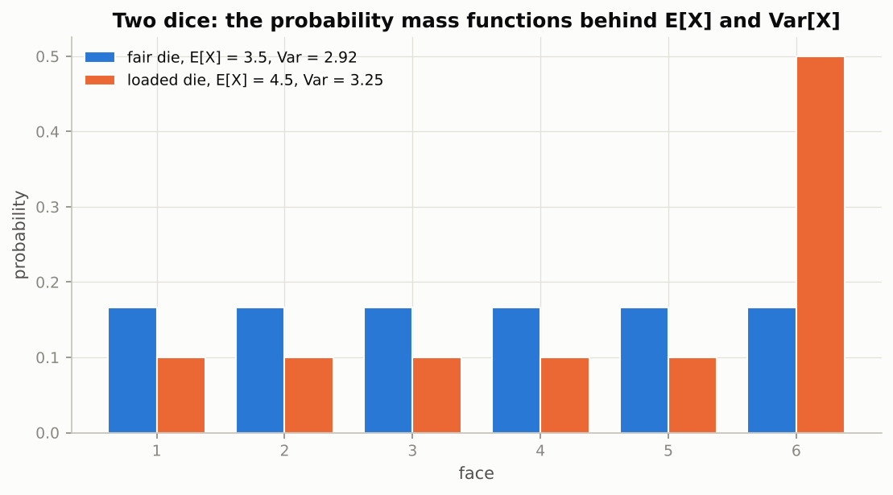

*What to see: moving half the mass onto the six raises the mean from 3.5 to 4.5 and, because the mass is now further apart, the variance from 2.92 to 3.25.*

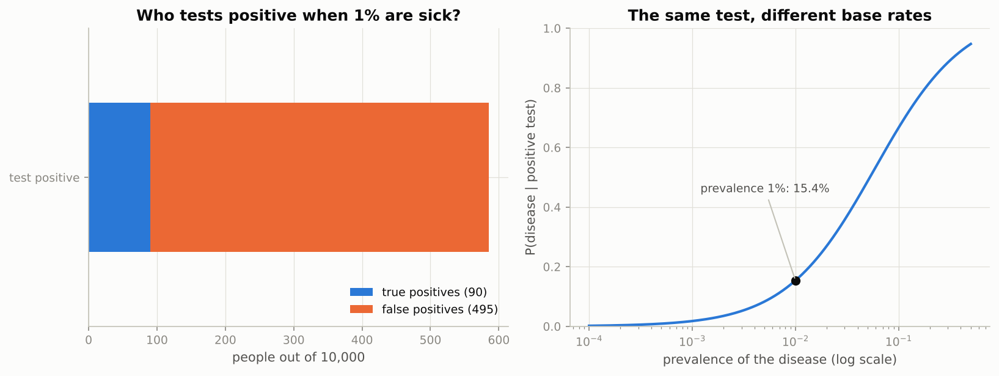

*What to see: on the left the false positives (495) swamp the true positives (90); on the right the same test is only trustworthy once the disease is common.*

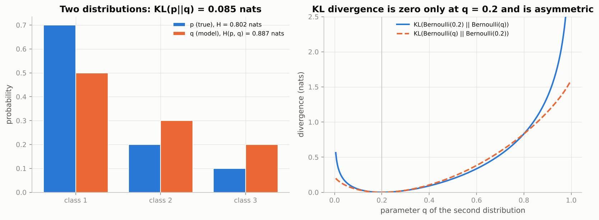

*What to see: the two KL curves on the right touch zero only at q = 0.2 and rise at different rates on either side, the asymmetry in one picture.*

### Real-world examples

- Screening programmes (for example mammography) follow up a positive result with a second test precisely because the base rate makes a single positive weak evidence, the arithmetic of the 585-person table.
- A language model's perplexity is the exponential of its average cross-entropy per token; a model that assigns probability 0.5 to every correct next token has perplexity 2.
- Naive Bayes spam filters apply Bayes' rule word by word, and because they multiply hundreds of probabilities they work with sums of log-probabilities (Section 5.2).
- Variational autoencoders (Notebook 11) and the KL penalty that keeps a fine-tuned chat model close to its reference model both use the KL divergence of Section 4.5.

### Examples for every subsection

- **4.1 Random variables, expectation and variance.** The loaded die: $\mathbb{E}[X] = 4.5$, $\mathrm{Var}[X] = 3.25$; an election poll of 1,000 people has a margin of a few percent for the same $1/\sqrt{n}$ reason as the die's running mean.
- **4.2 Three distributions: Bernoulli, categorical, Gaussian.** A click/no-click prediction is a Bernoulli with $\phi = \sigma(z)$; a next-token prediction is a categorical over 50,000 words; sensor noise is modelled as Gaussian with variance $\sigma^2$.
- **4.3 Joint, conditional and Bayes' rule.** $p(D \mid +) = 90/585 = 0.1538$ at 1% prevalence but $0.6667$ at 10%.
- **4.4 Maximum likelihood: where MSE and cross-entropy come from.** The notebook fits a Gaussian to 500 samples by gradient descent on the negative log-likelihood and lands on the same $(\mu, \sigma) = (1.9879, 1.5391)$ as the closed form; 200 coin flips give a Bernoulli NLL minimised at the observed frequency.
- **4.5 Entropy, cross-entropy and KL divergence.** $H(\mathbf{p}) = 0.8018$, $H(\mathbf{p}, \mathbf{q}) = 0.8869$, $D_{\mathrm{KL}}(\mathbf{p} \| \mathbf{q}) = 0.0851$ nats; an untrained 10-class classifier starts at cross-entropy $\log 10 = 2.30$.
- **4.6 Softmax, its derivative, and the log-sum-exp trick.** `softmax([1000, 1000, 999])` computed naively is `nan`; subtracting the maximum gives $(0.4223, 0.4223, 0.1554)$, and `log_softmax([0, -800])` is $(0, -800)$ instead of $(0, -\infty)$.

### Common pitfalls

- Confusing $p(+ \mid D)$ (the test's sensitivity, 0.9) with $p(D \mid +)$ (what the patient wants to know, 0.15). The base rate sits between them.
- KL is not a distance: $D_{\mathrm{KL}}(\mathbf{p} \| \mathbf{q}) \neq D_{\mathrm{KL}}(\mathbf{q} \| \mathbf{p})$, and the direction decides which mistakes are punished.
- Computing `log(softmax(z))` in two steps underflows to $-\infty$ for widely separated logits; use `log_softmax` or compute $\mathrm{LSE}(\mathbf{z}) - z_y$ directly.
- The sample variance used in the notebook's MLE divides by $N$, not $N - 1$; both are fine as long as you know which one you are using.

## 5. Numerical computation

### In plain words

A computer stores a finite menu of numbers, and every arithmetic step rounds to the nearest item on the menu. The menu has a largest entry (overflow gives `inf`, and `inf - inf` gives `nan`), a smallest positive entry (underflow turns a product of two hundred probabilities into exactly zero), and gaps that grow with magnitude (adding 1 to $10^8$ in `float32` does nothing, and subtracting two nearly equal large numbers leaves only rounding noise, which is called catastrophic cancellation). The four formats of deep learning trade range for precision: `float32` is the training default, `float16` keeps three decimal digits but overflows above 65,504, `bfloat16` keeps the full `float32` range with two digits. The cures are standard: log-probabilities instead of probabilities, `log1p` and friends, two-pass statistics. The section closes with the two habits that make array code fast, broadcasting (combining arrays of different shapes by aligning them from the right) and vectorisation (whole-array operations instead of Python loops), which buy two to three orders of magnitude.

### Sample data

Five hand-typed values rounded to `float16` and `float32`, and 10,000 samples with true variance 1 shifted to a large mean and stored in `float32` (generated with `rng.standard_normal`, then standardised):

| value | float16 | relative error | float32 | relative error |
|---|---|---|---|---|
| 0.1 | 0.09997558594 | 2.4e-04 | 0.1000000015 | 1.5e-08 |
| 1/3 | 0.3332519531 | 2.4e-04 | 0.3333333433 | 3.0e-08 |
| 1234.5678 | 1235 | 3.5e-04 | 1234.567749 | 4.1e-08 |
| 65504 | 65504 | 0 | 65504 | 0 |
| 70000 | inf | overflow | 70000 | 0 |

### Worked example

**Formats.** From `np.finfo`: `float16` has 10 mantissa bits and 5 exponent bits, machine epsilon 9.8e-04, largest value 6.550e+04; `float32` has 23 and 8, epsilon 1.2e-07, largest 3.403e+38; `float64` has 52 and 11, epsilon 2.2e-16, largest 1.798e+308; `bfloat16` (by definition) has 7 mantissa bits and 8 exponent bits, epsilon $2^{-7} = 7.8 \times 10^{-3}$ and the same largest value as `float32`, 3.39e+38. The table shows the consequence: `float16` carries about three to four significant digits (relative error a few times $10^{-4}$) and dies at 70,000, `float32` carries about seven digits. In `float16`, $1 + 1/1024 = 1.0009765625$ is representable but $1 + 1/2048$ rounds back to $1.0$; in `float32`, $10^8 + 1 = 10^8$ because the gap between neighbouring numbers at $10^8$ is 8.

**Cancellation in the one-pass variance.** The data have variance exactly 1. The one-pass formula $\mathbb{E}[x^2] - \mathbb{E}[x]^2$ and the two-pass formula $\mathbb{E}[(x - \bar x)^2]$, both evaluated in `float32`, give:

| mean of the data | one-pass variance | two-pass variance |
|---|---|---|
| 1 | 1.0000 | 1.0000 |
| 10 | 1.0000 | 1.0000 |
| 100 | 1.0000 | 1.0000 |
| 1,000 | 1.0000 | 1.0000 |
| 10,000 | 8.0000 | 1.0000 |
| 100,000 | 0.0000 | 1.0000 |

At mean $10^4$, $\mathbb{E}[x^2] \approx 10^8$ is stored with a gap of 8, so the subtraction of two numbers of size $10^8$ that differ by 1 returns 8; at mean $10^5$ it returns 0. The two-pass formula never subtracts large numbers and stays correct.

**Vectorisation.** The dot product of two vectors, as a Python loop versus NumPy (best of several repeats, single-threaded BLAS, on the machine that produced the figure):

| $n$ | Python loop (ms) | `np.sum(u * v)` (ms) | `u @ v` (ms) | speed-up of `u @ v` |
|---|---|---|---|---|
| 1,000 | 0.380 | 0.0070 | 0.0026 | 144x |
| 10,000 | 3.996 | 0.0156 | 0.0048 | 825x |
| 100,000 | 47.845 | 0.1506 | 0.0659 | 726x |
| 1,000,000 | 367.801 | 4.1065 | 0.7758 | 474x |

Absolute times differ from machine to machine; the two to three orders of magnitude do not. Broadcasting is what makes the vectorised version possible: `np.arange(4)[:, None] - np.arange(3)[None, :]` aligns a `(4, 1)` with a `(1, 3)` array to give a `(4, 3)` table of all pairwise differences, and squaring it gives $[[0, 1, 4], [1, 0, 1], [4, 1, 0], [9, 4, 1]]$ with no loop.

### Chart

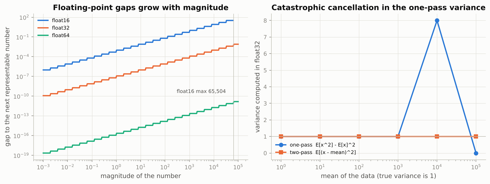

*What to see: on the left the gap between neighbouring numbers climbs with magnitude in every format and float16 simply ends at 65,504; on the right the one-pass variance is exact until the mean reaches 10,000 and then returns 8 and 0 instead of 1.*

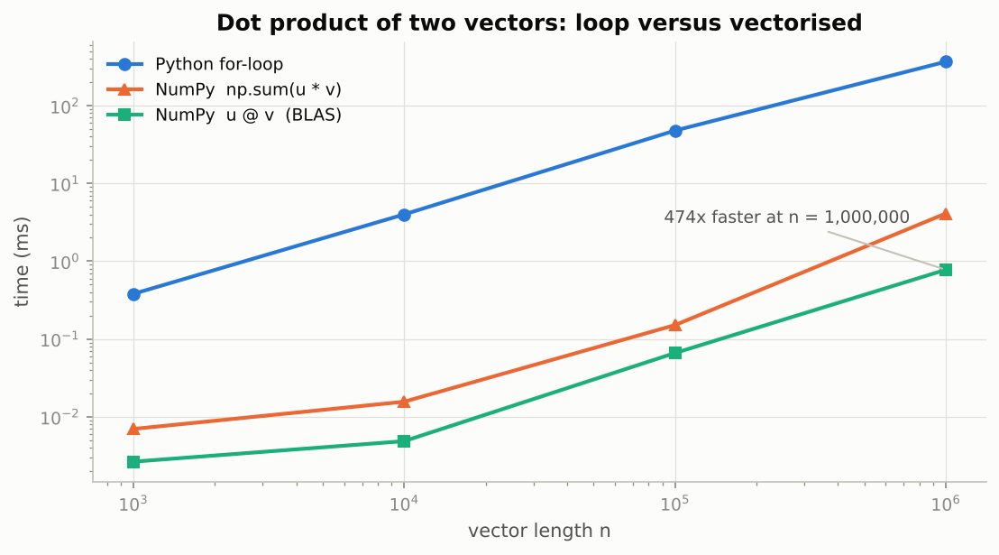

*What to see: all three lines grow with n, but the NumPy lines sit two to three decades below the loop.*

### Real-world examples

- NVIDIA's automatic mixed precision keeps a `float32` master copy of the weights and multiplies the loss by a scale factor before the `float16` backward pass, purely because `float16` gradients would otherwise underflow or overflow (Section 5.1); on TPUs and recent GPUs `bfloat16` avoids the scaling.
- Welford's online algorithm and the two-pass formula are what statistics libraries and `BatchNorm` use for running means and variances, because the one-pass formula fails on data with a large mean (Section 5.2).
- Hidden Markov models, CTC loss for speech recognition and every language model compute probabilities of long sequences as sums of logs with log-sum-exp, since the raw products underflow after a few hundred tokens.
- Similarity-search libraries such as FAISS compute millions of nearest-neighbour distances with the matrix-product identity of Section 5.4 instead of a loop over pairs.

### Examples for every subsection

- **5.1 Floating-point formats: float64, float32, float16 and bfloat16.** $1234.5678$ becomes $1235$ in `float16` and $70{,}000$ becomes `inf`; `bfloat16` cannot tell $1$ from $1 + 1/256$.
- **5.2 Overflow, underflow, catastrophic cancellation, and why we work with log-probabilities.** The product of 200 probabilities of 0.5 is exactly 0 in `float32`, while the sum of their logs is $-138.6$; the one-pass variance at mean $10^4$ returns 8 instead of 1.
- **5.3 Broadcasting.** `(5, 3) + (3,)` works (one bias per column), `(5, 3) + (5,)` fails, `(5, 3) + (5, 1)` works (one number per row); `(4, 1) - (1, 3)` gives the `(4, 3)` difference table above.
- **5.4 Vectorisation versus Python loops.** A million-element dot product: 367.8 ms as a loop, 0.78 ms as `u @ v`; the notebook's 5-nearest-neighbour classifier on 297 digits runs in tens of milliseconds the same way.

### Common pitfalls

- `0.1 + 0.2 == 0.3` is `False`; never compare floating-point results with `==`, use `np.allclose` or `np.isclose`.
- A learning rate below about $10^{-7}$ does nothing to `float32` weights of order 1, because the update is smaller than the gap between neighbouring numbers.
- `inf` is not the end of the story: the next `inf - inf` produces `nan`, which silently poisons everything downstream. Check for it early.
- Broadcasting can succeed by accident: adding a `(5,)` array to a `(5, 5)` matrix adds it to every row, which may not be what you meant.

## Exercises in plain words

- **Exercise 1 (warm-up): PCA on the iris dataset.** Repeat Section 1.9 on 150 flowers with four measurements: centre, take the SVD, plot the first two scores by species, print the variance explained and check that the reconstruction error for $k$ components equals $\sqrt{1 - \text{explained}_k}$. Useful because it is the complete PCA recipe on a dataset you can see. Hint: the four measurements share a unit (centimetres), so do not standardise; one species should separate cleanly along PC 1.
- **Exercise 2: gradient-check a hand-derived gradient.** Derive the gradient of regularised logistic regression with labels $\pm 1$, implement the loss stably with `np.logaddexp`, confirm it with `gradient_check`, plant a sign error and watch the checker catch it, then train on synthetic data. Useful because it is the full "derive, implement, verify, train" loop of every later notebook. Hint: write the margin $m_i = y_i \mathbf{x}_i^\top \mathbf{w}$ first; the derivative of $\log(1 + e^{-m})$ is $-\sigma(-m)$, the probability of the wrong label.
- **Exercise 3: a stable softmax cross-entropy with its gradient.** Write one function that returns the mean cross-entropy of a batch and its gradient $(\hat{\mathbf{p}} - \mathbf{y})/N$ using `log_sum_exp`, and check it against PyTorch and the gradient checker, including logits of size $10^4$. Useful because it is the loss of the NumPy network in Notebook 02. Hint: for the gradient, exponentiate the log-softmax and subtract 1 at the true class by indexing; scale the finite-difference step with the size of the logits.
- **Exercise 4: a vectorised nearest-neighbour classifier.** Classify 297 held-out digits by majority vote among the 5 nearest training images, with all distances from one matrix product and the votes from one-hot encoding, no loop over examples; compare with a loop. Useful because it is the broadcasting and matmul-identity toolkit on a real task. Hint: `np.eye(10)[labels_of_neighbours]` summed over the neighbour axis counts votes for every class at once.
- **Exercise 5 (challenge): fitting a Gaussian mixture by gradient descent on the likelihood.** Sample points from three Gaussians, treat the three means as unknown, write the negative log-likelihood with a log-sum-exp over components, derive its gradient, check it, and run gradient descent from three random data points. Useful because it joins Sections 3 and 4 and previews the EM algorithm and the ELBO of Notebook 11. Hint: the gradient of a log-sum-exp is a softmax, so the gradient weights each point by the responsibility of each component.

## Quick reference

| Concept | Formula or rule | In one sentence |
|---|---|---|
| Dot product | $\mathbf{a}^\top \mathbf{b} = \sum_i a_i b_i = \lVert \mathbf{a} \rVert \lVert \mathbf{b} \rVert \cos\theta$ | Alignment of two vectors; every neuron computes one. |
| Projection | $\mathrm{proj}_{\mathbf{a}}(\mathbf{b}) = \frac{\mathbf{a}^\top \mathbf{b}}{\mathbf{a}^\top \mathbf{a}} \mathbf{a}$ | The part of $\mathbf{b}$ along $\mathbf{a}$; the rest is orthogonal. |
| Shape rule | $(m \times n)(n \times p) = (m \times p)$ | Inner sizes must match; outer sizes give the result. |
| Batched layer | $\mathbf{H} = \mathbf{X}\mathbf{W} + \mathbf{b}$, shapes $(N, d_{\text{in}})(d_{\text{in}}, d_{\text{out}})$ | One product handles the whole batch; the bias broadcasts over rows. |
| Condition number | $\kappa = \lVert \mathbf{A} \rVert \lVert \mathbf{A}^{-1} \rVert$, or $\lambda_{\max}/\lambda_{\min}$ for a Hessian | How much input errors are amplified; how slow gradient descent is. |
| Norms | $\lVert \mathbf{x} \rVert_1 \ge \lVert \mathbf{x} \rVert_2 \ge \lVert \mathbf{x} \rVert_\infty$ | $\ell_2$ penalties shrink weights, $\ell_1$ penalties zero them out. |
| Eigenvector | $\mathbf{A}\mathbf{v} = \lambda \mathbf{v}$; symmetric: $\mathbf{A} = \mathbf{Q}\boldsymbol{\Lambda}\mathbf{Q}^\top$ | A direction that is only stretched by $\lambda$. |
| SVD | $\mathbf{A} = \mathbf{U}\boldsymbol{\Sigma}\mathbf{V}^\top = \sum_i \sigma_i \mathbf{u}_i \mathbf{v}_i^\top$ | Input directions, output directions, stretch factors, for any matrix. |
| Eckart-Young | $\lVert \mathbf{A} - \mathbf{A}_k \rVert_F = \sqrt{\sum_{i > k} \sigma_i^2}$ | Keeping the top $k$ terms is the best rank-$k$ approximation. |
| PCA | directions = right singular vectors of centred $\mathbf{X}$; variance $\sigma_i^2 / (N - 1)$; scores $\mathbf{Z} = \mathbf{X}\mathbf{V}$ | PCA is the SVD of the centred data. |
| Derivative | $f(x_0 + h) = f(x_0) + f'(x_0) h + O(h^2)$ | Slope of the best straight line. |
| Central difference | $f'(x) \approx \frac{f(x + h) - f(x - h)}{2h}$, $h \approx 10^{-5}$ in `float64` | Error $O(h^2)$ plus rounding $\varepsilon / h$; a test, not a method. |
| Gradient | $\nabla f = (\partial f / \partial x_1, \dots)^\top$; $D_{\mathbf{u}} f = \nabla f^\top \mathbf{u}$ | Steepest ascent, perpendicular to contours. |
| Chain rule | $\mathbf{J}_{h \circ g} = \mathbf{J}_h \mathbf{J}_g$; $\nabla_{\mathbf{x}} L = \mathbf{J}_1^\top \cdots \mathbf{J}_K^\top \nabla \ell$ | Multiply Jacobians; evaluate right to left for a scalar loss. |
| Linear layer backward | $\partial L / \partial \mathbf{W} = \mathbf{X}^\top \mathbf{G}$, $\partial L / \partial \mathbf{b} = \sum_n \mathbf{G}_{n,:}$, $\partial L / \partial \mathbf{X} = \mathbf{G}\mathbf{W}^\top$ | The three lines of a layer's backward pass. |
| Softmax Jacobian | $\partial p_i / \partial z_j = p_i(\delta_{ij} - p_j)$ | Rows sum to zero; with cross-entropy the gradient is $\mathbf{p} - \mathbf{y}$. |
| Relative error | $\frac{\lVert \mathbf{g}_a - \mathbf{g}_n \rVert}{\lVert \mathbf{g}_a \rVert + \lVert \mathbf{g}_n \rVert}$ | Below $10^{-7}$ correct, above $10^{-3}$ wrong. |
| Taylor step | $J(\boldsymbol{\theta} - \eta \mathbf{g}) \approx J - \eta \lVert \mathbf{g} \rVert^2 + \tfrac12 \eta^2 \mathbf{g}^\top \mathbf{H} \mathbf{g}$ | First term guarantees descent; second caps the step. |
| Stability | $\theta_i \leftarrow (1 - \eta\lambda_i)\theta_i$; need $\eta < 2 / \lambda_{\max}$ | Largest curvature sets the learning rate, smallest sets the speed. |
| Momentum | $\mathbf{v} \leftarrow \beta \mathbf{v} + \nabla J$, $\boldsymbol{\theta} \leftarrow \boldsymbol{\theta} - \eta \mathbf{v}$ | Steps drop from $O(\kappa)$ to $O(\sqrt{\kappa})$. |
| Expectation, variance | $\mathbb{E}[X] = \sum_x x\, p(x)$, $\mathrm{Var}[X] = \mathbb{E}[X^2] - \mathbb{E}[X]^2$ | Average and spread; Monte Carlo error falls like $1/\sqrt{n}$. |
| Bayes' rule | $p(y \mid x) = p(x \mid y)\, p(y) / p(x)$ | Evidence times prior, normalised; the base rate matters. |
| Maximum likelihood | $\mathrm{NLL} = -\sum_i \log p(y^{(i)} \mid \mathbf{x}^{(i)}; \boldsymbol{\theta})$ | Gaussian noise gives MSE, Bernoulli/categorical give cross-entropy. |
| Entropy, KL | $H(p) = -\sum p_k \log p_k$; $D_{\mathrm{KL}}(p \| q) = H(p, q) - H(p) \ge 0$ | Surprise, extra surprise; minimising cross-entropy minimises KL. |
| Log-sum-exp | $\mathrm{LSE}(\mathbf{z}) = c + \log \sum_k e^{z_k - c}$, $c = \max_k z_k$; $\log \mathrm{softmax}_i = z_i - \mathrm{LSE}$ | Never overflows; cross-entropy is $\mathrm{LSE}(\mathbf{z}) - z_y$. |
| Float formats | float32: $\varepsilon = 1.2 \times 10^{-7}$; float16: max 65,504; bfloat16: $\varepsilon = 7.8 \times 10^{-3}$ | Range versus precision; overflow at $e^{88}$ (float32) and $e^{709}$ (float64). |
| Broadcasting | Align shapes from the right; size-1 axes stretch; otherwise error | `b[None, :]` adds to every row, `c[:, None]` to every column. |

## Glossary

- **Tensor**: an array with any number of axes; its shape is a tuple such as `(N, C, H, W)`.
- **Dot product**: the sum of entry-wise products of two vectors; measures alignment.
- **Linear map**: a rule $\mathbf{x} \mapsto \mathbf{A}\mathbf{x}$ that keeps lines straight and the origin fixed.
- **Determinant**: the factor by which a square matrix scales areas or volumes; zero means information is lost.
- **Eigenvector / eigenvalue**: a direction a matrix only stretches, and the stretch factor.
- **Singular value decomposition (SVD)**: $\mathbf{A} = \mathbf{U}\boldsymbol{\Sigma}\mathbf{V}^\top$ for any matrix; singular values are the stretch factors.
- **Principal component analysis (PCA)**: the directions of largest variance of centred data, equal to its right singular vectors.
- **Gradient**: the vector of partial derivatives; the direction of steepest ascent.
- **Jacobian**: the matrix of all partial derivatives of a vector-valued function; one row per output.
- **Backpropagation**: the chain rule evaluated from the loss backwards as vector-Jacobian products.
- **Learning rate**: the step size $\eta$ of gradient descent; must stay below $2/\lambda_{\max}$.
- **Condition number**: the ratio of the largest to the smallest curvature (or singular value); large means slow and sensitive.
- **Maximum likelihood**: choosing parameters that make the observed data most probable; minimising the negative log-likelihood.
- **Cross-entropy**: $-\sum_k p_k \log q_k$, the average surprise when the truth is $p$ and the model says $q$.
- **Log-sum-exp**: $\log \sum_k e^{z_k}$ computed with the maximum subtracted, so it never overflows.
- **Broadcasting**: NumPy's rule for combining arrays of different shapes by stretching axes of length one.
