# 02 · Neural Networks from Scratch (NumPy) — Companion Guide

> Plain-language companion to [`02_neural_networks_from_scratch.ipynb`](02_neural_networks_from_scratch.ipynb). Read a section here, then run the
> matching section of the notebook. All numbers below were computed with the script
> [`figures/scripts/make_figures_02.py`](figures/scripts/make_figures_02.py); all charts are its output.

## At a glance

- **What you learn**
  - What one artificial neuron computes, why it can only draw a straight line, and why XOR needs a hidden layer.
  - Why a non-linear activation is essential, and what sigmoid, tanh, ReLU, leaky ReLU and GELU do differently.
  - How to write the forward pass of a multi-layer perceptron as matrix products with explicit shapes, and how to count its parameters.
  - Why we train on a smooth loss (mean squared error or softmax cross-entropy) instead of accuracy.
  - How backpropagation follows from the chain rule in three short rules, and how to check every gradient numerically.
  - How a few layer classes, a loss and an SGD optimizer form a tiny deep-learning library that learns two moons, a spiral and handwritten digits.
- **Where this is used in the real world**
  - Handwritten digit and character recognition: the first large deployments of backpropagation networks read ZIP codes and bank cheques in the 1990s (LeCun and colleagues at AT&T Bell Labs); MNIST comes from that work.
  - Tabular prediction: fraud scoring on card transactions, credit risk and insurance pricing commonly use MLPs over engineered features, exactly the forward pass of Section 3 with a softmax or sigmoid output.
  - Recommender systems: the retrieval and ranking stages of industrial recommenders (for example the deep candidate-generation network described by YouTube in 2016) are MLPs over user and item features trained with softmax cross-entropy.
  - Every modern framework: `loss.backward()` in PyTorch does what Section 5 derives by hand, and `torch.autograd.gradcheck` is the finite-difference test of Section 5.6.
  - Language models: next-token prediction is softmax cross-entropy over a vocabulary of tens of thousands of classes, computed with the same log-sum-exp trick as Section 4.
  - Surrogate models in engineering and science: one- and two-hidden-layer networks replace expensive simulations, relying on the universal approximation property of Section 8.

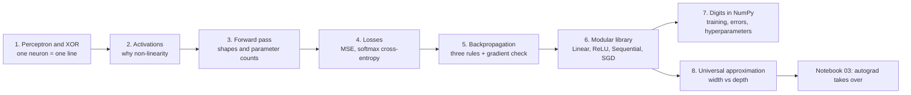

## 1. From perceptron to MLP

### In plain words

A neuron is a weighted vote. It multiplies each input by a weight, adds a bias, and fires if the total is positive. Geometrically the set of inputs where the total is exactly zero is a straight line (a plane in more dimensions), so one neuron can only separate classes that a single line can separate. The perceptron learning rule finds such a line automatically when it exists, as for AND and OR, and fails forever when it does not, as for XOR. The fix is a hidden layer: let two neurons compute OR and AND first, and a third neuron asks "OR but not AND". The hidden neurons re-describe the input in a new coordinate system where one line is enough. That is the whole idea of deep learning in miniature: layers learn representations that make the final linear decision easy.

### Sample data

The four inputs of a two-input logic gate and the three targets (hand-typed, the same arrays as the notebook's `X_gate`):

| $x_1$ | $x_2$ | AND | OR | XOR |
|---|---|---|---|---|
| 0 | 0 | 0 | 0 | 0 |
| 0 | 1 | 0 | 1 | 1 |
| 1 | 0 | 0 | 1 | 1 |
| 1 | 1 | 1 | 1 | 0 |

### Worked example

**A hand-designed AND neuron.** With $\mathbf{w} = (1, 1)$ and $b = -1.5$ the pre-activation $z = x_1 + x_2 - 1.5$ for the four inputs is $(-1.5, -0.5, -0.5, 0.5)$, so the step function outputs $(0, 0, 0, 1)$: only the last input exceeds the threshold.

**The perceptron rule (learning rate 0.1, random start, seed 42).** Each time the prediction is wrong, the weights move by $0.1\,(y - \hat y)\,\mathbf{x}$ and the bias by $0.1\,(y - \hat y)$.

| gate | epochs run | mistakes per epoch | learned $\mathbf{w}$ | learned $b$ | accuracy |
|---|---|---|---|---|---|
| AND | 7 | 2, 2, 2, 3, 2, 1, 0 | (0.130, 0.096) | -0.200 | 1.00 |
| OR | 4 | 1, 2, 1, 0 | (0.030, 0.096) | 0.000 | 1.00 |
| XOR | 50 (never converges) | 2, 2, 3, 4, 4, 4, 4, 4, ... | (-0.170, -0.104) | 0.100 | 0.25 |

Check the AND solution by hand: for $(1, 1)$ the total is $0.130 + 0.096 - 0.200 = 0.026 > 0$ (fires), for $(1, 0)$ it is $0.130 - 0.200 < 0$ and for $(0, 1)$ it is $0.096 - 0.200 < 0$ (silent). On XOR the rule keeps making 4 mistakes per epoch: no line exists, so the weights oscillate among wrong answers.

**The two-layer XOR network.** Hidden unit 1 is OR ($x_1 + x_2 - 0.5 > 0$), hidden unit 2 is AND ($x_1 + x_2 - 1.5 > 0$), and the output is $h_1 - h_2 - 0.5 > 0$:

| $x_1$ | $x_2$ | $h_1$ = OR | $h_2$ = AND | $h_1 - h_2 - 0.5$ | prediction | XOR |
|---|---|---|---|---|---|---|
| 0 | 0 | 0 | 0 | -0.5 | 0 | 0 |
| 0 | 1 | 1 | 0 | +0.5 | 1 | 1 |
| 1 | 0 | 1 | 0 | +0.5 | 1 | 1 |
| 1 | 1 | 1 | 1 | -0.5 | 0 | 0 |

The two positive inputs $(0,1)$ and $(1,0)$ both land on the same hidden point $(1, 0)$, where one line separates them from $(0,0)$ and $(1,1)$.

### Chart

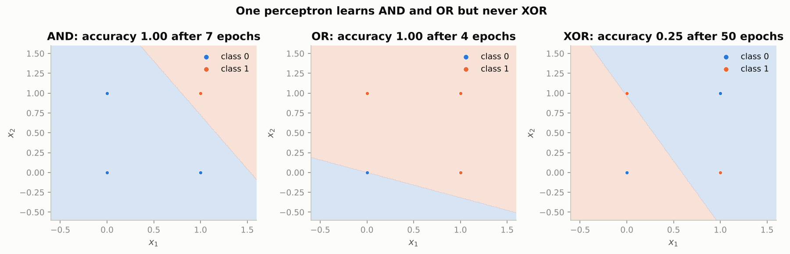

*AND and OR get a clean straight boundary within a few epochs; on XOR the final line is wrong for three of the four points and no line could do better.*

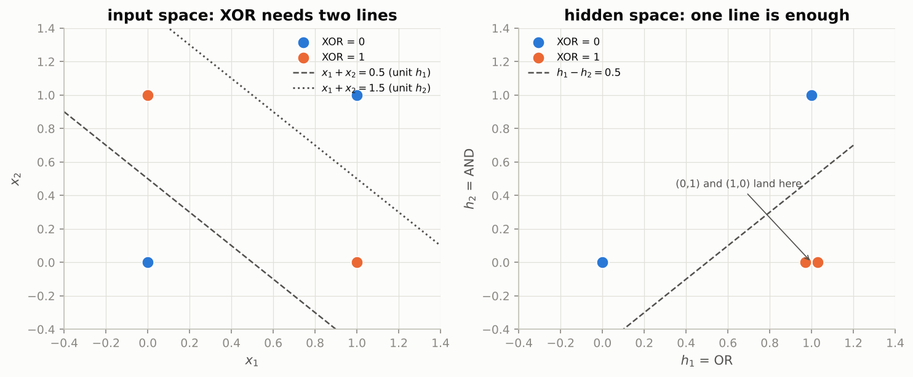

*Left: XOR needs the band between two parallel lines; right: after the OR and AND units, a single dashed line separates the classes.*

### Real-world examples

- Rosenblatt's Mark I Perceptron (1958) was a physical machine with 400 photocells that learned to recognise simple shapes with exactly this update rule; it is the ancestor of the neuron in the notebook's `step` function.
- Logistic regression and linear support-vector machines are single neurons on hand-made features; they still run spam filters and credit-scoring models when the features are informative enough for one line to work.
- Speech recognisers learn a hierarchy exactly like the OR/AND trick: early layers detect frequency patterns, later ones phonemes, and the last layer is a linear classifier over learned features.

### Examples for every subsection

- **1.1 The artificial neuron.** A loan officer adds up income times 0.3, years employed times 0.1, and subtracts a threshold; approve if the total is positive. Change the threshold (bias) and the dividing line slides without rotating.
- **1.2 Learning the weights: the perceptron algorithm.** On the AND gate the rule needed 7 epochs and 12 corrections in total (2 + 2 + 2 + 3 + 2 + 1) to land on $\mathbf{w} = (0.130, 0.096)$, $b = -0.2$.
- **1.3 Hidden layers as learned features.** "Exactly one switch is on" is not a linear question about two switches, but it is a linear question about the pair (any switch on, both switches on): $h_1 - h_2 > 0.5$.

### Common pitfalls

- Forgetting the bias forces every boundary through the origin; the OR gate above needed $b = 0$ by luck, but AND needed $b = -0.2$.
- Expecting the perceptron to "almost" solve XOR: it does not settle near a good answer, it oscillates, and the final accuracy (0.25) is worse than guessing.
- Thinking of the hidden layer as more inputs: it is a new coordinate system computed from the inputs, which is why it can make an unsolvable problem solvable.

## 2. Activation functions

### In plain words

Between two linear layers you must put a bend. Without it, two matrix products collapse into one (the script confirms `X @ W1 @ W2` equals a single product with `W1 @ W2`), so depth adds nothing. The classical bends, sigmoid and tanh, are S-shaped and flatten out for large inputs: there the slope is almost zero, so hardly any learning signal gets through, and the sigmoid never passes more than a quarter of it even at its steepest point. ReLU is a hinge: zero for negatives, identity for positives, with slope exactly one when active, which is why it trains deep networks so well. Its weakness is the dead unit, a neuron whose input is negative for every example; it outputs zero everywhere, gets zero gradient, and never recovers. Leaky ReLU and GELU keep a small slope on the negative side to prevent that.

### Sample data

Values and slopes of the five activations at five hand-picked pre-activations:

| $z$ | sigmoid | sigmoid$'$ | tanh | tanh$'$ | ReLU | ReLU$'$ | leaky ReLU (0.1) | GELU | GELU$'$ |
|---|---|---|---|---|---|---|---|---|---|
| -4 | 0.0180 | 0.0177 | -0.9993 | 0.0013 | 0 | 0 | -0.4 | -0.0001 | -0.0005 |
| -1 | 0.2689 | 0.1966 | -0.7616 | 0.4200 | 0 | 0 | -0.1 | -0.1587 | -0.0833 |
| 0 | 0.5000 | 0.2500 | 0.0000 | 1.0000 | 0 | 0 | 0.0 | 0.0000 | 0.5000 |
| 1 | 0.7311 | 0.1966 | 0.7616 | 0.4200 | 1 | 1 | 1.0 | 0.8413 | 1.0833 |
| 4 | 0.9820 | 0.0177 | 0.9993 | 0.0013 | 4 | 1 | 4.0 | 3.9999 | 1.0005 |

### Worked example

**Saturation.** At $z = 0$ the sigmoid slope is its maximum, 0.25; at $z = 4$ it is 0.0177 and at $z = 5$ it is 0.00665. Three saturated sigmoid layers in a row multiply the gradient by roughly $0.0177^3 \approx 5.5 \times 10^{-6}$: the early layers stop learning. The tanh slope at $z = 4$ is even smaller, 0.0013, although its maximum (1.0 at $z = 0$) is four times the sigmoid's.

**GELU.** Its minimum is $-0.1700$ at $z = -0.752$, so unlike ReLU it can output small negative values and has a non-zero slope there ($-0.0833$ at $z = -1$).

**Dead ReLUs (the notebook's simulation, seed 42).** 1000 inputs with 50 standard-normal features go through 100 He-initialised ReLU units; the same constant is added to every bias:

| bias shift | dead units (zero for every input) | average fraction of inputs that activate a unit |
|---|---|---|
| 0 | 0% | 0.498 |
| -2 | 0% | 0.078 |
| -4 | 21% | 0.003 |
| -6 | 96% | 0.000 |

With no shift each unit is active for about half the inputs. At $-4$ about a fifth of the layer is dead, at $-6$ almost all of it, and nothing in gradient descent can revive a dead unit.

### Chart

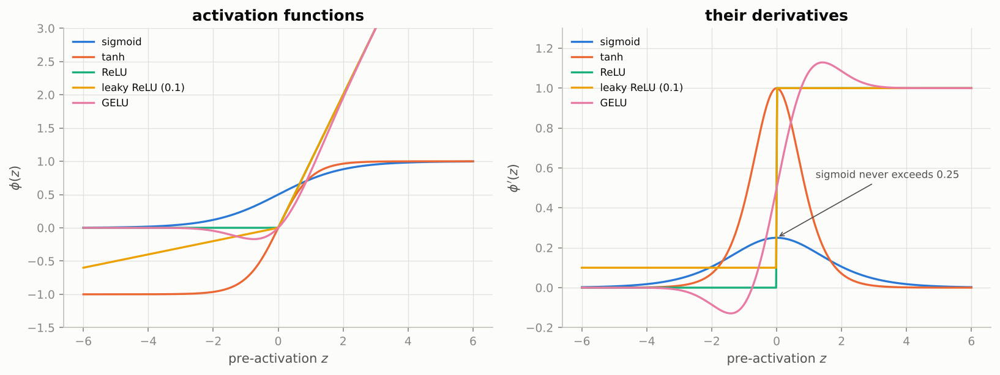

*The right panel is what matters for training: sigmoid and tanh slopes vanish on both sides, ReLU's slope is exactly 1 or 0, and leaky ReLU and GELU keep a little slope for negative inputs.*

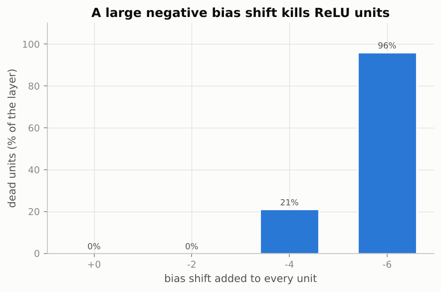

*A bias shift of -4 standard deviations already kills 21 of 100 units; at -6 the layer is essentially silent.*

### Real-world examples

- AlexNet (2012) reported that ReLU networks trained several times faster than tanh networks on ImageNet; ReLU is the default hidden activation in convolutional networks since.
- GELU is the hidden activation in BERT and the GPT family; the notebook's `gelu` is exactly the function those models apply after every feed-forward sublayer.
- Sigmoid survives at the output of binary classifiers such as click-through-rate models, where a probability between 0 and 1 is needed; tanh survives inside LSTM cells (Notebook 08).
- Practitioners monitor the fraction of permanently zero channels after a too-high learning rate; a sudden jump is the dead-ReLU effect of the table above.

### Examples for every subsection

- **2.1 Why we need non-linearity.** A random 3-4-2 pair of linear layers (seed 42) gives exactly the same outputs as the single 3-2 layer with weight `W1 @ W2` and bias `b1 @ W2 + b2`; the script prints `True` for the comparison.
- **2.2 The classical and the modern activations.** At $z = 1$, sigmoid passes 0.1966 of the gradient, tanh 0.42, ReLU 1.0, leaky ReLU 1.0 and GELU 1.0833; at $z = -1$ only the leaky ReLU (0.1) and GELU ($-0.0833$) pass anything.

### Common pitfalls

- Using sigmoid in hidden layers of a deep network: the gradient shrinks by at least a factor 4 per layer even when nothing saturates.
- A learning rate large enough to push biases far negative turns ReLU units off for good; lower the learning rate or switch to leaky ReLU or GELU.
- Computing the sigmoid as `1 / (1 + exp(-z))` for very negative `z` overflows `exp`; the notebook's `sigmoid` only ever exponentiates `-|z|`.

## 3. The forward pass with explicit shapes

### In plain words

A network processes a whole batch at once: the inputs are the rows of a matrix $X$ with shape (examples, features). A linear layer multiplies by a weight matrix of shape (inputs, outputs) and adds a bias to every row, which NumPy does by broadcasting. A two-hidden-layer network is three such products with a ReLU after the first two; the last outputs are the logits, one raw score per class, left without activation because the loss function handles that. Writing the shape next to every array is the single best debugging habit, because almost every mistake shows up as two shapes that do not fit. Counting parameters is simple: a layer from $d_{\text{in}}$ to $d_{\text{out}}$ has $(d_{\text{in}} + 1)\,d_{\text{out}}$ of them, and for the digit network the first layer, which touches all 784 pixels, holds 85% of the total.

### Sample data

A hand-typed 2-3-2 network (2 inputs, 3 hidden ReLU units, 2 output classes) and a batch of 2 examples:

| array | shape | values |
|---|---|---|
| $X$ | (2, 2) | rows $(1.0, 2.0)$ and $(-1.0, 0.5)$ |
| $y$ | (2,) | $(0, 1)$ |
| $W_1$ | (2, 3) | rows $(0.5, -0.3, 0.8)$ and $(0.1, 0.4, -0.6)$ |
| $\mathbf{b}_1$ | (3,) | $(0.0, 0.1, -0.2)$ |
| $W_2$ | (3, 2) | rows $(0.7, -0.5)$, $(0.2, 0.9)$, $(-0.4, 0.3)$ |
| $\mathbf{b}_2$ | (2,) | $(0.05, -0.05)$ |

### Worked example

**Layer 1, $Z_1 = X W_1 + \mathbf{b}_1$, shape (2, 2)(2, 3) + (3,) = (2, 3).** First row, first unit: $1.0 \cdot 0.5 + 2.0 \cdot 0.1 + 0.0 = 0.7$; second unit: $1.0 \cdot (-0.3) + 2.0 \cdot 0.4 + 0.1 = 0.6$; third unit: $1.0 \cdot 0.8 + 2.0 \cdot (-0.6) - 0.2 = -0.6$. The full matrix:

$$
Z_1 = \begin{pmatrix} 0.70 & 0.60 & -0.60 \\ -0.45 & 0.60 & -1.30 \end{pmatrix}, \qquad
A_1 = \text{ReLU}(Z_1) = \begin{pmatrix} 0.7 & 0.6 & 0 \\ 0 & 0.6 & 0 \end{pmatrix}.
$$

Unit 3 is inactive for both examples and unit 1 only for the first one; those zeros will matter in the backward pass.

**Layer 2, $Z_2 = A_1 W_2 + \mathbf{b}_2$, shape (2, 3)(3, 2) + (2,) = (2, 2).** First row: $0.7 \cdot 0.7 + 0.6 \cdot 0.2 + 0 \cdot (-0.4) + 0.05 = 0.66$ and $0.7 \cdot (-0.5) + 0.6 \cdot 0.9 + 0 \cdot 0.3 - 0.05 = 0.14$:

$$
Z_2 = \begin{pmatrix} 0.66 & 0.14 \\ 0.17 & 0.49 \end{pmatrix} \;(\text{logits}), \qquad
P = \text{softmax}(Z_2) = \begin{pmatrix} 0.6271 & 0.3729 \\ 0.4207 & 0.5793 \end{pmatrix}.
$$

The per-example losses $-\log p_y$ are 0.4666 (example 1, true class 0) and 0.5459 (example 2, true class 1); the mean loss is 0.5062.

**Parameter count.** $(2 + 1) \cdot 3 + (3 + 1) \cdot 2 = 9 + 8 = 17$. For the digit network with sizes 784, 256, 128, 10: $785 \cdot 256 = 200{,}960$, $257 \cdot 128 = 32{,}896$, $129 \cdot 10 = 1{,}290$, total $235{,}146$; the first layer holds 85.5%, the second 14.0%, the third 0.5%.

### Chart

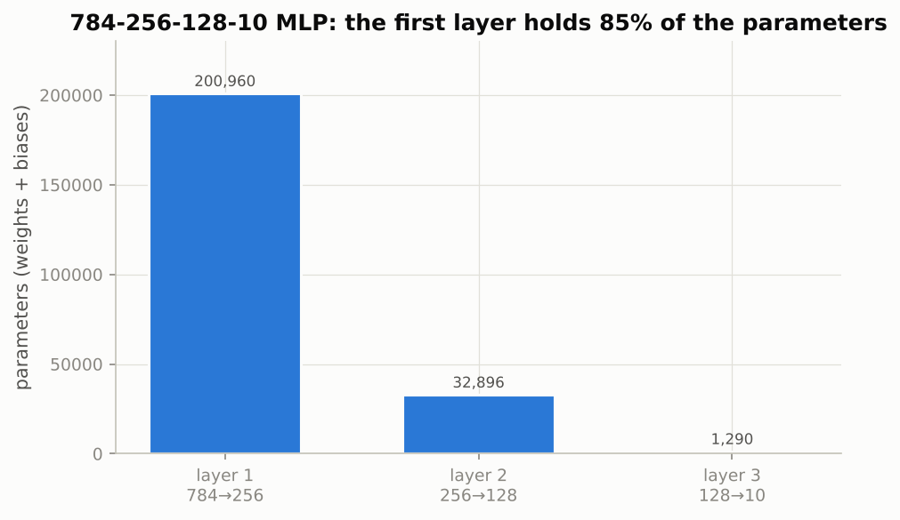

*The layer that touches the pixels dominates; this is the motivation for weight sharing in convolutional networks.*

### Real-world examples

- The (batch, features) layout is what GPUs accelerate: one matrix product per layer for thousands of examples at once, which is why training never loops over examples one by one.
- A transaction-fraud model takes a row of features per payment (amount, merchant category, hour, distance from the last purchase, ...), pushes it through two or three hidden layers, and outputs two logits (legitimate, fraudulent); the shapes are exactly those of Section 3.2 with $d_0$ equal to the number of features.
- Parameter counts are memory budgets: 235,146 float32 numbers are about 0.94 MB, while a 784-1024-1024-10 network has 1,863,690 parameters, eight times more, mostly in the two wide hidden layers.

### Examples for every subsection

- **3.1 Batches, weights and the affine layer.** With $X$ of shape (2, 2) and $W_1$ of shape (2, 3), the product has shape (2, 3) and the bias $(0.0, 0.1, -0.2)$ is added to each of the 2 rows; the second row of $Z_1$ above is $(-0.45, 0.60, -1.30)$.
- **3.2 A two-hidden-layer network.** The notebook's demo has sizes 4, 8, 6, 3 and a batch of 5, so the shapes chain as (5, 4)(4, 8) to (5, 8), then (5, 8)(8, 6) to (5, 6), then (5, 6)(6, 3) to (5, 3) logits.
- **3.3 Counting parameters.** The notebook's 4-8-6-3 demo has $5 \cdot 8 + 9 \cdot 6 + 7 \cdot 3 = 40 + 54 + 21 = 115$ parameters, and the script's 64-256-128-10 digits network has 50,826.

### Common pitfalls

- Storing $W$ as (outputs, inputs) and then writing `X @ W`: the shapes clash immediately. The notebook keeps $W$ as (inputs, outputs) so that the batch stays on the left; PyTorch stores the transpose and transposes inside `nn.Linear`.
- Applying an activation after the last layer: the logits must stay raw, otherwise the softmax inside the loss squashes already-squashed numbers and learning stalls.
- Forgetting to keep the intermediate arrays: the backward pass needs $X$, $Z_1$, $A_1$ and $Z_2$ again.

## 4. Loss functions

### In plain words

Training needs one number that says how wrong the network is and that changes smoothly when the weights change. For regression that number is the mean squared error, the average squared gap between prediction and target (with a factor one half so the derivative is tidy). For classification the softmax turns logits into probabilities that add up to one, and the cross-entropy charges the model the negative log of the probability it gave the true class: a confident correct answer costs nearly nothing, a confident wrong answer costs a lot. Accuracy cannot be used for training because it only changes when a prediction flips, so almost everywhere its slope is zero. Both losses must be computed carefully: a logit of 1000 overflows a naive softmax, while the log-sum-exp form gives the exact answer.

### Sample data

Hand-typed inputs for the three worked examples:

| example | data |
|---|---|
| MSE | predictions $\hat Y = \begin{pmatrix} 1.5 & 2.0 \\ 0.0 & -1.0 \end{pmatrix}$, targets $Y = \begin{pmatrix} 1.0 & 2.5 \\ 0.5 & -1.0 \end{pmatrix}$ |
| softmax | logits $(2.0, 1.0, 0.1)$ |
| 1-D classifier | $x = (-2.0, -1.2, -0.5, -0.1, 0.3, 0.8, 1.5, 2.2)$, $y = (0, 0, 0, 1, 0, 1, 1, 1)$, two noisy points ($-0.1$ labelled 1, $0.3$ labelled 0) |

### Worked example

**Mean squared error.** The squared errors are $\begin{pmatrix} 0.25 & 0.25 \\ 0.25 & 0 \end{pmatrix}$; their mean is 0.1875 and the loss is $0.5 \cdot 0.1875 = 0.09375$. The gradient is $(\hat Y - Y) / 4 = \begin{pmatrix} 0.125 & -0.125 \\ -0.125 & 0 \end{pmatrix}$: each entry says which way to move that prediction.

**Softmax cross-entropy.** Logits $(2.0, 1.0, 0.1)$ give probabilities $(0.6590, 0.2424, 0.0986)$, which sum to 1. If the true class is 0 the loss is $-\log 0.6590 = 0.4170$; if the true class is 2 it is $-\log 0.0986 = 2.3170$. For the extreme logits $(1000, 0, -1000)$ the naive formula returns `nan` (infinity over infinity), the stable version returns $(1, 0, 0)$, and the loss for true class 2 is exactly 2000.0, finite and still growing with the mistake.

**Accuracy is a staircase.** A one-parameter classifier scores class 1 with $w \cdot x$ and class 0 with 0:

| $w$ | 0.0 | 0.5 | 1.0 | 2.0 | 4.0 |
|---|---|---|---|---|---|
| cross-entropy | 0.6931 | 0.5004 | 0.3926 | 0.3123 | 0.3193 |
| accuracy | 0.500 | 0.750 | 0.750 | 0.750 | 0.750 |

The cross-entropy has a proper minimum, 0.3022 at $w = 2.73$, and slopes toward it from both sides. The accuracy is 0.75 for every $w > 0$ (the two noisy points can never be right), so its derivative is zero and gradient descent would have nothing to follow.

### Chart

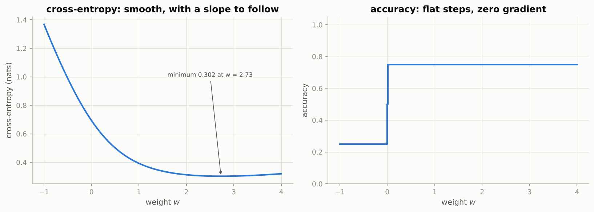

*The loss (left) is a smooth bowl with a minimum at w = 2.73; the accuracy (right) jumps once at w = 0 and is flat everywhere else.*

### Real-world examples

- ImageNet classifiers and language models are both trained with softmax cross-entropy; for a language model the "classes" are the tens of thousands of tokens in the vocabulary, and the log-sum-exp trick is what keeps those losses finite.
- Mean squared error trains regression networks such as house-price estimators, demand forecasters and remaining-useful-life predictors for machines.
- Medical screening models report accuracy, sensitivity and specificity, but are trained on cross-entropy; the metric and the loss are different objects, as Section 4.3 explains.

### Examples for every subsection

- **4.1 Mean squared error for regression.** Predicting 1.5 when the target is 1.0 contributes a squared error of 0.25 and a gradient entry of 0.125 pointing downward.
- **4.2 Softmax cross-entropy for classification.** Logits $(2.0, 1.0, 0.1)$ become probabilities $(0.659, 0.242, 0.099)$; being told the answer was class 2 costs 2.317, being told it was class 0 costs 0.417.
- **4.3 Why not optimize accuracy directly?** Between $w = 0.5$ and $w = 2.0$ accuracy stays at 0.750 while cross-entropy falls from 0.5004 to 0.3123: only the loss can tell the optimizer that $w = 2$ is better.

### Common pitfalls

- `np.log(softmax(Z))` in two steps: where a probability underflows to zero the logarithm is $-\infty$ and the loss becomes `inf` or `nan`. Always use `log_softmax`.
- Summing instead of averaging over the batch makes the loss and the gradient scale with batch size, so a learning rate tuned for one batch size breaks for another.
- Reporting the training loss as if it were the metric: the loss is a proxy; accuracy (or another task metric) must be measured separately.

## 5. Backpropagation, derived and checked

### In plain words

Backpropagation answers one question for every parameter: if I nudge this number, how much does the loss move? It is the chain rule applied backwards through the layers. Three rules cover the whole network. For softmax cross-entropy the gradient with respect to the logits is simply probabilities minus one-hot targets, $(P - Y)/N$. For a linear layer the weight gradient is the transposed input times the incoming gradient, the bias gradient is the incoming gradient summed over the batch, and the gradient passed on is the incoming gradient times the transposed weights. For ReLU the incoming gradient is multiplied by the mask of active units. Each layer's rule costs two matrix products the size of the forward product, so the backward pass costs about twice the forward pass regardless of the number of parameters. Because a forgotten mask or a wrong sign gives gradients of the correct shape and wrong value, every hand-written gradient is compared against finite differences before it is trusted.

### Sample data

The same hand-typed 2-3-2 network and batch as Section 3, with its forward results $A_1$, $P$ and the one-hot targets:

| array | values |
|---|---|
| $A_1$ (2, 3) | rows $(0.7, 0.6, 0)$ and $(0, 0.6, 0)$ |
| $P$ (2, 2) | rows $(0.6271, 0.3729)$ and $(0.4207, 0.5793)$ |
| $Y$ one-hot (2, 2) | rows $(1, 0)$ and $(0, 1)$ |
| ReLU mask $\mathbb{1}[Z_1 > 0]$ (2, 3) | rows $(1, 1, 0)$ and $(0, 1, 0)$ |

### Worked example

**Step 1, loss to logits.** $G_{Z_2} = (P - Y)/N$ with $N = 2$: first row $(0.6271 - 1, 0.3729 - 0)/2 = (-0.1864, 0.1864)$, second row $(0.4207, 0.5793 - 1)/2 = (0.2103, -0.2103)$. Each row pushes the true class's logit up and the other down.

**Step 2, output layer.** $G_{W_2} = A_1^\top G_{Z_2}$ has shape (3, 2)(2, 2) = (3, 2):

$$
G_{W_2} = \begin{pmatrix} -0.1305 & 0.1305 \\ 0.0143 & -0.0143 \\ 0 & 0 \end{pmatrix}, \qquad
G_{\mathbf{b}_2} = \text{column sums of } G_{Z_2} = (0.0239, -0.0239).
$$

For instance $G_{W_2}[0, 0] = 0.7 \cdot (-0.1864) + 0 \cdot 0.2103 = -0.1305$. The third row is zero because hidden unit 3 was inactive for both examples: a unit that never fires receives no weight gradient.

**Step 3, through the weights and the ReLU.** $G_{A_1} = G_{Z_2} W_2^\top$ has shape (2, 2)(2, 3) = (2, 3): first row $(-0.2237, 0.1305, 0.1305)$, second row $(0.2524, -0.1472, -0.1472)$. Multiplying by the mask zeroes the inactive entries:

$$
G_{Z_1} = G_{A_1} \odot \mathbb{1}[Z_1 > 0] = \begin{pmatrix} -0.2237 & 0.1305 & 0 \\ 0 & -0.1472 & 0 \end{pmatrix}.
$$

**Step 4, first layer.** $G_{W_1} = X^\top G_{Z_1}$ has shape (2, 2)(2, 3) = (2, 3):

$$
G_{W_1} = \begin{pmatrix} -0.2237 & 0.2777 & 0 \\ -0.4474 & 0.1874 & 0 \end{pmatrix}, \qquad
G_{\mathbf{b}_1} = (-0.2237, -0.0167, 0).
$$

Check one entry: $G_{W_1}[1, 1] = 2.0 \cdot 0.1305 + 0.5 \cdot (-0.1472) = 0.2610 - 0.0736 = 0.1874$.

**Step 5, gradient check** (central differences with $\varepsilon = 10^{-6}$, relative error $|g_{\text{num}} - g_{\text{ana}}| / (|g_{\text{num}}| + |g_{\text{ana}}|)$):

| parameter | correct backward pass | backward pass with the ReLU mask forgotten |
|---|---|---|
| $W_1$ | 7.5e-11 | 1.0 |
| $\mathbf{b}_1$ | 2.0e-09 | 1.0 |
| $W_2$ | 2.5e-09 | 2.5e-09 |
| $\mathbf{b}_2$ | 1.0e-09 | 1.0e-09 |

Entry by entry for $W_2$, analytic versus numeric: $-0.130498$ vs $-0.130498$ (error 5.4e-12), $+0.014347$ vs $+0.014347$ (2.5e-09), and the two zero entries agree exactly. With the planted bug, $W_1[0, 2]$ gets an analytic gradient of $+0.277735$ where the true value is $0$ (relative error 1.0) and $W_1[0, 0]$ gets $-0.476117$ instead of $-0.223711$ (error 0.36), while $W_2$ and $\mathbf{b}_2$, which sit before the bug in backward order, stay correct. The checker localises the bug for free.

### Chart

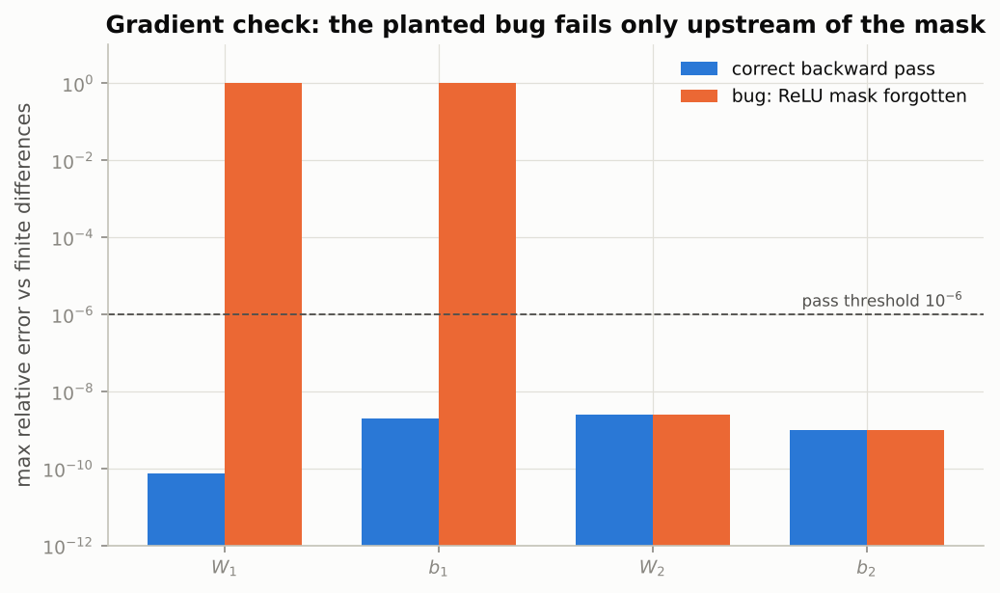

*Correct gradients sit around 1e-9 or better; the forgotten mask lifts the errors of everything upstream of it to order one while the output layer stays correct.*

### Real-world examples

- `loss.backward()` in PyTorch, `jax.grad` and TensorFlow's `GradientTape` all execute these rules; the $X^\top G$ and $G W^\top$ products appear verbatim in every framework's linear-layer backward kernel.
- `torch.autograd.gradcheck` is the Section 5.6 test as a library function; teams writing custom CUDA operators run it in their unit tests.
- The $(P - Y)$ gradient explains a known effect in noisy-label training: a confidently mislabelled example gets a gradient of magnitude close to 1 while well-classified examples contribute almost nothing, so a few bad labels can dominate an update.

### Examples for every subsection

- **5.1 The computational graph and the chain rule.** The tiny network's graph is $X \to Z_1 \to A_1 \to Z_2 \to L$; the gradient for $W_1$ is the product of four local effects read off that chain from right to left.
- **5.2 Backward through a linear layer.** $G_{W_2} = A_1^\top G_{Z_2}$ is (3, 2)(2, 2) = (3, 2), the shape of $W_2$; there is no other way to combine a (2, 3) and a (2, 2) array into a (3, 2) one.
- **5.3 Backward through an element-wise activation.** The mask $(1, 1, 0; 0, 1, 0)$ zeroes three of the six entries of $G_{A_1}$, so hidden unit 3 and the first example's unit 1 pass nothing back.
- **5.4 Backward through softmax cross-entropy: the $\mathbf{p} - \mathbf{y}$ result.** Example 1 has $p = (0.6271, 0.3729)$ and target class 0, so $p - y = (-0.3729, 0.3729)$: raise logit 0, lower logit 1, each by the same amount.
- **5.5 The complete backward pass.** Five steps, four matrix products, one element-wise mask; the forward pass had two matrix products, so the backward pass is about twice the work.
- **5.6 Gradient checking.** Worst relative error 2.5e-09 for the correct pass, 1.0 for the buggy pass; the threshold 1e-6 separates them by nine orders of magnitude.

### Common pitfalls

- Forgetting the ReLU mask (the planted bug): shapes are right, values are wrong, and only the gradient check notices.
- Gradient-checking in float32: the two losses $L(\theta \pm \varepsilon)$ differ in the seventh digit and the finite difference is noise. Use float64 and a tiny network.
- Checking a parameter whose pre-activation sits within $\varepsilon$ of a ReLU kink: the finite difference straddles the kink and reports a spurious error.

## 6. A modular implementation

### In plain words

Instead of one function per architecture, the code becomes a set of layer objects: each knows how to go forward (and remember what it needs), how to go backward (turn the gradient of its output into the gradient of its input, filling in its own parameter gradients), and which parameters it owns. `Sequential` chains layers, a loss object returns the first upstream gradient, and `SGD` subtracts learning rate times gradient from every parameter in place. One pass over the shuffled training set in mini-batches is an epoch; each batch means forward, backward, update. With this library a 2-32-32-2 network learns the two moons and a 2-64-64-3 network learns a three-arm spiral; the spiral also shows that ReLU hidden units train far faster than sigmoid ones started from the same weights.

### Sample data

The first five rows of `make_moons(n_samples=600, noise=0.2, random_state=42)` and of the generated spiral (seed 42):

| dataset | $x_1$ | $x_2$ | class |
|---|---|---|---|
| moons | +0.581 | +1.014 | 0 |
| moons | +0.696 | -0.437 | 1 |
| moons | +1.649 | +0.074 | 1 |
| moons | +0.867 | +0.677 | 0 |
| moons | -0.316 | +0.711 | 0 |
| spiral | +0.274 | +0.179 | 0 |
| spiral | -0.010 | +0.054 | 0 |
| spiral | +0.834 | +0.311 | 1 |
| spiral | -0.425 | +0.894 | 2 |
| spiral | +0.448 | +0.055 | 0 |

Moons: 500 training and 100 validation points. Spiral: 480 training and 120 validation points.

### Worked example

**Two moons, 2-32-32-2 ReLU network, SGD with learning rate 0.1, batch size 32, 300 epochs (1,218 parameters).**

| epoch | train loss | validation loss | validation accuracy |
|---|---|---|---|
| 1 | 0.5112 | 0.3655 | 0.840 |
| 10 | 0.2985 | 0.2735 | 0.890 |
| 50 | 0.1055 | 0.1798 | 0.960 |
| 100 | 0.0900 | 0.1821 | 0.960 |
| 300 | 0.0840 | 0.2516 | 0.960 |

The training loss keeps creeping down while the validation accuracy is flat at 0.96 after epoch 50; the validation loss even drifts up slightly (0.18 to 0.25) as the network becomes more confident about the few noisy points it gets wrong. That drift is the first sign of overfitting.

**Spiral, 2-64-64-3 network, same optimizer, 600 epochs, identical initial weights for both activations.**

| epoch | ReLU train loss | ReLU val acc | sigmoid train loss | sigmoid val acc |
|---|---|---|---|---|
| 50 | 0.0452 | 1.000 | 0.7756 | 0.525 |
| 100 | 0.0172 | 1.000 | 0.7624 | 0.525 |
| 200 | 0.0065 | 1.000 | 0.7235 | 0.542 |
| 400 | 0.0025 | 1.000 | 0.2975 | 0.942 |
| 600 | 0.0014 | 1.000 | 0.0997 | 0.983 |

ReLU is essentially done after 50 epochs. The sigmoid network sits on a plateau around loss 0.76 for 200 epochs, then slowly escapes; it is not broken, just starved of gradient by saturation.

### Chart

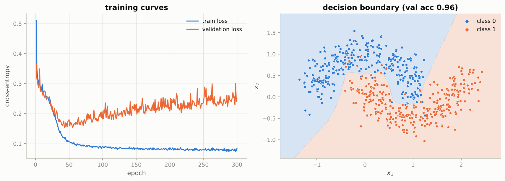

*The boundary is a curve made of straight segments, one kink per ReLU unit; the handful of misclassified points lie inside the other moon.*

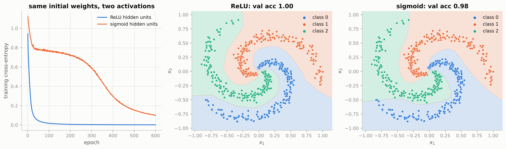

*Same initial weights, same optimizer: ReLU reaches a near-zero loss in tens of epochs while sigmoid needs hundreds, and the sigmoid boundary is visibly rougher.*

### Real-world examples

- `torch.nn.Module` with `forward`, `nn.Sequential` and `torch.optim.SGD` are this library with autograd supplying `backward`; Keras `Sequential` follows the same design.
- `torch.utils.data.DataLoader(shuffle=True)` is `iterate_minibatches`: every production training loop shuffles and batches exactly like `train_one_epoch`.
- The TensorFlow Playground web demo trains small MLPs on moons- and spiral-shaped data in the browser; its "spiral" task is the standard illustration that depth and the right activation matter.

### Examples for every subsection

- **6.1 Layers as objects with `forward` and `backward`.** `Linear(2, 32)` owns `W` of shape (2, 32) and `b` of shape (32,); `ReLU` owns nothing but remembers its mask; `SGD.step` does `p -= lr * grad` in place so the layer sees the new weights.
- **6.2 The training loop.** With 500 training points and batch size 32, one epoch is 16 updates; 300 epochs on the moons is 4,800 updates, which is why the first-epoch loss of 0.5112 falls to 0.0840.
- **6.3 Two moons.** Validation accuracy 0.96 from epoch 50 onward; the remaining 4 of 100 validation points are noise victims that no boundary can recover.
- **6.4 A three-class spiral.** At epoch 100 the ReLU network has validation accuracy 1.000, the sigmoid network 0.525; only by epoch 600 does sigmoid reach 0.983.

### Common pitfalls

- Writing `p = p - lr * grad` instead of `p -= lr * grad` in the optimizer: a new array is created, the layer keeps its old weights, and nothing learns while no error is raised.
- Comparing two methods from different random starts: re-seed before each run, as the spiral experiment does, or you measure initialization luck instead of the method.
- Reading the training loss alone: the moons' training loss keeps falling after epoch 50 while validation quality is flat; always log a validation metric.

## 7. MNIST in NumPy

### In plain words

MNIST is 70,000 handwritten digits of 28 by 28 pixels, flattened to 784 numbers each and standardised with the training mean and spread. A 784-256-128-10 ReLU network trained with plain mini-batch SGD reaches about 97 to 98% test accuracy in ten epochs of NumPy. A confusion matrix then shows which digits get mixed up, and a small study shows how the learning rate, the batch size and the initialization change the outcome. MNIST cannot be downloaded in the environment that produced this guide, so every number below uses the notebook's documented offline fallback, scikit-learn's bundled `load_digits` (1,797 images of 8 by 8 pixels, 64 features). The network is the same recipe with a 64-wide input, and the qualitative story is the same; the notebook prints the real MNIST numbers when it runs online.

### Sample data

The digits data after the notebook's fallback split (seed 42, stratified 75/25 train/test, the last fifth of the training part held out for validation):

| split | shape | note |
|---|---|---|
| train | (1078, 64) | first 8 labels: 2, 1, 2, 1, 7, 4, 8, 5 |
| validation | (269, 64) | used only for monitoring |
| test | (450, 64) | touched once, at the end |

Pixel mean 0.3055 and standard deviation 0.3760, computed on the training split only. The first training image's top row after standardisation is $(-0.81, -0.48, 1.18, 1.85, 1.18, -0.81, -0.81, -0.81)$: dark background becomes negative, ink becomes positive.

### Worked example

**Training the 64-256-128-10 network (50,826 parameters) with SGD, learning rate 0.1, batch size 64, 10 epochs.**

| epoch | train loss | validation loss | validation accuracy |
|---|---|---|---|
| 1 | 1.2095 | 0.3843 | 0.9368 |
| 2 | 0.3032 | 0.2798 | 0.9257 |
| 3 | 0.2027 | 0.1898 | 0.9442 |
| 5 | 0.1138 | 0.1475 | 0.9665 |
| 8 | 0.0631 | 0.1151 | 0.9703 |
| 10 | 0.0482 | 0.0967 | 0.9628 |

Test loss 0.1186, test accuracy 0.9644: 16 of the 450 test images are misclassified.

**Confusion matrix.** Per-class accuracy: 0: 0.978, 1: 0.957, 2: 1.000, 3: 1.000, 4: 1.000, 5: 0.978, 6: 0.978, 7: 1.000, 8: 0.814, 9: 0.933. The largest confusions are true 8 predicted as 1 (6 images), true 9 predicted as 4 (2), true 1 predicted as 6 (2) and true 9 predicted as 7 (1). Digit 8 alone accounts for 8 of the 16 errors.

**Three knobs, 3 epochs each, same seed, validation accuracy:**

| setting | final train loss | validation accuracy |
|---|---|---|
| learning rate 0.01 | 1.0606 | 0.7881 |
| learning rate 0.1 | 0.2027 | 0.9442 |
| learning rate 1.0 | 0.3580 | 0.9108 |
| batch size 8 | 0.0421 | 0.9331 |
| batch size 64 | 0.2027 | 0.9442 |
| batch size 512 | 1.0076 | 0.8959 |
| init zero | 2.3023 | 0.0558 |
| init small (std 0.01) | 2.3010 | 0.0558 |
| init Xavier | 0.3056 | 0.9442 |
| init He | 0.2027 | 0.9442 |

Learning rate 0.01 is slow (train loss still 1.06 after 3 epochs); 0.1 is the sweet spot; 1.0 is worse and on the larger MNIST problem becomes unstable. Batch size 8 drives the training loss lowest (more updates per epoch) while 512 makes only 6 updates per epoch and lags. Zero and tiny initialization are stuck at the loss of a uniform guess, $\ln 10 = 2.30$: with zero weights every hidden unit is identical and only the output bias can move; with std 0.01 the signal is attenuated to almost nothing by the time it reaches the logits.

### Chart

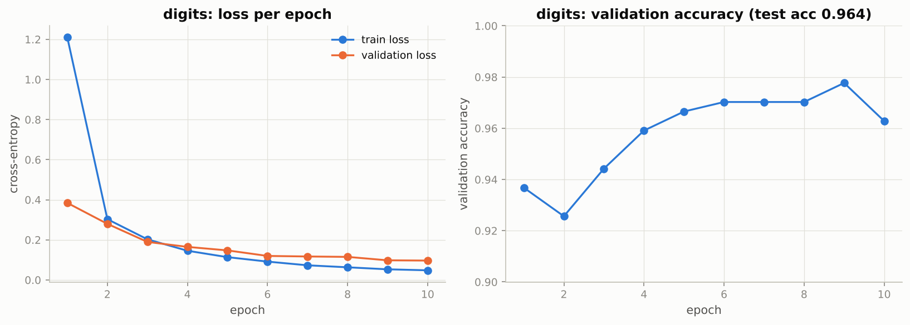

*Training loss falls monotonically; validation loss flattens after epoch 6, the first hint of overfitting.*

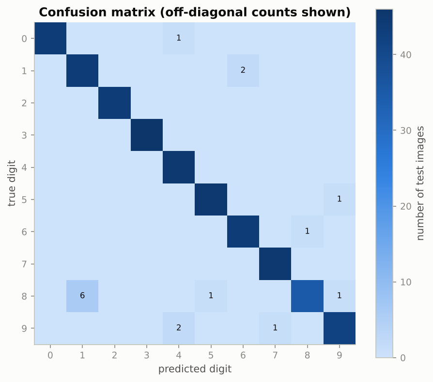

*The diagonal dominates; the one dark off-diagonal cell is 8 predicted as 1, which is where almost half the errors live.*

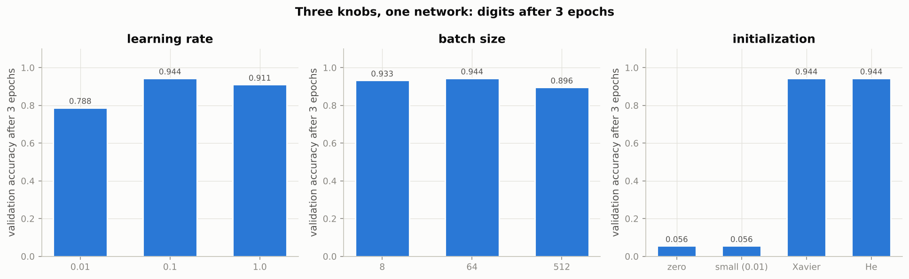

*Learning rate 0.1, a moderate batch and a scaled initialization (Xavier or He) win; zero or tiny weights never leave chance level.*

### Real-world examples

- MNIST was assembled from NIST scans of US Census Bureau employees' and high-school students' handwriting; LeCun's group used its predecessors to build ZIP-code readers for the postal service (1989) and cheque-reading systems for banks in the 1990s, the first large industrial deployments of backpropagation networks.
- Confusion matrices are the standard error-analysis tool in medical image classification (which conditions are confused with which) and in content moderation, where the cost of each kind of confusion differs.
- Learning-rate range tests and the linear scaling rule for batch size (double the batch, double the learning rate) are routine in large-scale ImageNet and language-model training; Section 7.4 is that practice at toy scale.

### Examples for every subsection

- **7.1 Loading the data.** The pixel mean 0.3055 and standard deviation 0.3760 come from the 1,078 training images only and are reused unchanged for validation and test data.
- **7.2 Training a 784-256-128-10 network.** The 64-input stand-in has 50,826 parameters and reaches 0.9644 test accuracy after 10 epochs; the real network has 235,146 parameters and the notebook reports about 97 to 98% on MNIST.
- **7.3 Where does the network go wrong?** Digit 8 has the lowest per-class accuracy, 0.814, and is predicted as 1 six times; on MNIST the notebook finds the analogous pairs 4/9, 3/5, 7/2 and 8/3.
- **7.4 Learning rate, batch size and initialization.** Zero initialization gives validation accuracy 0.0558 and a loss of 2.3023, exactly the uniform-guess loss $\ln 10$; He and Xavier give 0.9442.

### Common pitfalls

- Computing the standardisation statistics on the whole dataset including test images: a subtle leak that makes test numbers slightly optimistic.
- Judging batch size at equal epochs only: batch 8 wins per epoch here but costs the most wall-clock time per epoch because tiny matrix products use the hardware poorly.
- Initialising all weights to zero: the network is effectively one unit wide forever (the symmetry problem), and the loss stays at $\ln 10$.

## 8. Universal approximation in practice

### In plain words

A single hidden layer, if wide enough, can approximate any continuous function on a bounded range: that is the universal approximation theorem. For ReLU networks the picture is concrete: the output is a polyline with one kink per hidden unit, and more kinks give a finer approximation. Fitting $\sin(x)$ and a step function with 2, 4, 16 and 128 hidden units shows both the promise and the catch. Width adds capacity, but gradient descent does not always use it well, and a sharp jump needs very large weights that SGD approaches only slowly. Depth is a different story: composing layers multiplies the number of linear pieces, so a deep network builds with a handful of units what a shallow one needs exponentially many units for. Finally, hand-deriving backward passes stops scaling here; convolutions, recurrent cells and attention each need their own rules, so from Notebook 03 on the framework records the computation and differentiates it automatically.

### Sample data

256 evenly spaced inputs on $[-\pi, \pi]$ with two targets, $\sin(x)$ and the step $\mathbb{1}[x > 0]$; one-hidden-layer ReLU networks of width 2, 4, 16 and 128, trained with MSE, batch size 32, 1500 epochs, learning rate $0.2/\text{width}$, with the kinks spread uniformly over the interval at the start (the notebook's data-dependent initialization).

### Worked example

**Fits of a one-hidden-layer ReLU network:**

| width | $\sin(x)$ MSE | step MSE | width of the ramp where the step fit goes from 0.1 to 0.9 |
|---|---|---|---|
| 2 | 0.0844 | 0.0284 | 2.834 |
| 4 | 0.0023 | 0.0057 | 0.641 |
| 16 | 0.0003 | 0.0060 | 0.690 |
| 128 | 0.0003 | 0.0075 | 0.862 |

Two units give a crude tent for the sine (MSE 0.0844) and a long ramp for the step (2.834 wide). Four units already capture the sine (0.0023), sixteen are essentially perfect (0.0003), and 128 do not improve further. The step is different: the jump needs two kinks very close together with a steep segment between them, which means huge weights; even with 128 units the ramp stays about 0.86 wide and the MSE does not fall below 0.0057. Capacity and trainability are different things.

**Depth versus width: a sawtooth by composition.** The two-unit network $t(x) = 2\,\text{ReLU}(x) - 4\,\text{ReLU}(x - 0.5)$ is a tent on $[0, 1]$. Composing it with itself $L$ times uses $2L$ hidden units and produces a sawtooth with $2^{L-1}$ teeth and $2^L - 1$ kinks:

| depth $L$ | hidden units used | kinks | teeth | units a one-hidden-layer network needs (at least one per kink) |
|---|---|---|---|---|
| 1 | 2 | 1 | 1 | 1 |
| 2 | 4 | 3 | 2 | 3 |
| 3 | 6 | 7 | 4 | 7 |
| 4 | 8 | 15 | 8 | 15 |

Eight units in depth do what fifteen units need in width; at depth 20 the gap is 40 units against more than a million.

### Chart

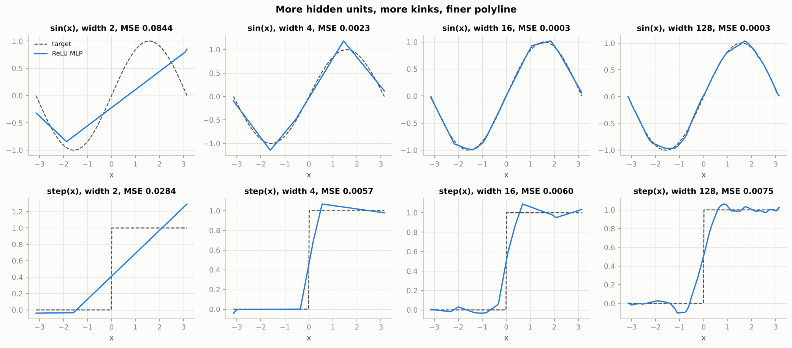

*Each extra hidden unit adds one kink to the polyline: the sine is captured by width 16, while the step keeps a visible ramp around zero even at width 128.*

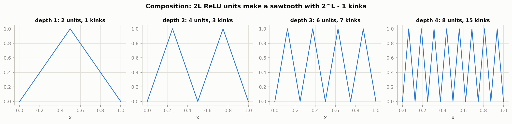

*Every extra layer doubles the number of teeth while adding only two units; a shallow network would need one unit per kink.*

### Real-world examples

- Surrogate models in engineering replace a slow physics simulation (airflow over a wing, battery ageing) by an MLP fitted to simulated samples; the universal approximation property is what makes this a sensible plan, and Section 8.1 shows why it still needs care.
- ResNets with 50 to 152 layers and Transformers with dozens of layers exist because depth composes features efficiently, the practical face of the sawtooth argument; making such depth trainable (initialization, normalization, residual connections) is the subject of Notebooks 04 and 06.
- PyTorch, JAX and TensorFlow record the computational graph during the forward pass and derive the backward pass mechanically; nobody hand-derives gradients for attention blocks in production, which is exactly the point of Section 8.2.

### Examples for every subsection

- **8.1 One hidden layer can fit anything — in principle.** Width 16 fits $\sin(x)$ with MSE 0.0003, but the step function's ramp only shrinks from 2.834 (width 2) to about 0.64 to 0.86 (widths 4 to 128): more units do not buy a sharper jump under SGD.
- **8.2 Depth versus width, and why "from scratch" stops here.** Depth 4 with 8 units has 15 kinks; the notebook's two-hidden-layer MNIST network needed four hand-derived rules and a gradient check, and that effort would have to be repeated for every new layer type.

### Common pitfalls

- Starting all kinks at zero: with zero biases every ReLU unit bends at $x = 0$ and the network is a "V" no matter how wide; spread the kinks over the input range or use a data-dependent initialization.
- Keeping the learning rate fixed as the hidden layer widens: with $H$ hidden features the curvature of the output layer grows with $H$, and SGD diverges; the notebook scales the learning rate as $0.2/H$.
- Reading the theorem as a training guarantee: it promises that good weights exist, not that gradient descent will find them or that the width is affordable.

## Exercises in plain words

- **Exercise 1 (warm-up): a `Tanh` layer.** Write a layer whose backward pass multiplies by $1 - \tanh^2$ using the stored output, then write a checker that gradient-checks every parameter of any `Sequential` model. Useful because tanh is the traditional recurrent-cell activation (Notebook 08) and because a reusable checker is the first tool you need for every new layer. Hint: compute the analytic gradients once, before perturbing any parameter, and read them from `layer.grads`.
- **Exercise 2: SGD with momentum.** Keep a running velocity per parameter, $v \leftarrow \mu v - \eta g$, and move by $v$. Useful because momentum is the single most common improvement over plain SGD. Hint: in a direction of consistent gradient the effective step grows to $\eta / (1 - \mu)$, ten times the nominal step for $\mu = 0.9$, so compare at a smaller learning rate.
- **Exercise 3: L2 regularization in the backward pass.** Add $\lambda W$ to each weight gradient (not to the biases) and train on noisier moons with three values of $\lambda$. Useful because this is exactly what `weight_decay` does in PyTorch. Hint: subclass `Linear` and modify `grads["W"]` after calling the parent's `backward`; expect a smoother boundary for a small penalty and under-fitting for a large one.
- **Exercise 4: does shuffling matter?** Sort a subset of the training images by label and train one epoch with and without shuffling. Useful because it shows why every data loader shuffles by default. Hint: without shuffling the network mostly predicts the last class it saw; count which class dominates the predictions.
- **Exercise 5: a two-layer network for regression.** Fit $y = \sin(2 x_1) + \tfrac12 x_2^2 + \text{noise}$ with one hidden layer of 64 ReLU units and the `MSE` loss, and report $R^2$ on held-out data. Useful because it shows that regression differs from classification only in the last layer and the loss. Hint: standardise the target and use a small learning rate (0.01) for the reason given in Section 8; the noise sets an $R^2$ ceiling near 0.99.
- **Exercise 6 (challenge): softmax backward without the combined trick.** Implement a stand-alone `Softmax` layer using the full Jacobian $p_i(\delta_{ij} - p_j)$ and a separate `NLLLoss`, and show that the chain reproduces $(P - Y)/N$. Useful because it proves that the clean result is not a trick but what the chain rule produces. Hint: the Jacobian-vector product collapses to $p_j (g_j - \sum_i g_i p_i)$, a row-wise inner product, so you never need the $k \times k$ matrix.

## Quick reference

| Concept | Formula or rule | In one sentence |
|---|---|---|
| Neuron | $z = \mathbf{w}^\top \mathbf{x} + b$, $a = \phi(z)$ | Weighted sum plus bias, then a non-linearity. |
| Perceptron update | $\mathbf{w} \leftarrow \mathbf{w} + \eta (y - \hat y)\,\mathbf{x}$, $b \leftarrow b + \eta (y - \hat y)$ | Nudge toward misclassified examples; converges only if a separating line exists. |
| Linear collapse | $W_2(W_1 \mathbf{x} + \mathbf{b}_1) + \mathbf{b}_2 = (W_2 W_1)\mathbf{x} + (W_2 \mathbf{b}_1 + \mathbf{b}_2)$ | Stacked linear layers are one linear layer; activations are what make depth count. |
| Activation derivatives | $\sigma' = \sigma(1 - \sigma)$, $\tanh' = 1 - \tanh^2$, $\text{ReLU}' = \mathbb{1}[z > 0]$, $\text{GELU}' = \Phi(z) + z\varphi(z)$ | Sigmoid's slope is at most 0.25; ReLU's is 1 or 0. |
| Affine layer | $Z = XW + \mathbf{1}\mathbf{b}^\top$, shapes $(N, d_{\text{in}})(d_{\text{in}}, d_{\text{out}})$ | Batch on the left, weights as (in, out), bias broadcast to every row. |
| Parameter count | $\sum_l (d_{l-1} + 1)\, d_l$ | 784-256-128-10 has 235,146 parameters, 85% in the first layer. |
| Mean squared error | $L = \frac{1}{2Nk}\sum (\hat y - y)^2$, $\partial L / \partial \hat Y = (\hat Y - Y)/(Nk)$ | The half cancels the 2 from the square; averaging keeps the scale independent of batch size. |
| Softmax | $p_j = e^{z_j} / \sum_i e^{z_i}$ | Positive scores that add up to one; compute via log-softmax with the maximum subtracted. |
| Cross-entropy | $L = -\frac{1}{N}\sum_n \log p_{n, y_n} = \frac{1}{N}\sum_n (\log\sum_i e^{z_{ni}} - z_{n, y_n})$ | Negative log-probability of the true class; the log-sum-exp form never overflows. |
| Linear backward | $G_W = X^\top G_Z$, $G_{\mathbf{b}} = \sum_n (G_Z)_n$, $G_X = G_Z W^\top$ | Two matrix products and a column sum; the shapes force the formulas. |
| Activation backward | $G_Z = G_A \odot \phi'(Z)$ | Element-wise multiply by the local slope; for ReLU, multiply by the mask. |
| Softmax-CE backward | $G_Z = (P - Y)/N$ | Probabilities minus one-hot targets, averaged over the batch. |
| Gradient check | $\dfrac{\lvert g_{\text{num}} - g_{\text{ana}}\rvert}{\lvert g_{\text{num}}\rvert + \lvert g_{\text{ana}}\rvert}$ with central differences, $\varepsilon = 10^{-6}$ | Below $10^{-6}$ is correct, near 1 is a bug; use float64 and a tiny network. |
| He initialization | $W \sim \mathcal{N}(0, 2/d_{\text{in}})$ | Keeps ReLU activations at a constant scale from layer to layer. |
| Xavier initialization | $W \sim \mathcal{N}(0, 2/(d_{\text{in}} + d_{\text{out}}))$ | The tanh-era compromise between forward and backward signal scales. |
| SGD step | $\theta \leftarrow \theta - \eta\, G_\theta$ (in place) | Subtract learning rate times gradient; must modify the array in place. |
| Momentum | $v \leftarrow \mu v - \eta g$, $\theta \leftarrow \theta + v$ | Effective step $\eta/(1 - \mu)$ in consistent directions; $\mu = 0.9$ is standard. |
| Universal approximation | $f(x) = \sum_j v_j \max(0, w_j x + b_j) + c$ | One kink per hidden unit at $x = -b_j / w_j$; width buys kinks, depth multiplies them. |

## Glossary

- **Activation function**: the non-linear function applied element-wise after a linear layer (sigmoid, tanh, ReLU, leaky ReLU, GELU).
- **Backpropagation**: the chain rule applied backwards through the layers to obtain the gradient of the loss with respect to every parameter.
- **Batch (mini-batch)**: a group of examples processed together as the rows of one matrix; one gradient step per batch.
- **Cross-entropy**: the classification loss, minus the average log-probability assigned to the true class.
- **Dead ReLU**: a unit whose pre-activation is negative for every input; it outputs zero, receives zero gradient and never recovers.
- **Epoch**: one full pass over the training set, usually shuffled and cut into mini-batches.
- **Gradient check**: comparing an analytic gradient with central finite differences on a few parameter entries.
- **He initialization**: Gaussian weights with variance $2/d_{\text{in}}$, the right scale for ReLU networks.
- **Hidden layer**: a layer between input and output whose units compute learned features of the input.
- **Logits**: the raw, unnormalised scores of the last layer, one per class, before the softmax.
- **MLP (multi-layer perceptron)**: a stack of fully connected linear layers with activations in between.
- **Perceptron**: the 1958 single neuron with a step activation and its error-driven learning rule.
- **Saturation**: the regime where sigmoid or tanh inputs are large and their slopes are nearly zero.
- **Softmax**: the map from logits to a probability vector, $e^{z_j}$ divided by the sum of all $e^{z_i}$.
- **Universal approximation theorem**: a single sufficiently wide hidden layer can approximate any continuous function on a bounded domain.
