# 03 · Tensors and Autograd — Companion Guide

> Plain-language companion to [`03_tensors_and_autograd.ipynb`](03_tensors_and_autograd.ipynb). Read a section here, then run the
> matching section of the notebook. All numbers below were computed with the script
> [`figures/scripts/make_figures_03.py`](figures/scripts/make_figures_03.py); all charts are its output.

## At a glance

- **What you learn**
  - A tensor is a NumPy array with two extras: it can live on a GPU, and it can remember how it was computed.
  - Views share memory with their source, in-place operations change that memory, and broadcasting stretches size-1 dimensions without copying.
  - A derivative can be computed by walking a graph of elementary operations backwards (reverse-mode automatic differentiation), and one backward sweep gives the gradient of one loss with respect to every parameter.
  - A complete scalar autograd engine fits in about a hundred lines of Python; `torch.autograd` is the same idea with tensors as nodes.
  - The rules of `torch.autograd`: gradients accumulate, the graph is freed after `backward()`, updates and evaluation go under `no_grad`, and in-place edits of saved tensors raise an error.
  - A training loop is forward, loss, `backward()`, update, zero the gradients; `nn.Module` and `torch.optim` only package this.
- **Where this is used in the real world**
  - Every PyTorch model, from a phone keyboard's next-word predictor to a protein-structure model, is trained with the reverse-mode autograd described here.
  - Image pipelines normalise a batch of photos by subtracting a per-channel mean of shape (3, 1, 1) from a tensor of shape (batch, 3, H, W): pure broadcasting.
  - Physics and engineering simulators written in a differentiable framework (fluid, robotics, molecular dynamics) use autograd to tune parameters, such as a material constant, by gradient descent through the whole simulation.
  - In finance, the sensitivities of an option price to its inputs (the "Greeks") can be obtained with one reverse sweep through a Monte-Carlo pricer instead of one re-pricing per input.
  - Interpretability methods such as saliency maps are gradients of a network's output with respect to its input pixels, obtained with the same `backward()` call used for training.
  - GPU acceleration of dense matrix products is the reason deep learning is feasible: large batched products run tens to hundreds of times faster than on a CPU.

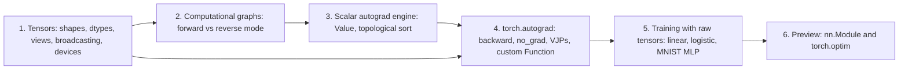

## 1. Tensors

### In plain words

A tensor is a block of numbers with a shape, a number format (dtype) and a home (device). If you can use a NumPy array you can already use a tensor: create it, index it, reshape it, sum along an axis, multiply matrices. The differences are deliberate. The default decimal type is float32 rather than float64, because that is what GPUs are fast at. Many operations return *views* that share memory with the original instead of copies. Broadcasting lets a small tensor act as if it had been copied to a larger shape. And the tensor can live on a GPU, where a large matrix product runs far faster than on the CPU. This section is the vocabulary that every later notebook uses.

### Sample data

Three tiny tensors used in the worked examples below (hand-typed, as in the notebook).

| name | values | shape | used for |
|---|---|---|---|
| `x` | [[0, 1, 2], [3, 4, 5]] | (2, 3) | strides, views, transposes |
| `r` | [[1, 5, 3], [4, 2, 6]] | (2, 3) | reductions with `dim` |
| `col`, `row` | [0, 1, 2] as a column, [0, 1, 2, 3] as a row | (3, 1), (1, 4) | broadcasting |
| `img` | R = [[200, 100], [150, 50]], G = [[20, 60], [40, 80]], B = [[0, 255], [255, 0]] | (3, 2, 2) | per-channel normalisation |

### Worked example

**dtypes.** float32 has a machine epsilon of 1.192e-07, which is about 6.9 significant decimal digits; float64 has 2.220e-16 (about 15.7 digits). The two 16-bit formats trade differently: float16 keeps 3.0 digits but its largest value is only 6.550e+04, while bfloat16 keeps float32's range (max 3.390e+38) at the price of about 2.1 digits. The number 0.1 is stored as 0.100000001490 in float32, 0.099975585938 in float16 and 0.100097656250 in bfloat16.

**Strides and views.** `x = arange(6).reshape(2, 3)` is stored as six numbers in a row with strides (3, 1): move 3 elements to go down one row, 1 element to go right one column. Its transpose `x.T` is the *same* memory with strides (1, 3); it is not contiguous (row-major) and `np.shares_memory` reports `True`. Writing 100 into a view, `v = x.reshape(2, 3); v[0, 0] = 100`, changes `x[0, 0]` to 100.0 as well.

**Reductions.** For `r = [[1, 5, 3], [4, 2, 6]]`: `r.sum()` = 21.0; `r.sum(dim=0)` sums *over rows* and leaves one number per column, [5, 7, 9]; `r.sum(dim=1)` gives one number per row, [9, 12]; `r.max(dim=1)` returns values [5, 6] and indices [1, 2].

**`keepdim` for a stable softmax.** For the logits `z = [[1000, 0, -1000], [1, 2, 3]]` the naive softmax computes `exp(1000)` and returns `nan` for the first row. Subtracting each row's maximum (kept as a (2, 1) column so it broadcasts back) gives [1, 0, 0] for row 0 and [0.09, 0.2447, 0.6652] for row 1.

**Broadcasting.** The column [0, 1, 2] of shape (3, 1) times the row [0, 1, 2, 3] of shape (1, 4) aligns the shapes from the right, (3, 1) against (1, 4), stretches each size-1 dimension and produces the (3, 4) multiplication table shown in the chart. For the image: the per-channel means of the (3, 2, 2) image are [125, 50, 127.5] with shape (3, 1, 1), the standard deviations are [55.902, 22.361, 127.5], and `(img - mean) / std` normalises every channel at once; the red channel becomes [[1.342, -0.447], [0.447, -1.342]]. The silent bug: a (4, 1) column minus a (4,) vector has shape (4, 4), not (4,).

**Matrix products on the CPU.** One BLAS thread, float32, best of several repeats:

| n | time per n × n product | GFLOP | GFLOP/s |
|---|---|---|---|
| 64 | TBD_MM64 ms | 0.001 | TBD_GF64 |
| 128 | TBD_MM128 ms | 0.004 | TBD_GF128 |
| 256 | TBD_MM256 ms | 0.034 | TBD_GF256 |
| 512 | TBD_MM512 ms | 0.268 | TBD_GF512 |
| 1024 | TBD_MM1024 ms | 2.147 | TBD_GF1024 |
| 2048 | TBD_MM2048 ms | 17.180 | TBD_GF2048 |

Doubling n from 1024 to 2048 multiplies the time by TBD_RATIO_BIG, close to the 8 predicted by the $2n^3$ flop count. A GPU runs the same product on thousands of cores; for the large sizes it is one to two orders of magnitude faster, for n = 64 the fixed cost of launching a kernel dominates and it gains nothing.

### Chart

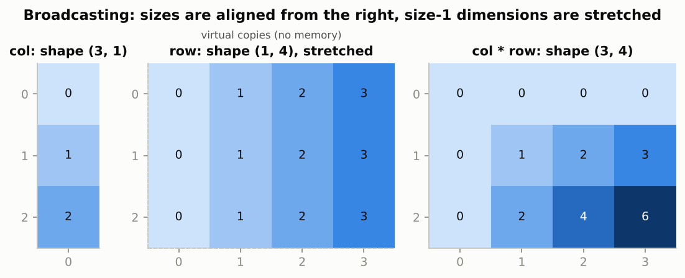

*The size-1 dimensions are stretched virtually: the middle panel's three identical rows are never stored, yet the result on the right is the full (3, 4) table.*

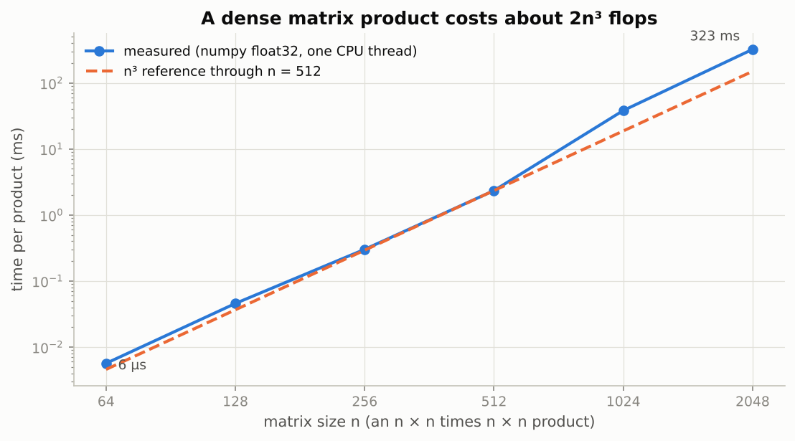

*On log-log axes the measured times follow the dashed n³ line once n is a few hundred; this cubic growth is why batching work into large matrix products pays off on a GPU.*

### Real-world examples

- Image classifiers normalise every input batch with a (3, 1, 1) mean and standard deviation against a (batch, 3, H, W) tensor; the ImageNet means and standard deviations used by torchvision models are exactly such broadcast constants.
- Mixed-precision training on modern GPUs stores activations in bfloat16 or float16 and keeps a float32 copy of the weights, which is why the dtype section matters for anyone training large models (Notebook 14).
- A recommendation system keeps user and item embeddings as large tensors on the GPU; the `.to(device)` and `detach().cpu().numpy()` idioms are what move scores back for display.
- `einsum("bqd,bkd->bqk")` is literally the attention-score computation inside every transformer (Notebook 09).

### Examples for every subsection

- **1.1 What a tensor is.** A batch of 32 colour photos of 224 × 224 pixels is one tensor of shape (32, 3, 224, 224); a table of 1,000 patients with 12 measurements is (1000, 12).
- **1.2 dtypes.** 0.1 becomes 0.100000001490 in float32 and 0.099975585938 in float16: the 16-bit format already loses the fourth decimal, which is fine for activations and dangerous for a gradient check.
- **1.3 Indexing and slicing.** With probabilities `[[0.7, 0.2, 0.1], [0.1, 0.1, 0.8]]` and targets `[0, 2]`, `probs[arange(2), targets]` picks 0.7 and 0.8, the true-class probabilities every cross-entropy needs.
- **1.4 Views versus copies.** `x.T` keeps the same memory with strides (1, 3) instead of (3, 1); `view(-1)` refuses to flatten it, `reshape(-1)` copies, and writing into a view changed `x[0, 0]` to 100.
- **1.5 In-place operations.** `x.add_(1)`, `x += 1` and `x[0] = 10` each bump the tensor's version counter; an optimizer update is an in-place `p -= lr * p.grad`.
- **1.6 Broadcasting.** (3, 1) times (1, 4) gives the (3, 4) multiplication table; (N, 1) minus (N,) gives an (N, N) matrix, the classic silent bug.
- **1.7 Reductions with `dim` and `keepdim`.** `r.sum(dim=0)` = [5, 7, 9] and `r.max(dim=1)` = values [5, 6], indices [1, 2]; subtracting a `keepdim` row maximum turns a `nan` softmax into [1, 0, 0].
- **1.8 `einsum`, `stack` and `cat`, and other reshaping tools.** `stack` of two length-3 vectors is (2, 3), `cat` is (6,); `einsum("bij,bjk->bik")` is a batched matrix product and `einsum("ii->")` is a trace.
- **1.9 NumPy interoperability.** `torch.from_numpy(arr)` shares memory, so `arr[0] = 99` changes the tensor; the safe way back to NumPy before plotting is `t.detach().cpu().numpy()`.
- **1.10 Devices.** The CPU table above shows the n³ growth; with a GPU the 2048 × 2048 product that took TBD_MM2048 ms here runs in a few milliseconds.

### Common pitfalls

- Treating `view`/`reshape`/`transpose` output as independent: an in-place change to it silently changes the original; `clone()` when you need a copy.
- Forgetting that `torch.from_numpy` yields float64; convert with `.float()` or every layer will complain about dtype mismatches.
- Timing GPU code without `torch.cuda.synchronize()`: the clock stops before the GPU has finished.
- Adding a (N,) vector to an (N, 1) column and getting an (N, N) matrix without any error.

## 2. Computational graphs and reverse-mode automatic differentiation

### In plain words

To train a network you need the derivative of the loss with respect to every parameter. Writing those derivatives by hand does not scale, finite differences would need one extra forward pass per parameter, and symbolic formulas explode in size. Automatic differentiation takes a third road: it records the calculation as a graph of elementary operations (add, multiply, tanh, ...), each of which knows its own simple local derivative, and then applies the chain rule along the graph. Reverse mode starts at the output with a gradient of 1 and walks backwards, handing each node's gradient to its inputs multiplied by the local derivative; inputs reached along several paths add up their contributions. One reverse sweep gives the derivative of one output with respect to all inputs, which is exactly the shape of the training problem: one loss, millions of parameters.

### Sample data

The notebook's example $L = (a \cdot b + c) \cdot d$ at the point used in the notebook.

| variable | value | role |
|---|---|---|
| a | 2.0 | input |
| b | -3.0 | input |
| c | 10.0 | input |
| d | 0.5 | input |
| e = a·b | -6.0 | intermediate |
| f = e + c | 4.0 | intermediate |
| L = f·d | 2.0 | output |

### Worked example

**Forward pass.** e = a·b = -6.0, f = e + c = 4.0, L = f·d = 2.0.

**Reverse pass** (an adjoint $\bar v$ is $\partial L / \partial v$). Start with $\bar L = 1$. The product L = f·d hands f the adjoint $\bar f = \bar L \cdot d = 0.5$ and hands d the adjoint $\bar d = \bar L \cdot f = 4.0$. The sum f = e + c has local derivatives 1 and 1, so $\bar e = \bar c = 0.5$. The product e = a·b gives $\bar a = \bar e \cdot b = -1.5$ and $\bar b = \bar e \cdot a = 1.0$. So the gradient is (dL/da, dL/db, dL/dc, dL/dd) = (-1.5, 1.0, 0.5, 4.0).

**Check by central finite differences** (step 1e-6): [-1.5, 1.0, 0.5, 4.0]. Identical.

**Forward mode, for contrast.** Seed $\dot a = 1$ and the others 0, then push tangents forward: $\dot e = \dot a \cdot b = -3.0$, $\dot f = \dot e = -3.0$, $\dot L = \dot f \cdot d = -1.5$. That is dL/da again, but one sweep per input: four sweeps for this graph, 235,146 sweeps for the MNIST MLP of Section 5. Reverse mode needs one sweep for any number of inputs (ten sweeps if the function had ten outputs).

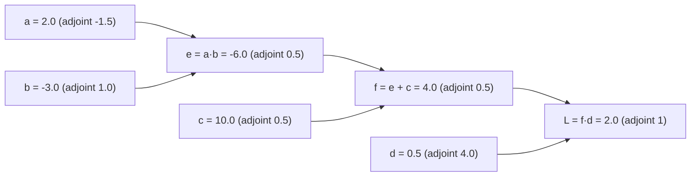

### Chart

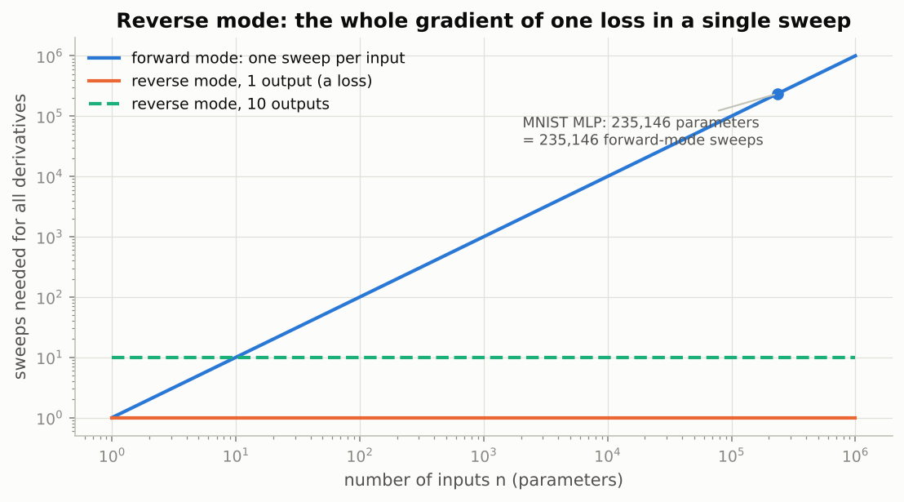

*Forward mode needs one sweep per input (the rising line), reverse mode one sweep per output (the flat lines); with one loss and 235,146 parameters the gap is five orders of magnitude.*

### Real-world examples

- Backpropagation in every deep-learning framework is reverse-mode AD; the memory it needs to keep intermediate activations is why training a model needs far more GPU memory than running it.
- Differentiable physics engines let engineers tune a simulated robot's parameters by gradient descent through thousands of simulation steps: one reverse sweep per loss evaluation.
- In quantitative finance, adjoint algorithmic differentiation computes all price sensitivities of a derivative contract from a single reverse sweep through the pricing code.
- Forward mode is the right choice when there are few inputs and many outputs, for instance the sensitivity of an entire weather-model output field to one uncertain parameter.

### Examples for every subsection

- **2.1 Three ways to compute a derivative.** Finite differences on the four-input example needed 8 extra evaluations of L (two per input) and gave [-1.5, 1.0, 0.5, 4.0] only to about nine digits; reverse mode gave the exact values from one sweep.
- **2.2 The computational graph.** The graph above has seven nodes (four inputs, two intermediates, one output); each product node's local derivatives are "the other factor" and each sum node's are 1 and 1.
- **2.3 Forward mode versus reverse mode.** Seeding $\dot a = 1$ gives dL/da = -1.5 after one forward sweep; seeding $\bar L = 1$ gives all four derivatives after one reverse sweep.

### Common pitfalls

- Overwriting instead of adding when a variable reaches the output by several paths (x in x·x): the contributions must be summed.
- Assuming reverse mode is free: it stores every intermediate value until the backward sweep has used it.
- Trusting finite differences as "the truth": they are limited to roughly eight or nine digits by the step size and cancellation.

## 3. A scalar autograd engine

### In plain words

The engine wraps each number in a `Value` object that stores the number, a gradient slot, the set of `Value`s it was made from, and a small function that knows how to pass a gradient to those inputs. Every operator (`+`, `*`, `**`, `exp`, `log`, `tanh`, `relu`) creates a new `Value` and attaches its local rule. Calling `backward()` on the final `Value` first lists the graph in topological order (every node after its inputs), seeds the output gradient with 1, and runs the local rules in reverse order so that every node's gradient is complete before it is passed on. That is the entire algorithm. The engine is verified against finite differences, trains a tiny network on the two-moons data, and is then timed against a batched tensor version: it is three orders of magnitude slower because it builds one Python object per scalar operation.

### Sample data

The first five of the 40 two-moons points used to train the engine's MLP (`make_moons(n_samples=40, noise=0.1, random_state=0)`, labels mapped to ±1).

| x1 | x2 | target |
|---|---|---|
| 0.014 | 0.202 | +1 |
| -0.136 | 0.489 | +1 |
| 0.238 | -0.165 | +1 |
| 0.749 | 0.531 | -1 |
| -0.124 | 0.944 | -1 |

### Worked example

**The example graph on the engine.** Building `L = (a * b + c) * d` with `Value`s creates 7 nodes. The depth-first post-order walk lists them (by their data) as [10.0, 2.0, -3.0, -6.0, 4.0, 0.5, 2.0]: every node appears after its inputs, and the output 2.0 is last. Walking that list in reverse and running each closure gives grads (-1.5, 1.0, 0.5, 4.0), the same as Section 2.

**Why `+=` and why zero.** For `y = x * x + x` at x = 3 the true derivative is 2x + 1 = 7. One `backward()` gives `x.grad` = 7.0 because the two paths through the product each add 3 and the direct path adds 1. A second `backward()` without zeroing gives 14.0: leaf gradients accumulate. Setting `x.grad = 0` first gives 7.0 again.

**Verification on a messy function.** `messy(1.3, -0.7, 2.1)` = -2.551670 uses every operation of the engine (34 nodes). The engine's gradient (d/dx, d/dy, d/dz) = (-0.317406, 2.454143, -0.706174); central differences give (-0.317406, 2.454143, -0.706174); the largest difference is 4.2e-10, which is the accuracy limit of the finite differences, not of the engine.

**A 2-8-1 tanh MLP on the engine.** The network has 33 parameters, and one forward pass for one input creates 91 `Value` nodes (33 parameter leaves, 2 inputs, and one node per multiply, add and tanh). Training with full-batch mean squared error on the 40 points, learning rate 0.3:

| step | MSE | train accuracy |
|---|---|---|
| 1 | 0.9032 | 0.650 |
| 10 | 0.4801 | 0.800 |
| 40 | 0.4461 | 0.800 |
| 60 | 0.3880 | 0.875 |
| 80 | 0.2927 | 0.875 |
| 100 | 0.2151 | 0.925 |
| 120 | 0.1800 | 0.975 |

The loss graph for the whole batch has 2,516 nodes, and one forward-plus-backward step takes TBD_ENGINE_MS ms. The same network as a batched NumPy computation with a hand-written backward (what a tensor library does internally) takes TBD_NUMPY_US µs per step: the scalar engine is about TBD_ENGINE_RATIO times slower.

### Chart

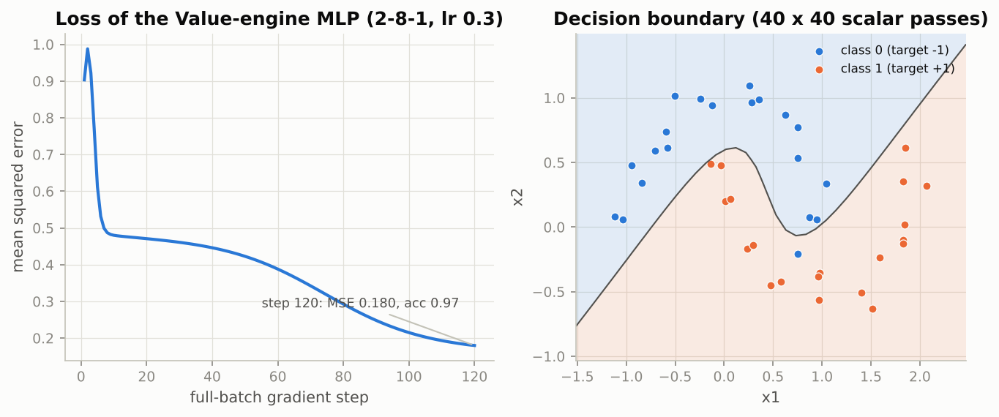

*The loss sits on a plateau around 0.47 (a nearly straight boundary) for forty steps before the hidden units bend the boundary around the moons and the accuracy climbs to 0.975.*

### Real-world examples

- Andrej Karpathy's micrograd, the model for this section, is roughly 100 lines and is the standard teaching implementation of backpropagation; the same design (data, grad, children, local backward) appears in every framework's documentation of custom operations.
- Early automatic-differentiation tools for scientific code (such as those used in computational fluid dynamics) worked exactly like this engine on scalars, which is why vectorised tensor frameworks were such a leap.
- The "duck typing" trick, where the same Python function runs on floats, `Value`s and tensors, is how PyTorch models are written as ordinary Python arithmetic.

### Examples for every subsection

- **3.1 Design.** `Value(2.0) * Value(-3.0)` returns a `Value` with data -6.0, children {a, b} and a closure that will add b·grad to a and a·grad to b.
- **3.2 Why a topological sort?** The post-order [10.0, 2.0, -3.0, -6.0, 4.0, 0.5, 2.0] guarantees that f = 4.0 is processed before e = -6.0, so e receives its complete adjoint 0.5 before passing it on.
- **3.3 Verification against finite differences and against PyTorch.** On `messy`, the engine and central differences agree to 4.2e-10; the notebook adds `torch.autograd` as a third column and all three match to six decimals.
- **3.4 A tiny MLP on the engine.** 33 parameters, 91 nodes per example, 2,516 nodes per full-batch step, accuracy 0.975 after 120 steps, and about TBD_ENGINE_RATIO times slower than the batched version.

### Common pitfalls

- Running the closures in creation order or in an arbitrary order: a node's gradient may be incomplete when it is passed on, giving wrong answers that look plausible.
- Forgetting to zero parameter gradients between steps: the second step uses the sum of two gradients.
- Expecting the engine to be fast: the per-example cost is a Python object per scalar operation, so even 40 points and 33 weights take tens of milliseconds per step.

## 4. `torch.autograd`

### In plain words

PyTorch's engine is the `Value` engine with tensors as nodes. Set `requires_grad=True` on the tensors you want derivatives for, compute a scalar loss from them, call `loss.backward()`, and read the gradients from `.grad` on the leaves. The rules to remember: gradients accumulate, so zero them before each backward; the graph is freed after `backward()` unless you ask to keep it; wrap evaluation and parameter updates in `torch.no_grad()`; `detach()` turns a tensor into a constant; and never modify in place a tensor the backward pass still needs, because autograd checks a version counter and refuses. On top of the basic loop, `backward(v)` computes vector-Jacobian products, `torch.autograd.grad(..., create_graph=True)` gives higher derivatives, `torch.func` gives whole Jacobians and Hessians, and a custom `autograd.Function` lets you write your own backward rule and check it with `gradcheck`.

### Sample data

| example | input | what the notebook computes |
|---|---|---|
| accumulation | x = 3, y = x·x + x | `x.grad` after 1 to 4 backward calls |
| tanh | x in {-2, -1, 0, 1, 2} | tanh, tanh', tanh'' |
| vector output | x = [1, 2, 3], y = [x0·x1, x1² + x2, 10·x0·x2] | Jacobian rows by vector-Jacobian products |
| quadratic | A = [[2, 1, 0], [0, 3, 1], [1, 0, 4]], x0 = [1, -1, 2] | gradient and Hessian of ½ xᵀAx |
| softplus | x in {-20, 0, 20, 88, 89, 100} | naive versus stable formula in float32 |

### Worked example

**Accumulation.** For y = x·x + x at x = 3, `x.grad` after backward calls 1 to 4 without zeroing is [7, 14, 21, 28]; with `x.grad = 0` before each call it is [7, 7, 7, 7]. This is why every training loop zeroes gradients (`p.grad = None` or `optimizer.zero_grad()`).

**Higher-order derivatives.** With `create_graph=True` the gradient is itself differentiable, so tanh can be differentiated twice. Finite differences confirm tanh' = 1 − tanh² to 3.3e-11:

| x | tanh | tanh' | tanh'' |
|---|---|---|---|
| -2 | -0.9640 | 0.0707 | 0.1362 |
| -1 | -0.7616 | 0.4200 | 0.6397 |
| 0 | 0.0000 | 1.0000 | 0.0000 |
| 1 | 0.7616 | 0.4200 | -0.6397 |
| 2 | 0.9640 | 0.0707 | -0.1362 |

The slope is largest at 0 (tanh' = 1), and the second derivative peaks at x = ±0.6585 with value ∓0.7698: those are the points where the activation bends most.

**Vector-Jacobian products.** For y = f(x) = [x0·x1, x1² + x2, 10·x0·x2] at x = [1, 2, 3], y = [2, 7, 30] and the Jacobian is

$$
J = \begin{pmatrix} 2 & 1 & 0 \\ 0 & 4 & 1 \\ 30 & 0 & 10 \end{pmatrix},
$$

which finite differences confirm to 3.2e-09. `y.backward(v)` deposits $v^\top J$ in `x.grad`: v = [1, 0, 0] gives row 0, [2, 1, 0]; v = [0, 1, 0] gives row 1, [0, 4, 1]; v = [1, 1, 1] gives the column sums [32, 5, 11], the gradient of `y.sum()`. Three one-hot VJPs rebuild the whole matrix, which is what `torch.func.jacrev` does in one vectorised call.

**Hessian of a quadratic.** For f(x) = ½ xᵀAx with the A above and x0 = [1, -1, 2]: f = 10.0, the gradient is ½(A + Aᵀ)x0 = [2.5, -1.5, 8], and the Hessian is ½(A + Aᵀ) = [[2, 0.5, 0.5], [0.5, 3, 0.5], [0.5, 0.5, 4]], symmetric even though A is not.

**Version counter.** sigmoid saves its *output* s because its derivative is s(1 − s): at x = 0.5, s = 0.622459 and s(1 − s) = 0.235004. If s is then multiplied in place, the saved tensor is wrong and autograd raises an error rather than using it.

**Custom Function: a stable softplus.** float32 cannot hold exp(x) for x > 88.72, so the naive log(1 + exp(x)) overflows:

| x | naive log(1 + eˣ) | stable max(x, 0) + log1p(e^(−|x|)) | sigmoid(x) = derivative |
|---|---|---|---|
| -20 | 0.0000 | 0.0000 | 0.000000 |
| 0 | 0.6931 | 0.6931 | 0.500000 |
| 20 | 20.0000 | 20.0000 | 1.000000 |
| 88 | 88.0000 | 88.0000 | 1.000000 |
| 89 | inf | 89.0000 | 1.000000 |
| 100 | inf | 100.0000 | 1.000000 |

The hand-written backward multiplies the upstream gradient by sigmoid(x); finite differences of the stable softplus at x = [-3, -0.5, 0, 2] give [0.047426, 0.377541, 0.5, 0.880797], exactly the sigmoid values. For the swish exercise, the product rule gives swish'(x) = s(1 + x(1 − s)); at x = [-2, 0, 1.5] both the formula and finite differences give [-0.090784, 0.5, 1.041294].

### Chart

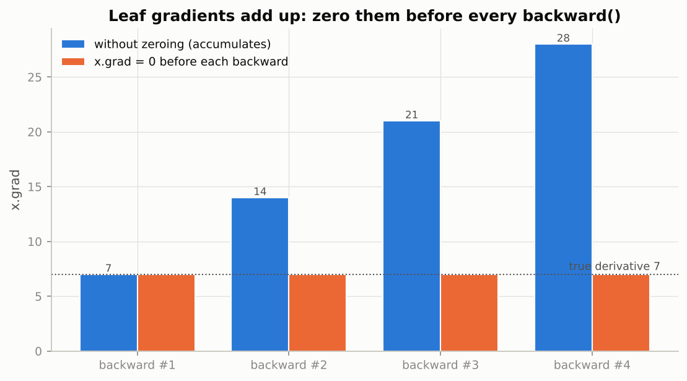

*Without zeroing, each backward adds another 7 to `x.grad`; with zeroing, every call returns the true derivative.*

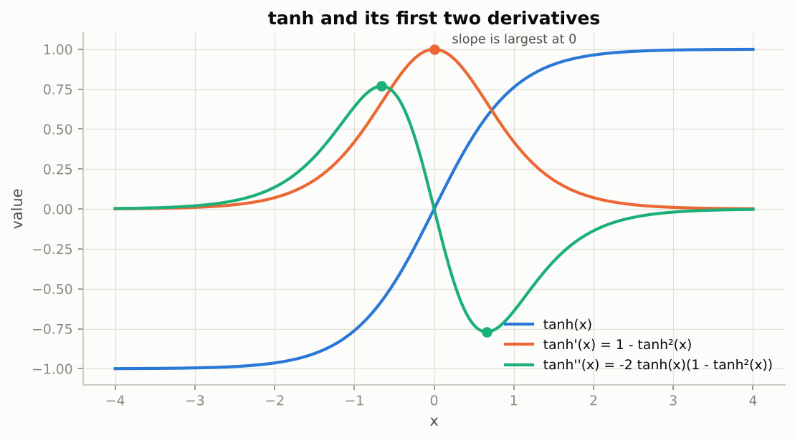

*The first derivative peaks at 1 where tanh is steepest, and the second derivative changes sign at 0, which is what `create_graph=True` lets autograd compute.*

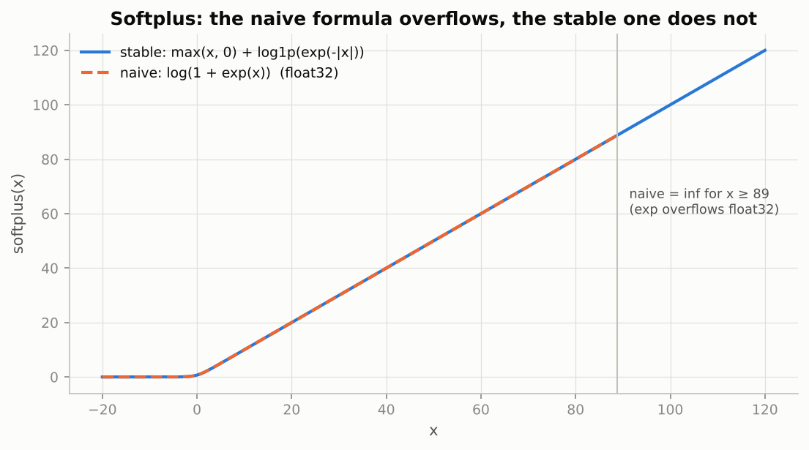

*The two formulas agree exactly until x = 89, where exp overflows float32 and the naive curve becomes infinite while the stable one keeps climbing.*

### Real-world examples

- Gradient accumulation over several mini-batches, used to train large language models on limited GPU memory, relies on `.grad` adding up between `optimizer.step()` calls.
- Gradient penalties in GAN training (Notebook 12) and physics-informed networks need the derivative of a gradient, which is `torch.autograd.grad(..., create_graph=True)`.
- Per-example gradients from `torch.func.vmap(grad(...))` are the basic quantity of differentially private training, where each example's gradient is clipped before averaging.
- Straight-through estimators in quantization-aware training (Notebook 15) are custom `autograd.Function`s whose backward deliberately ignores the rounding in the forward.

### Examples for every subsection

- **4.1 `requires_grad`, `backward()` and `.grad`.** For y = x³ + 2x at x = 2 the notebook gets `x.grad` = 14; for a loss ((XW)²).sum() the gradient 2Xᵀ(XW) lands in `W.grad` with W's shape.
- **4.2 Gradients accumulate — so we zero them.** Four backward calls on y = x·x + x without zeroing give `x.grad` = 7, 14, 21, 28; the chart above.
- **4.3 Leaf and non-leaf tensors, `retain_grad` and `retain_graph`.** h = 3x is a non-leaf, so its gradient is dropped unless `h.retain_grad()` is called; a third `backward()` after one `retain_graph=True` call raises "Trying to backward through the graph a second time".
- **4.4 Turning autograd off: `torch.no_grad`, `detach` and `requires_grad_`.** `w -= 0.1 * g` on a leaf outside `no_grad` raises an error; inside `with torch.no_grad():` it is the parameter update of every training loop.
- **4.5 Non-scalar outputs and vector-Jacobian products.** `y.backward(torch.tensor([1., 0., 0.]))` gives row 0 of the Jacobian, [2, 1, 0]; three such calls rebuild J.
- **4.6 `torch.autograd.grad` and higher-order derivatives.** Differentiating tanh twice gives tanh'' = -0.6397 at x = 1; the notebook does the same for sin(x)·exp(−x²/4) up to the third derivative.
- **4.7 `torch.func`: Jacobians and Hessians as function transforms.** `torch.func.hessian` of ½ xᵀAx returns ½(A + Aᵀ) = [[2, 0.5, 0.5], [0.5, 3, 0.5], [0.5, 0.5, 4]]; `vmap(grad(loss))` gives one gradient per example.
- **4.8 In-place operations and the version counter.** `s = sigmoid(x); s.mul_(2)` then `s.sum().backward()` fails because sigmoid saved s (its derivative is s(1 − s) = 0.235004 at x = 0.5); `s * 2` works.
- **4.9 A custom `torch.autograd.Function`.** The stable softplus returns 89.0000 at x = 89 where the naive formula returns inf, and its backward (the sigmoid) passes `gradcheck`.

### Common pitfalls

- Reading `.grad` of a non-leaf and getting `None`: call `retain_grad()` first, or use `torch.autograd.grad`.
- Calling `backward()` twice on one graph without `retain_graph=True`.
- Updating parameters outside `torch.no_grad()`, or forgetting to zero gradients.
- Masked assignment such as `h[h < 0] = 0` on a tensor that tanh or sigmoid saved: use `torch.where` or `clamp` instead.

## 5. Training with raw tensors and autograd

### In plain words

Everything needed to train a model is now in place, and this section uses only tensors and autograd so that every moving part is visible. Parameters are tensors with `requires_grad=True`; the forward pass is ordinary arithmetic; the loss is a scalar; `backward()` fills the gradients; the update subtracts a small multiple of each gradient under `no_grad`; and the gradients are reset. The same loop fits a straight line (where the answer can be checked against least squares), a logistic classifier on two moons (where a straight boundary is simply the wrong model, 84% is its ceiling), and the full 784-256-128-10 MNIST network of Notebook 02, now in about forty lines instead of a hundred and fifty.

### Sample data

Eight points generated from y = 3x − 2 plus Gaussian noise of standard deviation 0.5 (seed 3), rounded to two decimals.

| x | y |
|---|---|
| -1.66 | -7.41 |
| -1.05 | -3.49 |
| 1.21 | 1.74 |
| 0.33 | -1.19 |
| -1.62 | -7.00 |
| -0.27 | -3.14 |
| -0.08 | -2.77 |
| -1.36 | -6.28 |

### Worked example

**Linear regression by hand.** Least squares gives w = 2.9533, b = -2.0312 (close to the true 3 and -2; the noise moves them). Gradient descent starts at w = b = 0 with learning rate 0.1. The loss is the mean squared error, and its gradients are the averages dL/dw = mean(2(ŷ − y)x) and dL/db = mean(2(ŷ − y)).

| step | loss before the step | dL/dw | dL/db | w after | b after |
|---|---|---|---|---|---|
| 1 | 22.1879 | -9.6570 | 7.3850 | 0.9657 | -0.7385 |
| 2 | 9.9199 | -6.4157 | 4.8216 | 1.6073 | -1.2207 |
| 3 | 4.5732 | -4.2719 | 3.1355 | 2.0345 | -1.5342 |
| 10 | 0.4443 | | | 2.8574 | -2.0612 |
| 50 | 0.4272 | | | 2.9528 | -2.0319 |
| 100 | 0.4272 | | | 2.9533 | -2.0312 |
| 200 | 0.4272 | | | 2.9533 | -2.0312 |

For example, step 1 updates w to 0 − 0.1 × (−9.6570) = 0.9657. After 200 steps the difference from the least-squares solution is 1.4e-11 in w and 1.7e-11 in b. The least-squares MSE, TBD_LSFLOOR, is the floor the loss cannot go below because of the noise; the loss sits TBD_EXCESS1 above it at step 1 and only TBD_EXCESS10 above it at step 10.

**Logistic regression on two moons** (400 points, noise 0.2, seed 42, learning rate 0.5, 500 full-batch steps). At w = b = 0 the binary cross-entropy is log 2 = 0.6931. Then:

| step | BCE | train accuracy |
|---|---|---|
| 125 | 0.3182 | 0.8375 |
| 250 | 0.3084 | 0.8400 |
| 375 | 0.3066 | 0.8375 |
| 500 | 0.3062 | 0.8375 |

The final line is w = [1.2355, -4.3171], b = 0.4617, and it classifies 335 of 400 points correctly (83.75%). The first three points get probabilities [0.133, 0.944, 0.252] for class 1 with true labels [1, 1, 0]: the first point is on the wrong side. No straight line does better; the tips of the moons need a hidden layer.

**The MNIST MLP, parameter by parameter.** The 784-256-128-10 network is six tensors: W1 (784 × 256) = 200,704 weights plus 256 biases, W2 (256 × 128) = 32,768 plus 128, W3 (128 × 10) = 1,280 plus 10, a total of 235,146 parameters. He initialisation scales each weight matrix by sqrt(2/fan-in): 0.0505 for fan-in 784, 0.0884 for 256, 0.1250 for 128. With batches of 64 an epoch over 55,000 training images is 860 steps (157 steps for the 10,000-image `FAST_RUN` subset). Adding a 64-unit layer (784-256-128-64-10) makes 8 tensors and 242,762 parameters, and changes nothing in the backward pass.

### Chart

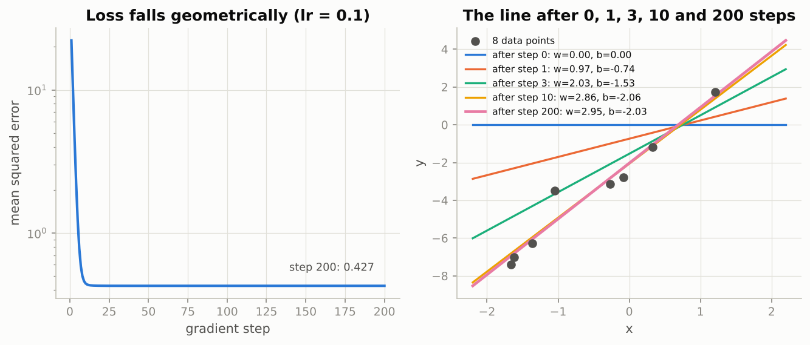

*The line swings from flat to the least-squares fit within ten steps, and the loss above its noise floor falls by a constant factor per step, a straight line on the log axis.*

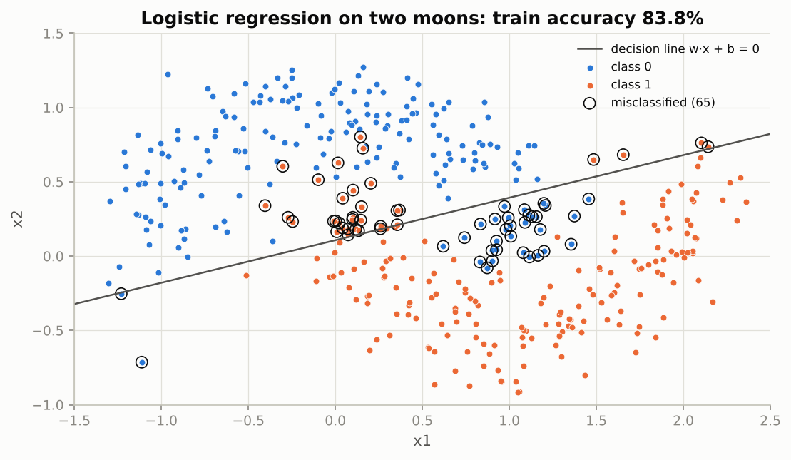

*The best straight line still misclassifies 65 of 400 points, all near the tips of the crescents: the model, not the optimiser, is the limit.*

### Real-world examples

- Linear regression with gradient descent is how a house-price or demand-forecast baseline is fitted when the data is too large for the normal equations to be convenient.
- Logistic regression on a few engineered features is still the model behind many credit-scoring and spam-filter systems, and the stable `binary_cross_entropy_with_logits` form is what production code uses.
- The MNIST-style MLP is the architecture behind early handwriting readers for postal codes and cheques; the same loop with a convolutional model (Notebook 06) is what reads them today.
- "Keep the whole dataset on the GPU and slice mini-batches from a permutation" is the fastest input pipeline for any dataset that fits in memory, used in tabular-data competitions.

### Examples for every subsection

- **5.1 Linear regression.** Starting from w = b = 0, three steps with learning rate 0.1 reach w = 2.0345, b = -1.5342; two hundred steps reach the least-squares values 2.9533 and -2.0312 to eleven decimals.
- **5.2 Logistic regression.** The learned line w = [1.2355, -4.3171], b = 0.4617 gets 335 of 400 moons points right (83.75%), down from BCE 0.6931 to 0.3062.
- **5.3 The MNIST MLP, rewritten with tensors and autograd.** Six tensors, 235,146 parameters, He scales 0.0505 / 0.0884 / 0.1250, 860 steps per epoch; the notebook reports about 97 to 98% test accuracy after five epochs.

### Common pitfalls

- Applying a sigmoid and then `binary_cross_entropy` instead of `binary_cross_entropy_with_logits`: the separate version can produce log(0).
- Comparing `w.grad` shapes: a (1, 1) weight and a (1,) bias broadcast fine, but a (N,) prediction minus an (N, 1) target silently produces an (N, N) loss matrix.
- Measuring CPU versus GPU time with tiny batches: the GPU wins only when the matrix products are large.

## 6. Preview: `nn.Module` and `torch.optim`

### In plain words

The raw-tensor loop still makes you create and initialise every parameter, pass the list around, loop over it for the update and reset the gradients by hand. `nn.Module` bundles parameters with a `forward` method (and `nn.Linear`, `nn.Sequential` build the common pieces for you), while a `torch.optim` optimizer takes the parameter list once and then provides `step()` for the update and `zero_grad()` for the reset. Nothing new is computed: a module's parameters are tensors with `requires_grad=True`, and `optimizer.step()` is the `p -= lr * p.grad` loop. The payoff is that swapping the update rule is a one-line change, and the same loop reads the same whether the model has two layers or fifty.

### Sample data

Eight points from y = 3x − 2 plus noise, but with x drawn from [1, 5] instead of [-2, 2], so slope and intercept are entangled and the problem is ill-conditioned.

| x | 1.34 | 1.95 | 4.21 | 3.33 | 1.38 | 2.73 | 2.92 | 1.64 |
|---|---|---|---|---|---|---|---|---|
| y | 1.59 | 5.51 | 10.74 | 7.81 | 2.00 | 5.86 | 6.23 | 2.72 |

### Worked example

Least squares gives w = 2.9533, b = -1.8913 and a minimum MSE of 0.4272. The Hessian of the loss has eigenvalues 0.240 and 15.506, a condition number of 65, so plain gradient descent is stable only for learning rates below 2/15.51 = 0.129: at learning rate 0.15 the loss is 5.67e+03 after ten steps and 2.01e+50 after two hundred. Three update rules, each a one-line swap in the same loop, measured as the MSE above its minimum:

| optimizer | after 10 steps | after 50 | after 100 | after 200 |
|---|---|---|---|---|
| SGD, lr 0.1 | 0.6009 | 0.08571 | 0.007525 | 5.801e-05 |
| SGD + momentum 0.9, lr 0.03 | 12.92 | 0.1402 | 9.261e-05 | 1.361e-08 |
| Adam, lr 0.3 | 5.116 | 0.4864 | 0.01557 | 3.66e-07 |

Plain SGD is held back by the slow direction (eigenvalue 0.240) and is still 5.8e-05 above the minimum after 200 steps. Momentum overshoots at first (12.92 after ten steps) but ends four orders of magnitude lower; Adam's per-parameter step sizes make it insensitive to the scale of x and land in between. Which rule wins depends on the problem (Notebook 04 treats this properly); what does not change is the loop.

### Chart

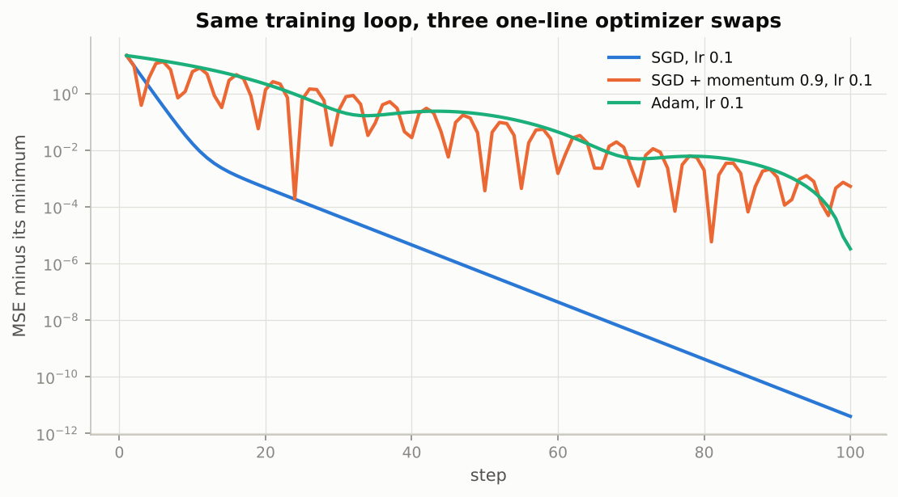

*Momentum (orange) oscillates but reaches the minimum fastest on this ill-conditioned fit; plain SGD (blue) is a straight, slow line; Adam (green) sits between them.*

### Real-world examples

- `nn.Sequential(nn.Linear, nn.ReLU, ...)` is the first model in most tabular-data pipelines, and `torch.optim.AdamW` is the default optimizer for training transformers.
- Any published PyTorch model, from torchvision's ResNet to a Hugging Face language model, is an `nn.Module` whose `parameters()` you hand to an optimizer in exactly the way this section previews.
- `model.train()` and `model.eval()` are the switch that turns dropout and batch normalisation on and off; forgetting `eval()` at inference time is a classic production bug (Notebook 04).

### Examples for every subsection

- **6 (no numbered subsections) · the `nn.Sequential` loop.** `nn.Sequential(nn.Linear(784, 256), nn.ReLU(), nn.Linear(256, 128), nn.ReLU(), nn.Linear(128, 10))` owns the same 235,146 parameters as the six raw tensors of Section 5.3, and `optimizer.step()` performs the same update.
- **6 (no numbered subsections) · a custom module.** `TwoLayerMLP` creates two `nn.Linear` layers in `__init__` and composes them in `forward`; its `named_parameters()` are leaves with `requires_grad=True`, exactly like the hand-made tensors.

### Common pitfalls

- Creating the optimizer before moving the model to the GPU with `.to(device)`: the optimizer then holds references to the old CPU parameters in some setups; create it after.
- Calling `optimizer.step()` before `loss.backward()`, or forgetting `optimizer.zero_grad()`: the gradients accumulate exactly as in Section 4.2.
- Assuming a fancier optimizer is always better: on the well-conditioned fit of Section 5.1 plain SGD at a good learning rate is already near-optimal.

## Exercises in plain words

- **Exercise 1 (warm-up): `sigmoid` and `softmax` for the `Value` engine.** Add a sigmoid with its own backward rule, and a softmax built only from `exp` and division. Useful because it shows that most functions need no backward of their own. Hint: copy the `tanh` method and replace the local derivative; for softmax, subtract the largest logit (a plain float) before exponentiating.
- **Exercise 2: a `Value`-based cross-entropy.** Compute the cross-entropy through a log-sum-exp instead of log(softmax). Useful because the gradient of this loss with respect to the logits has the famous form p − y, which you will see fall out of the engine. Hint: subtract the maximum logit, add it back after the log, and compare with `F.cross_entropy`.
- **Exercise 3: the Hessian of a quadratic with autograd.** Get the Hessian of ½ xᵀAx + bᵀx both with nested `torch.autograd.grad` calls and with `torch.func.hessian`. Useful for any second-order method or curvature analysis. Hint: compute the gradient with `create_graph=True`, then differentiate one component at a time with `retain_graph=True`.
- **Exercise 4: find the in-place bug.** A loss function with `h[h < 0] = 0` after a `tanh` fails on `backward()`. Useful because this is the most common in-place error in practice. Hint: which tensor does `tanh` save for its backward, and what does masked assignment do to its version counter?
- **Exercise 5 (challenge): a custom `Function` for the swish activation.** Implement swish(x) = x·sigmoid(x) with a hand-derived backward and verify it with `gradcheck`. Useful as a template for any custom operation. Hint: product rule plus sigmoid' = s(1 − s); the result simplifies to s(1 + x(1 − s)).

## Quick reference

| Concept | Formula or rule | In one sentence |
|---|---|---|
| Broadcasting | align shapes from the right; sizes must match or be 1 | size-1 dimensions are stretched virtually, missing ones count as 1 |
| View versus copy | `view`, `reshape`, `t()`, slicing share storage; `clone()` copies | writing into a view changes the original |
| Strides | element steps per dimension, (3, 1) for a contiguous 2 × 3 | a transpose swaps strides, (1, 3), without moving data |
| Chain rule along a path | $\partial L/\partial a = \partial L/\partial f \cdot \partial f/\partial e \cdot \partial e/\partial a$ | multiply local derivatives along the path, add over paths |
| Reverse mode | seed $\bar L = 1$, pass $\bar v \cdot \partial v/\partial u$ to each input u | one sweep gives the gradient of one output with respect to all inputs |
| Forward mode | seed $\dot a = 1$, push tangents forward | one sweep per input, all outputs at once |
| Vector-Jacobian product | `y.backward(v)` stores $v^\top J$ in `x.grad` | one-hot v extracts one row of the Jacobian |
| Gradient accumulation | `.grad += contribution` | zero gradients before every backward |
| Parameter update | `p -= lr * p.grad` under `torch.no_grad()` | in-place edits of leaves are only legal without recording |
| Version counter | saved tensor modified in place ⇒ error | use the out-of-place op or `clone()` |
| Stable softplus | $\max(x, 0) + \log(1 + e^{-\lvert x \rvert})$, derivative $\sigma(x)$ | the naive $\log(1 + e^x)$ overflows for x > 88.72 in float32 |
| Binary cross-entropy with logits | $\frac{1}{N}\sum_n [\operatorname{softplus}(z_n) - y_n z_n]$ | never apply sigmoid and then `binary_cross_entropy` separately |
| Hessian of a quadratic | $\nabla^2 \tfrac12 x^\top A x = \tfrac12 (A + A^\top)$ | symmetric even when A is not |
| He initialisation | weights scaled by $\sqrt{2/\text{fan-in}}$ | 0.0505 for fan-in 784, 0.0884 for 256, 0.1250 for 128 |
| SGD stability on a quadratic | learning rate below $2/\lambda_{\max}$ | 0.129 for the Section 6 fit; 0.15 diverges |

## Glossary

- **Tensor**: a multi-dimensional array with a dtype, a shape, a device and optionally a record of how it was computed.
- **dtype**: the number format of every element; float32 by default, float64 for precise checks, float16 and bfloat16 for speed.
- **View**: a tensor that shares storage with another and differs only in shape, strides or offset.
- **Stride**: how many elements to skip in memory to move one step along a dimension.
- **Broadcasting**: the rule that lets tensors of different but compatible shapes be combined element-wise without copying.
- **Computational graph**: the directed acyclic graph of elementary operations that produced a value.
- **Adjoint**: the derivative of the final output with respect to a node, written $\bar v$ and stored in `.grad`.
- **Reverse-mode AD**: computing all adjoints in one sweep from the output back to the inputs; backpropagation is this.
- **Forward-mode AD**: propagating the derivative with respect to one input alongside the values, one sweep per input.
- **Topological order**: a listing of a graph in which every node appears after all of its inputs.
- **Leaf tensor**: a tensor created directly by the user (such as a parameter); only leaves keep `.grad`.
- **Vector-Jacobian product**: $v^\top J$, what `backward(v)` computes without ever building the Jacobian.
- **Version counter**: the per-tensor count of in-place modifications that autograd compares against what it saved.
- **`autograd.Function`**: a user-defined operation with a `forward` and a hand-written `backward`.
- **Optimizer**: an object that owns the parameters and applies an update rule in `step()`, resetting gradients in `zero_grad()`.
