# 04 · Training Deep Networks: Optimization, Initialization, Normalization, Regularization — Companion Guide

> Plain-language companion to [`04_training_deep_networks.ipynb`](04_training_deep_networks.ipynb). Read a section here, then run the
> matching section of the notebook. All numbers below were computed with the script
> [`figures/scripts/make_figures_04.py`](figures/scripts/make_figures_04.py); all charts are its output.

## At a glance

- **What you learn**
  - Why a mini-batch gradient is a noisy but honest estimate of the true gradient, and how batch size and learning rate set the noise.
  - How momentum, Nesterov, AdaGrad, RMSProp, Adam and AdamW update the weights, written in a few lines each and checked against PyTorch.
  - Why the learning rate must change during a run, which schedules are standard, and how a range test picks the starting value.
  - Why the random starting weights decide whether a deep network can learn at all (the Xavier and He rules).
  - What BatchNorm and LayerNorm do, why they make training robust, and what goes wrong with tiny batches or a missing `model.eval()`.
  - How weight decay, dropout, early stopping, augmentation, label smoothing and clipping shrink the gap between training and validation.
  - How to read a loss curve, catch pipeline bugs in seconds, and search hyperparameters sensibly.
- **Where this is used in the real world**
  - Large language models (GPT-style and others) are trained with AdamW, linear warmup followed by cosine or linear decay, weight decay around 0.1 and gradient clipping at 1.0: Sections 2, 3 and 6 are literally their training recipe.
  - ImageNet classifiers such as ResNets are trained with SGD plus Nesterov momentum, step or cosine decay, He initialization, BatchNorm and random-crop augmentation; the same backbones power medical image screening (for example diabetic retinopathy or chest X-ray triage).
  - Every Transformer, from BERT to speech recognizers, uses LayerNorm because it needs no batch statistics and works with variable-length sequences.
  - Kaggle-style tabular models stop training on a validation metric with a patience rule (early stopping), the cheapest regularizer there is.
  - Machine-translation systems and the Inception image models use label smoothing of 0.1 to keep predictions calibrated.
  - Hyperparameter tuners such as Optuna, Ray Tune and cloud AutoML services sample learning rates log-uniformly and prune bad short runs, exactly the ideas of Section 8.

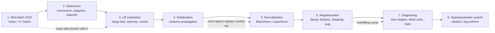

## 1. The loss landscape and stochastic gradient descent

### In plain words

Training means finding weights that make the average error on the training data small. The error as a function of the weights is a landscape, and gradient descent walks downhill on it. Computing the exact downhill direction needs every training example at every step, so instead we average the slope over a small random sample, the mini-batch. The sample's average is right on average but noisy; the noise shrinks with the square root of the batch size and grows with the learning rate. Small batches mean many cheap, noisy steps per pass over the data; large batches mean few, smooth, expensive steps. That trade-off, and what to do about the noise, is the theme of the whole notebook.

### Sample data

A toy regression with 256 examples generated as $y = 2x + 0.5\,\varepsilon$ (seed 1). The model is $\hat y = \theta x$ with loss $\tfrac12(\theta x - y)^2$, so the per-example gradient at $\theta = 0$ is $g_i = (\theta x_i - y_i)\,x_i = -y_i x_i$.

| example | $x$ | $y$ | $g_i$ at $\theta = 0$ |
|---|---|---|---|
| 1 | 0.346 | 0.256 | -0.089 |
| 2 | 0.822 | 1.682 | -1.382 |
| 3 | 0.330 | 0.883 | -0.292 |
| 4 | -1.303 | -2.721 | -3.546 |
| 5 | 0.905 | 1.379 | -1.249 |
| 6 | 0.446 | 1.203 | -0.537 |

### Worked example

1. The full-batch gradient is the mean of all 256 per-example gradients: $-1.682$. (The population value, with infinitely many examples, would be $-2.0$.)
2. A mini-batch made of examples 1 to 4 gives $(-0.089 - 1.382 - 0.292 - 3.546)/4 = -1.327$: same sign, same rough size, but off by about 0.36.
3. How noisy is the estimate? The standard deviation of a single-example gradient is $2.638$. Drawing 4000 random mini-batches of each size gives a standard deviation of the estimate of $2.638$ ($b = 1$), $1.303$ ($b = 4$), $0.648$ ($b = 16$), $0.283$ ($b = 64$) and $0.162$ ($b = 128$). The rule "single-example std divided by $\sqrt b$" predicts $2.638$, $1.319$, $0.659$, $0.330$, $0.233$: it matches up to $b = 16$ and is slightly pessimistic for large $b$ because batches are drawn without replacement from only 256 examples.
4. Training with the same learning rate $0.05$ for 6 epochs: batch 4 takes 64 steps per epoch (384 in total) and ends at $\theta = 1.961$; batch 16 takes 16 steps per epoch (96 in total) and ends at $\theta = 1.962$; batch 64 takes only 4 steps per epoch (24 in total) and has reached only $\theta = 1.288$, far from the optimum $2.0$.
5. The noise shows in the last epoch's mini-batch losses: batch 4 has mean $0.108$ with std $0.086$, batch 16 has the same mean $0.108$ with std $0.036$. Larger batch, same place, less jitter.

### Chart

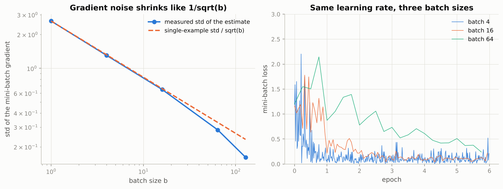

*Left: the measured noise follows the $1/\sqrt{b}$ line; right: at a fixed learning rate the batch-4 curve is a thick band, the batch-64 curve is smooth but has taken sixteen times fewer steps and is still far from converged.*

### Real-world examples

- Facebook's ImageNet-in-one-hour result trained ResNet-50 with a batch of 8192 images across 256 GPUs and multiplied the learning rate by the same factor as the batch (the linear scaling rule), with a short warmup to keep the first steps stable.
- Language models are trained on batches of millions of tokens; the batch size is chosen to fill the accelerators, and the learning rate is scaled accordingly.
- Recommender systems and ad-click models are updated from streaming mini-batches of recent user interactions: a true "stochastic" gradient over data that never fits in memory.

### Examples for every subsection

- **1.1 What we are minimizing.** For ten clothing classes the loss of a model that guesses uniformly is $\ln 10 \approx 2.303$; every training run in the notebook starts near that number, and a run that does not is a sign that the head or the loss is wrong.
- **1.2 Full-batch versus mini-batch gradients.** In the table above, four examples already give a gradient of $-1.327$ against the full-batch $-1.682$: good enough to move the right way at a fraction of the cost.
- **1.3 A common experimental harness.** The notebook keeps 20,000 FashionMNIST images (4,000 under `FAST_RUN`) in memory as standardized tensors, with the mean and std computed on the training subset only, so that every later experiment starts from the same data and the same initial weights.
- **1.4 SGD as a class with the `torch.optim` interface.** An optimizer needs only `zero_grad()` and `step()`; the notebook's base class loops over the parameters inside `torch.no_grad()` and calls a one-line `update`, `p.sub_(lr * g)` for plain SGD.
- **1.5 Experiment: the effect of batch size.** Our toy run reproduces the notebook's picture: batch 4 and batch 16 reach $\theta \approx 1.96$ after six epochs while batch 64, with only 24 updates, sits at $1.288$.

### Common pitfalls

- Changing the batch size without touching the learning rate: the noise level is set by the ratio of the two, so a bigger batch usually wants a proportionally bigger learning rate.
- Computing standardization statistics on all data (including validation and test) instead of the training subset only; it leaks information.
- Judging a method by one epoch of a tiny batch versus one epoch of a huge batch: the number of updates differs by the batch ratio.

## 2. Optimizers from scratch and compared

### In plain words

Plain SGD struggles in two situations: a long narrow valley, where the slope points across the valley and the walk zig-zags, and weights whose gradients differ in size by orders of magnitude, which one global learning rate cannot serve. Momentum fixes the first by keeping a velocity, a running sum of past gradients in which the back-and-forth components cancel and the consistent ones add up. Adaptive methods fix the second by dividing each weight's step by a running estimate of its gradient size, so every weight moves by roughly the learning rate per step. Adam does both and corrects the start-up bias of its running averages; AdamW adds weight decay in the only way that works correctly with adaptive steps. All of them are a handful of lines, and the notebook verifies each one against its `torch.optim` twin to floating-point precision.

### Sample data

Adam's running averages for a constant gradient $g = 1$ with $\beta_1 = 0.9$, $\beta_2 = 0.999$ (the notebook's cell 15, redone by hand):

| step $t$ | $m_t$ | $s_t$ | $\hat m_t$ | $\hat s_t$ | uncorrected $m_t/\sqrt{s_t}$ | corrected $\hat m_t/\sqrt{\hat s_t}$ |
|---|---|---|---|---|---|---|
| 1 | 0.1000 | 0.001000 | 1.000 | 1.0000 | 3.162 | 1.000 |
| 2 | 0.1900 | 0.001999 | 1.000 | 1.0000 | 4.250 | 1.000 |
| 3 | 0.2710 | 0.002997 | 1.000 | 1.0000 | 4.950 | 1.000 |

The second test problem is the badly conditioned bowl $f(x, y) = \tfrac12(x^2 + 20y^2)$ started at $(-9, 2)$, where the gradient is $(-9, 40)$ and $f = 80.5$.

### Worked example

**Adam's bias correction.** After one step $m_1 = 0.1 \cdot 1 = 0.1$ and $s_1 = 0.001 \cdot 1 = 0.001$. Without correction the normalized step would be $0.1/\sqrt{0.001} = 3.162$ times the learning rate, three times the intended size, and it would still be $4.950$ at step 3. Dividing $m_t$ by $1 - 0.9^t$ and $s_t$ by $1 - 0.999^t$ gives $\hat m_t = \hat s_t = 1$ at every step, so the normalized step is exactly $1$ from the first update.

**Plain SGD on the stretched bowl** with learning rate $0.09$, just below the stability limit $2/\kappa = 0.1$. Per step the $x$ coordinate is multiplied by $1 - 0.09 = 0.91$ and the $y$ coordinate by $1 - 0.09 \cdot 20 = -0.8$: it overshoots and shrinks by 20 percent each time.

| step | gradient | new $\theta$ | $f$ |
|---|---|---|---|
| 1 | $(-9.000, 40.000)$ | $(-8.190, -1.600)$ | 59.138 |
| 2 | $(-8.190, -32.000)$ | $(-7.453, 1.280)$ | 44.157 |
| 3 | $(-7.453, 25.600)$ | $(-6.782, -1.024)$ | 33.484 |

**All six methods, 100 steps each.** Momentum and Nesterov (learning rate $0.02$, more than four times smaller) are the first to get within distance 1 of the minimum, after 14 and 13 steps; SGD needs 24, Adam 32, RMSProp 44, AdaGrad 47. After 100 steps the final values of $f$ are SGD $2.6\cdot10^{-7}$, Nesterov $1.3\cdot10^{-4}$, Adam $1.7\cdot10^{-3}$, Momentum $1.8\cdot10^{-3}$, AdaGrad $8.0\cdot10^{-3}$ and RMSProp $2.2\cdot10^{-2}$: on a quadratic, SGD at the edge of stability eventually wins the precision contest, while RMSProp chatters at $y = 0.047$ because its normalized step never shrinks.

**Rosenbrock, 500 steps, distance to the minimum $(1, 1)$.** Momentum $0.094$ and Nesterov $0.110$ get furthest; RMSProp reaches $0.583$; SGD ($1.678$), AdaGrad ($1.470$) and Adam ($1.610$) are still far back on the valley floor. Adam is slow here because with $\beta_2 = 0.999$ it still remembers the huge gradients of the first steps. SGD survives a learning rate of $0.002$ for all 500 steps but diverges after 3 steps at $0.01$.

### Chart

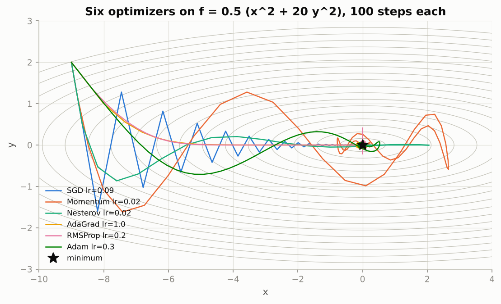

*SGD zig-zags across the steep direction, momentum overshoots and spirals in, and the adaptive methods walk to the valley floor and along it in nearly straight lines.*

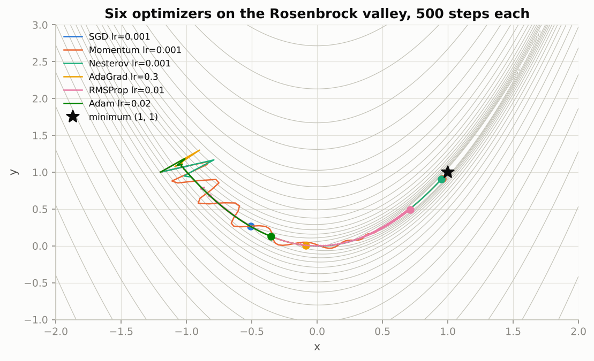

*On the curved valley the momentum methods travel furthest but bounce off the walls, RMSProp follows the bend steadily, and Adam advances slowly because its long second-moment memory keeps the normalized step small.*

### Real-world examples

- AdamW with $\beta_2 = 0.95$, weight decay 0.1 and learning rates near $10^{-4}$ is the published recipe of GPT-3-class language models; the decoupled decay of Section 2.6 is what makes the weight decay behave.
- ResNets and most ImageNet convolutional networks are trained with SGD plus Nesterov momentum 0.9 and weight decay $5\cdot10^{-4}$, which still gives slightly better final accuracy than Adam on those problems when tuned.
- AdaGrad was designed for sparse features: in text models with huge embedding tables, rare words get large steps and common words small ones.
- RMSProp was the optimizer of DeepMind's DQN Atari agents and of early recurrent language models, before Adam became standard.

### Examples for every subsection

- **2.1 Momentum.** On the bowl, Momentum's first step moves to $(-8.820, 1.200)$, barely more than SGD's along $x$, but 14 steps later it is already within distance 1 of the minimum because the velocity along $x$ kept growing.
- **2.2 Nesterov accelerated gradient.** Nesterov's first step lands at $(-8.658, 0.480)$ versus Momentum's $(-8.820, 1.200)$: the look-ahead already damps the cross-valley component, and Nesterov ends at $f = 1.3\cdot10^{-4}$ against Momentum's $1.8\cdot10^{-3}$.
- **2.3 AdaGrad: per-parameter learning rates.** AdaGrad's first step on the bowl is exactly $1.0$ in each coordinate (learning rate 1.0, gradient divided by its own size), to $(-8.000, 1.000)$; afterwards its accumulated denominators only grow and it is the last to reach distance 1 (47 steps).
- **2.4 RMSProp: forget the distant past.** RMSProp reaches the valley floor fast but ends at $y = 0.047$, chattering with an amplitude set by its learning rate 0.2 because its steps do not shrink near the minimum.
- **2.5 Adam: momentum plus RMSProp, with bias correction.** The table above: uncorrected ratios 3.162, 4.250, 4.950 versus the corrected 1.000 at every step.
- **2.6 AdamW: decoupled weight decay.** With decay folded into the gradient, a weight with gradient noise of std 100 is barely regularized (its expected value after 1000 steps is still about 9 in the notebook's demo), whereas AdamW multiplies every weight by $0.99$ per step regardless of its gradient.
- **2.7 Trajectories on two-dimensional test functions.** Rosenbrock distances after 500 steps: Momentum 0.094, Nesterov 0.110, RMSProp 0.583, AdaGrad 1.470, Adam 1.610, SGD 1.678.
- **2.8 Comparison on the FashionMNIST harness.** The notebook trains the same MLP from identical weights with all seven optimizers; the momentum methods and Adam reach a low loss fastest, but final validation accuracies are close.
- **2.9 The equivalent `torch.optim` calls.** The notebook's twenty-step comparison gives parameter gaps at the $10^{-7}$ level once the defaults that differ are set explicitly (`Adagrad(eps=1e-10)`, `RMSprop(alpha=0.99)`).

### Common pitfalls

- Reusing an SGD learning rate for Adam (or the reverse): $0.1$ for SGD and $10^{-3}$ for Adam are equally normal; $0.1$ for Adam usually diverges.
- Forgetting the bias correction when writing Adam yourself: the first steps come out about three times too large.
- Adding L2 regularization through the loss when using Adam: it gets divided by the gradient scale; use `torch.optim.AdamW` instead.

## 3. Learning-rate schedules

### In plain words

The learning rate that is right at the start is wrong at the end. Early on large steps save time; late in the run the mini-batch noise keeps the weights bouncing inside a ball whose radius is proportional to the learning rate, and the only way to settle is to shrink the step. A schedule is the rule for shrinking it: in stages (step decay), smoothly (exponential or cosine), after a short ramp-up (warmup), or in one rise-and-fall cycle. To choose the starting value, run a range test: let the learning rate grow geometrically over a few hundred mini-batches and watch the loss go flat, then fall, then explode; pick a value on the falling part.

### Sample data

Six schedules over 1000 steps with base learning rate $0.1$, evaluated at five checkpoints:

| schedule | step 0 | step 100 | step 300 | step 500 | step 999 |
|---|---|---|---|---|---|
| constant | 0.10000 | 0.10000 | 0.10000 | 0.10000 | 0.10000 |
| step (x0.1 every 300) | 0.10000 | 0.10000 | 0.01000 | 0.01000 | 0.00010 |
| exponential ($0.997^t$) | 0.10000 | 0.07405 | 0.04060 | 0.02226 | 0.00497 |
| cosine | 0.10000 | 0.09755 | 0.07939 | 0.05000 | 0.00000 |
| warmup 10% + cosine | 0.00100 | 0.10000 | 0.08830 | 0.05868 | 0.00000 |
| one-cycle | 0.00400 | 0.02800 | 0.10000 | 0.08117 | 0.00000 |

### Worked example

1. **Cosine** at the halfway point: $0.1 \cdot \tfrac12(1 + \cos(\pi \cdot 500/1000)) = 0.1 \cdot 0.5 = 0.05000$, exactly the table value; at the end it reaches 0.
2. **Step decay** multiplies by 0.1 at steps 300, 600 and 900, so the final learning rate is $0.1 \cdot 0.1^3 = 0.00010$. (The notebook's schedule with `step_size = 0.4 T` decays twice, at 40 and 80 percent of the run.)
3. **Warmup** starts at $0.1 \cdot 1/100 = 0.00100$ and reaches the full $0.10000$ at step 100, then follows a cosine to 0.
4. **One-cycle** with PyTorch's defaults starts at $0.1/25 = 0.00400$, peaks at exactly $0.10000$ at 30 percent of the run (step 300), and anneals to nearly zero.
5. **Range test** on a noisy 20-dimensional quadratic with momentum SGD, learning rate growing geometrically from $10^{-4}$: the smoothed loss starts at $2324.6$, falls to its minimum $123.37$ at learning rate $0.0891$, and the test stops after 122 steps at $0.106$ once the smoothed loss exceeds four times its best value. The suggested learning rate is one fifth of the minimum's, $0.0178$. For reference, the true stability limit of momentum SGD on this bowl is $2(1 + \beta)/\lambda_{\max} = 0.076$: the loss minimum of a range test sits right at the edge of instability, which is why one divides by 3 to 10.

### Chart

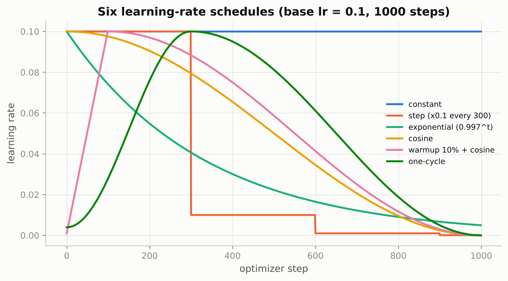

*Only the constant schedule ends where it started; the others finish at a small fraction of the base rate, by stairs, by a smooth curve, or after a warmup ramp or a one-cycle rise.*

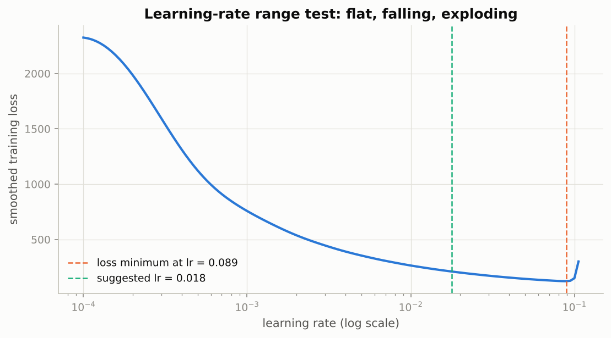

*The loss is flat while the learning rate is too small, falls through the useful range, and blows up just past the minimum, so the suggested value sits well to the left of the lowest point.*

### Real-world examples

- BERT, GPT and nearly every Transformer recipe use linear warmup for the first few percent of steps followed by cosine or linear decay; without warmup Adam's early steps are unreliable and training can diverge.
- The original ResNet ImageNet recipe divided the learning rate by 10 at epochs 30, 60 and 90: the classic step schedule.
- The one-cycle policy with a range test (popularized by fast.ai) won early DAWNBench speed competitions by reaching a target accuracy in a fraction of the usual epochs.
- `ReduceLROnPlateau` is the default choice in many Keras and tabular pipelines when the run length is unknown: it divides the rate when the validation loss stalls.

### Examples for every subsection

- **3.1 Why the learning rate should change during training.** The exponential schedule in the table has fallen to $0.00497$ by the last step, one twentieth of its start, which shrinks the noise ball to one twentieth of its radius.
- **3.2 The learning-rate range test.** Loss minimum at $0.0891$, suggested value $0.0178$, stop at $0.106$: three numbers from one short run.
- **3.3 Experiment: schedules compared at a fixed budget.** The notebook trains Nesterov SGD under five schedules for the same number of steps; the decaying ones finish with a visibly lower and smoother loss, and warmup makes no difference for an MLP with momentum SGD.

### Common pitfalls

- Forgetting `scheduler.step()`, or calling it once per epoch when the schedule was configured in steps: the learning rate never decays. Log `optimizer.param_groups[0]["lr"]`.
- Setting the cosine horizon longer than the run you actually do: a cosine interrupted halfway is a slowly decaying constant.
- Taking the learning rate at the minimum of the range-test curve instead of a few times below it.

## 4. Initialization

### In plain words

Each layer multiplies the spread of its signal by a factor that depends on how many inputs it sums and how large its weights are: the factor is (number of inputs) times (weight variance). If that factor is not close to one, ten layers turn a signal of size one into something either vanishingly small or astronomically large, and the gradients flowing back suffer the same fate. The Xavier rule sets the weight variance to $2/(n_{\text{in}} + n_{\text{out}})$ so the factor is about one for tanh-like activations; the He rule uses $2/n_{\text{in}}$ because a ReLU throws away half of each signal. Zero or identical weights fail for a different reason: all units in a layer would compute the same thing forever.

### Sample data

The five initializations of the notebook, for a layer with 256 inputs and 256 outputs:

| initialization | $\sigma_W$ | $n_{\text{in}}\sigma_W^2$ | std multiplier per linear layer |
|---|---|---|---|
| zero | 0.0000 | 0.0000 | 0.000 |
| small (std 0.01) | 0.0100 | 0.0256 | 0.160 |
| large (std 0.2) | 0.2000 | 10.2400 | 3.200 |
| Xavier | 0.0625 | 1.0000 | 1.000 |
| He | 0.0884 | 2.0000 | 1.414 |

### Worked example

1. For the "small" initialization each linear layer multiplies the std by $\sqrt{0.0256} = 0.160$, a shrink of about six per layer. Starting from inputs of std 1 in 784 dimensions, the first layer gives std $\sqrt{784 \cdot 10^{-4}} = 0.28$, and nine more layers give $0.28 \cdot 0.16^9 = 1.92\cdot10^{-8}$. The simulation through a tanh network measures $2.609\cdot10^{-1}$ after layer 1, $1.680\cdot10^{-4}$ after layer 5 and $1.738\cdot10^{-8}$ after layer 10: the hand calculation is right to within 10 percent.
2. For the "large" initialization in a ReLU network the std grows by $3.2/\sqrt2 \approx 2.26$ per layer (the ReLU halves the second moment): measured $3.272$, $85.18$, $4258$ after layers 1, 5, 10. In the tanh network the same weights saturate instead: the std sits at $0.927$, $0.849$, $0.850$, which looks healthy but means most activations are pinned at $\pm1$ where tanh has no slope.
3. **He with ReLU** stays flat: $0.826$, $0.821$, $0.692$. **Xavier with ReLU** loses the predicted $\sqrt2$ per layer: $0.717$, $0.178$, $0.027$. **Xavier with tanh** drifts slowly, $0.685$, $0.327$, $0.228$, a factor of three over ten layers, against a factor of $10^7$ for the small initialization.
4. Zero weights give exactly zero activations in every layer, for both activations.

### Chart

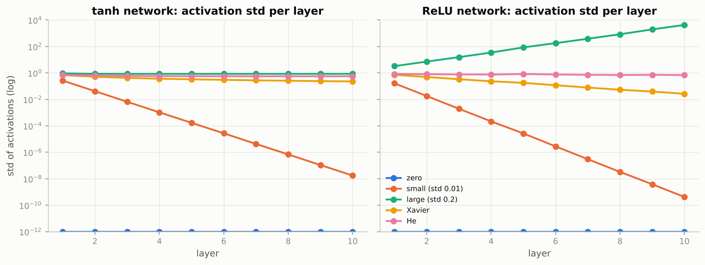

*The "small" line falls eight orders of magnitude in ten layers, the "large" ReLU line explodes, and only He (ReLU) and Xavier (tanh) stay near a constant scale.*

### Real-world examples

- The He initialization paper trained 30-layer ReLU networks that would not learn at all with Xavier scaling; the same rule is the default of every ResNet implementation.
- GPT-2 scales the initialization of its residual projections by $1/\sqrt{N}$ for $N$ residual layers, a depth-aware variant of the same variance argument.
- Older tanh-based networks and many embedding layers use Xavier (Glorot) uniform initialization, which is what `nn.init.xavier_uniform_` implements.
- PyTorch's `nn.Linear` default (variance $1/(3n_{\text{in}})$) is fine for shallow networks, which is why small MLPs train without anyone thinking about it, and fails for deep plain ones.

### Examples for every subsection

- **4.1 Why initialization matters: variance propagation.** The factor $n_{\text{in}}\sigma_W^2$ in the table is $0.0256$, $10.24$, $1.0$ and $2.0$ for small, large, Xavier and He weights: everything below follows from those four numbers.
- **4.2 Experiment: activations and gradients through a 10-layer network.** Measured std after ten tanh layers: small $1.738\cdot10^{-8}$, Xavier $0.228$, He $0.556$, large $0.850$ (saturated).
- **4.3 Vanishing and exploding gradients in a deep sigmoid network.** A sigmoid's slope is at most $1/4$, so even perfectly scaled weights shrink the backward signal by at least four per layer; the notebook's 20-layer sigmoid network loses roughly an order of magnitude of gradient every one to two layers.
- **4.4 Experiment: does the initialization change what a deep network learns?** In the notebook, the 10-layer ReLU MLP with He weights learns immediately, the one with std 0.01 sits on the $\ln 10$ plateau, and PyTorch's default (shrinking by about 2.4 per layer) starts late.

### Common pitfalls

- Using Xavier for a deep ReLU network: the signal halves in variance at every layer ($0.717 \to 0.027$ in ten layers above).
- Initializing all weights to zero or to the same constant: the units never become different (symmetry is never broken).
- Trusting a healthy-looking activation std: the saturated tanh network has std 0.85 but almost no gradient.

## 5. Normalization

### In plain words

Careful initialization fixes the scale of the activations only at the start; training moves the weights and the scale drifts. Batch Normalization fixes it by force: for each feature it subtracts the mean over the current mini-batch and divides by the standard deviation, then lets the network re-introduce any scale and shift it wants through two learned numbers. This smooths the loss landscape so much that deep networks train at learning rates that would otherwise diverge. The price is a dependence on the batch: at test time the layer must use running averages instead of batch statistics, so it behaves differently in `train()` and `eval()` mode, and very small batches give poor statistics. LayerNorm removes that dependence by normalizing each example across its own features, which is why Transformers use it.

### Sample data

A hand-typed batch of 4 examples with 3 features (rows are examples):

| example | feature 1 | feature 2 | feature 3 |
|---|---|---|---|
| 1 | 1 | 10 | 100 |
| 2 | 2 | 20 | 110 |
| 3 | 3 | 30 | 90 |
| 4 | 6 | 40 | 100 |

### Worked example

1. Batch means per feature: $(3, 25, 100)$. Biased batch variances: $(3.5, 125, 50)$.
2. Normalize each column: $\hat x = (x - \mu)/\sqrt{\sigma^2 + 10^{-5}}$. Example 1 becomes $(-1.069, -1.3416, 0)$, example 2 becomes $(-0.5345, -0.4472, 1.4142)$, example 3 becomes $(0, 0.4472, -1.4142)$, example 4 becomes $(1.6036, 1.3416, 0)$. Every column now has mean $0$ and std $1$.
3. With a learned scale $\gamma = (2, 1, 0.5)$ and shift $\beta = (0, 1, -1)$ the first row becomes $(-2.1381, -0.3416, -1.0)$: the network can put the features on any scale it likes.
4. Running statistics with momentum $0.1$, starting from mean $0$ and variance $1$: the stored variance uses the unbiased estimate $\sigma^2 \cdot 4/3 = (4.667, 166.667, 66.667)$, so after this one batch the running mean is $(0.3, 2.5, 10)$ and the running variance $(1.367, 17.567, 7.567)$. These are what `eval()` mode will use.
5. Why tiny batches hurt: for a feature with true mean 0 and variance 1, the std of the batch-mean estimate is $0.706$ at $B = 2$, $0.249$ at $B = 16$, $0.090$ at $B = 128$ and $0.063$ at $B = 256$ (the rule $1/\sqrt B$ gives $0.707$, $0.250$, $0.088$, $0.062$); the variance estimate is even noisier, $0.715$ at $B = 2$ and $0.088$ at $B = 256$.

### Chart

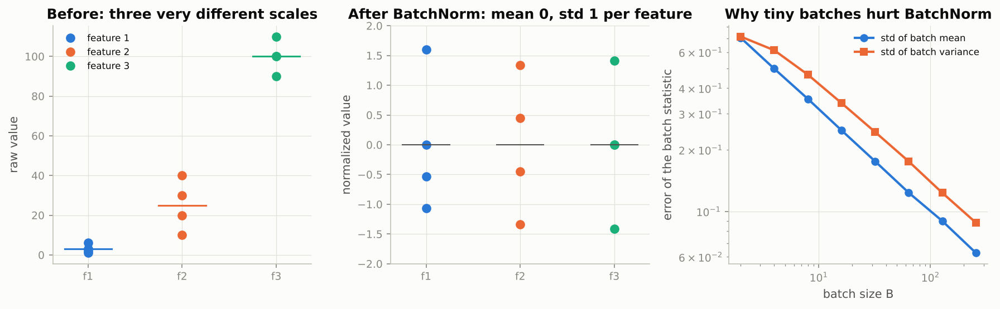

*Three features on scales of 1, 25 and 100 are mapped onto the same mean-0, std-1 scale, and the right panel shows how the batch statistics become unreliable as the batch shrinks.*

### Real-world examples

- ResNets, which have a BatchNorm layer after every convolution, are the standard backbone for medical imaging classifiers such as diabetic-retinopathy screening from retinal photographs and pneumonia detection on chest X-rays.
- Every Transformer (BERT, GPT, Whisper for speech) uses LayerNorm, because sequences in a batch have different lengths and inference often runs on a single example.
- Detection and segmentation models that process a few large images per GPU (Mask R-CNN style) use GroupNorm, which does not degrade when the batch is two or four.
- Style-transfer networks and image-to-image GANs use InstanceNorm, the one-group special case, so that each image is normalized on its own.

### Examples for every subsection

- **5.1 Batch Normalization: idea and equations.** The 4 by 3 batch above: means $(3, 25, 100)$, variances $(3.5, 125, 50)$, and the normalized row 1 is $(-1.069, -1.3416, 0)$.
- **5.2 BatchNorm from scratch, checked against `nn.BatchNorm1d`.** The stored variance is the unbiased one ($\times 4/3$ for four examples), which is why the running variance after one batch is $(1.367, 17.567, 7.567)$ and not $(1.25, 13.4, 5.9)$; the notebook's class matches PyTorch's to floating-point precision in both modes.
- **5.3 Experiment: trainability of deep networks and the allowable learning rate.** The notebook's 10-layer ReLU MLP at learning rate 0.5 typically diverges or stalls without normalization and trains comfortably with BatchNorm or LayerNorm.
- **5.4 The batch-size dependence of BatchNorm.** The batch-mean error of $0.706$ at $B = 2$ versus $0.063$ at $B = 256$ is why the notebook's accuracy collapses when a trained BatchNorm network is evaluated in training mode with batches of two.
- **5.5 LayerNorm and GroupNorm.** For a single token embedding of 64 numbers, LayerNorm subtracts the mean of those 64 and divides by their std; no other example is involved, so a batch of one works and nothing is stored.

### Common pitfalls

- Forgetting `model.eval()` before prediction: predictions then depend on the batch-mates, a single example raises an error, and every forward pass silently updates the running statistics.
- Putting dropout before BatchNorm: the variance differs between training and test, so the running variance is wrong at test time.
- Expecting BatchNorm to work with batches of two or four: use GroupNorm or LayerNorm instead.

## 6. Regularization

### In plain words

A network with hundreds of thousands of weights can memorize a few thousand training images perfectly, after which its training loss keeps falling while its error on new data rises: it has overfit. Regularization is everything that narrows the gap between training and validation performance, usually at the cost of a slightly worse fit on the training set. The tools are shrinking the weights (weight decay), randomly switching units off during training (dropout), stopping when the validation loss stops improving, showing randomly altered copies of the data (augmentation), softening the targets (label smoothing) and capping extreme gradients (clipping). Think of it as the bias-variance trade: a too-flexible model fits the noise of its particular training set, and every regularizer buys a lot of variance reduction for a little bias.

### Sample data

Twelve noisy points of $y = \sin(2\pi x) + 0.3\,\varepsilon$ (seed 7), the first six:

| point | $x$ | $y$ |
|---|---|---|
| 1 | 0.005 | 0.065 |
| 2 | 0.225 | 0.709 |
| 3 | 0.278 | 0.975 |
| 4 | 0.300 | 1.159 |
| 5 | 0.303 | 0.542 |
| 6 | 0.468 | 0.063 |

A dropout example: 12 activations $h = (0.99, 1.98, 0.98, 1.68, 1.80, 1.09, 1.16, 1.06, 0.66, 1.22, 0.86, 0.89)$ with mask $(0, 0, 1, 0, 0, 1, 1, 1, 1, 0, 0, 0)$ at $p = 0.5$.

### Worked example

**Capacity and overfitting.** Fitting polynomials of growing degree to the 12 points and scoring them on 200 fresh noisy test points:

| degree | 0 | 1 | 2 | 3 | 4 | 5 | 6 | 7 | 8 | 9 |
|---|---|---|---|---|---|---|---|---|---|---|
| train MSE | 0.8698 | 0.3173 | 0.2864 | 0.0461 | 0.0396 | 0.0313 | 0.0311 | 0.0297 | 0.0233 | 0.0224 |
| test MSE | 0.6518 | 0.2909 | 0.3163 | 0.1599 | 0.1834 | 0.1805 | 0.2143 | 0.4269 | 27.1416 | 16.3831 |

The training error only ever falls; the test error is lowest at degree 3 ($0.1599$, close to the noise floor $\sigma^2 = 0.09$) and then climbs to $16.38$ at degree 9, whose curve swings wildly between the points.

**Weight decay.** Adding an L2 penalty $\lambda$ to the degree-9 fit and sweeping $\lambda$: the best value $\lambda = 2.42\cdot10^{-1}$ brings the test MSE from $16.3831$ down to $0.1435$ (better than the unpenalized degree 3) while the norm of the coefficient vector drops from $612.5$ to $2.2$. Small weights, smooth function.

**Dropout.** With the mask above, 5 of 12 units are kept and each survivor is doubled: the output is $(0, 0, 1.96, 0, 0, 2.18, 2.32, 2.12, 1.32, 0, 0, 0)$. For this one small vector the mean falls from $1.198$ to $0.825$ (only five survivors), but the scaling is right on average: over 200,000 units of value 2.0, a fraction $0.499$ is zeroed and the output mean is $2.004$.

**Label smoothing.** For 10 classes and $\alpha = 0.1$ the target for true class 3 changes from $(0,0,0,1,0,\dots)$ to $0.91$ on class 3 and $0.01$ on each other class (sum 1.0). The smoothed loss is $0.5003$ when the network predicts exactly that distribution and $0.8298$ when it predicts $0.9991$ on the true class: overconfidence is now penalized.

### Chart

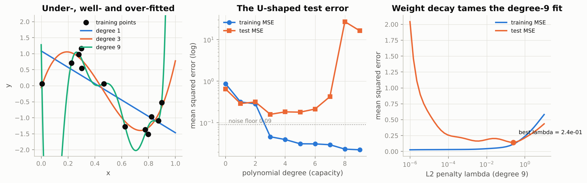

*Training error falls with capacity, test error is U-shaped with its minimum at degree 3, and a well-chosen L2 penalty rescues the degree-9 model.*

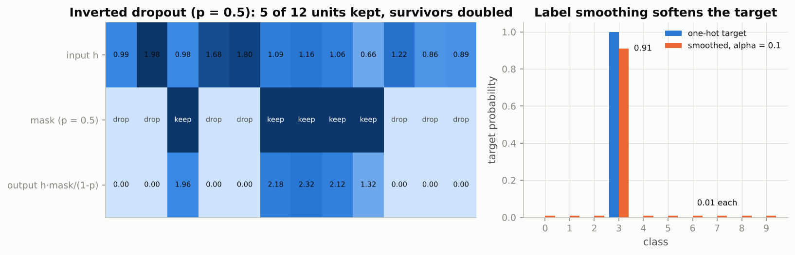

*Left: dropped units become zero and survivors are doubled; right: label smoothing moves 10 percent of the target mass from the true class to all classes equally.*

### Real-world examples

- In Kaggle-style tabular competitions nearly every winning neural network and gradient-boosting model is trained with early stopping on a validation metric, with a patience of a few rounds.
- Label smoothing of 0.1 was introduced with Inception-v3 for ImageNet and is part of the original Transformer machine-translation recipe, where it improved BLEU scores despite raising the perplexity.
- Gradient clipping by norm was introduced to tame exploding gradients in recurrent language models and is standard (clip at 1.0) in Transformer and LLM training.
- AlexNet's dropout of 0.5 in its fully connected layers was a key ingredient of the 2012 ImageNet result; modern convolutional networks rely on augmentation and BatchNorm instead.

### Examples for every subsection

- **6.1 Overfitting, seen in learning curves.** Degree 9 fits the 12 points with training MSE $0.0224$ and test MSE $16.38$: the textbook gap between training and held-out error.
- **6.2 L2 regularization and weight decay.** $\lambda = 0.242$ shrinks the degree-9 coefficient norm from $612.5$ to $2.2$ and the test MSE from $16.38$ to $0.1435$.
- **6.3 Dropout from scratch.** The mask above keeps 5 of 12 units and doubles them; over 200,000 units the fraction zeroed is $0.499$ and the mean is preserved ($2.004$ versus $2.0$).
- **6.4 Early stopping with a patience loop.** In the Section 7 simulation below, the validation loss is lowest at epoch 96 of 1500; a patience loop would have stopped soon after and kept those weights.
- **6.5 Data augmentation as regularization (a preview).** The notebook flips each FashionMNIST image horizontally with probability one half and shifts it by up to two pixels, so the network never sees the same pixels twice; a flipped shirt is still a shirt, a flipped digit 6 is not a 6.
- **6.6 Label smoothing.** Target $0.91$ on the true class and $0.01$ elsewhere; predicting $0.9991$ costs $0.8298$ instead of $0.5003$.
- **6.7 Gradient clipping.** The notebook multiplies the logits by 50 to create a gradient with norm in the hundreds; `clip_grad_norm_(max_norm=1.0)` rescales it to norm 1 without changing its direction.
- **6.8 The bias–variance view.** Degree 0 and 1 have high bias (test MSE $0.65$ and $0.29$ with similar training error), degree 8 and 9 have high variance (training error $0.02$, test error above 16); degree 3 balances the two.
- **6.9 Comparison experiment.** On the notebook's 2,000-image problem, augmentation is usually the single strongest regularizer and the combination of all four generalizes best, at the price of the lowest training accuracy.

### Common pitfalls

- Regularizing an underfitting model: if the training accuracy is already low, dropout and weight decay make it worse.
- Forgetting that the mean is preserved only in expectation: with few units a dropout layer's output mean swings (0.825 versus 1.198 above).
- Applying augmentations that change the label (flipping digits, rotating characters).

## 7. Diagnosing training

### In plain words

Most of the time in deep learning is spent looking at a loss curve and asking "is this normal?". A curve that barely moves means the learning rate is too low; one that shoots up and turns into infinity or NaN means it is too high; a flat line at the loss of random guessing that suddenly drops much later means the initialization is bad; training loss falling while validation loss rises is overfitting; both still high and falling means train longer or bigger. Two cheap checks catch most pipeline bugs: count ReLU units that never fire, and make sure the model can memorize a single mini-batch. NaN losses almost always come from a learning rate that is too high, a logarithm or division of zero, or an overflow.

### Sample data

The six simulated runs behind the chart (regression runs use the Section 1 data with batches of 16; the plateau run is a chain of 10 scalar weights; the overfitting run is a tiny network on 40 two-moons points):

| scenario | setting | key numbers |
|---|---|---|
| learning rate too low | SGD, lr 0.001, 96 steps | full-data loss $2.059 \to 1.727$ |
| learning rate too high | SGD, lr 3.0 | losses $2.1, 13.7, 134.1, 1060.5, 1064.0, \dots$ then non-finite after 26 steps |
| healthy | SGD, lr 0.05, 96 steps | below 0.3 after 24 steps, ends at $0.135$ |
| bad initialization | 10 weights at 0.5, product 0.00098 | flat within 1 percent of $0.499$ for 247 steps, below 0.1 at step 325 |
| overfitting | 64 hidden units, 1500 epochs | train $0.0067$, validation $1.723$, best validation $0.378$ at epoch 96 |
| underfitting / too short | same run, first 40 epochs | train $0.408$, validation $0.398$, both still falling |

### Worked example

1. **Too low.** With learning rate 0.001 the loss on all data moves from $2.059$ to $1.727$ in 96 steps; the thin mini-batch curve looks like pure noise around a slowly sinking line. Multiply the learning rate by 3 to 10.
2. **Too high.** With learning rate 3.0 the stability limit of this bowl (2 divided by the curvature, which is about 1) is passed; the loss reads $2.1$, $13.7$, $134.1$, $1060.5$ after the first four steps, reaches $2.55\cdot10^{11}$ and is non-finite after 26 steps. Divide the learning rate, add warmup, or clip.
3. **Bad initialization.** Ten weights of 0.5 multiplied together give $0.00098$, so every gradient is tiny: the loss stays within 1 percent of $0.499$ for 247 steps, then collapses below 0.1 at step 325 once the product has grown enough. In a deep network this is the plateau at $\ln K$.
4. **Overfit-one-batch check.** A correct model on 16 random examples goes from loss $2.445$ to $0.0004$ in 100 steps and $0.0001$ at step 300. With a softmax applied before the cross-entropy (which already contains one), the loss goes from $2.279$ to $1.4612$ and stays there, exactly the theoretical floor $-\ln\big(e/(e + 9)\big) = 1.4612$, because a softmax of numbers in $[0, 1]$ can never put more than $0.2320$ on one class.
5. **Overfitting.** The 64-unit network drives the training loss to $0.0067$ while the validation loss, lowest at $0.378$ after epoch 96, climbs to $1.723$ by epoch 1500: early stopping at epoch 96 would have kept the best model.

### Chart

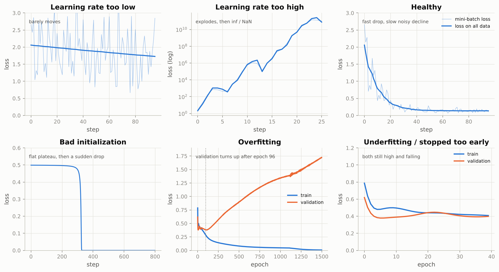

*Learn these shapes: a crawl, an explosion, a healthy drop with a shrinking noise band, a plateau followed by a cliff, a validation curve that turns upward, and two curves that are both still falling.*

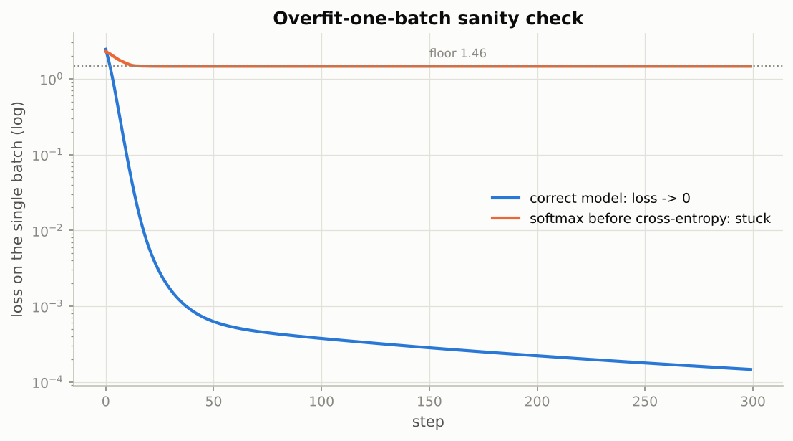

*A correct model memorizes 16 examples within a hundred steps; the double-softmax bug is stuck at the floor of 1.46 and would otherwise look like a model that "trains but never gets good".*

### Real-world examples

- Loss-curve dashboards (TensorBoard, Weights & Biases, MLflow) are the first thing any ML team opens; the shapes in the chart are what they look for.
- "Overfit a single batch first" is a standard step in published training checklists such as Karpathy's recipe for training neural networks.
- Large language-model training runs monitor the gradient norm and restart from a checkpoint, skipping the offending batches, when a loss spike appears; PaLM's technical report describes exactly this procedure.
- Mixed-precision training uses a loss scaler because float16 overflows at 65,504; a sudden NaN in a half-precision run is usually that overflow.

### Examples for every subsection

- **7.1 Reading loss curves.** Learning rate 0.001: $2.059 \to 1.727$; learning rate 0.05: $0.135$ with a visible noise band; learning rate 3.0: $10^{11}$ then NaN.
- **7.2 Dead ReLUs.** A ReLU unit whose pre-activation is negative for every input outputs zero and receives zero gradient; the notebook counts units that never fire on the validation set and finds many after a run with learning rate 3.0.
- **7.3 The "overfit one batch" sanity check.** Correct model $0.0001$ after 300 steps; double-softmax model stuck at $1.4612$.
- **7.4 NaN losses and their causes.** The learning-rate-3.0 run above becomes non-finite after 26 steps, the most common cause; the others are a log or division of zero, exploding gradients, float16 overflow and NaN already in the data.
- **7.5 A checklist.** Does the loss start near $\ln K$? Can the model overfit one batch? Right mode, gradients zeroed, labels correct, learning rate checked with a range test, dead units counted, then regularize or enlarge depending on which side is failing.

### Common pitfalls

- Comparing a training loss averaged over an epoch (while the model improves) with a validation loss measured at the end: the training value lags and can look worse than validation.
- Counting dead units on a network whose weights are already NaN: the count is meaningless; the NaN is the diagnosis.
- Leaving `torch.autograd.set_detect_anomaly(True)` on: it finds the first NaN but slows training a lot.

## 8. Hyperparameter search basics

### In plain words

Learning rate, weight decay, width, depth, dropout and batch size all have to be chosen, and each trial is a training run. Grid search tries every combination of a few values per knob, so with two knobs and nine trials it tries only three distinct values of each. Random search draws every knob afresh in every trial, so nine trials give nine distinct values of the one knob that really matters (usually the learning rate). Quantities like the learning rate live on a logarithmic scale and must be sampled by drawing the exponent, otherwise almost all draws land at the top of the range. Short runs serve as a proxy for long ones, decisions are made on the validation set, and the test set is used exactly once at the end.

### Sample data

Nine grid trials and nine random trials over an important and an unimportant hyperparameter, both in $[0, 1]$:

| trial | grid (important, unimportant) | random (important, unimportant) |
|---|---|---|
| 1 | (0.15, 0.15) | (0.82, 0.37) |
| 2 | (0.15, 0.50) | (0.69, 0.85) |
| 3 | (0.15, 0.85) | (0.64, 0.55) |
| 4 | (0.50, 0.15) | (0.75, 0.71) |
| 5 | (0.50, 0.50) | (0.47, 0.57) |
| 6 | (0.50, 0.85) | (0.74, 0.08) |
| 7 | (0.85, 0.15) | (0.64, 0.73) |
| 8 | (0.85, 0.50) | (0.40, 0.51) |
| 9 | (0.85, 0.85) | (0.24, 0.64) |

### Worked example

1. Project both sets onto the important axis: the grid tries 3 distinct values (0.15, 0.50, 0.85), the random set tries 9.
2. Suppose the score depends almost only on the important knob, peaking at 0.62 with a width of about 0.12. The best grid trial scores $0.365$ (its nearest value, 0.50, is a full width away); the best random trial scores $0.956$ (it has a point at 0.64).
3. Sampling scale: 2000 draws uniformly on $[10^{-4}, 10^{-1}]$ put $89.8$ percent above $10^{-2}$ and only $0.9$ percent below $10^{-3}$; log-uniform draws ($10^{U(-4,-1)}$) put $33.9$ percent above $10^{-2}$ and $33.6$ percent below $10^{-3}$, one third per decade.

### Chart

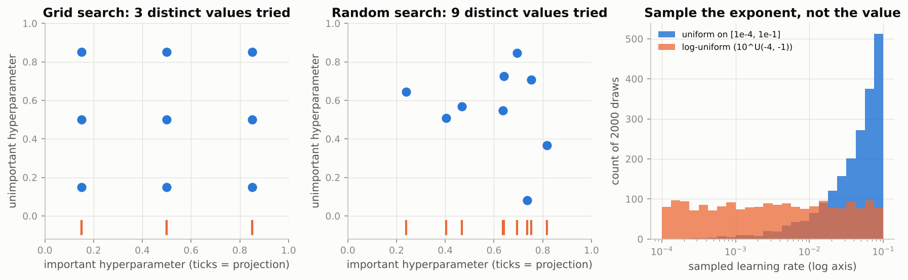

*Nine grid trials test only three values of the important knob while nine random trials test nine, and only log-uniform sampling spreads learning rates evenly across the decades.*

### Real-world examples

- Optuna, Ray Tune and Hyperopt all default to random or Bayesian sampling with log-scale distributions for learning rates, and prune unpromising short runs (the Hyperband and successive-halving ideas).
- Google's Vizier service, behind Vertex AI's hyperparameter tuning, runs Bayesian optimization on top of the same log-scale parameterization.
- Research papers on language models report learning-rate sweeps on log grids (for example $10^{-4}$, $3\cdot10^{-4}$, $10^{-3}$) with short proxy runs before committing to the full budget.

### Examples for every subsection

- **8.1 Grid search versus random search.** Nine trials: 3 distinct important values versus 9, and best scores $0.365$ versus $0.956$ on the toy objective.
- **8.2 Sampling on the right scale.** Uniform on $[10^{-4}, 10^{-1}]$: $89.8$ percent of draws above $10^{-2}$; log-uniform: $33.9$ percent, with another third per decade below.
- **8.3 A small random search on the harness.** The notebook draws the learning rate log-uniformly on $[10^{-4}, 10^{-1.5}]$, the weight decay on $[10^{-5}, 10^{-1}]$, a width from (128, 256, 512) and a dropout from (0, 0.2, 0.5), trains each configuration for a few epochs, retrains the best with the full budget and scores it once on the test set.

### Common pitfalls

- Sampling the learning rate uniformly: nine out of ten draws land in the top decade.
- Reading only the single best trial: its other settings may be luck; look at each hyperparameter's marginal effect.
- Touching the test set more than once; every look turns it into another validation set.

## Exercises in plain words

- **Exercise 1 (cosine annealing with warm restarts).** Write a learning-rate factor that follows a cosine from full to zero over a period, then restarts at full with the period doubled, and check it against PyTorch's `CosineAnnealingWarmRestarts`. Useful because restarts give the optimizer several low-learning-rate snapshots to choose from. Hint: subtract completed periods from the step count in a short loop until the remainder fits inside the current period.
- **Exercise 2 (Nadam).** Build Adam with Nesterov momentum by changing only the numerator of the Adam step to a look-ahead mix of the corrected momentum and the current gradient. Useful as a small consistent improvement over Adam. Hint: subclass the notebook's `Adam` and override `adam_step`; the rest stays the same.
- **Exercise 3 (the BatchNorm train/eval bug).** Write a prediction function that forgets `model.eval()` and watch three things go wrong: a single example raises an error, the same example gets different probabilities depending on its batch-mates, and the running statistics drift. Useful because this is one of the most common PyTorch bugs. Hint: run the buggy version on a `copy.deepcopy` of the model so the original stays intact.
- **Exercise 4 (DropConnect).** Drop individual weights instead of units: subclass `nn.Linear`, mask the weight matrix with probability $p$ during training and scale the survivors by $1/(1 - p)$. Useful for seeing that dropout is one member of a family of noise regularizers. Hint: sample the mask once per forward pass with `torch.rand_like(self.weight)` and use `F.linear`.
- **Exercise 5 (a reusable learning-rate finder).** Turn the range test into a class that saves the model and optimizer state, drives the learning rate through `param_groups`, suggests the point of steepest descent of the smoothed loss, and restores everything afterwards. Useful because "range test, then one-cycle" is a common recipe for a new problem. Hint: `np.gradient(losses, np.log10(lrs))` gives the slope in log-learning-rate space.

## Quick reference

| Concept | Formula or rule | In one sentence |
|---|---|---|
| Mini-batch gradient | $\hat g_B = \tfrac1b\sum_{i\in B}\nabla\ell_i$, std $\propto 1/\sqrt b$ | Unbiased but noisy; noise level set by learning rate over batch size. |
| SGD | $\theta \leftarrow \theta - \eta g$ | Step against the gradient. |
| Momentum | $v \leftarrow \beta v + g$, $\theta \leftarrow \theta - \eta v$ | Velocity accumulates consistent directions, memory about $1/(1-\beta)$ steps. |
| Nesterov | $\theta \leftarrow \theta - \eta(g + \beta v)$ | Momentum with a look-ahead, as in `SGD(nesterov=True)`. |
| AdaGrad | $G \leftarrow G + g^2$, $\theta \leftarrow \theta - \eta g/(\sqrt G + \epsilon)$ | Per-parameter rates that only shrink. |
| RMSProp | $s \leftarrow \rho s + (1-\rho)g^2$, $\theta \leftarrow \theta - \eta g/(\sqrt s + \epsilon)$ | Moving average of squared gradients; steps of roughly $\eta$. |
| Adam | $\hat m = m/(1-\beta_1^t)$, $\hat s = s/(1-\beta_2^t)$, $\theta \leftarrow \theta - \eta\hat m/(\sqrt{\hat s}+\epsilon)$ | Momentum plus RMSProp with bias correction; default $\eta = 10^{-3}$. |
| AdamW | $\theta \leftarrow (1 - \eta\lambda)\theta$, then the Adam step | Decoupled weight decay, $\lambda \in [0.01, 0.1]$. |
| Stability of GD on a quadratic | $\eta < 2/\lambda_{\max}$ | Steepest direction limits the learning rate; condition number $\kappa$ sets the slowdown. |
| Cosine schedule | $\eta_t = \tfrac12\eta_0(1 + \cos(\pi t/T))$ | Smooth decay to zero over the planned horizon $T$. |
| Warmup | $\eta_t = \eta_0\, t/T_w$ for $t < T_w$ | Linear ramp protecting the first steps, standard with Adam. |
| Range test | geometric increase of $\eta$, pick the falling part | Choose $\eta_0$ a few times below the loss minimum. |
| Variance propagation | $\mathrm{Var}(y) = n_{\text{in}}\sigma_W^2\sigma_x^2$ | The per-layer factor must be about 1. |
| Xavier / He | $\sigma_W^2 = 2/(n_{\text{in}} + n_{\text{out}})$ / $2/n_{\text{in}}$ | tanh-like / ReLU initializations. |
| BatchNorm | $\hat x = (x - \mu_B)/\sqrt{\sigma_B^2 + \epsilon}$, $y = \gamma\hat x + \beta$ | Per-feature over the batch; running stats in eval mode. |
| LayerNorm | same formula over the features of one example | No batch dependence; used in Transformers. |
| L2 / weight decay | $L + \tfrac{\lambda}{2}\|\theta\|^2$, $\theta \leftarrow (1-\eta\lambda)\theta - \eta g$ | Pull weights to zero; identical to decay only for SGD. |
| Inverted dropout | $\tilde h = m h/(1-p)$, $m \sim \text{Bernoulli}(1-p)$ | Expectation preserved; identity at eval time. |
| Label smoothing | $\tilde y = (1-\alpha)y + \alpha/K$ | Target $1 - \alpha + \alpha/K$ on the true class. |
| Gradient clipping | $g \leftarrow g\min(1, c/\|g\|_2)$ | Caps the norm, keeps the direction. |
| Bias-variance | error $=$ bias$^2$ $+$ variance $+$ noise | Regularizers trade a little bias for a lot of variance. |
| Random search | sample each knob independently, log-uniform for rates | Beats grid search for the same budget. |

## Glossary

- **Mini-batch**: a random subset of the training data used for one gradient estimate.
- **Learning rate**: the step-size multiplier applied to the gradient (or to the normalized update).
- **Momentum**: a running sum of past gradients that acts like the velocity of a heavy ball.
- **Adaptive method**: an optimizer that divides each parameter's step by an estimate of its gradient magnitude (AdaGrad, RMSProp, Adam).
- **Bias correction**: dividing Adam's moving averages by $1 - \beta^t$ so that they are not biased towards zero early on.
- **Weight decay**: multiplying the weights by a factor slightly below one at every step; decoupled in AdamW.
- **Schedule**: the rule by which the learning rate changes over the run (step, cosine, warmup, one-cycle).
- **Condition number**: the ratio of the largest to the smallest curvature of the loss; large values make plain gradient descent slow.
- **Variance propagation**: the per-layer multiplication of the signal variance by $n_{\text{in}}\sigma_W^2$, which fixes the initialization scale.
- **Vanishing / exploding gradient**: gradients shrinking or growing exponentially with depth because that factor is below or above one.
- **Running statistics**: the exponential moving averages of mean and variance that BatchNorm uses in evaluation mode.
- **Overfitting**: training loss keeps falling while the loss on new data rises.
- **Early stopping**: halting training when the validation loss has not improved for a set number of epochs and keeping the best weights.
- **Dead ReLU**: a unit whose pre-activation is negative for every input, so it outputs zero and receives no gradient.
- **Log-uniform sampling**: drawing an exponent uniformly and using $10^{u}$, so that each decade gets equal probability.
