# 05 · The PyTorch Workflow and Best Practices — Companion Guide

> Plain-language companion to [`05_pytorch_workflow_and_best_practices.ipynb`](05_pytorch_workflow_and_best_practices.ipynb). Read a section here, then run the
> matching section of the notebook. All numbers below were computed with the script
> [`figures/scripts/make_figures_05.py`](figures/scripts/make_figures_05.py); all charts are its output.

## At a glance

- **What you learn**
  - How a PyTorch model is organised: an `nn.Module` with parameters (trained), buffers (saved but not trained) and submodules, and what `state_dict` saves to disk.
  - How data reaches the model: a `Dataset` that answers "how many examples?" and "give me example i", and a `DataLoader` that shuffles, batches and collates.
  - A reusable training loop (`train_one_epoch`, `evaluate`, `fit`) with scheduling, gradient clipping, early stopping, best-model checkpoints and a history you can plot.
  - How to log runs to TensorBoard, save a checkpoint that can be resumed exactly, and seed every source of randomness.
  - A complete FashionMNIST project, how to read its errors, and how to debug shape errors, `nan`s and silent bugs.
  - How to move working notebook code into a small package with configs, scripts and tests.
- **Where this is used in the real world**
  - Model sharing: pretrained vision and language models (torchvision, the Hugging Face Hub) are distributed as `state_dict` style weight files that you load into a freshly built `nn.Module`.
  - Long training runs on shared clusters and spot or pre-emptible cloud machines are checkpointed every few minutes so that a killed job resumes where it stopped instead of restarting from zero.
  - Experiment tracking (TensorBoard, MLflow, Weights & Biases) is how ML teams compare dozens of runs, keep the configuration next to the result, and find the run that produced a number months later.
  - Medical and fraud classifiers face rare positive classes; weighted sampling and class-weighted losses keep the rare class from being ignored during training.
  - Regulated settings (medical devices, bank credit models) require that a reported result can be reproduced: fixed seeds, recorded library versions and saved configurations are part of the paperwork.
  - Interpretability tools such as Grad-CAM are built on forward and backward hooks, the same mechanism the notebook uses to inspect activations.

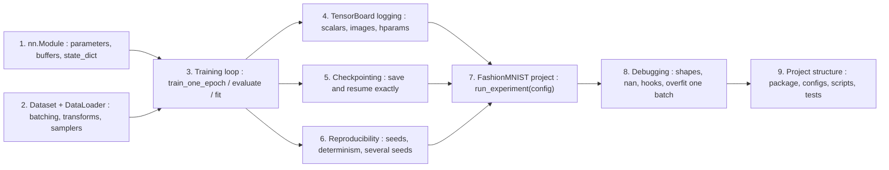

The loop at the centre of the notebook, as `fit` runs it every epoch:

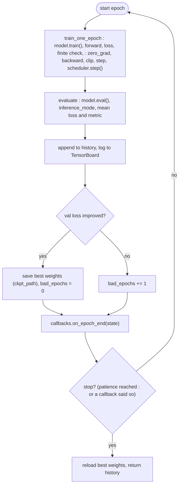

## 1. `nn.Module` anatomy

### In plain words

A PyTorch model is a Python object that knows three things about itself: which tensors are trained (parameters), which tensors travel with it but are never trained (buffers, such as BatchNorm's running mean), and which smaller modules it contains. You create those pieces in `__init__` and describe the computation in `forward`; everything else (finding parameters for the optimizer, moving to the GPU, saving, train/eval mode) is inherited and works only for pieces that were *registered* by being assigned as attributes or kept in `nn.ModuleList`/`nn.ModuleDict`. A plain Python list of layers is invisible: the model runs, but those layers are never trained or saved. `state_dict()` is the dictionary of all parameters and buffers, keyed by their path in the tree, and is what a weights file contains.

### Sample data

The `demo` module of Section 1.2 is `nn.Sequential(Standardize([0.5, 1.0], [2.0, 4.0]), nn.Linear(2, 3), nn.BatchNorm1d(3))`. Its `state_dict` has 9 entries (listed by the figure script from the module definition):

| key | shape | kind | values |
|---|---|---|---|
| `0.mean` | (2,) | buffer | 2 |
| `0.std` | (2,) | buffer | 2 |
| `1.weight` | (3, 2) | parameter | 6 |
| `1.bias` | (3,) | parameter | 3 |
| `2.weight` | (3,) | parameter | 3 |
| `2.bias` | (3,) | parameter | 3 |
| `2.running_mean` | (3,) | buffer | 3 |
| `2.running_var` | (3,) | buffer | 3 |
| `2.num_batches_tracked` | () | buffer | 1 |

15 values are parameters (seen by the optimizer) and 11 are buffers (saved and moved with the model, never trained).

### Worked example

Counting the parameters of `SmallCNN` layer by layer, with the rule "weights plus biases" (a 3x3 convolution from $c_{in}$ to $c_{out}$ channels has $9\,c_{in}\,c_{out} + c_{out}$ parameters; BatchNorm has a scale and a shift per channel):

| layer | formula | parameters | share |
|---|---|---|---|
| conv1, 1 to 32 channels | 9 x 1 x 32 + 32 | 320 | 0.1 % |
| bn1 | 2 x 32 | 64 | 0.0 % |
| conv2, 32 to 64 channels | 9 x 32 x 64 + 64 | 18,496 | 4.4 % |
| bn2 | 2 x 64 | 128 | 0.0 % |
| fc1, 3136 to 128 | 3136 x 128 + 128 | 401,536 | 95.2 % |
| fc2, 128 to 10 | 128 x 10 + 10 | 1,290 | 0.3 % |
| total | | 421,834 | |

The notebook's docstring says "~420k parameters" and `count_parameters` will print 421,834. For comparison, the default `MLP(512, 256)` has 535,818 parameters. The lesson of the table: 95 % of the CNN's parameters are in the first fully connected layer, which is why modern CNNs replace it with global average pooling (Notebook 06).

### Chart

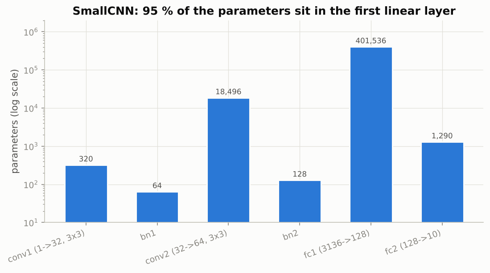

*On a log scale the first linear layer towers over everything else: the convolutions do the interesting work with a few thousand weights.*

### Real-world examples

- torchvision's pretrained ResNets and the models on the Hugging Face Hub are shipped as weight files that map `state_dict` keys to tensors; loading them is `model.load_state_dict(...)` into a freshly constructed module, exactly as in Section 1.2.
- Transformer implementations register their positional-encoding tables and attention masks as buffers, so they move to the GPU and are saved with the model without being trained.
- Shipping preprocessing inside the model, as the `Standardize` module does, is common in deployed tabular models: the serving code receives raw features and never has to remember the training-set statistics.
- Multi-task models (one shared body, several heads) use `nn.ModuleDict` so that each head is registered and trained; a plain dictionary of heads is the classic silent bug.

### Examples for every subsection

- **1.1 `__init__` and `forward`.** `MLP(hidden_dims=(256, 128), dropout=0.2)` builds Linear-ReLU-Dropout blocks from a tuple, flattens a (4, 1, 28, 28) batch itself and returns (4, 10) logits; calling `model(x)` rather than `model.forward(x)` is what makes hooks run.
- **1.2 Parameters, buffers and `state_dict`.** In the table above, `0.mean` and `0.std` are buffers: `.to(device)` moves them and `torch.save` keeps them, but `demo.parameters()` does not return them, so the optimizer never changes the standardisation.
- **1.3 Containers: `nn.Sequential`, `nn.ModuleList`, `nn.ModuleDict`.** `BrokenStack` keeps three `nn.Linear(8, 8)` layers in a Python list and reports 0 parameters and an empty `state_dict`; `FixedStack` uses `nn.ModuleList` and reports 3 x (64 + 8) = 216.
- **1.4 Initialization with `apply`, summaries and parameter counts.** `cnn.apply(init_weights)` visits every submodule and applies He initialisation to convolutions and linear layers; `torchinfo.summary(cnn, input_size=(1, 1, 28, 28))` prints the per-layer output shapes (28x28 to 14x14 to 7x7) and the counts of the table above.

### Common pitfalls

- Forgetting `super().__init__()`: attribute assignment then fails with a confusing error because the registries do not exist yet.
- Storing a constant tensor as a plain attribute: it stays on the CPU when the model moves to the GPU and is missing from the saved file. Use `register_buffer`.
- Trusting a printed architecture: always compare the parameter count and a dummy forward pass against what you expect.

## 2. Data: `Dataset` and `DataLoader`

### In plain words

A `Dataset` is any object with `__len__` and `__getitem__`; where the data lives and how it is decoded is your business. A `DataLoader` wraps it and produces mini-batches: a sampler chooses the order of indices (sequential, random, or weighted), a batch sampler groups them, and a collate function stacks the examples into tensors. The default collation works when all examples have the same shape; sequences of different lengths need a custom `collate_fn` that pads. Splitting correctly means two dataset objects, one with augmentation for training and one plain for validation, sharing a fixed index permutation, because `random_split` returns two views of the *same* object and therefore the same transform. When one class is rare, a `WeightedRandomSampler` with inverse-frequency weights makes every batch roughly balanced. Finally, data loading is often the real bottleneck; worker processes and caching tensors are the fixes.

### Sample data

The first 6 of the 500 rows of the notebook's synthetic table (`DATA_DIR/synthetic_table.csv`, generated with `np.random.default_rng(42)`, so the notebook prints the same numbers). The label is 1 when $f_0 + 0.5 f_3 + \text{noise} > 0$, with Gaussian noise of standard deviation 0.5:

| row | f0 | f1 | f2 | f3 | f4 | f0 + 0.5 f3 | label |
|---|---|---|---|---|---|---|---|
| 0 | 0.30 | 4.80 | 0.08 | -1.12 | -0.95 | -0.25 | 1 |
| 1 | -1.30 | 10.64 | -0.03 | -3.03 | 0.15 | -2.82 | 0 |
| 2 | 0.88 | 13.89 | 0.01 | -0.75 | 1.47 | 0.51 | 1 |
| 3 | -0.86 | 11.84 | -0.10 | -1.24 | 0.95 | -1.48 | 0 |
| 4 | -0.18 | 6.60 | 0.12 | -3.31 | 0.57 | -1.84 | 0 |
| 5 | -0.35 | 12.66 | 0.04 | -2.17 | 1.43 | -1.44 | 0 |

Row 0 has a negative score but label 1: the noise flipped it, which is why the task is not perfectly separable. Over all 500 rows there are 79 positives (15.8 %).

### Worked example

**Batching.** 500 rows with `batch_size=64` give 8 batches per epoch, the last one with 500 mod 64 = 52 rows; with `drop_last=True` there are 7.

**Imbalance.** The notebook keeps every row of class 0 and each row of class 1 with probability 0.05, which leaves 421 negatives and 6 positives (427 rows, 14 batches of 32). Inverse-frequency weights are 1/421 = 0.002375 per negative and 1/6 = 0.166667 per positive, so each class has total weight 1.0 and the sampler draws a positive with probability 0.50. The expected number of positives in a batch of 32 is 0.45 with plain shuffling and 16 with the sampler. One simulated epoch of each loader: with shuffling the fraction of positives per batch has mean 0.01, minimum 0.00, and 9 of the 14 batches contain no positive at all; with the sampler the mean is 0.51 and the minimum 0.34.

**Workers (illustrative model).** Suppose a batch takes 40 ms to load and augment in Python and 10 ms to compute, for 400 batches per epoch. With `num_workers=0` the two happen one after the other: 20.0 s per epoch. With $w$ workers loading in parallel the per-batch time is $\max(10, 40/w)$ ms: 16.0 s for 1 worker, 8.0 s for 2, 5.3 s for 3 and 4.0 s from 4 workers on, which is the compute-bound floor (400 x 10 ms). More workers than 4 buy nothing here.

### Chart

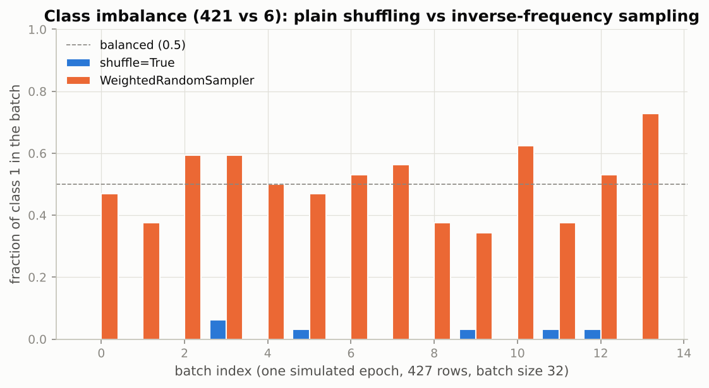

*With plain shuffling most batches have no positive at all; with inverse-frequency weights every batch is close to half and half.*

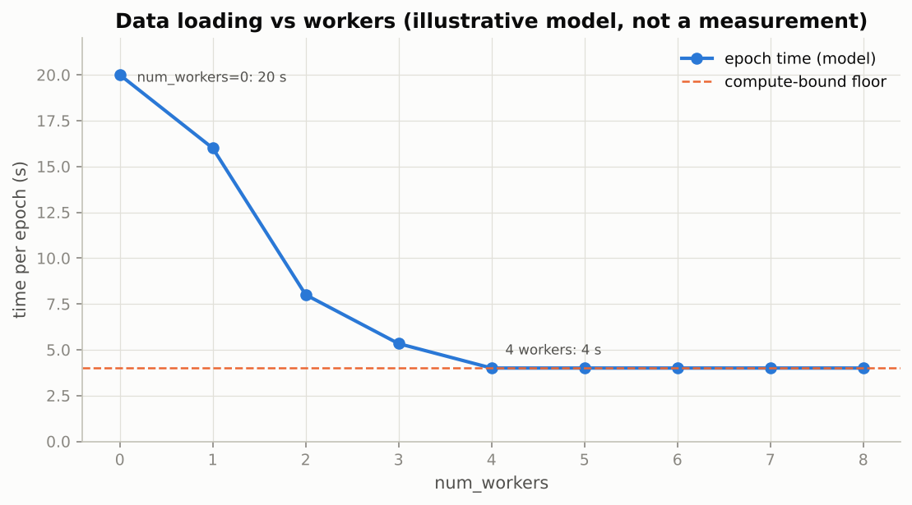

*Epoch time falls until the loader keeps up with the compute; after that the GPU is the bottleneck and extra workers do nothing.*

### Real-world examples

- ImageNet training reads more than a million JPEGs from a `root/class/image.jpg` layout, the `ImageFolder` convention, and decodes them lazily in 8 or more worker processes because decoding is the bottleneck, not the network.
- Language-model pipelines pad sentences of different lengths to the longest in the batch with a custom `collate_fn` and return the lengths, the pattern of Section 2.2 and of Notebook 08.
- Screening classifiers for rare diseases (one positive in hundreds of scans) are trained with weighted sampling or class-weighted losses; without them the model learns to predict "healthy" and scores a misleadingly high accuracy.
- Augmentation only on the training split, never on validation or test, is a rule in every image competition; the two-dataset-objects pattern is how it is enforced.

### Examples for every subsection

- **2.1 The `Dataset` protocol.** `TableDataset` loads the 500-row CSV into two tensors in `__init__`; `table[0]` returns the row 0 features above as a float tensor and the label 1 as a `long`.
- **2.2 `DataLoader`: batching, shuffling, collation, samplers.** The loader yields 8 batches of shape (64, 5), the last of shape (52, 5); `RandomSequences` of lengths 3 to 9 break the default collate and `pad_collate` returns a padded (4, max_len) tensor plus the lengths.
- **2.3 Images in folders.** Forty synthetic 32x32 images of circles and squares in `synthetic_shapes/circle` and `synthetic_shapes/square` are read by `ImageFolder` (class 0 = circle, alphabetical) and by the notebook's own `FolderImageDataset`; item 0 is identical in both.
- **2.4 `torchvision` datasets, `transforms.v2`, and splitting data correctly.** FashionMNIST's 60,000 training images are split by a fixed permutation into 55,000 training and 5,000 validation images (6,000 and 1,000 under `FAST_RUN`); the training `Subset` points at the augmented dataset object, the validation `Subset` at the plain one.
- **2.5 Imbalanced classes: `WeightedRandomSampler`.** With 421 negatives and 6 positives, weights 1/421 and 1/6 make each class equally likely, so about 16 of 32 examples per batch are positive instead of 0.45.
- **2.6 Data pipeline performance.** The notebook times one pass over 6,000 images with per-image `v2` transforms against the same images cached as a `TensorDataset`; the gap is pure Python overhead, which is why small datasets are cached and large ones use workers.

### Common pitfalls

- Passing both `shuffle=True` and a `sampler`: the loader refuses, because the sampler defines the order.
- `num_workers > 0` inside a notebook on Windows or macOS: workers are spawned and cannot import classes defined in the notebook; use 0 in notebooks and raise it in scripts.
- Computing normalisation statistics on the full dataset including the test set: a small leak, but a leak.

## 3. The training loop, done properly

### In plain words

One epoch of training is: switch to train mode, for each batch move the data to the device, compute the loss, check that it is finite, zero the gradients, backpropagate, optionally clip the gradient norm, step the optimizer and (per batch) the scheduler, and accumulate loss and metric as *sums* so that the epoch average is exact even when the last batch is smaller. Evaluation is the same pass in eval mode under `inference_mode`, with no gradients. `fit` repeats this for several epochs and adds what a real run needs: a scheduler in one of three modes, early stopping with a patience counter, saving the best weights whenever the validation loss improves and restoring them at the end, TensorBoard logging, callbacks that can stop the run, and a history dictionary to plot. Accuracy alone hides where a classifier fails; the confusion matrix and per-class accuracy show which classes are mixed up.

### Sample data

A 4-class confusion matrix from 40 predictions (10 of each true class), hand-typed. Rows are the true class, columns the predicted class, so $C_{ij}$ counts examples of class $i$ predicted as class $j$:

| true \ predicted | cat | dog | fox | owl | row sum |
|---|---|---|---|---|---|
| cat | 8 | 1 | 1 | 0 | 10 |
| dog | 2 | 7 | 0 | 1 | 10 |
| fox | 0 | 1 | 9 | 0 | 10 |
| owl | 0 | 0 | 2 | 8 | 10 |

### Worked example

**Exact epoch mean.** Three batches of sizes 64, 64 and 52 have mean losses 0.70, 0.60 and 0.50. Averaging the three batch means gives 0.6000; the exact mean over examples is $(64 \cdot 0.7 + 64 \cdot 0.6 + 52 \cdot 0.5) / 180 = 109.2 / 180 = 0.6067$. `train_one_epoch` accumulates `loss.item() * batch_size` and divides by the number of examples, which gives the second number.

**Early stopping, as `fit` does it with `patience=3`.** The simulated validation losses below improve every epoch until epoch 10 (0.3825), get worse at epoch 11 (0.3848, bad_epochs = 1), improve again at epoch 12 (0.3703, best, counter reset, checkpoint saved), then 0.3844, 0.418 and 0.4356 at epochs 13 to 15 (bad_epochs = 1, 2, 3). After epoch 15 the counter reaches the patience, training stops, and `fit` reloads the epoch-12 weights, so the model you get back is the best one, not the last one.

**Metrics from the confusion matrix.** Overall accuracy is the trace over the total, 32/40 = 0.800. Per-class accuracy (recall) is the diagonal over the row sum: cat 8/10 = 0.800, dog 7/10 = 0.700, fox 9/10 = 0.900, owl 8/10 = 0.800. Precision is the diagonal over the column sum: cat 8/10 = 0.800, dog 7/9 = 0.778, fox 9/12 = 0.750, owl 8/9 = 0.889. The largest off-diagonal entry is "true dog predicted as cat" (2 examples), which is the confusion to look at first.

### Chart

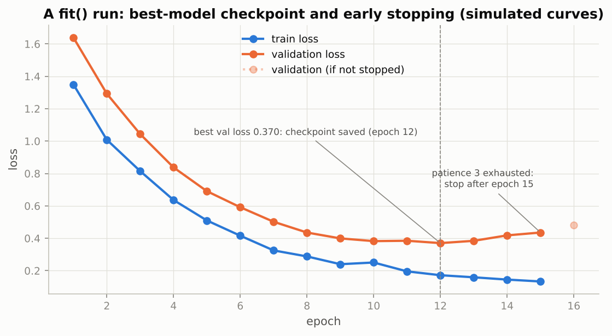

*The validation loss bottoms out at epoch 12 (checkpoint saved) and the run stops three non-improving epochs later.*

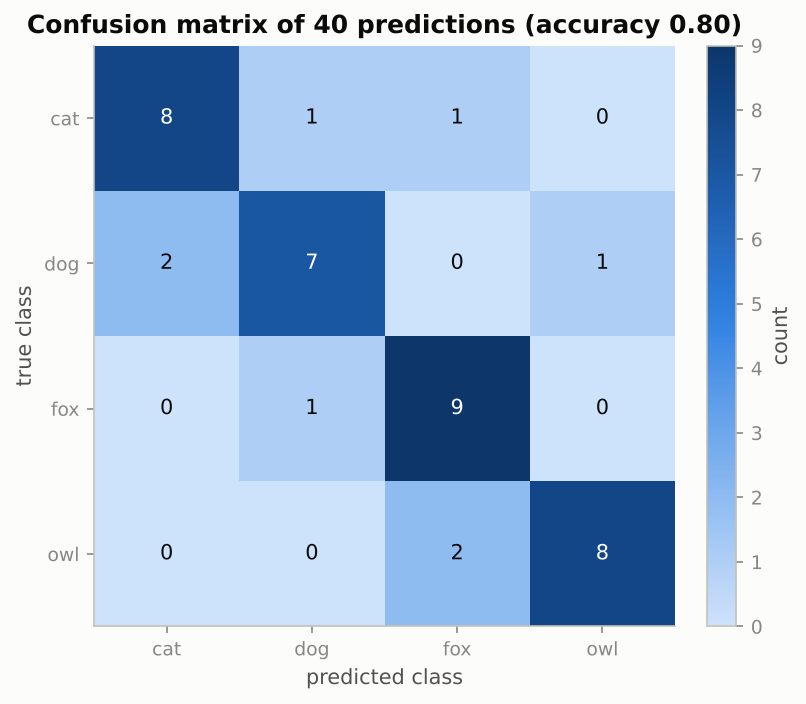

*A good classifier is a dark diagonal; every off-diagonal cell is a specific confusion you can name and investigate.*

### Real-world examples

- Medical screening tests are reported as sensitivity and specificity, which are the per-class recalls of a 2x2 confusion matrix; accuracy would be meaningless when 99 % of patients are healthy.
- Spam filters tune the trade-off between precision (how many flagged mails are really spam) and recall (how much spam is caught), two numbers accuracy cannot separate.
- Early stopping on a validation metric with a patience counter is the default in Keras and PyTorch Lightning callbacks; the `fit` function here is the same idea in forty lines.
- Gradient-norm clipping at 1.0, as `fit` does, is standard in transformer training recipes to survive the occasional huge gradient.

### Examples for every subsection

- **3.1 `train_one_epoch` and `evaluate`.** An untrained 10-class MLP evaluated on the validation loader gives a loss near $\ln 10 \approx 2.30$ and accuracy near 0.1; if it does not, the loss or the labels are wrong before training even starts.
- **3.2 `fit`: scheduling, clipping, early stopping, checkpointing, history.** The demo trains `MLP(256, 128)` with AdamW, a one-cycle schedule stepped per batch, `clip_norm=1.0`, `patience=3` and `ckpt_path=CKPT_DIR/"mlp_demo_best.pt"`, printing one line per epoch with a star when the validation loss improves.
- **3.3 Metrics: accuracy, per-class accuracy, confusion matrix, classification report.** `per_class_accuracy` is `bincount(targets[preds == targets]) / bincount(targets)`, the "diagonal over row sum" of the worked example; on FashionMNIST the hard classes are Shirt, T-shirt/top, Pullover and Coat.

### Common pitfalls

- Stepping a per-batch scheduler (`OneCycleLR`) once per epoch, or the reverse: log the learning rate and look at it.
- Forgetting `model.eval()` in evaluation: dropout stays on and BatchNorm uses batch statistics, so metrics change between calls.
- Averaging batch means instead of summing: a small bias every epoch when the last batch is short.

## 4. Logging and experiment tracking with TensorBoard

### In plain words

Printing one line per epoch is fine for one run, but you will run dozens and want to compare them. A `SummaryWriter` writes event files into a run directory; TensorBoard reads every run under a root folder and draws the curves together. You log scalars (losses, metrics, the learning rate, gradient norms), images, histograms of weights, the model graph and, at the end, the hyperparameters with the final metrics so that runs can be sorted in a table. The discipline that pays off is one directory per run, named with a timestamp and a tag, holding the event files, the configuration as JSON or YAML, and the checkpoints: three months later the config file is what tells you which learning rate produced that number.

### Sample data

The configuration dictionary the notebook saves next to the Section 4 demo run, and the files that end up in the run directory:

| key | value |
|---|---|
| model | "mlp" |
| hidden_dims | [256, 128] |
| dropout | 0.2 |
| lr | 0.002 |
| weight_decay | 0.01 |
| batch_size | 128 |
| epochs | 1 (FAST_RUN) or 3 |
| seed | 42 |

Run directory `runs/YYYYMMDD-HHMMSS_mlp_tb_demo/`: `config.json`, `config.yaml` (if PyYAML is installed), `best.pt`, and the `events.out.tfevents...` file.

### Worked example

**Smoothing, as the TensorBoard slider does it.** Six raw step losses 2.3, 2.1, 2.25, 1.9, 1.95, 1.7 with smoothing weight 0.6 (an exponential moving average, debiased for the first points) become 2.3, 2.175, 2.213, 2.069, 2.018, 1.884. The smoothed curve lags the raw one but is readable; the raw curve is what to look at when hunting a spike.

**The learning rate you should always log.** The notebook's `OneCycleLR` with `max_lr=2e-3` over 47 steps per epoch x 3 epochs = 141 steps starts at max_lr / 25 = 8.00e-05, rises with a cosine to the peak 2.00e-03 at step 42 (30 % of the run), and anneals to 8.00e-09 (initial / 10,000) at the last step; at step 100 it is 7.07e-04. If the logged `train/lr` curve does not look like this, the scheduler is stepped in the wrong place.

### Chart

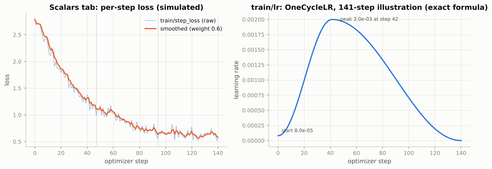

*Left: the raw per-step loss and its smoothed version as the Scalars tab shows them; right: the exact one-cycle learning rate, the curve that catches scheduler bugs.*

### Real-world examples

- TensorBoard began as TensorFlow's dashboard and is now framework-neutral; the `SummaryWriter` in `torch.utils.tensorboard` writes the same event format.
- ML teams use hosted trackers (MLflow, Weights & Biases, Neptune, Comet) for the same per-epoch scalars plus run comparison across machines; the `config` dictionary and the `fit` loop need no change, only the writer object.
- Logging a few input images with predictions each epoch is how vision teams catch broken augmentation (upside-down images, wrong normalisation) early.
- Saving the config and the git commit with every run is the habit that makes a result reproducible months later.

### Examples for every subsection

- **4.1 `SummaryWriter`.** `make_run_dir("mlp_tb_demo", config)` creates a timestamped folder with `config.json`; the writer then receives the first batch as images, the traced graph, per-step `train/step_loss` and `train/lr`, per-epoch `epoch/*` curves, and weight histograms at the end.

### Common pitfalls

- Starting TensorBoard inside a notebook cell: it is a long-lived server, start it from a terminal (`tensorboard --logdir ../data/runs`).
- Inconsistent tag names across runs (`loss/val` in one, `val_loss` in another): the curves cannot be overlaid.
- Logging only the loss: without the learning rate and the gradient norm, scheduler and clipping bugs are invisible.

## 5. Checkpointing and resuming

### In plain words

The best weights (`model.state_dict()`) are enough for inference. To continue an interrupted run as if nothing had happened you need more: the optimizer state (Adam's moment estimates), the scheduler state (where in the schedule you are), the epoch counter and history, the configuration, and the random-number-generator states of Python, NumPy, PyTorch (CPU and CUDA) and the loader's shuffling generator. Without the optimizer state a resumed Adam starts with empty moments and takes different steps; without the RNG states the run is valid but not reproducible. Load with `map_location="cpu"` so that a GPU checkpoint opens on a laptop, save `state_dict`s rather than pickled model objects, and check `missing_keys` and `unexpected_keys` whenever you load partially.

### Sample data

What `save_checkpoint` writes, for the `MLP(hidden_dims=(256,), dropout=0.2)` of Section 5.2 trained with AdamW:

| key | content | notes |
|---|---|---|
| `model` | state_dict: `hidden.0.weight` (256, 784), `hidden.0.bias` (256,), `head.weight` (10, 256), `head.bias` (10,) | the weights |
| `optimizer` | AdamW state: `exp_avg` and `exp_avg_sq` per parameter, step counts, param groups with `lr` | twice the size of the weights |
| `scheduler` | scheduler state_dict or `None` | position in the schedule |
| `epoch` | 1 | last completed epoch |
| `history` | dict of lists: train_loss, train_acc, val_loss, val_acc, lr, epoch_time | for plotting after resume |
| `config` | the config dictionary or `None` | hyperparameters |
| `rng` | Python, NumPy, torch CPU and CUDA generator states | dropout masks and augmentation continue the same sequence |
| `loader_generator` | the shuffling generator's state | the same mini-batch order |
| `torch_version` | e.g. "2.x.y" | recorded, not restored |

### Worked example

The figure script repeats the notebook's experiment on a problem small enough to follow: momentum SGD (momentum 0.9, cosine learning-rate schedule over 40 steps) on a 2-D quadratic loss. Run A runs 40 steps without interruption. Run B stops after step 20 and saves a checkpoint holding the weights [0.4922, -0.102], the momentum buffer [1.0143, 1.413] and the step counter 20; then fresh objects load it and run the remaining 20 steps. Run C loads only the weights and starts with a zero momentum buffer and a reset step counter.

At step 20 the loss is 0.34645. At step 21 run A has 0.13653, the full resume also 0.13653, the weights-only resume 0.10590: already different. At step 40 the losses are 0.021923 (A), 0.021923 (full resume) and 0.024856 (weights-only). The largest gap between A and the full resume over all steps is 0.0e+00; between A and the weights-only resume it is 0.199. The point is not that the weights-only run is worse (here it is sometimes lower, sometimes higher), it is that it is a *different* run, so its curve cannot be compared with run A's and the experiment is no longer reproducible. The notebook shows the same thing with a real MLP: the resumed second epoch matches run A's second epoch to the last digit on the CPU.

### Chart

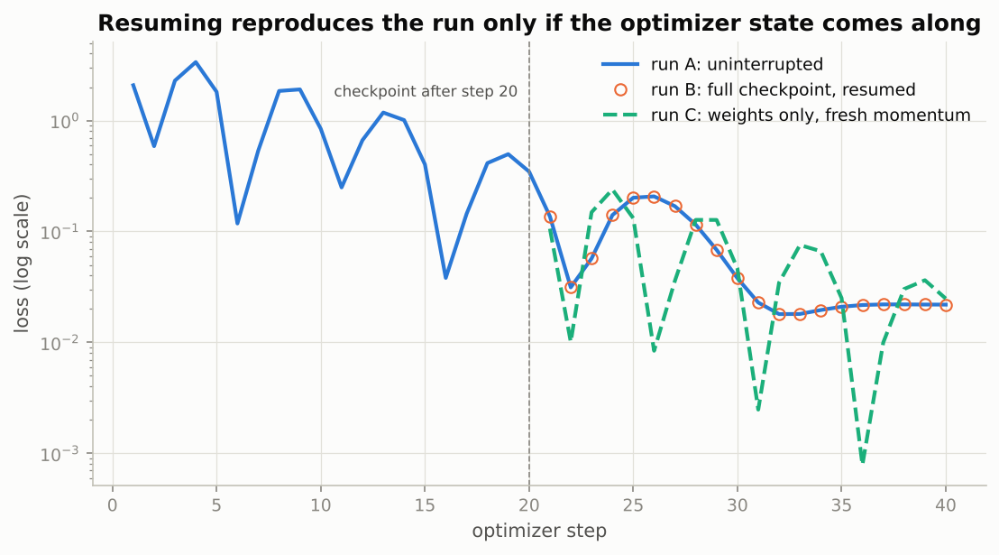

*The circles of the full resume sit exactly on run A's curve after the checkpoint; the weights-only resume wanders off on its own path.*

### Real-world examples

- Spot and pre-emptible cloud instances can be reclaimed with a two-minute warning; training jobs on them checkpoint every few minutes and start with "if a checkpoint exists in the run directory, resume from it".
- Cluster schedulers (SLURM) kill jobs at a wall-time limit; multi-day runs are chains of resumed jobs, and the published training logs of large language models record dozens of restarts from checkpoints after hardware failures.
- Transfer learning loads a pretrained body under a new head with `strict=False`, exactly the partial-loading pattern of Section 5.3; the new head shows up in `missing_keys` and is trained from scratch.
- Pickling whole model objects breaks when a class is renamed or a file moves, which is why model hubs distribute `state_dict` style files (increasingly in the `safetensors` format) rather than pickled modules.

### Examples for every subsection

- **5.1 What a checkpoint must contain.** The table above: weights, optimizer, scheduler, epoch, history, config, RNG states, loader generator, and the version string; `torch.load(..., map_location="cpu", weights_only=False)` is required because the NumPy generator state is not on the safe-unpickling allow-list.
- **5.2 Experiment: resuming reproduces the uninterrupted run.** Run B is checkpointed after one epoch and continued in objects built with seed 999; its second-epoch training and validation losses equal run A's to the printed precision, and the checkpoint file is about three times the weights-only size because AdamW keeps two extra tensors per parameter.
- **5.3 Best-model selection, `state_dict` versus pickling, strict and partial loading.** Loading the 10-class `mlp_demo_best.pt` into a 3-class MLP fails strictly on `head.weight`; dropping the `head.*` keys and loading with `strict=False` reports `missing_keys = ['head.weight', 'head.bias']` and no unexpected keys.

### Common pitfalls

- Saving only the best weights and calling it a resume checkpoint: the best epoch is usually not the last one, so the run cannot continue from it.
- Loading untrusted checkpoints with `weights_only=False`: it unpickles arbitrary objects. Only do it for files you made.
- Ignoring `unexpected_keys`: a misspelled layer name silently leaves a layer at its random initialisation.

## 6. Reproducibility

### In plain words

A run draws random numbers from at least four places: Python's `random`, NumPy, PyTorch's CPU generator (initialisation, dropout, shuffling) and its CUDA generators. Seeding all of them, plus passing a seeded generator to the `DataLoader`, makes your own reruns identical on the same machine. Deterministic algorithms (`torch.use_deterministic_algorithms(True)`, cuDNN deterministic mode, the cuBLAS workspace variable) remove the remaining GPU non-determinism at a speed cost; use them when hunting a bug that depends on exact numbers, not in routine training. Even then, different hardware, library versions or batch sizes give slightly different numbers. The more valuable habit is to run several seeds and report mean and spread: an improvement smaller than the seed-to-seed variation is not an improvement.

### Sample data

Sources of randomness and what seeds them, as `seed_everything` does it:

| source | used by | seeded with |
|---|---|---|
| Python `random` | some data code | `random.seed(seed)` |
| NumPy global RNG | synthetic data, augmentation libraries, mixup's Beta draw | `np.random.seed(seed)` |
| PyTorch CPU generator | weight init, dropout, `randperm`, `v2` augmentations | `torch.manual_seed(seed)` |
| PyTorch CUDA generators | dropout and sampling on the GPU | `torch.manual_seed(seed)` (seeds all devices) |
| DataLoader shuffling | mini-batch order | `generator=torch.Generator().manual_seed(seed)` |
| worker processes | per-worker NumPy/`random` state when `num_workers > 0` | `worker_init_fn=seed_worker` |

### Worked example

Simulated validation accuracies (the figure script draws them from Gaussians; the notebook's Exercise 5 produces real ones) for two configurations over five seeds:

| seed | config A (dropout 0.0) | config B (dropout 0.3) |
|---|---|---|
| 0 | 0.8851 | 0.8869 |
| 1 | 0.8904 | 0.8913 |
| 2 | 0.8899 | 0.8888 |
| 3 | 0.8830 | 0.8920 |
| 4 | 0.8838 | 0.8816 |
| mean | 0.8864 | 0.8881 |
| std | 0.0035 | 0.0042 |

The difference of means is +0.0017, the pooled seed-to-seed standard deviation is 0.0038, a ratio of 0.44. With five seeds the two configurations are not distinguishable: a single-seed comparison could have picked either one. Running config A twice with the same seed, on the other hand, gives the same number to the last digit, which is what Section 6.1 demonstrates.

### Chart

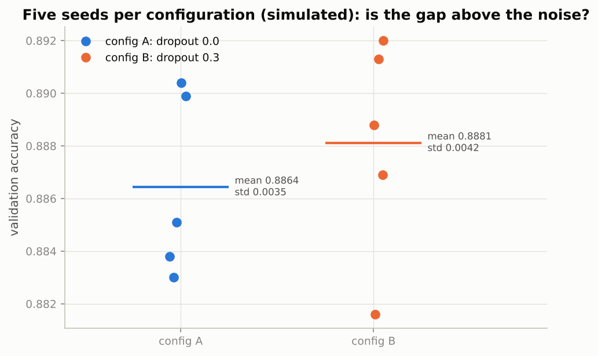

*The two clouds overlap: the gap between the means (0.0017) is well inside the spread of each configuration.*

### Real-world examples

- Research papers report "mean ± std over 5 seeds" because reviewers know that single-seed deep learning results can move by a percentage point.
- Regulated models (medical-device software, bank credit-risk models under model-risk-management rules) must be reproducible on request, so seeds, library versions and configs are part of the model documentation.
- Kaggle winners are asked to reproduce their solution from code; fixed seeds and saved configs are what makes that possible.
- Debugging a numerical divergence between two machines starts with deterministic mode, which turns "the numbers differ somewhere" into "this operation has no deterministic kernel".

### Examples for every subsection

- **6.1 Seeding everything.** `short_run(42)` called twice gives identical training loss and validation accuracy; `short_run(43)` gives a different run, and that difference is the noise floor of the experiment.
- **6.2 What can still differ.** A GPU and a CPU sum in different orders, so their results differ in the last bits and the gap grows over thousands of steps; cuDNN autotuning (`benchmark=True`) can pick different kernels per run; a different PyTorch or CUDA version can change default algorithms, so record them with the run.

### Common pitfalls

- Seeding PyTorch but not NumPy: mixup's `np.random.beta` and NumPy-based augmentations stay random.
- Leaving deterministic mode on for the whole project: it is slower and some operations only warn or raise.
- Claiming a 0.3 % improvement from one seed each: compare with the seed-to-seed spread first.

## 7. A complete project: FashionMNIST

### In plain words

`run_experiment(config)` is the whole notebook in one function: seed, create the run directory with the config, build the model and loaders, train with AdamW, a one-cycle schedule and gradient clipping, checkpoint the best weights, log to TensorBoard, evaluate the test set once, record the hyperparameters with the final metrics, and write `results.json`. It is run for an MLP and a small CNN; in the full run the CNN wins (about 92 to 93 % test accuracy against 89 to 90 %) because convolutions exploit the image structure that the MLP has to learn from scratch. Error analysis then looks past the single number: the confusion matrix, the per-class accuracies of both models, and the test images the model gets wrong with the highest confidence, which is where label noise and genuine ambiguity show up. A small grid over learning rate and weight decay shows the mechanics of a sweep, ranked on validation accuracy only.

### Sample data

The two configurations the notebook trains (from `mlp_config` and `cnn_config`):

| key | MLP | CNN |
|---|---|---|
| model | "mlp" | "cnn" |
| hidden_dims | [512, 256] | [] |
| dropout | 0.2 | 0.3 |
| lr (peak, one-cycle) | 0.002 | 0.003 |
| weight_decay | 0.05 | 0.05 |
| batch_size | 128 | 128 |
| epochs | 1 (FAST_RUN) or 8 | 1 (FAST_RUN) or 8 |
| augment | True | True |
| seed | 42 | 42 |

A toy prediction table in the format `predict_all` returns (hand-typed, six test examples):

| index | true | predicted | probability of the prediction | |
|---|---|---|---|---|
| 17 | Shirt | T-shirt/top | 0.93 | wrong |
| 42 | Pullover | Coat | 0.61 | wrong |
| 58 | Shirt | Shirt | 0.88 | correct |
| 71 | Coat | Pullover | 0.97 | wrong |
| 90 | Ankle boot | Sneaker | 0.55 | wrong |
| 133 | T-shirt/top | T-shirt/top | 0.99 | correct |

### Worked example

**Confidently wrong examples (Section 7.1).** Keep the rows where `pred != true` (four of six, accuracy 2/6 = 0.333 on this toy table) and sort them by the probability the model gave its wrong answer: index 71 (Coat predicted as Pullover, 0.97), then 17 (Shirt as T-shirt/top, 0.93), 42 (0.61) and 90 (0.55). The top of this list is what the notebook's 16-image grid shows: images where the model is sure and wrong, which are often ambiguous or mislabelled.

**The sweep (Section 7.2), illustrative values.** Three peak learning rates and two weight decays give six runs. With one-epoch budgets the (made-up but typical) best validation accuracies are 0.842 and 0.840 for lr 0.0005, 0.868 and 0.866 for lr 0.002, and 0.875 and 0.871 for lr 0.008, for weight decay 0 and 0.1 respectively. The best by validation accuracy is lr 0.008 with weight decay 0 (0.875); the spread across the grid is 0.035 and comes almost entirely from the learning rate, while weight decay changes the best row by +0.004, inside the seed noise of Section 6. This is the notebook's point: with short budgets the learning rate dominates and weight decay only pays off over longer runs.

### Chart

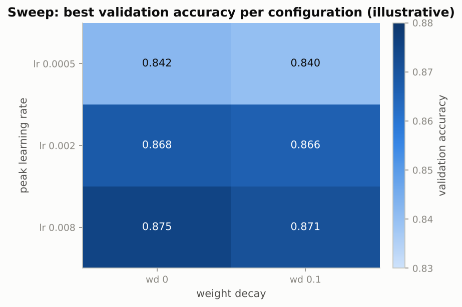

*Rows differ a lot (learning rate), columns barely (weight decay): on a one-epoch budget, rank on the learning rate and do not trust the weight-decay column.*

### Real-world examples

- Error analysis by "most confident mistakes" is how teams find mislabelled training data; the FashionMNIST classes Shirt, T-shirt/top, Pullover and Coat are a textbook case of label ambiguity that caps achievable accuracy.
- Every production training script is some version of `run_experiment(config)`: config in, run directory with metrics and checkpoints out.
- Hyperparameter sweeps on short budgets favour "fast starters"; the pruners in Optuna (Notebook 14) and successive-halving schedulers exist to correct that bias.
- Reporting the test score once, for the configuration chosen on validation, is the rule that keeps a leaderboard honest.

### Examples for every subsection

- **7.1 Error analysis: confusion matrix, per-class accuracy, confidently wrong examples.** The CNN's test confusion matrix is near-diagonal for Trouser, Bag and Sandal and dense inside the Shirt/T-shirt/Pullover/Coat block; `probs[wrong, preds[wrong]]` sorted descending gives the 16 most confident errors, as with indices 71 and 17 above.
- **7.2 A mini hyperparameter sweep.** Six `run_experiment` calls with tags such as `sweep_lr0.002_wd0.1`, each a separate TensorBoard run so the HParams tab can rank them; `max(h["val_acc"])` is the ranking key and the test column is shown only to check that the two agree.

### Common pitfalls

- Ranking on the test set: it is then no longer a test set.
- Comparing one-epoch smoke-test numbers between models: under `FAST_RUN` both models are far from converged.
- Reading accuracy without the confusion matrix: a 93 % model and a 90 % model may differ only inside one cluster of classes.

## 8. Debugging deep learning code

### In plain words

Bugs come in two kinds. Those that crash (shape and device errors, exceptions in autograd) are solved by reading the message: a matrix-multiplication error tells you the shapes, and you map them back to your code. Those that do not crash (a model that trains but learns nothing useful) are found with sanity checks and instrumentation: the loss of an untrained model should equal a uniform guess, a single batch must be overfittable to near-zero loss, hooks show whether activations die or gradients vanish, and `detect_anomaly` points at the operation that first produced a `nan`. The notebook ends with a table of common exceptions and a ten-step checklist.

### Sample data

The anomaly example of Section 8.2: a loss $\sum_i m_i \sqrt{x_i}$ with the values below. The forward pass is finite; the gradient is not.

| i | x | mask m | m * sqrt(x) | gradient m / (2 sqrt(x)) |
|---|---|---|---|---|
| 0 | 0.0 | 0.0 | 0.0 | nan (0 times infinity) |
| 1 | 1.0 | 1.0 | 1.0 | 0.5 |
| 2 | 4.0 | 1.0 | 2.0 | 0.25 |

Forward value 3.0; gradient [nan, 0.5, 0.25]. Without `detect_anomaly` the `nan` enters the weights silently; with it, autograd raises and names `SqrtBackward0`.

### Worked example

**Reading a shape error.** `nn.Linear(784, 10)` applied to a batch of shape (2, 1, 28, 28): a linear layer acts on the last dimension, so it sees 2 x 1 x 28 = 56 rows of 28 features and tries (56x28) @ (784x10), which fails because 28 is not 784. The fix is `x.flatten(start_dim=1)`, which the notebook's `MLP` does itself.

**Overfit one batch, with a tiny numpy network.** A 3-16-4 MLP is trained by plain gradient descent (learning rate 0.5) on one batch of 8 examples with labels 0, 1, 2, 3, 0, 1, 2, 3. A uniform guess over 4 classes costs $\ln 4 = 1.3863$. The loss on the batch is 1.4814 at step 0 (accuracy 0.375), 0.7969 at step 10 (0.750), 0.2106 at step 50 (1.000), 0.0672 at step 100, 0.0210 at step 200 and 0.0113 at step 300. That is the healthy signature: the loss falls well below the uniform-guess line and keeps falling. If it plateaus near 1.39, the bug is in the model, the loss or the labels, not in the hyperparameters.

### Chart

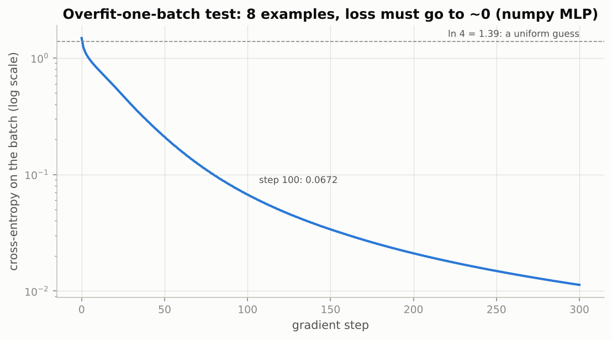

*The loss drops from the uniform-guess line (1.39) to about 0.01 in 300 steps; a pipeline that cannot do this on 8 examples will not learn on 60,000.*

### Real-world examples

- Karpathy's "A Recipe for Training Neural Networks" (2019), the origin of the overfit-one-batch test and most of the checklist, is the standard reference handed to new deep-learning engineers.
- `detect_anomaly` is switched on when a mixed-precision run starts producing `nan` losses, to find the `log(0)` or `sqrt(0)` responsible; it is then switched off again because it slows training several-fold.
- Grad-CAM and feature-visualisation tools register forward and backward hooks on a chosen convolution layer, the same API as Section 8.3.
- "Expected all tensors to be on the same device" after moving a model to the GPU almost always means a constant tensor that should have been a buffer (Section 1.2).

### Examples for every subsection

- **8.1 Shape errors and how to read them.** `mat1 and mat2 shapes cannot be multiplied (56x28 and 784x10)`: 56 rows come from 2 x 1 x 28, the fix is a flatten; `SmallCNN` asserts `(B, 1, 28, 28)` at the top of `forward` so the error names the actual shape.
- **8.2 Anomaly detection.** The table above: `(sqrt(x) * mask).sum()` is 3.0 but `x.grad` is `[nan, 0.5, 0.25]`; inside `torch.autograd.detect_anomaly()` the backward pass raises "Function 'SqrtBackward0' returned nan values".
- **8.3 Hooks: looking inside the network.** Forward hooks on every Conv2d, Linear and ReLU of the CNN record output shape, mean, std and fraction of zeros on one batch (healthy ReLUs: roughly 30 to 70 % zeros, near 100 % means dead units); a tensor hook on `z` prints the gradient [1, 2, 3] reaching it.
- **8.4 Overfitting a single batch with the real pipeline.** A `DataLoader` over one 64-image batch is used as both training and validation set for `SmallCNN`; the eval-mode loss starts above the train loss while BatchNorm's running statistics (momentum 0.1) catch up, then drops below it.
- **8.5 Common exceptions and what they mean.** `expected scalar type Long but found Float` in `cross_entropy` means float class indices: call `y.long()`; `Expected more than 1 value per channel` means BatchNorm in train mode with a batch of one.
- **8.6 A debugging checklist.** Dummy batch, inspect one batch of data, untrained loss near $\ln K$, overfit one batch, count parameters, confirm train/eval modes, log lr and gradient norm, lower the lr before `detect_anomaly`, test the metric on a hand-made example, make everything small.

### Common pitfalls

- Leaving `detect_anomaly` on in production training: several-fold slowdown.
- Forgetting `handle.remove()` after registering a hook: it keeps running and keeps references alive.
- Tuning hyperparameters before the overfit-one-batch test passes: no learning rate fixes a wrong loss or shuffled labels.

## 9. Project structure for real work

### In plain words

A notebook is for exploring; code you rely on belongs in a small installable package. The move is mostly a reorganisation of what the notebook already contains: models into `models.py`, datasets and transforms into `data.py`, the training loop into `engine.py`, checkpoint and seeding helpers into `checkpoint.py`, `run_experiment` into `scripts/train.py`, and the sanity checks into `tests/`. A run is then a config file plus a git commit: the script loads the YAML, builds everything from the dictionary, copies the config into the run directory and leaves behind metrics, checkpoints and TensorBoard events. The engine knows nothing about the task, which is what makes it reusable, and two cheap tests (dummy batch through each model, overfit one batch) catch most expensive bugs before a long job starts.

### Sample data

Where the notebook's code goes, with the number of non-empty code lines in each group of cells (counted from the notebook's code cells):

| notebook section | target module | code lines |
|---|---|---|
| 1 (`nn.Module` anatomy) | `src/fashion/models.py` | 102 |
| 2 (Dataset and DataLoader) | `src/fashion/data.py` | 165 |
| 3 and 4 (loop, logging) | `src/fashion/engine.py` | 191 |
| 5 and 6 (checkpoints, seeds) | `src/fashion/checkpoint.py` | 104 |
| 7 (the project) | `scripts/train.py` | 79 |
| 8 (debugging checks) | `tests/` | 63 |

### Worked example

The six groups hold 704 lines in total; the training engine is the largest at 191 lines, 27 % of the code, and it is also the part that never changes between projects. A `train.py` of the sketched form is then short: parse `--config` and optional overrides, `yaml.safe_load` the file, `seed_everything(config["seed"])`, `build_loaders(config)`, `build_model(config).to(device)`, call `fit`, write `results.json`. Under `if __name__ == "__main__":` so that DataLoader workers can be spawned on Windows and macOS. The two tests take seconds: `assert model(torch.zeros(2, 1, 28, 28)).shape == (2, 10)` for each model, and an overfit-one-batch test that asserts the loss falls below a threshold in fifty steps.

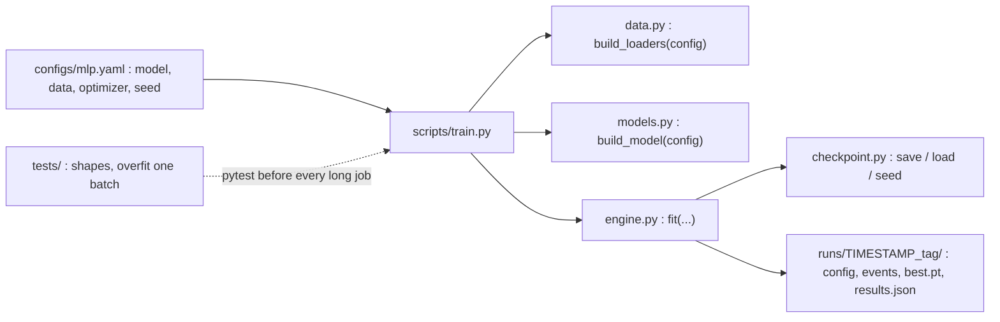

### Chart

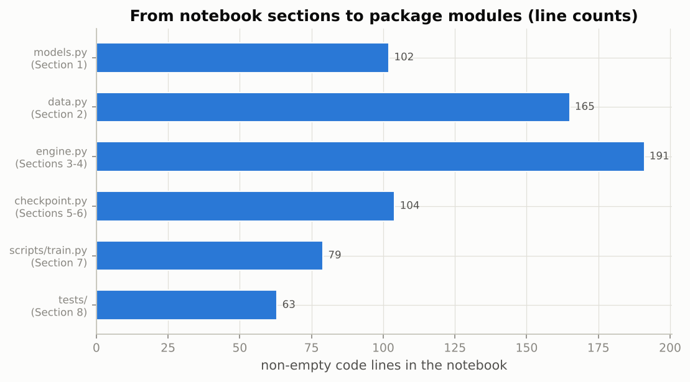

*The engine is the biggest and most reusable piece; the script that drives a project is the smallest.*

### Real-world examples

- PyTorch Lightning, the Hugging Face `Trainer` (Notebook 10) and the course's own `Trainer` class (Notebook 17) are industrial versions of `engine.py`: a task-agnostic loop with hook points for callbacks.
- Research groups drive experiments with Hydra or plain YAML configs and command-line overrides such as `--lr 3e-3`, so that a sweep is a loop over config files and every run directory holds its own copy.
- Continuous-integration pipelines run the shape and overfit-one-batch tests on every commit, which catches a broken loss or a frozen parameter before a GPU-day is spent.
- Sculley et al. (2015), "Hidden Technical Debt in Machine Learning Systems", is the classic account of why configuration, reproducibility and structure matter more in ML code than in ordinary software.

### Examples for every subsection

- **Configuration drives everything.** `build_model({"model": "cnn", "dropout": 0.3, ...})` returns a `SmallCNN`; `make_run_dir` copies the same dictionary into the run folder, so the run and its settings can never be separated.
- **The engine knows nothing about the task.** The same `fit` trains the 10-class classifiers of Section 7, the regression MLP of Exercise 1 (`loss_fn=F.mse_loss`, `metric_name="mae"`) and the mixup variant of Exercise 2.
- **Tests are cheap and catch the expensive bugs.** `test_output_shapes` pushes `torch.zeros(2, 1, 28, 28)` through `MLP()` and `SmallCNN()` and asserts a (2, 10) output.
- **Runs are artifacts.** `results.json` with the history, the test metrics and the training time is what a report notebook reads later.
- **Notebooks remain, but for exploration.** They import from `src/`, stay short and are re-run top to bottom before anything in them is trusted.

### Common pitfalls

- Copying functions between notebooks instead of importing them: three slightly different `fit`s within a month.
- Hard-coding paths, seeds and learning rates in the script: they belong in the config, where they get saved with the run.
- Skipping the tests because "it worked yesterday": the overfit test takes ten seconds and the failed training job takes a night.

## Exercises in plain words

- **Exercise 1 (warm-up), a regression `Dataset` with standardisation inside the model.** Build a dataset of three features and one continuous target, split it, and train a small MLP with `fit` using `F.mse_loss` and a mean-absolute-error metric that returns a *sum* over the batch. Why: it proves that `fit` is task-agnostic and shows how buffers ship preprocessing with the weights. Hint: compute the mean and std on the training split only, hand them to `Standardize`, and look for `0.mean` and `0.std` at the top of the `state_dict`.
- **Exercise 2, mixup as an alternative training step.** Write a `train_one_epoch_mixup` with the same signature that mixes each batch with a shuffled copy of itself using a Beta-distributed weight and mixes the two losses the same way, then plug it into `fit` via `train_epoch_fn`. Why: it shows how the loop is extended without touching `fit`, and mixup is a useful regulariser. Hint: `np.random.beta(alpha, alpha)` for the weight, `torch.randperm` for the partner, and measure training accuracy against the dominant label.
- **Exercise 3, periodic resume checkpoints.** Implement a `PeriodicCheckpoint` callback that writes a full checkpoint at the end of every epoch and a `resume_from_checkpoint` function that restores everything into fresh objects and trains the remaining epochs, then check that an interrupted-and-resumed three-epoch run matches the uninterrupted one, including the learning-rate trajectory. Why: it is the mechanism that makes multi-day runs survive pre-emption. Hint: the callback needs the scheduler and the loader's generator, which `fit`'s state dictionary does not contain, so pass them to its constructor.
- **Exercise 4, callbacks of your own.** Write `TimeLimit(seconds)`, `StopAtMetric(name, target)` and `LambdaCallback(fn)` and run them together. Why: it shows that a callback system is nothing more than objects reacting to the state at fixed hook points. Hint: `on_epoch_end(state)` returns `True` to stop; `state["history"][name][-1]` is the latest value of a metric.
- **Exercise 5 (challenge), k-fold cross-validation.** Split a subset of the training indices into k folds, train k models with a different fold as validation each time (augmentation on the training folds only), and report mean and standard deviation of the validation accuracy for an MLP with and without dropout. Why: it gives an error bar, which is what you need to decide whether a difference is real. Hint: the two dataset objects of Section 2.4 make "augment only the training folds" a matter of which object each `Subset` points to; `np.array_split` makes the folds.

## Quick reference

| Concept | Formula or rule | In one sentence |
|---|---|---|
| Registration | assign as attribute, or use `nn.ModuleList` / `nn.ModuleDict` | Only registered parameters, buffers and submodules are trained, moved and saved. |
| `state_dict` | all parameters and buffers, keyed by dotted path | What a weights file contains; `parameters()` returns only the trainable part. |
| Parameters of a 3x3 conv | $9\,c_{in}\,c_{out} + c_{out}$ | SmallCNN: 320 + 18,496 for the two convolutions, 401,536 for the first linear layer. |
| Dataset protocol | `__len__`, `__getitem__(i)` returning `(x, y)` | Everything a `DataLoader` needs. |
| Batches per epoch | $\lceil N / B \rceil$, or $\lfloor N / B \rfloor$ with `drop_last` | 500 rows, batch 64: 8 batches (last has 52) or 7. |
| Inverse-frequency weights | $w_i = 1 / n_{\text{class}(i)}$ | Each class gets total weight 1, so every class is equally likely per draw. |
| Exact epoch loss | $\sum_b \ell_b n_b / \sum_b n_b$ | Accumulate `loss.item() * batch_size`, divide by the number of examples. |
| Untrained loss | $\ln K$ | 2.30 for 10 classes, 1.39 for 4; a first sanity check. |
| Early stopping | stop when `bad_epochs >= patience` | Counter resets on every improvement of the validation loss; the best weights are reloaded. |
| Per-class accuracy (recall) | $C_{kk} / \sum_j C_{kj}$ | Diagonal over the row sum of the confusion matrix. |
| Precision | $C_{kk} / \sum_i C_{ik}$ | Diagonal over the column sum. |
| OneCycleLR | start = max_lr / 25, peak at 30 % of the steps, end = start / 10,000 | Stepped once per batch; `total_steps` = epochs x batches per epoch. |
| Resume checkpoint | model + optimizer + scheduler + epoch + history + config + RNG states + loader generator | Weights alone give inference, not an exact resume. |
| Checkpoint size with Adam(W) | about 3 x the weights | Two moment tensors per parameter. |
| Seeding | `random`, NumPy, `torch.manual_seed`, loader `generator` | Same machine and versions: identical reruns; across machines: only approximately. |
| Noise floor | compare the gap between configs with the std over seeds | A gap inside the spread is not an improvement. |
| Shape error | `Linear` acts on the last dimension | (2, 1, 28, 28) into `Linear(784, 10)` is (56x28) @ (784x10): flatten first. |

## Glossary

- **nn.Module**: the base class of every PyTorch model, layer and loss; it tracks parameters, buffers and submodules.
- **Parameter**: a tensor the optimizer updates; created by layers such as `nn.Linear` or explicitly with `nn.Parameter`.
- **Buffer**: a tensor saved and moved with the model but never trained, registered with `register_buffer` (BatchNorm's running statistics).
- **state_dict**: the dictionary of all parameters and buffers keyed by their path in the module tree; what `torch.save` writes for a model.
- **Dataset / DataLoader**: an indexable collection of examples, and the iterator that shuffles, batches and collates it.
- **collate_fn**: the function that turns a list of examples into one batch; custom versions pad variable-length inputs.
- **Sampler**: the object that decides the order of indices; `WeightedRandomSampler` draws rare classes more often.
- **Transform (v2)**: a composable preprocessing or augmentation step from `torchvision.transforms.v2`, applied per example inside `__getitem__`.
- **Epoch**: one pass over the training loader; with a weighted sampler it becomes a convention of `num_samples` draws.
- **Early stopping**: ending training when the validation loss has not improved for `patience` epochs, keeping the best weights.
- **Checkpoint**: a saved dictionary of everything needed to resume a run: weights, optimizer and scheduler state, epoch, history, config and RNG states.
- **SummaryWriter / TensorBoard**: the logger that writes scalars, images and histograms to event files, and the dashboard that draws them.
- **Confusion matrix**: a table counting true class against predicted class; its diagonal is correct predictions, the rest are specific confusions.
- **Hook**: a function PyTorch calls on a module's forward or backward pass, or on a tensor's gradient, without changing the model.
- **detect_anomaly**: an autograd mode that raises, with a traceback, at the first backward function that produces `nan` or `inf`.
- **Overfit-one-batch test**: training on a single batch until the loss is near zero; failure means a bug in the model, loss or data.
