# 07 · Transfer Learning and Modern Vision — Companion Guide

> Plain-language companion to [`07_transfer_learning_and_modern_vision.ipynb`](07_transfer_learning_and_modern_vision.ipynb). Read a section here, then run the
> matching section of the notebook. All numbers below were computed with the script
> [`figures/scripts/make_figures_07.py`](figures/scripts/make_figures_07.py); all charts are its output.

## At a glance

- **What you learn**
  - Why a network trained on ImageNet is a good starting point for almost any image task, and how to choose between freezing it and fine-tuning it from the size and similarity of your data.
  - How to load a pretrained torchvision model with the `weights=` API, preprocess images exactly as it expects, and replace its head.
  - Three ways to adapt a backbone (linear probe, fine-tuning with discriminative learning rates, gradual unfreezing) plus test-time augmentation, and how they compare on CIFAR-10.
  - How Grad-CAM turns gradients into a heatmap, and what such a heatmap does and does not prove.
  - What a Vision Transformer does with an image, why it loses to a CNN on small data, and how patch size trades cost against detail.
  - Segmentation with a U-Net scored by Dice and IoU, detection concepts with box IoU and non-maximum suppression, and contrastive self-supervised learning with the NT-Xent loss.
- **Where this is used in the real world**
  - Medical imaging: dermatology and retinal-screening classifiers are fine-tuned ImageNet CNNs, because labelled scans are scarce and expensive.
  - Model auditing: Grad-CAM heatmaps are a standard check that a chest X-ray model looks at lungs rather than at hospital markers or text burnt into the image.
  - Tumour and organ segmentation (the BraTS and Medical Segmentation Decathlon challenges) and satellite land-cover maps are dominated by U-Net variants.
  - Object detection runs in driver-assistance systems (pedestrians, vehicles, signs) and in camera-based checkout-free retail stores.
  - Contrastive pretraining is behind text-to-image search and generation: CLIP embeddings rank images for a text query and condition diffusion models such as Stable Diffusion.

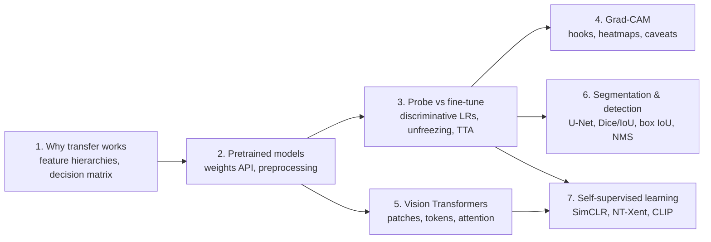

## 1. Why transfer learning works

### In plain words

A convolutional network trained on ImageNet has spent an enormous budget learning what natural images look like: its early layers detect edges and colour contrasts, its middle layers textures and parts, and only its last layers are about the 1,000 ImageNet labels. Those early and middle layers are useful for any photograph, so instead of training a new network from random weights on your small dataset you start from the pretrained one, keep what is general and retrain what is specific. The practical consequences are fewer labelled examples, faster training and higher accuracy. Which layers to retrain depends on two things: how much target data you have and how similar it is to the source data. The notebook summarises this in a 2x2 decision matrix.

### Sample data

The figure script builds a tiny numpy version of the whole story, a "teacher-student" task. A fixed teacher network with 32 hidden units turns 20 random input numbers into a hidden representation, and two tasks are defined on that same representation: a **source** task with 10 classes and 20,000 labelled examples (the "ImageNet" of the toy) and a **target** task with 4 classes and very few labels. A student network with 64 ReLU units is first trained on the source task (it reaches 93.6 % training accuracy there) and then reused on the target task. The target classes are balanced (test frequencies 0.250, 0.251, 0.255, 0.244), so chance is 25 %.

| x1 | x2 | x3 | ... | target label |
|---|---|---|---|---|
| +2.04 | -2.56 | +0.42 | ... | 1 |
| +0.02 | +1.55 | +0.55 | ... | 1 |
| +0.28 | +0.70 | -0.44 | ... | 0 |
| -1.64 | +0.06 | -0.96 | ... | 2 |
| +1.68 | +0.75 | +0.75 | ... | 0 |

First five rows of the labelled target pool (20 inputs per row, only three shown), generated with a fixed seed.

### Worked example

Four strategies are run with 300 Adam steps each, for target-set sizes from 25 to 800 examples, averaged over three seeds and measured on 4,000 held-out target examples:

| labelled target examples | linear probe, pretrained features | linear probe, random features | fine-tuning, discriminative LR | from scratch |
|---|---|---|---|---|
| 25 | 45.8 % | 39.2 % | 45.2 % | 40.5 % |
| 50 | 54.3 % | 44.7 % | 54.3 % | 48.6 % |
| 100 | 65.5 % | 50.7 % | 64.3 % | 55.8 % |
| 200 | 73.9 % | 55.1 % | 72.7 % | 63.9 % |
| 400 | 80.0 % | 61.5 % | 78.4 % | 68.1 % |
| 800 | 83.9 % | 66.2 % | 80.8 % | 74.2 % |

Reading the rows: with 100 labelled examples the probe on pretrained features reaches 65.5 % while the same classifier on random features gets 50.7 % and a network trained from scratch 55.8 %. The gap closes slowly as data grow (at 800 examples: 83.9 % versus 74.2 %), which is exactly the "small dataset" row of the decision matrix. The pretrained features are reusable because the source task forced the student to learn the teacher's hidden representation, and the target task is defined on the same representation; the random features are only a fixed random projection of the inputs.

### Chart

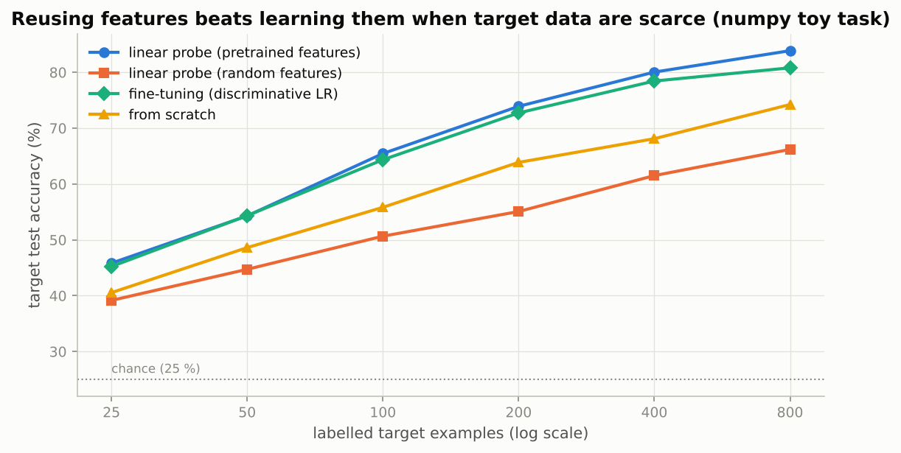

*What to see: the two pretrained curves sit well above "from scratch" at every size, and the random-feature probe is the floor; the advantage of reuse is largest when labels are scarce.*

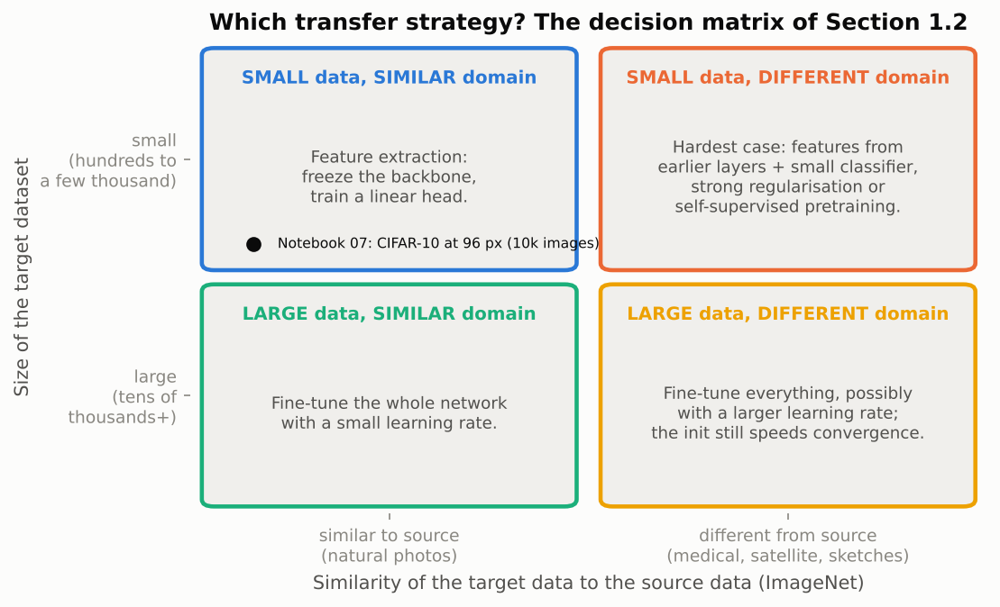

*What to see: the notebook's CIFAR-10 experiment lives in the top-left cell (small, similar), where feature extraction is the safe default and fine-tuning is the upgrade when you have 10,000 images.*

### Real-world examples

- Dermatology classifiers that distinguish malignant from benign skin lesions start from an ImageNet-pretrained CNN and fine-tune on tens of thousands of clinical photographs, far fewer than ImageNet's 1.28 million.
- Diabetic-retinopathy screening from retinal photographs uses the same recipe: a pretrained backbone, a new head for the severity grades.
- Wildlife camera-trap classification (millions of unlabelled frames, few labelled species) relies on pretrained backbones because labelling by experts is the bottleneck.
- In language the same idea powers every chat assistant: pretrain on next-word prediction, then adapt (Notebook 10).

### Examples for every subsection

- **1.1 Feature hierarchies are reusable.** The toy student's hidden layer learned on a 10-class task predicts the 4-class task at 83.9 % with a linear head, while a random hidden layer only reaches 66.2 %: the features, not the architecture, carry the value.
- **1.2 A decision matrix.** A hospital with 800 labelled X-rays (small, different domain) should extract features from earlier layers and regularise strongly; an e-commerce company with 200,000 product photos (large, similar) should fine-tune everything.

### Common pitfalls

- Expecting ImageNet features to work unchanged on very different images (microscopy, radar, spectrograms): the early layers still help, but the late layers need retraining or self-supervised pretraining on your own data.
- Comparing a fine-tuned model with a from-scratch model that has had far more epochs; the fair control uses the same budget, as the notebook does.

## 2. Pretrained models in torchvision

### In plain words

`torchvision.models` ships dozens of architectures with ImageNet weights. Since version 0.13 every model has a weights enum, for example `ResNet18_Weights.DEFAULT`, that bundles the checkpoint, the preprocessing transform the weights were evaluated with (`weights.transforms()`) and metadata such as accuracy and class names. Preprocessing is the part people get wrong: the model expects the shorter side resized to 256, a 224 centre crop, pixels scaled to $[0, 1]$ and then normalised with the ImageNet channel mean and standard deviation. Anything else silently lowers accuracy. The checkpoint is downloaded once into the torch hub cache; the notebook wraps the download in `try/except` and falls back to random weights with a warning.

### Sample data

ImageNet normalisation of four hand-typed `uint8` pixels, computed as $(x/255 - \text{mean}) / \text{std}$ per channel with mean $(0.485, 0.456, 0.406)$ and std $(0.229, 0.224, 0.225)$:

| uint8 (R, G, B) | scaled to [0, 1] | normalised |
|---|---|---|
| (120, 200, 60) | (0.4706, 0.7843, 0.2353) | (-0.063, 1.466, -0.759) |
| (255, 255, 255) | (1, 1, 1) | (2.249, 2.429, 2.640) |
| (0, 0, 0) | (0, 0, 0) | (-2.118, -2.036, -1.804) |
| (124, 116, 104) | (0.4863, 0.4549, 0.4078) | (0.006, -0.005, 0.008) |

The last row is the ImageNet mean colour itself, which maps to almost exactly zero.

### Worked example

ResNet-18's top-level modules and their parameter counts, computed from the architecture (two 3x3 convolutions and two BatchNorms per basic block, a 1x1 projection where the width doubles):

| module | parameters | share |
|---|---|---|
| conv1 | 9,408 | 0.1 % |
| bn1 | 128 | 0.0 % |
| layer1 | 147,968 | 1.3 % |
| layer2 | 525,568 | 4.5 % |
| layer3 | 2,099,712 | 18.0 % |
| layer4 | 8,393,728 | 71.8 % |
| fc | 513,000 | 4.4 % |
| total | 11,689,512 | |

The backbone (everything but `fc`) has 11,176,512 parameters. Spatially the network divides the input by 32: at 224 pixels the map goes 224, 112 (conv1), 56 (maxpool), 56 (layer1), 28, 14, 7; at 96 pixels it goes 96, 48, 24, 24, 12, 6, 3. Relative to a 32x32 thumbnail, 224 pixels cost 49x the pixels and 96 pixels cost 9x, which is why Section 3 settles on 96.

### Chart

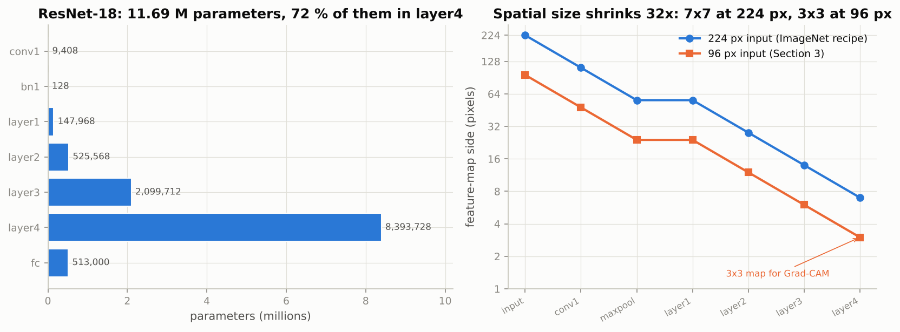

*What to see: almost three quarters of the weights sit in layer4, and the spatial map shrinks by 32 in both resolutions, ending at 7x7 (224 px) or 3x3 (96 px).*

### Real-world examples

- Any production image pipeline that serves a torchvision or timm model stores the preprocessing with the weights, for the same reason the `weights` API does: a mismatch between training and serving normalisation is a classic silent bug.
- Mobile apps use the smaller members of the same zoo (MobileNetV3, EfficientNet) with identical preprocessing conventions, so swapping backbones is a one-line change.
- The 1,000 ImageNet class names in `weights.meta["categories"]` are what "zero-training" demos such as photo-tagging apps show; a temple becomes "palace" or "monastery" because no closer label exists.

### Examples for every subsection

- **2.1 The `weights` API.** `ResNet18_Weights.DEFAULT` reports 69.8 % top-1 accuracy and 11,689,512 parameters from its metadata before a single image is processed; `weights.transforms()` gives the resize-256, crop-224, normalise pipeline.
- **2.2 Running the classifier on new images.** A `(427, 640, 3)` uint8 photo becomes a `(3, 224, 224)` float tensor whose channels were normalised as in the table above; the pixel (124, 116, 104) ends up near zero in every channel.

### Common pitfalls

- Passing `pretrained=True`: deprecated since torchvision 0.13, use `weights=`.
- Normalising with CIFAR statistics (or not at all) before a pretrained ImageNet model.
- Forgetting the batch dimension: the model wants `(N, 3, 224, 224)`, the transform returns `(3, 224, 224)`.

## 3. Feature extraction versus fine-tuning

### In plain words

Feature extraction treats the backbone as a fixed function: replace the head by `nn.Identity()`, run every image through once, cache the 512-dimensional features and train a linear classifier on them (a linear probe). Fine-tuning updates the backbone itself with a small learning rate, so that it adapts without forgetting. Discriminative learning rates make this safer: the new head gets the full rate and each group of layers towards the stem gets the rate divided by 2.6 again. Gradual unfreezing trains the head and last stage first and unfreezes earlier stages phase by phase. Test-time augmentation averages predictions over an image and its mirror image. The notebook measures all of them on CIFAR-10 at 96 pixels and shows that fine-tuning from ImageNet weights beats the same network trained from scratch with the same budget by a wide margin.

### Sample data

The five parameter groups of the notebook's `discriminative_param_groups` with base rate 0.01 and decay 2.6, plus the warm-up/cosine schedule of `fit` for the full run (3 epochs of 312 steps, 5 % warm-up):

| group | depth from head | learning rate |
|---|---|---|
| fc (head) | 0 | 0.01000 |
| layer4 | 1 | 0.00385 |
| layer3 | 2 | 0.00148 |
| layer2 | 3 | 0.00057 |
| conv1 + bn1 + layer1 | 4 | 0.00022 |

| step | schedule multiplier | head lr | layer4 lr |
|---|---|---|---|
| 0 | 0.0217 | 0.00022 | 0.00008 |
| 10 | 0.2391 | 0.00239 | 0.00092 |
| 46 (end of warm-up) | 1.0000 | 0.01000 | 0.00385 |
| 468 (half-way) | 0.5405 | 0.00541 | 0.00208 |
| 935 (last) | 0.0000 | 0.00000 | 0.00000 |

### Worked example

Learning rate of a group: $0.01 / 2.6^{d}$, so layer3 at depth 2 gets $0.01 / 6.76 = 0.00148$. The schedule multiplies every group by the same factor: $(t+1)/46$ during the 46 warm-up steps, then $\tfrac{1}{2}(1 + \cos(\pi (t - 46)/890))$ down to zero at step 935.

For the learning curves the toy task of Section 1 is run with 100 labelled target examples (mean of 3 seeds, test accuracy in %):

| method | step 10 | step 50 | step 100 | step 300 |
|---|---|---|---|---|
| linear probe (pretrained features) | 60.2 | 66.0 | 65.7 | 65.5 |
| linear probe (random features) | 50.4 | 53.2 | 52.2 | 50.7 |
| fine-tuning (discriminative LR) | 61.1 | 65.3 | 64.8 | 64.3 |
| from scratch | 50.4 | 55.7 | 55.8 | 55.8 |

Both pretrained strategies are above 60 % after ten steps; from scratch never passes 56 %. With only 100 examples the probe and fine-tuning end within a point of each other (65.5 % versus 64.3 %): fine-tuning has nothing to gain here because the toy target is a linear function of the very features the source task taught, and it overfits slightly. In the notebook the target domain differs from the source (blurry 96-pixel thumbnails versus 224-pixel photos), and that is where fine-tuning pulls ahead of the probe.

### Chart

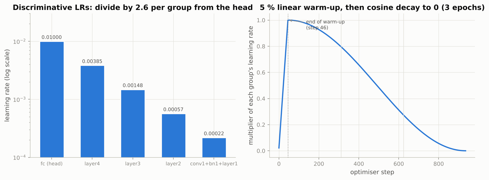

*What to see: each group's rate is 2.6 times smaller than the previous one (a straight line on the log axis), and one schedule multiplier moves all of them together.*

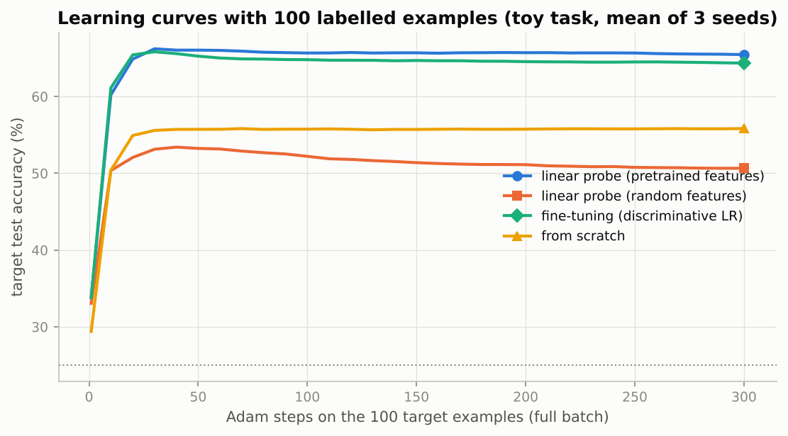

*What to see: the pretrained curves jump to above 60 % within a few steps and stay there; the random-feature probe and the from-scratch network plateau ten points lower.*

### Real-world examples

- Kaggle-style image competitions almost always fine-tune a pretrained backbone with a low learning rate and a cosine schedule, and most winning entries add horizontal-flip test-time augmentation.
- ULMFiT (Howard and Ruder, 2018) introduced discriminative learning rates and gradual unfreezing for text classifiers; the same recipe is standard in the fastai library for images.
- Linear probes on frozen features are how self-supervised papers report representation quality (Section 7), and how embedding services evaluate whether a backbone suits a new domain.
- Frozen-backbone feature extraction is the usual choice on edge devices: features are computed once, and only a tiny head is trained or updated per customer.

### Examples for every subsection

- **3.1 A target task: CIFAR-10 at 96 pixels.** A 32x32 image would reach layer4 as a 1x1 map; at 96 pixels layer4 is 3x3 for 9x the pixels, at 224 it would be 7x7 for 49x.
- **3.2 Feature extraction: a linear probe on frozen features.** Cache 512 numbers per image, train a 512-to-10 linear layer for 30 epochs in seconds; the same probe on a random network is the control (in the toy: 65.5 % versus 50.7 % with 100 examples).
- **3.3 Fine-tuning with discriminative learning rates.** Five parameter groups with rates 0.01, 0.00385, 0.00148, 0.00057, 0.00022; the stem moves 46 times less than the head.
- **3.4 Gradual unfreezing.** Phase 1 trains fc + layer4, phase 2 adds layer3, phase 3 everything, one epoch each, same total budget as full fine-tuning.
- **3.5 Comparison, test-time augmentation and a look at the features.** Averaging the logits of an image and its horizontal mirror costs one extra forward pass; t-SNE of the 512-dimensional features shows tight clusters after fine-tuning.

### Common pitfalls

- Fine-tuning with the from-scratch learning rate (0.05 to 0.1 with SGD): catastrophic forgetting, the ImageNet features are destroyed in a few steps.
- Freezing a backbone with `requires_grad_(False)` but leaving it in `train()` mode: BatchNorm running statistics keep drifting with every batch. Keep a frozen backbone in `eval()`.
- Caching features once and expecting augmentation benefits: cached features see each image exactly once.

## 4. Explaining predictions with Grad-CAM

### In plain words

Grad-CAM (Selvaraju et al., 2017) explains a prediction with one forward and one backward pass. Take the feature maps $A^k$ of the last convolutional layer, compute the gradient of the class score $y^c$ with respect to each map, average that gradient over the map's positions to get one weight $\alpha_k^c$ per channel, add up the weighted maps and cut off negative values with a ReLU. The result is a coarse heatmap (7x7 at 224 pixels, 3x3 at 96) that is upsampled and overlaid on the image. It is class-discriminative: asking for "palace" and for the runner-up class on the same photo gives different maps. Hooks make the implementation short: a forward hook stores the activations, a tensor hook stores the gradient. Grad-CAM++ (Exercise 2) replaces the plain average of the gradient by a pixel-weighted one.

### Sample data

A 4x4 feature map with three channels and hand-typed gradients. Channel 1 is a blob in the top-left, channel 2 a blob in the bottom-right, channel 3 a texture of roughly 0.5 everywhere.

| | channel 1 ($A^1$) | channel 2 ($A^2$) | channel 3 ($A^3$) |
|---|---|---|---|
| row 1 | 0.2 0.8 0.6 0.1 | 0.0 0.0 0.1 0.0 | 0.5 0.5 0.4 0.6 |
| row 2 | 0.4 1.0 0.7 0.1 | 0.0 0.1 0.2 0.3 | 0.5 0.6 0.5 0.5 |
| row 3 | 0.1 0.3 0.2 0.0 | 0.1 0.2 0.9 1.0 | 0.4 0.5 0.5 0.6 |
| row 4 | 0.0 0.0 0.1 0.0 | 0.0 0.1 0.6 0.8 | 0.6 0.5 0.4 0.5 |
| gradient $\partial y^c / \partial A^k$ | +0.5 everywhere | -1 in the left half, +1 in the right half | -0.25 everywhere |

### Worked example

1. Channel weights are the spatial means of the gradients: $\alpha_1 = 0.5$, $\alpha_2 = 0$ (the -1 and +1 halves cancel), $\alpha_3 = -0.25$.
2. Weighted sum, for instance at row 2, column 2: $0.5 \cdot 1.0 + 0 \cdot 0.1 - 0.25 \cdot 0.6 = 0.350$. At row 3, column 3: $0.5 \cdot 0.2 + 0 \cdot 0.9 - 0.25 \cdot 0.5 = -0.025$, which the ReLU sets to 0.
3. The Grad-CAM map (after ReLU, before normalisation):

| | | | |
|---|---|---|---|
| 0.000 | 0.275 | 0.200 | 0.000 |
| 0.075 | 0.350 | 0.225 | 0.000 |
| 0.000 | 0.025 | 0.000 | 0.000 |
| 0.000 | 0.000 | 0.000 | 0.000 |

Only the top-left blob survives. Channel 2 argued strongly for the class in its right half, but its average gradient is zero, so Grad-CAM ignores it entirely: this is the "cancellation within one map" caveat of Section 4.3.

4. Grad-CAM++ weights each position by $g^2 / (2 g^2 + g^3 \sum_{ab} A_{ab})$ and keeps only positive gradients. With channel sums 4.6, 4.4 and 8.1: channel 1 gets $0.25 / (0.5 + 4.6 \cdot 0.125) = 0.2326$ per position, so $w_1 = 16 \cdot 0.2326 \cdot 0.5 = 1.8605$; channel 2's right half gets $1 / (2 + 4.4) = 0.1562$ per position, so $w_2 = 8 \cdot 0.1562 \cdot 1 = 1.2500$; channel 3 has a negative gradient everywhere, so $w_3 = 0$. The Grad-CAM++ map therefore lights up both blobs (its largest values are 1.985 at row 2, column 2 and 1.497 at row 3, column 3).

### Chart

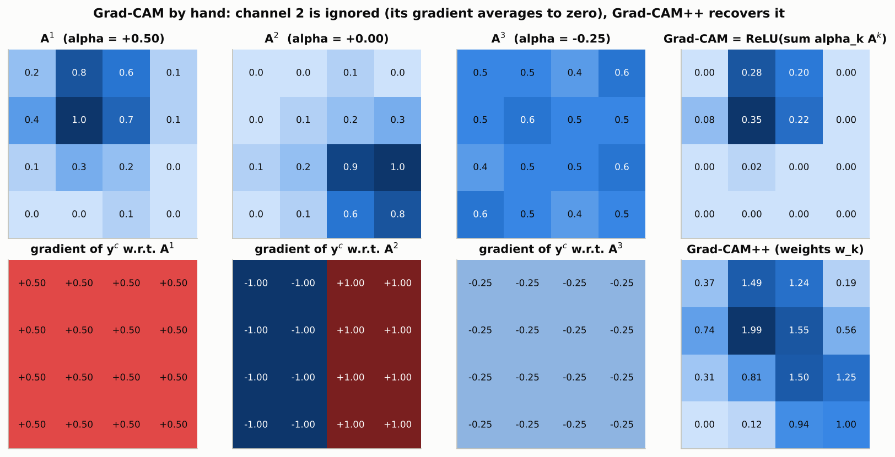

*What to see: the top row shows the three maps with their $\alpha$ weights and the resulting Grad-CAM; the bottom row shows the signed gradients and the Grad-CAM++ result, which recovers the bottom-right blob that plain Grad-CAM discarded.*

### Real-world examples

- Auditing chest X-ray classifiers: Grad-CAM revealed models that keyed on laterality markers, text or the portable-scanner look of an image rather than on lung tissue, a well-documented shortcut problem.
- Dermatology models have been caught attending to rulers and ink markings placed next to lesions; a heatmap on the ruler is a red flag before deployment.
- Quality inspection in manufacturing uses heatmaps to show operators where a defect classifier "looked", which makes rejections explainable.
- Wildlife and remote-sensing classifiers are checked the same way, for example to confirm that a "ship" detector looks at the hull and not at the water.

### Examples for every subsection

- **4.1 From occlusion maps to gradients.** Occlusion needs one forward pass per patch position (hundreds per image); Grad-CAM needs one backward pass and, for a ResNet, reduces to the classifier weights divided by the map area.
- **4.2 Implementation with hooks.** `register_forward_hook` on `layer4` stores a `(1, 512, 7, 7)` activation; `output.register_hook` stores the `(1, 512, 7, 7)` gradient; the weighted sum is `(1, 1, 7, 7)` and is bilinearly upsampled to 224x224.
- **4.3 What Grad-CAM can and cannot tell you.** In the toy example channel 2's evidence vanished because +1 and -1 gradients averaged to zero; on 96-pixel CIFAR images the 3x3 map cannot separate a cat's head from its body.

### Common pitfalls

- Forgetting to remove the hook: it keeps firing on every later forward pass and holds activations in memory.
- Reading a plausible heatmap as proof. Validate by occluding the highlighted region and checking that the prediction changes (Notebook 16 has the systematic sanity checks).
- Using an early layer for sharper maps and then over-interpreting them: early layers are not class-specific.

## 5. Vision Transformers

### In plain words

A Vision Transformer (Dosovitskiy et al., 2021) cuts an image into non-overlapping $P \times P$ patches, flattens each into a vector of $P^2 C$ numbers and maps it linearly to a $D$-dimensional token, which is exactly a convolution with kernel size and stride $P$. A learned class token is prepended and a learned positional embedding is added, then $L$ pre-norm Transformer blocks (multi-head self-attention followed by an MLP, each with a residual connection) update the tokens, and a linear head on the final class token gives the logits. Self-attention compares every token with every other, so its cost grows with the square of the number of tokens, which is why the patch size matters. A ViT has almost no built-in knowledge about images (no locality, no translation equivariance), so trained from scratch on 50,000 CIFAR images it loses to a small CNN; given enough pretraining data it matches or beats CNNs.

### Sample data

Patchifying an 8x8 RGB image with $P = 2$: $N = (8/2)^2 = 16$ patches, each flattened to $2 \cdot 2 \cdot 3 = 12$ values, giving a sequence of 17 tokens with the class token. For the notebook's full-run ViT (dim 192, depth 6, MLP ratio 2, 10 classes) on 32x32 images:

| patch size $P$ | tokens $N$ | values per patch | patch-embed params | pos-embed params | 6 blocks | head | total params | $N^2$ |
|---|---|---|---|---|---|---|---|---|
| 2 | 256 | 12 | 2,496 | 49,344 | 1,782,144 | 2,314 | 1,836,490 | 65,536 |
| 4 | 64 | 48 | 9,408 | 12,480 | 1,782,144 | 2,314 | 1,806,538 | 4,096 |
| 8 | 16 | 192 | 37,056 | 3,264 | 1,782,144 | 2,314 | 1,824,970 | 256 |
| 16 | 4 | 768 | 147,648 | 960 | 1,782,144 | 2,314 | 1,933,258 | 16 |

The FAST_RUN ViT (dim 96, depth 3) has 236,554 parameters at $P = 4$ and 245,770 at $P = 8$.

### Worked example

Take $P = 4$ on a 32x32 image: $N = (32/4)^2 = 64$ tokens of $4 \cdot 4 \cdot 3 = 48$ values. The patch embedding is a $48 \times 192$ matrix plus bias, $48 \cdot 192 + 192 = 9{,}408$ parameters; the positional embedding is $(64 + 1) \times 192 = 12{,}480$; one block costs 297,024 parameters (LayerNorms, the $192 \to 576$ qkv projection, the output projection and the two MLP layers), six blocks 1,782,144; the head is $2 \cdot 192 + 192 \cdot 10 + 10 = 2{,}314$. Total 1,806,538.

Doubling the patch to $P = 8$ quarters the tokens (16) and divides $N^2$ by 16 (256 instead of 4,096). The patch embedding grows by 27,648 parameters, the positional embedding shrinks by 9,216, and the total changes by +18,432, only 1.02 %: this is the claim of Exercise 3 that parameters barely change while attention cost drops 16x. At ImageNet scale, 224 pixels with $P = 16$ gives 196 tokens of 768 values; $P = 8$ would give 784 tokens and 16x the attention cost.

### Chart

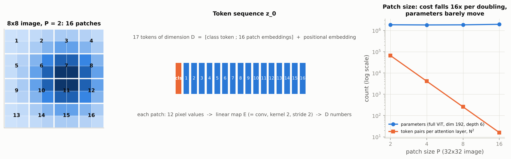

*What to see: the image becomes a numbered grid of 16 patches and then a sequence of 17 tokens; on the right the $N^2$ attention cost falls four orders of magnitude from $P = 2$ to $P = 16$ while the parameter count stays flat.*

### Real-world examples

- Pretrained ViTs (ImageNet-21k, JFT) and their self-supervised cousins (DINOv2) are now the default backbones for dense tasks such as depth estimation and segmentation in research and in several production vision APIs.
- CLIP's image tower is a ViT; its patch tokens are what text-to-image retrieval systems embed.
- Swin Transformers (local attention windows) are used in medical and satellite imagery where images are large and the quadratic cost of global attention would be prohibitive.
- DeiT showed that with strong augmentation and distillation a ViT can be trained on ImageNet-1k alone, which made ViTs usable without a 300-million-image dataset.

### Examples for every subsection

- **5.1 An image is a sequence of patches.** 32x32 image, $P = 4$: 64 patches of 48 values become 64 tokens of 192 numbers, plus one class token, plus a 65x192 positional embedding.
- **5.2 A compact implementation.** `nn.Conv2d(3, 192, kernel_size=4, stride=4)` followed by `flatten(2).transpose(1, 2)` turns `(N, 3, 32, 32)` into `(N, 64, 192)`; the forward pass prints `(2, 64, 192)`, `(2, 65, 192)` and `(2, 10)`.
- **5.3 ViT versus CNN on CIFAR-10.** Same AdamW, same schedule, same 12 epochs: the CNN wins by roughly ten points because it knows that nearby pixels are related and the ViT has to learn it from 50,000 images.

### Common pitfalls

- Skipping the warm-up: Transformers are sensitive to the early learning rate; the notebook uses a 10 % linear warm-up with AdamW.
- Changing the image size at fine-tuning time without interpolating the positional embedding to the new number of patches.
- Choosing a tiny patch for detail without budgeting the quadratic attention cost: $P = 2$ on 32x32 is 16x the attention cost of $P = 4$.

## 6. Beyond classification: segmentation and detection

### In plain words

Semantic segmentation labels every pixel, so the network must output a $(K, H, W)$ map of class logits. The U-Net (Ronneberger et al., 2015) does this with an encoder that halves the resolution at each level, a decoder that doubles it back with transposed convolutions, and skip connections that concatenate the encoder map of the same resolution with the decoder map, so fine boundary information reaches the output directly. Because the background usually dominates, pixel accuracy is misleading and the standard metrics are IoU and Dice, computed per class on binary masks. Object detection outputs a set of boxes with labels and scores; two-stage detectors (Faster R-CNN) propose regions and then classify them, one-stage detectors (YOLO, RetinaNet) predict at every anchor of a dense grid, and DETR predicts a set with Transformer queries. All anchor-based detectors end with non-maximum suppression, which uses the same IoU applied to rectangles.

### Sample data

Three pairs of 8x8 binary masks (prediction $A$, ground truth $B$) and six detection proposals around two objects:

| mask pair | $\|A\|$ | $\|B\|$ | intersection | union | IoU | Dice |
|---|---|---|---|---|---|---|
| large overlap | 25 | 25 | 16 | 34 | 16/34 = 0.4706 | 32/50 = 0.6400 |
| half overlap | 16 | 16 | 4 | 28 | 4/28 = 0.1429 | 8/32 = 0.2500 |
| small overlap | 9 | 16 | 1 | 24 | 1/24 = 0.0417 | 2/25 = 0.0800 |

| box | (x1, y1, x2, y2) | score |
|---|---|---|
| 0 | (10, 10, 40, 45) | 0.90 |
| 1 | (12, 8, 42, 44) | 0.75 |
| 2 | (8, 14, 38, 48) | 0.60 |
| 3 | (55, 20, 90, 50) | 0.85 |
| 4 | (58, 22, 92, 52) | 0.70 |
| 5 | (35, 15, 60, 45) | 0.50 |

### Worked example

**Dice from IoU.** For the first pair, $2 \cdot 0.4706 / (1 + 0.4706) = 0.6400$, the same as $2 \cdot 16 / (25 + 25)$; the relation $\text{Dice} = 2\,\text{IoU}/(1 + \text{IoU})$ holds for all three rows, and Dice is always the larger number. For the shapes dataset of the notebook (89 % background pixels) a model that predicts background everywhere scores 0.89 pixel accuracy, about $(0.89 + 0.3 + 0.3)/3 = 0.497$ mean IoU under the per-image convention (each shape class is absent from roughly 30 % of the images and earns a free 1 there) and $0.89/3 = 0.297$ under the dataset-level convention of Exercise 4.

**Box IoU.** For $A = (10, 10, 40, 45)$ and $B = (20, 20, 50, 55)$: the intersection's top-left corner is the element-wise maximum $(20, 20)$ and its bottom-right the element-wise minimum $(40, 45)$, so the intersection is $20 \times 25 = 500$. Areas are $30 \times 35 = 1050$ each, the union is $1050 + 1050 - 500 = 1600$, IoU $= 500/1600 = 0.3125$. Shifting $A$ by two pixels in each direction gives IoU 0.7857; a disjoint box gives 0.

**NMS with threshold 0.5.** Sort by score: 0 (0.90), 3 (0.85), 1 (0.75), 4 (0.70), 2 (0.60), 5 (0.50).
1. Keep box 0. Its IoU with the rest: box 1: 0.81, box 2: 0.72, box 3: 0.00, box 4: 0.00, box 5: 0.09. Drop 1 and 2; left: 3, 4, 5.
2. Keep box 3. IoU with box 4: 0.76, with box 5: 0.07. Drop 4; left: 5.
3. Keep box 5. Nothing is left.

Kept: boxes 0, 3 and 5. Box 5 is a low-confidence proposal straddling both objects; it survives because its IoU with every kept box is below 0.5, a typical NMS false positive that a score threshold would remove.

### Chart

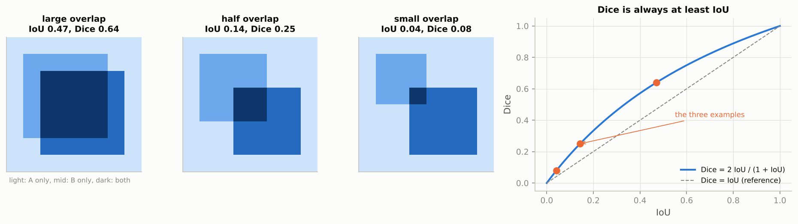

*What to see: the three examples sit on the curve $2\,\text{IoU}/(1+\text{IoU})$, which lies above the diagonal everywhere between 0 and 1.*

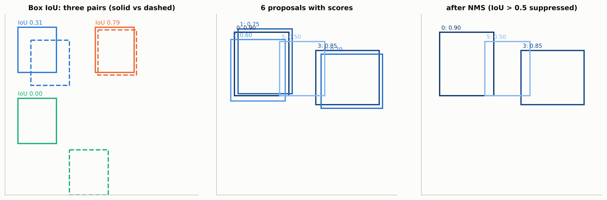

*What to see: three box pairs with their IoU on the left; six overlapping proposals in the middle; the three survivors of greedy NMS on the right, including the straddling box 5.*

### Real-world examples

- Brain-tumour segmentation on MRI (the BraTS challenge) and organ segmentation on CT are dominated by U-Net variants such as nnU-Net, reported in Dice.
- Satellite land-cover and building-footprint maps are produced by U-Nets over tiled images, with a pretrained ResNet encoder.
- Driver-assistance systems run one-stage detectors on video for pedestrians, vehicles and signs, with NMS as the final step of each frame.
- Checkout-free retail stores and warehouse robots use detectors trained on product categories, which only know the objects they were trained on, exactly as the COCO detector of Section 6.5 does not know "temple".

### Examples for every subsection

- **6.1 Semantic segmentation and the U-Net.** The notebook's U-Net has encoder levels at 64, 32 and 16 pixels with 16, 32 and 64 channels, a bottleneck at 8 pixels with 128 channels, and decoder convolutions with doubled input channels because of the concatenated skips.
- **6.2 A synthetic shapes dataset.** 64x64 images with one to three random circles and rectangles in random colours; about 89 % of the pixels are background, so colour cannot be used to tell the two shape classes apart and shape must be learned.
- **6.3 Training with Dice and IoU.** Per-pixel cross-entropy on `(N, 3, 64, 64)` logits; a class absent from both masks counts as a perfect 1, which is why the all-background model still gets about 0.5 mean IoU per image.
- **6.4 Object detection: concepts.** Six proposals around two objects collapse to two true boxes plus one straddling survivor after greedy NMS at threshold 0.5.
- **6.5 A pretrained detector (optional).** A COCO-trained Faster R-CNN with a MobileNetV3 backbone returns boxes, labels and scores for 80 everyday categories; on the temple photo it may find little, because "temple" is not among them.

### Common pitfalls

- Reporting pixel accuracy for segmentation: predicting background everywhere already scores 89 % on the shapes data.
- Mixing the per-image and the dataset-level mIoU conventions when comparing with papers (0.497 versus 0.297 for the same trivial model).
- Setting the NMS threshold too low merges neighbouring objects of the same class (a crowd of people); too high keeps duplicates.

## 7. Self-supervised and contrastive learning

### In plain words

Labels are expensive and images are free, so self-supervised learning invents a pretext task whose supervision comes from the data itself. In contrastive learning two random augmentations of the same image form a positive pair that should map to nearby embeddings, while views of other images are negatives that should be far away. SimCLR's NT-Xent loss writes this as a softmax cross-entropy: for each view, the "classes" are all the other $2N - 1$ views, the correct class is the partner view, and the logits are cosine similarities divided by a temperature $\tau$. MoCo keeps a queue of negatives, BYOL and DINO drop negatives with a teacher-student trick, CLIP contrasts images with captions and gets zero-shot classification, and MAE reconstructs masked patches instead. The notebook implements NT-Xent in six lines and shows that an ImageNet backbone is already far more invariant to the augmentations than a random one.

### Sample data

A batch of 4 pairs gives 8 views. The toy embeddings are unit vectors in the plane given by an angle, so the cosine similarity between two views is the cosine of their angle difference; view $i$ and view $i + 4$ are partners.

| view | 0 | 1 | 2 | 3 | 4 | 5 | 6 | 7 |
|---|---|---|---|---|---|---|---|---|
| angle (degrees) | 0 | 90 | 180 | 270 | 12 | 78 | 200 | 262 |
| partner | 4 | 5 | 6 | 7 | 0 | 1 | 2 | 3 |

The angle differences within the four positive pairs are 12, 12, 20 and 8 degrees, so their similarities are 0.98, 0.98, 0.94 and 0.99.

### Worked example

Row 0 of the similarity matrix (view 0 against the others): 0.00, -1.00, -0.00, 0.98, 0.21, -0.94, -0.14 for views 1 to 7; the self-similarity is masked out.

- $\tau = 0.5$: logits are the similarities divided by 0.5, so the partner's logit is 1.96 and the negatives are 0.00, -2.00, -0.00, 0.42, -1.88, -0.28. The softmax over the seven other views gives 0.608 to the partner, so view 0 contributes $-\log 0.608 = 0.4976$; averaged over all 8 views the loss is 0.5331.
- $\tau = 0.1$: the same similarities become logits 9.78 for the partner against 0.00, -10.0, -0.00, 2.08, -9.40, -1.39; the partner's probability is 0.9994 and the mean loss is 0.0035.
- A collapsed encoder (all views identical) or random embeddings cannot do better than $\log(2N - 1) = \log 7 = 1.9459$; random 64-dimensional embeddings average 1.969 over 200 draws.
- The loss of this good encoder rises with temperature: 0.0000 at $\tau = 0.05$, 1.0493 at $\tau = 1$, 1.4438 at $\tau = 2$. A lower temperature makes the same similarity differences count for more.

### Chart

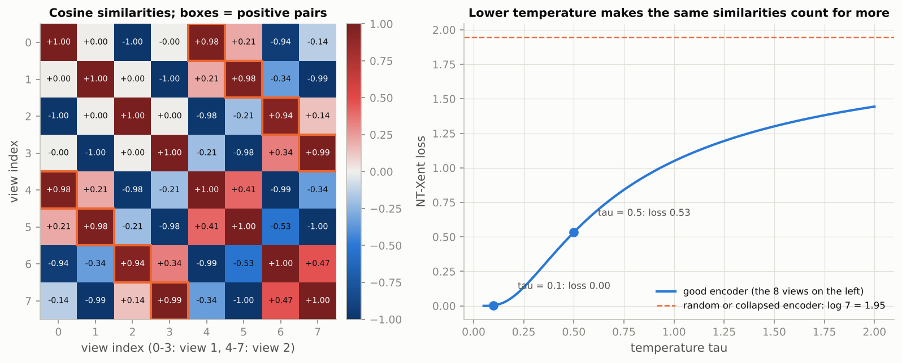

*What to see: the positive pairs are the two orange off-diagonal bands of high similarity; on the right the loss of a good encoder is far below the random-encoder level of log 7 and shrinks further as the temperature falls.*

### Real-world examples

- CLIP (Radford et al., 2021), trained contrastively on 400 million image-caption pairs, powers text-to-image search in photo libraries and stock-image sites and serves as the text encoder of diffusion models such as Stable Diffusion.
- DINO and DINOv2 features from self-supervised ViTs are used for image retrieval and as frozen backbones for segmentation and depth, without any labels in pretraining.
- SimCLR and MoCo-style pretraining on unlabelled in-house images (satellite tiles, pathology slides, retail shelves) is how companies get ImageNet-like backbones for domains far from natural photos, the hardest cell of the decision matrix.
- Masked autoencoders (MAE) pretrain ViTs by reconstructing 75 % hidden patches, the vision analogue of BERT.

### Examples for every subsection

- **7.1 Learning representations without labels.** Two crops of the same CIFAR photo, flipped and colour-jittered, must land near each other; the ImageNet backbone retrieves the partner view far more often than a random backbone, whose features change drastically under cropping.
- **7.2 The NT-Xent loss.** With 4 pairs and $\tau = 0.5$ the toy encoder's loss is 0.5331; a random or collapsed encoder scores log 7 = 1.9459; at $\tau = 0.1$ the toy loss drops to 0.0035.

### Common pitfalls

- Forgetting to mask the self-similarity: the diagonal would be the easiest "positive" and the loss would collapse to zero without learning anything.
- Too few negatives: SimCLR needs batches of thousands; MoCo's queue is the fix for small batches.
- Using the projection head's output downstream: SimCLR throws the projection head away and uses the encoder's features.

## Exercises in plain words

- **Exercise 1 (warm-up): a different backbone.** Repeat the linear probe with MobileNetV3-Small (576-dimensional features after replacing `classifier` by `nn.Identity()`) and compare feature size, backbone size, extraction time and accuracy with ResNet-18. Useful because swapping backbones is the most common engineering decision in transfer learning. Hint: the backbone without its classifier has well under a million parameters, so expect speed, not accuracy.
- **Exercise 2: Grad-CAM++.** Subclass `GradCAM` and override `channel_weights` with the pixel-weighted formula. Useful when the class appears several times or covers a small area. Hint: the sum over positions applies only to $A$, the gradient stays per pixel, and positions with a zero denominator get weight 0 (the worked example above shows the arithmetic).
- **Exercise 3: patch-size ablation for the ViT.** Train the ViT with patch 8 (16 tokens) and compare parameters, time per epoch and accuracy with patch 4. Useful for understanding where a Transformer's cost comes from. Hint: attention cost scales with $N^2$, the linear layers with $N$; the table in Section 5 gives the parameter counts.
- **Exercise 4: dataset-level IoU for the U-Net.** Accumulate a confusion matrix over the whole test set and compute per-class IoU as diagonal over (row sum + column sum - diagonal). Useful because benchmarks such as Cityscapes report this convention. Hint: `torch.bincount` on `true * K + pred` builds the matrix in one line; expect a number below the per-image average.
- **Exercise 5 (challenge): mixup and CutMix for fine-tuning.** Implement both pairwise mixers, a training loop with the mixed loss, and fine-tune with CutMix. Useful because they are standard regularisers in modern recipes. Hint: for CutMix the box side is $\sqrt{1 - \lambda}$ times the image side and $\lambda$ must be recomputed from the clipped box.

## Quick reference

| Concept | Formula or rule | In one sentence |
|---|---|---|
| Decision matrix | small + similar: freeze; large: fine-tune; small + different: earlier features, regularise | How much to retrain depends on data size and domain similarity. |
| ImageNet preprocessing | resize 256, crop 224, $x/255$, $(x - \mu)/\sigma$ with $\mu = (0.485, 0.456, 0.406)$, $\sigma = (0.229, 0.224, 0.225)$ | Use `weights.transforms()`; anything else silently hurts. |
| Linear probe | cache backbone features once, train a linear classifier on them | Cheapest transfer; measures representation quality. |
| Discriminative LRs | $\eta_d = \eta_{\text{head}} / 2.6^{d}$, $d$ = depth from the head | Head moves most, stem barely moves. |
| Warm-up + cosine | $(t+1)/w$ for $t < w$, then $\tfrac12(1 + \cos(\pi (t - w)/(T - w)))$ | One multiplier scales every parameter group. |
| Grad-CAM | $\alpha_k^c = \frac{1}{uv}\sum_{ij} \partial y^c / \partial A^k_{ij}$, $L^c = \mathrm{ReLU}(\sum_k \alpha_k^c A^k)$ | Gradient-weighted sum of the last feature maps, positive part only. |
| CAM equivalence | for GAP + linear heads, $\alpha_k^c = w_{ck}/(uv)$ | Grad-CAM at the last layer reduces to the classifier weights. |
| Grad-CAM++ | $\alpha_{ij} = g^2 / (2g^2 + g^3 \sum_{ab} A_{ab})$, $w_k = \sum_{ij} \alpha_{ij}\,\mathrm{ReLU}(g_{ij})$ | Pixel-weighted gradients instead of their plain average. |
| ViT patches | $N = HW/P^2$ tokens of $P^2 C$ values; attention cost $O(N^2 D)$ | Doubling $P$ divides the attention cost by 16. |
| Self-attention | $\mathrm{softmax}(QK^\top / \sqrt{d})\,V$ | Every token is a similarity-weighted average of all values. |
| IoU and Dice | $\text{IoU} = \frac{\|A \cap B\|}{\|A \cup B\|}$, $\text{Dice} = \frac{2\|A \cap B\|}{\|A\| + \|B\|} = \frac{2\,\text{IoU}}{1 + \text{IoU}}$ | Dice is always at least IoU; neither is fooled by the background. |
| Box IoU | intersection corners = max of top-lefts, min of bottom-rights, clamp at 0 | Same overlap measure applied to rectangles. |
| NMS | sort by score; keep the best, drop boxes with IoU above the threshold; repeat | One box per object, greedy. |
| NT-Xent | $\ell_{ij} = -\log \frac{\exp(\mathrm{sim}(z_i, z_j)/\tau)}{\sum_{k \ne i} \exp(\mathrm{sim}(z_i, z_k)/\tau)}$ | Softmax over the other $2N-1$ views; chance level $\log(2N-1)$. |
| mixup / CutMix | $\tilde x = \lambda x_i + (1-\lambda) x_j$ or a pasted box of area fraction $1-\lambda$; loss $\lambda \ell(y_i) + (1-\lambda)\ell(y_j)$ | Pairwise regularisers for long fine-tuning schedules. |

## Glossary

- **Backbone**: the part of a network up to the pooled features; everything except the task-specific head.
- **Head**: the final layer(s) that map features to the task's outputs; replaced when the task changes.
- **Linear probe**: a linear classifier trained on frozen features; the standard measure of representation quality.
- **Fine-tuning**: continuing to train pretrained weights on the target data with a small learning rate.
- **Catastrophic forgetting**: destroying pretrained features with learning rates that are too large.
- **Parameter group**: a dictionary of parameters with its own hyperparameters inside a PyTorch optimiser.
- **Test-time augmentation (TTA)**: averaging predictions over augmented copies of an input, typically the image and its mirror.
- **Grad-CAM**: a class-discriminative heatmap from gradient-weighted feature maps of the last convolutional layer.
- **Hook**: a callback PyTorch runs on a module's forward pass or on a tensor's gradient; used to capture activations and gradients.
- **Patch embedding**: the linear map (a strided convolution) that turns each image patch into a token.
- **Class token**: a learned vector prepended to the token sequence whose final state represents the whole image.
- **Inductive bias**: built-in assumptions of an architecture, such as a CNN's locality and translation equivariance; a ViT has few.
- **U-Net**: an encoder-decoder segmentation network with concatenation skip connections.
- **IoU / Dice**: overlap scores between a predicted and a true mask or box; Dice $= 2\,\text{IoU}/(1+\text{IoU})$.
- **Non-maximum suppression (NMS)**: greedy removal of detection boxes that overlap a higher-scoring box too much.
- **Contrastive learning**: pulling embeddings of two views of the same image together and pushing other images apart.
- **Temperature**: the divisor $\tau$ applied to similarities before the softmax; smaller values sharpen the distribution.
