# 08 · Sequence Models: RNNs, LSTMs and GRUs — Companion Guide

> Plain-language companion to [`08_sequence_models_rnn_lstm.ipynb`](08_sequence_models_rnn_lstm.ipynb). Read a section here, then run the
> matching section of the notebook. All numbers below were computed with the script
> [`figures/scripts/make_figures_08.py`](figures/scripts/make_figures_08.py); all charts are its output.
> The script re-implements the vanilla RNN and the LSTM, with their exact backward passes, in numpy, so every
> gradient curve and the delayed-recall experiment below are computed, not sketched.

## At a glance

- **What you learn**
  - Why sequences need a model that handles any length *and* notices order, and how a hidden state that is updated with the same weights at every step gives both.
  - What a vanilla RNN computes, step by step, and why unrolling it over 100 steps makes it a 100-layer network with shared weights.
  - Why the gradient that travels back through time is a product of one matrix per step, so it shrinks to nothing or blows up exponentially with the lag, and what truncation and clipping do about it.
  - How the LSTM's additive cell state and its gates turn the decay rate of the gradient into something the network learns, and how the GRU does the same with two gates.
  - How to train a character-level language model with truncated backpropagation, measure it with perplexity and sample from it with a temperature.
  - How to forecast a time series without leaking the future, classify variable-length sequences with padding and packing, and build an encoder-decoder that reveals the fixed-size bottleneck attention was invented to remove.
- **Where this is used in the real world**
  - Speech recognition before Transformers: the acoustic models in Google's voice search and Baidu's Deep Speech 2 (2015 to 2016) were deep LSTM or GRU networks reading audio frames one at a time.
  - Machine translation: Google's 2016 production system (GNMT) was an eight-layer LSTM encoder-decoder with attention, the direct descendant of the seq2seq models of Section 9.
  - Predictive text: the next-word suggestions of mobile keyboards such as Gboard were produced by small LSTM language models trained on-device, the word-level cousin of the character model in Section 6.
  - Demand and load forecasting: Amazon's DeepAR is an autoregressive RNN for forecasting demand across many products, and the winning entry of the M4 forecasting competition (2018) combined exponential smoothing with an LSTM; electricity grid operators run similar models on hourly load.
  - Anomaly detection in sensor streams: predictive-maintenance systems train a recurrent model to predict the next sensor reading and flag the moments when the prediction error jumps, which is the forecasting setup of Section 7 turned into an alarm.
  - Protein sequences: UniRep (2019) learned protein representations with a multiplicative LSTM trained to predict the next amino acid, exactly the next-token objective of Section 6 on a 20-letter alphabet.

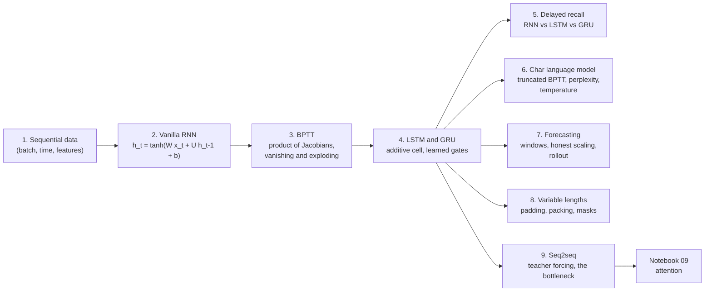

## 1. Sequential data and why order matters

### In plain words

A sequence is a list of steps whose length is not fixed and whose order carries meaning: text, audio samples, sensor readings, moves in a game. Two sequences can contain exactly the same values and mean opposite things, so any model that summarises a sequence with an order-blind statistic, such as the average over time, is blind to what matters. A recurrent network avoids this by reading one step at a time and updating a running summary, the hidden state, with the same small set of weights at every step. Reusing the same update means the model accepts any length; building each update on the previous state means it is sensitive to order.

### Sample data

Eight values of a slowly rising curve, generated as `sin(t/4)` for eight equally spaced `t`, then the same eight values reversed and shuffled (seed 42). This mirrors the notebook's "rising, falling, shuffled" cell with 8 steps instead of 40.

| t | rising | falling | shuffled |
|---|---|---|---|
| 0 | 0.00 | 1.00 | 0.62 |
| 1 | 0.22 | 0.97 | 0.78 |
| 2 | 0.43 | 0.90 | 0.43 |
| 3 | 0.62 | 0.78 | 1.00 |
| 4 | 0.78 | 0.62 | 0.97 |
| 5 | 0.90 | 0.43 | 0.22 |
| 6 | 0.97 | 0.22 | 0.90 |
| 7 | 1.00 | 0.00 | 0.00 |

### Worked example

1. Sorting each column gives the same list, so the three sequences are the same "bag of values".
2. The time-average of every sequence is 0.6150. A model that pools over time by averaging sees three identical inputs.
3. The last value is 1.00 for rising, 0.00 for falling and 0.00 for shuffled; the first value is 0.00, 1.00 and 0.62. A single position separates *some* pairs here, but only by luck: the information that tells the classes apart is the arrangement of all eight values.

### Chart

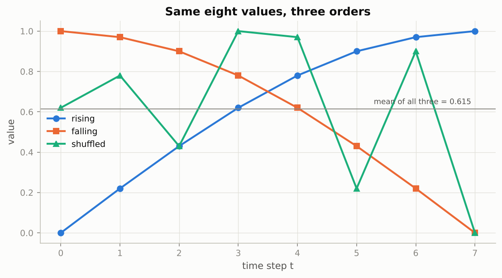

*Three curves that share every value and the same mean 0.615; only their order differs, and only a model that reads the order can tell them apart.*

### Real-world examples

- An ECG classifier must distinguish a heart rate that is speeding up from one that is slowing down, although both windows contain the same set of beat intervals.
- A fraud model reads a customer's transactions in order: a large withdrawal *after* a password change is a different story from the same two events the other way round.
- Activity recognition on a smartwatch classifies a window of accelerometer readings as walking, running or climbing stairs from the shape of the signal over time, not from its average.

### Examples for every subsection

- **1.1 Shapes and the taxonomy of sequence tasks.** A batch of 32 sentences of 20 word ids each is a tensor of shape (32, 20, 1) before the embedding and (32, 20, 64) after it. Sentiment classification reads the whole sentence and outputs one label (many-to-one); part-of-speech tagging outputs one tag per word (aligned many-to-many); translation outputs a sentence of a different length (unaligned many-to-many); image captioning starts from one vector and writes a sentence (one-to-many).

### Common pitfalls

- Averaging or max-pooling a sequence over time before the model has seen it throws the order away; pooling is fine *after* a recurrent layer has mixed in the context.
- `nn.RNN`, `nn.LSTM` and `nn.GRU` expect `(time, batch, features)` unless you pass `batch_first=True`; feeding `(batch, time, features)` without the flag runs silently with the axes swapped.

## 2. The vanilla RNN from scratch

### In plain words

The simplest recurrent cell keeps a vector of numbers as its state. At each step it multiplies the new input by one matrix, the previous state by another, adds a bias and squashes the sum with `tanh` so the state stays between minus one and one. Only three weight tensors exist, whatever the length of the sequence, so the parameter count does not grow with time. Drawing the computation for a sequence of length `T` gives a feed-forward network with `T` layers that all share the same weights; this "unrolled" picture is what autograd differentiates, and it is why the problems of very deep networks reappear here. The state is a fixed-size vector, so it has to compress everything relevant that has been seen so far.

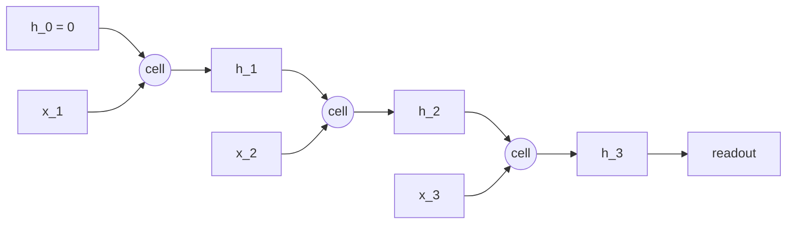

*The same cell (the same `W_xh`, `W_hh`, `b`) is applied three times; the arrows from `h_1` to `h_2` to `h_3` are the path the gradient has to travel backwards.*

### Sample data

A cell with **one** hidden unit, so every tensor is a single number: $w_{xh} = 0.8$, $w_{hh} = 0.5$, $b = -0.1$, starting state $h_0 = 0$. Two input sequences that contain the same three numbers in different orders.

| sequence | $x_1$ | $x_2$ | $x_3$ |
|---|---|---|---|
| A | +1.0 | +0.5 | -1.0 |
| B (A reversed) | -1.0 | +0.5 | +1.0 |

### Worked example

Each step computes the pre-activation $a_t = 0.8\,x_t + 0.5\,h_{t-1} - 0.1$ and then $h_t = \tanh(a_t)$.

Sequence A:

| t | $x_t$ | $a_t$ | $h_t$ |
|---|---|---|---|
| 1 | +1.00 | +0.7000 | +0.6044 |
| 2 | +0.50 | +0.6022 | +0.5386 |
| 3 | -1.00 | -0.6307 | -0.5585 |

Sequence B:

| t | $x_t$ | $a_t$ | $h_t$ |
|---|---|---|---|
| 1 | -1.00 | -0.9000 | -0.7163 |
| 2 | +0.50 | -0.0581 | -0.0581 |
| 3 | +1.00 | +0.6710 | +0.5856 |

The two final states are $-0.5585$ and $+0.5856$: same inputs, opposite conclusions, because the state carries the history in the order it arrived. The parameter count of the notebook's cell with $H = 8$ hidden units and $D = 5$ input features is $H D + H^2 + H = 112$; `nn.RNN` stores one extra bias vector and reports 120.

### Chart

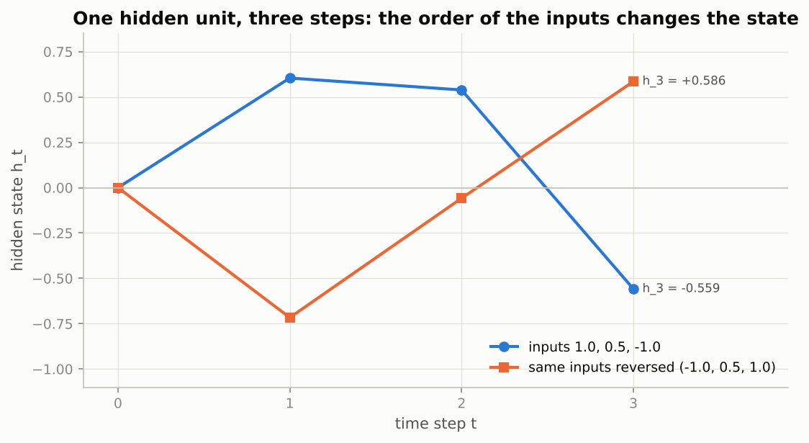

*The two trajectories start at the same state and consume the same three numbers, yet end at $-0.559$ and $+0.586$.*

### Real-world examples

- Before Transformers, Google's voice search ran deep LSTM acoustic models that read one 10-millisecond audio frame per step; the vanilla cell is the ancestor of those models.
- Handwriting recognition on tablets reads pen coordinates one sample at a time with recurrent layers, turning a variable-length stroke into characters.
- Simple sensor smoothers in embedded devices are tiny recurrent filters: the state is a running estimate, the input is the latest reading, and the update is applied at every tick with the same coefficients.

### Examples for every subsection

- **2.1 The recurrence.** With one unit and $w_{hh} = 0.5$, the step is $h_t = \tanh(0.8\,x_t + 0.5\,h_{t-1} - 0.1)$; the table above runs it by hand for three steps.
- **2.2 Implementation.** The notebook's `RNNCellScratch(5, 8)` holds a $(8, 5)$ input matrix, an $(8, 8)$ recurrent matrix and a bias of length 8, 112 numbers in total, and `rnn_forward` loops over the 7 time steps of a $(3, 7, 5)$ batch, handling all 3 sequences at once in each step.
- **2.3 Checking against `nn.RNN`.** Copying `weight_ih_l0`, `weight_hh_l0` and the sum of the two biases into the scratch cell makes the outputs agree to about $10^{-7}$, the size of float32 rounding; `h_n[0]` is the same tensor as `output[:, -1]` for a single layer and direction.

### Common pitfalls

- Initialising a `(H, H)` recurrent matrix with large values makes `tanh` saturate at $\pm 1$ in a few steps, after which the state stops reacting to inputs; the $\pm 1/\sqrt{H}$ uniform init keeps the first steps in the responsive range.
- Forgetting that the Python loop runs over *time* and the matrix product over the *batch*: looping over batch elements is hundreds of times slower.

## 3. Backpropagation through time

### In plain words

Training an RNN is ordinary backpropagation on the unrolled network. The loss at a late step depends on the weights through every earlier state, so the gradient for the shared weights is a sum over time, and the piece that carries the error from step $t$ back to step $k$ is a product of one matrix per intervening step: the derivative of `tanh` times the recurrent matrix. If each factor shrinks vectors even slightly, the product collapses exponentially with the lag; if each stretches them, it explodes. Exploding gradients are loud (a `nan` loss) and are tamed by clipping the gradient's length. Vanishing gradients are silent: training looks fine, but the model only ever learns from the last few steps of context. Truncated BPTT bounds the memory cost by cutting the stream into chunks and carrying the state, but not the gradient, across the cut.

### Sample data

The notebook's experiment, reproduced in numpy with explicit Jacobian products: a `tanh` RNN with 32 hidden units and 8 input features, recurrent matrix $W_{hh} = g\,Q$ with $Q$ random orthogonal (so every singular value equals the gain $g$), 60 steps, a random linear readout on the last state, random inputs. The table lists the norm of $\partial L/\partial h_t$ at three lags.

| gain $g$ | norm at lag 0 | norm at lag 30 | norm at lag 59 | fitted slope per step | factor per step |
|---|---|---|---|---|---|
| 0.5 | 6.641 | $6.92 \times 10^{-10}$ | $9.89 \times 10^{-20}$ | $-0.774$ | 0.461 |
| 1.0 | 6.641 | $5.34 \times 10^{-2}$ | $2.79 \times 10^{-4}$ | $-0.168$ | 0.845 |
| 1.5 | 6.641 | $4.12 \times 10^{1}$ | $9.15 \times 10^{1}$ | $+0.044$ | 1.045 |

### Worked example

1. **One-unit Jacobians by hand.** In the one-unit example of Section 2 (sequence A), each backward step multiplies the gradient by $(1 - h_t^2)\,w_{hh}$: at $t = 2$ this is $(1 - 0.5386^2) \times 0.5 = 0.3550$, at $t = 3$ it is $(1 - (-0.5585)^2) \times 0.5 = 0.3440$, so $\partial h_3 / \partial h_1 = 0.3550 \times 0.3440 = 0.1221$. Two steps already cost 88 percent of the signal. With $w_{hh} = 1.5$ instead, the same product is $1.0990$: the recurrent weight alone decides whether the chain shrinks or grows.
2. **Thirty-two units, sixty steps.** With gain 0.5 the gradient loses a factor 0.461 per step on average (slightly worse than one half, because the `tanh` derivatives are below one too) and has fallen from 6.641 to $9.9 \times 10^{-20}$ after 59 steps. With gain 1.0 the orthogonal matrix preserves length exactly and only the `tanh` derivatives bite: the factor is 0.845 per step and the norm is down to $2.8 \times 10^{-4}$ after 59 steps. With gain 1.5 the linear part amplifies by 1.5 per step while saturated states push back; here the net factor is 1.045 and the gradient grows about fourteenfold.
3. **No non-linearity.** Replacing `tanh` by the identity makes the per-step ratio exactly the gain: 0.5000, 1.0000 and 1.5000 at every one of the 59 steps. The dashed reference line in the chart is the gain-1 identity case: perfectly flat.
4. **Clipping.** A 2-D gradient $g = (4.0, 1.0)$ has norm 4.123. Clipping by norm at $\tau = 1$ rescales it to $(0.970, 0.243)$, norm 1.000, cosine similarity with $g$ equal to 1.0000: same direction. Clipping each coordinate to $\pm 0.5$ gives $(0.500, 0.500)$, norm 0.707, cosine 0.8575: the update now points somewhere else.

### Chart

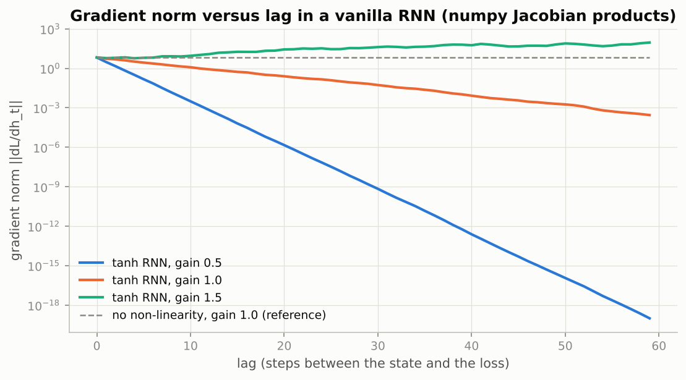

*On a log axis each curve is close to a straight line, which is what exponential decay or growth looks like; the vertical span between gain 0.5 and gain 1.5 at lag 59 is twenty orders of magnitude.*

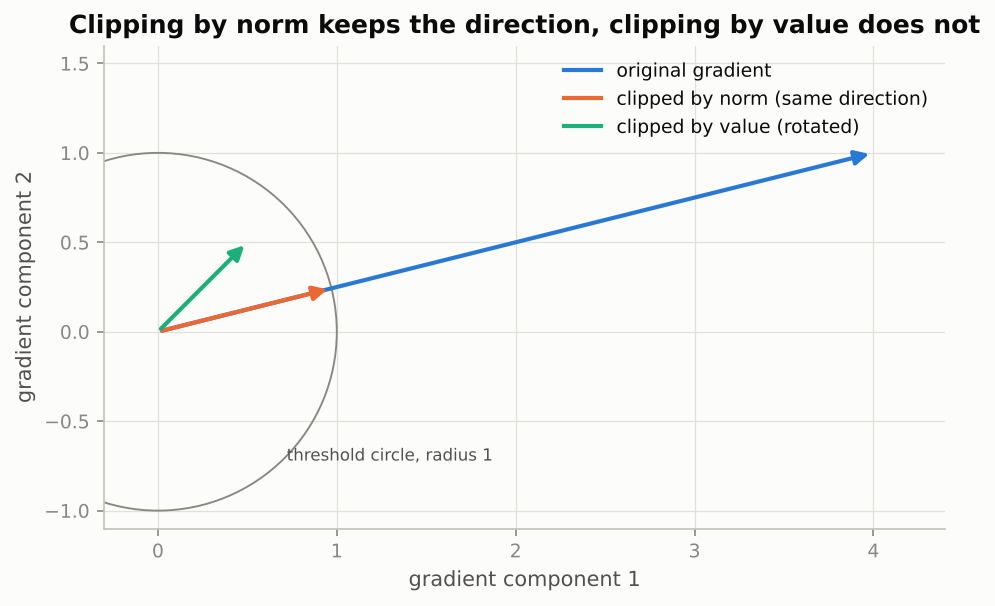

*Norm clipping slides the gradient along its own direction back to the threshold circle; value clipping bends it towards the diagonal.*

### Real-world examples

- Character and word language models trained with `nn.LSTM` all keep a `clip_grad_norm_` line between `backward()` and `step()`; without it a single unusual batch can push the loss to `nan` after hours of healthy training.
- Streaming models (speech, keystroke prediction) are trained with truncated BPTT on chunks of a few hundred steps while carrying the state, exactly as the notebook's `train_lm` does, because the full audio or text stream never fits in memory as one graph.
- The vanishing-gradient analysis of Bengio, Simard and Frasconi (1994) and Pascanu, Mikolov and Bengio (2013) is the reason gated cells, orthogonal RNNs and, eventually, attention were invented.

### Examples for every subsection

- **3.1 The unrolled graph and the chain rule.** For the one-unit sequence A, the gradient of a loss on $h_3$ with respect to $w_{hh}$ collects three terms, one for each step at which $w_{hh}$ was used; the term from step 1 is multiplied by $\partial h_3 / \partial h_1 = 0.1221$.
- **3.2 Why gradients vanish or explode.** With every singular value of $W_{hh}$ equal to 0.5, the bound $(\gamma\,\sigma_{\max})^{\text{lag}}$ gives at most $0.5^{59} \approx 1.7 \times 10^{-18}$ of the signal after 59 steps; the measured norm falls from 6.641 to $9.9 \times 10^{-20}$, below even what the bound allows, because the `tanh` derivatives are below one.
- **3.3 The algorithm.** The numpy `rnn_backward` in the figure script is exactly the notebook's recursion: `da = dh * (1 - h**2)`, accumulate `da.T @ x_t`, `da.T @ h_prev` and `da.sum(0)`, then `dh = da @ W_hh`; its gradients agree with finite differences to $2 \times 10^{-10}$.
- **3.4 Measuring the decay: gradient norm versus lag.** The table above: factors 0.461, 0.845 and 1.045 per step for gains 0.5, 1.0 and 1.5.
- **3.5 Truncated BPTT and gradient clipping.** The clipping example: $(4.0, 1.0)$ becomes $(0.970, 0.243)$ by norm (cosine 1.0000) or $(0.500, 0.500)$ by value (cosine 0.8575).

### Common pitfalls

- Clipping by value (`clip_grad_value_`) looks similar but rotates the update; use `clip_grad_norm_` for recurrent models.
- `clip_grad_norm_` returns the norm *before* clipping; logging it is the cheapest way to see exploding gradients coming.
- Truncation does not cure vanishing gradients, it only caps memory; the model still has to learn to keep information in its state across chunk boundaries on its own.

## 4. Gated architectures: LSTM and GRU

### In plain words

A vanilla RNN overwrites its state at every step, and the gradient passing through each overwrite is scaled by a matrix the network does not control. The LSTM adds a second state, the cell, that is updated by *addition*: keep a learned fraction of the old cell (the forget gate) and add a learned fraction of a new candidate (the input gate), then expose a learned fraction of the result as the hidden state (the output gate). Gates are sigmoids, numbers between zero and one, computed from the current input and the previous hidden state, so the network decides per coordinate and per step whether to remember, replace or blend. When the forget gate sits near one, the cell copies itself and the gradient passes through nearly unchanged; the decay rate becomes a learned quantity. The GRU folds the same idea into two gates and a single state and performs about as well with three quarters of the parameters.

### Sample data

One LSTM step for three independent units, with hand-typed gate pre-activations (the values before the sigmoid or `tanh`) and a previous cell value. Each unit is chosen to show one behaviour.

| unit | $a_i$ | $a_f$ | $a_g$ | $a_o$ | $c_{t-1}$ |
|---|---|---|---|---|---|
| A: remember | -3.0 | +3.0 | +0.5 | +1.0 | +0.80 |
| B: overwrite | +3.0 | -3.0 | -1.5 | +2.0 | +0.80 |
| C: store but hide | +1.0 | +1.0 | +1.0 | -4.0 | -0.50 |

### Worked example

Unit A, step by step: $i = \sigma(-3.0) = 0.047$, $f = \sigma(3.0) = 0.953$, $\tilde c = \tanh(0.5) = +0.462$, $o = \sigma(1.0) = 0.731$. Keep $f \cdot c_{t-1} = 0.953 \times 0.80 = +0.762$, write $i \cdot \tilde c = 0.047 \times 0.462 = +0.022$, so $c_t = +0.784$: the memory is almost untouched. Expose $h_t = o \cdot \tanh(c_t) = 0.731 \times 0.655 = +0.4788$.

| unit | $i$ | $f$ | $\tilde c$ | $o$ | $f \cdot c_{t-1}$ | $i \cdot \tilde c$ | $c_t$ | $h_t$ |
|---|---|---|---|---|---|---|---|---|
| A: remember | 0.047 | 0.953 | +0.462 | 0.731 | +0.762 | +0.022 | +0.784 | +0.4788 |
| B: overwrite | 0.953 | 0.047 | -0.905 | 0.881 | +0.038 | -0.862 | -0.824 | -0.5966 |
| C: store but hide | 0.731 | 0.731 | +0.762 | 0.018 | -0.366 | +0.557 | +0.191 | +0.0034 |

Unit B throws away the old value and writes the candidate; unit C updates its memory to $+0.191$ but, with the output gate at 0.018, shows almost nothing of it ($h_t = +0.0034$): the cell can carry a value for many steps while the output ignores it.

Gradient along the cell path, computed with the exact numpy backward pass for a 32-unit LSTM over 60 steps (same setup as Section 3, forget bias set as in the notebook):

| forget bias | $f$ at init | mean $f$ over the run | factor per step | norm at lag 59 | ideal $f^{59}$ |
|---|---|---|---|---|---|
| 0 | 0.500 | 0.500 | 0.618 | $7.6 \times 10^{-13}$ | $1.7 \times 10^{-18}$ |
| 2 | 0.881 | 0.880 | 0.984 | $0.61$ | $5.6 \times 10^{-4}$ |
| 5 | 0.993 | 0.993 | 1.025 | $4.0$ | $0.67$ |

The measured factor is a little above $f$ in every row because the paths through $h_t$ add to the cell path; with the bias at 2 the gradient arrives at lag 59 with norm 0.61, about a quarter of its lag-0 norm of 2.546 (the vanilla RNN of Section 3 at gain 1 falls from 6.641 to $2.8 \times 10^{-4}$ over the same lag), and with the bias at 5 it even grows. For reference, $0.99^{100} = 0.366$ and $0.993^{60} = 0.656$.

### Chart

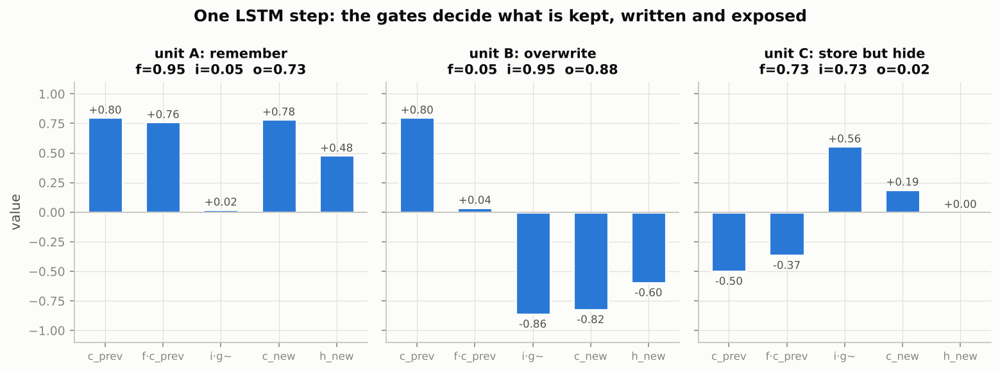

*Unit A keeps its memory, unit B replaces it, unit C updates it but hides it from the output; the gates, printed in each title, are the only difference.*

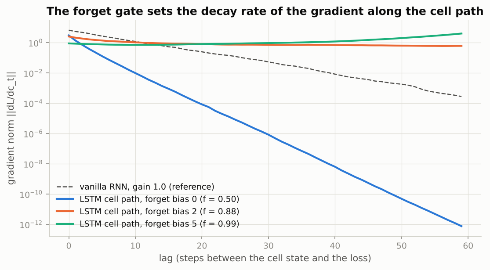

*A forget bias of 2 (gate at 0.88) flattens the gradient curve that the vanilla RNN (dashed) and the bias-0 LSTM lose exponentially; the rate is now set by a learnable gate.*

### Real-world examples

- Google's 2016 neural translation system stacked eight LSTM layers per direction; the LSTM's ability to carry a subject across a long sentence is why it replaced phrase-based translation.
- Speech recognisers built on LSTMs with the CTC loss (Graves and colleagues, 2013 onwards) could align hundreds of audio frames to a handful of characters, which a vanilla RNN could not learn.
- Mobile keyboards ran small GRU or LSTM language models on the phone for next-word prediction because they are cheap to evaluate one token at a time while carrying a state.
- The forget-gate bias trick (start at 1 or 2) was adopted in most LSTM code bases after Jozefowicz, Zaremba and Sutskever (2015) showed it mattered more than most architectural variants.

### Examples for every subsection

- **4.1 The idea: an additive memory with learned gates.** Unit A above: $c_t = 0.953 \times 0.80 + 0.047 \times 0.462 = 0.784$, a near copy of $c_{t-1} = 0.80$, so $\partial c_t/\partial c_{t-1} \approx 0.953 \approx 1$.
- **4.2 The LSTM cell equations.** For $D = 6$ inputs and $H = 10$ units the stacked matrices are $W_{ih} \in \mathbb{R}^{40 \times 6}$ and $W_{hh} \in \mathbb{R}^{40 \times 10}$, gates in the order i, f, g, o; the parameter count $4(HD + H^2 + 2H) = 720$ is exactly four times the 180 of a one-bias-pair `nn.RNN` of the same size.
- **4.3 Implementation from scratch.** The figure script's `lstm_forward` does what the notebook's `LSTMCellScratch` does: one matrix product gives all $4H$ pre-activations, `np.split` cuts them into i, f, g, o, then `c = f*c_prev + i*g` and `h = o*tanh(c)`.
- **4.4 Verification against `nn.LSTMCell`.** The notebook copies `weight_ih`, `weight_hh`, `bias_ih`, `bias_hh` and gets agreement to about $10^{-7}$ over 12 steps; the numpy version here is checked against finite differences instead (max error $1.9 \times 10^{-10}$ on the parameter gradients, and $\|\partial L/\partial c_t\|$ = 0.532152 both ways).
- **4.5 Why the additive cell state preserves gradients.** The table above: factors 0.618, 0.984 and 1.025 per step for forget biases 0, 2 and 5.
- **4.6 The GRU.** With the update gate at $z = \sigma(2) = 0.881$ the GRU keeps 88 percent of its old state and writes 12 percent of the candidate, which is why the notebook's `set_forget_bias` sets the *update* gate bias for a GRU; PyTorch applies the reset gate inside the `tanh`, to $W_{hn} h_{t-1} + b_{hn}$, and a cell that applies it to $h_{t-1}$ before the product will not match `nn.GRUCell`.
- **4.7 The `nn.LSTM` API.** For a 2-layer bidirectional LSTM with hidden size 16 on a batch of 3 sequences of 5 steps, `out` has shape (3, 5, 32) and `h_n` has shape (4, 3, 16), ordered layer 0 forward, layer 0 backward, layer 1 forward, layer 1 backward; `h_n[3]` equals `out[:, 0, 16:]` because the backward direction finishes at time step 0.

### Common pitfalls

- Setting the forget bias in `bias_ih` *and* `bias_hh` doubles it; the notebook sets one slice to the value and the other to zero.
- The gradient argument is about the *cell* path. Gradients that travel through $h_t$ into the next step's gates still pass through `tanh` and sigmoids and shrink; LSTMs reliably learn dependencies over hundreds of steps, not thousands.
- The gate order differs between libraries (PyTorch: i, f, g, o; some others: i, f, o, g). Copying weights across frameworks without reordering gives a cell that runs but is wrong.

## 5. Experiment: learning long-range dependencies

### In plain words

Theory says a vanilla RNN cannot pass a gradient across a long gap and a gated cell can, so the notebook tests it with a task where only distant information matters. Each sequence starts with a key drawn from four classes, followed by a long run of meaningless distractor symbols, and the model has to name the key after reading everything. Chance is 25 percent, and the length sets how far one fact must be carried. With the same size, optimizer, clipping and step budget, every architecture solves short sequences; as the gap grows the vanilla RNN slides to chance while the LSTM and GRU keep learning. The RNN does not lack room in its state; what it lacks is a teaching signal that survives the trip back to step one.

### Sample data

Two sequences of length 8 from the figure script's generator (seed 42): position 0 holds the key (ids 0 to 3), the rest are distractors (ids 4 to 11).

| sequence | tokens | key |
|---|---|---|
| 1 | 0, 9, 7, 7, 10, 4, 9, 5 | 0 |
| 2 | 3, 4, 8, 11, 9, 10, 9, 10 | 3 |

### Worked example

The figure script trains a numpy vanilla RNN and a numpy LSTM with the notebook's recipe: embedding of size 16, one recurrent layer of 32 units, linear head on the final state, Adam with learning rate 0.005, gradient-norm clipping at 1, batches of 64, 300 steps per run, forget bias 2 for the LSTM, accuracy on 1,000 fresh test sequences.

| length $T$ | vanilla RNN | LSTM (forget bias 2) |
|---|---|---|
| 5 | 1.000 | 1.000 |
| 15 | 0.588 | 1.000 |
| 30 | 0.229 | 1.000 |

An extra LSTM run at $T = 30$ with the forget bias at 0 (gate at 0.5) reaches only 0.238, chance level, within the same 300 steps. That is the gradient table of Section 4 turned into accuracy: with $f = 0.5$ the signal reaching the key is of order $0.5^{30} \approx 10^{-9}$, with $f = 0.88$ it is $0.88^{30} \approx 0.022$, enough to learn from.

### Chart

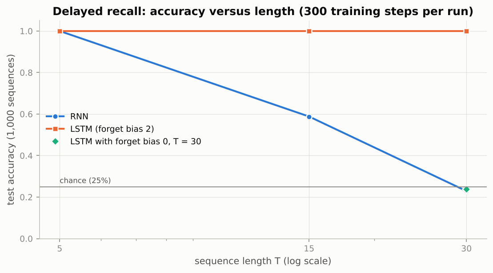

*The vanilla RNN falls from perfect to chance between lengths 5 and 30 while the LSTM stays at 100 percent; the same LSTM with its forget gate at 0.5 (diamond) fails at length 30 just like the RNN.*

### Real-world examples

- Closing a bracket or quotation mark that was opened 200 characters earlier is a delayed-recall problem that character-level LSTMs solve and vanilla RNNs do not.
- In clinical time series, a diagnosis recorded at admission must influence a prediction made days of hourly measurements later; gated cells were the standard tool for such records before Transformers.
- Subject-verb agreement across a long relative clause ("the keys that the man who ... holds *are*") is the linguistic version of the task, used in papers that measure how far language models can carry information.

### Examples for every subsection

- **5.1 The delayed-recall task.** The two sample sequences above: eight tokens, the answer is the first one, and the remaining seven carry no information at all.
- **5.2 Accuracy versus sequence length.** The table above: at $T = 30$ the numpy RNN scores 0.229 and the LSTM 1.000 after 300 steps each; the notebook adds a GRU and, in the full run, lengths up to 160.

### Common pitfalls

- Reading the prediction from `out[:, -1]` is correct here only because every sequence in a batch has the same length; with variable lengths you need packing (Section 8).
- A gated model that fails at the longest length within a small budget is usually undertrained, not incapable: the notebook suggests increasing `STEPS_RECALL` before concluding anything.

## 6. A character-level language model on Tiny Shakespeare

### In plain words

A language model gives a probability to text by predicting each next token from everything before it, so training it is just next-token classification with cross-entropy at every position. Working with single characters keeps the vocabulary at about 65 symbols, needs no tokenizer, and makes progress visible: noise, then letter patterns, then words, then lines that look like a play. The text is cut into parallel streams so consecutive mini-batches continue where the previous ones stopped, and the LSTM state is carried across chunks while the gradient is cut at the chunk boundary (truncated BPTT). Perplexity, the exponential of the mean next-character loss, reads as the number of equally likely options the model is choosing among: 65 is clueless, around 4 is good for this corpus. Sampling turns the classifier into a writer, and a temperature knob trades safe repetitive text for varied, error-prone text.

### Sample data

A six-character stretch of text and the probability a model assigned to the character that actually came next at each position (hand-typed), plus the logits of a five-character softmax for the temperature example.

| position | 1 | 2 | 3 | 4 | 5 | 6 |
|---|---|---|---|---|---|---|
| $p(\text{actual next char})$ | 0.50 | 0.25 | 0.10 | 0.80 | 0.05 | 0.30 |
| $-\log p$ | 0.693 | 1.386 | 2.303 | 0.223 | 2.996 | 1.204 |

| candidate next character | e | a | i | o | r |
|---|---|---|---|---|---|
| logit $z$ | 2.0 | 1.2 | 0.6 | 0.3 | -0.8 |

### Worked example

1. **Perplexity.** The mean of the six negative log-probabilities is 1.4675 nats, so the perplexity is $\exp(1.4675) = 4.338$: on average the model was as unsure as if it were choosing among 4.3 equally likely characters. Uniform guessing over 65 characters costs $\log 65 = 4.174$ nats per character, perplexity 65; a model that only knows character bigram statistics sits near 2.5 nats, perplexity 12.18; the notebook's full run reaches about 1.4 nats, perplexity 4.06.
2. **Temperature.** Dividing the logits by $\tau$ before the softmax gives:

| $\tau$ | e | a | i | o | r |
|---|---|---|---|---|---|
| 0.3 | 0.924 | 0.064 | 0.009 | 0.003 | 0.000 |
| 1.0 | 0.516 | 0.232 | 0.127 | 0.094 | 0.031 |
| 1.5 | 0.407 | 0.239 | 0.160 | 0.131 | 0.063 |

At $\tau = 0.3$ the sampler picks "e" 92 percent of the time and never "r"; at $\tau = 1.5$ "r", a character the model considers unlikely, is drawn one time in sixteen, which is how high-temperature text acquires misspellings.

### Chart

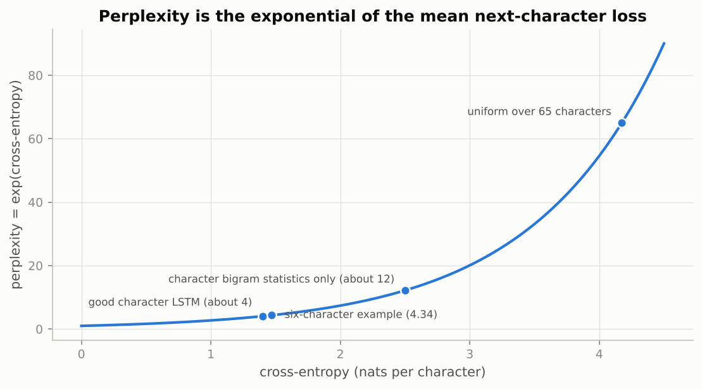

*Perplexity is an exponential of the loss, so halving the loss from 2.8 to 1.4 nats takes the perplexity from about 16 to about 4.*

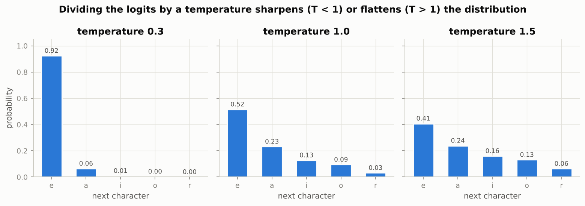

*The same five logits produce a near-deterministic choice at temperature 0.3 and an almost flat spread at 1.5.*

### Real-world examples

- Andrej Karpathy's 2015 char-rnn essay, which the notebook follows, trained exactly this model on Shakespeare, Wikipedia markup, LaTeX and Linux source code, and the samples learned to balance brackets and indent code.
- Autocomplete in code editors and search boxes is next-token prediction served one step at a time from a carried state, the `sample_ids` loop of the notebook.
- Perplexity is still the headline metric reported for every large language model, computed exactly as here as the exponential of the mean next-token cross-entropy.
- Temperature is the "creativity" slider exposed by chat and text-generation APIs; the default of 1 samples from the model's own distribution.

### Examples for every subsection

- **6.1 What a language model is.** For the string "To be", the model's probability of the whole string is $p(\text{T}) \cdot p(\text{o} \mid \text{T}) \cdot p(\text{ } \mid \text{To}) \cdots$, and the training target at every position is simply the next character.
- **6.2 Data.** Tiny Shakespeare is about 1.1 million characters with 65 distinct symbols; the built-in fallback text is 3,901 characters with 51 distinct symbols, enough to run every cell offline but far too little to learn English from.
- **6.3 Vocabulary, encoding and contiguous streams.** Reshaping a training tensor of 1,000,000 ids into 64 streams gives 64 rows of 15,625 characters; mini-batch $k$ takes columns $[128k, 128k + 128)$ of every row as input and the same columns shifted right by one as target.
- **6.4 The model, the evaluation metric and sampling.** The six-character example above: mean loss 1.4675 nats, perplexity 4.338.
- **6.5 Training with truncated BPTT.** The notebook's loop runs `logits, state = model(x, state)` then `state = tuple(s.detach() for s in state)`: the next chunk starts from the full history but `backward()` sees only 128 steps.
- **6.6 The effect of temperature.** The temperature table above: the probability of the most likely character goes 0.924, 0.516, 0.407 as $\tau$ goes 0.3, 1.0, 1.5.

### Common pitfalls

- Splitting the corpus for validation at random positions leaks: neighbouring characters are near-identical examples. Hold out one contiguous block.
- Forgetting to detach the carried state makes the graph grow with every chunk until memory runs out.
- Comparing perplexities across tokenisations (characters versus words) is meaningless; divide by the number of characters per token first (Exercise 3).

## 7. Time-series forecasting

### In plain words

Forecasting becomes supervised learning by sliding a window over the series: the previous 48 values are the input and the next value is the target, so one long signal becomes thousands of examples. Three habits decide whether the result is honest. Split the series in time order, never shuffled, so no window from the test period is seen in training. Fit the scaler's mean and spread on the training period only, because a scaler fitted on everything tells the model where the future level is. And compare every model with the naive forecast, which repeats the last value and is nearly unbeatable on random-walk-like data. On a smooth signal with trend and noise a small MLP and a linear model on the window both beat the naive forecast and approach the floor set by the noise; the notebook's LSTM gets there too but needs a higher learning rate and more epochs. Feeding predictions back to forecast many steps ahead compounds errors, so one-step accuracy flatters every model.

### Sample data

The notebook's synthetic series, regenerated with the same seed: two sinusoids with periods 50 and 13 (the pattern repeats every $\operatorname{lcm}(50, 13) = 650$ steps), a trend of 0.0002 per step and Gaussian noise of standard deviation 0.1, 3,000 points split in time into 2,100 training, 450 validation and 450 test points.

| step | 0 | 1 | 2 | 3 | 4 | 5 | 6 | 7 |
|---|---|---|---|---|---|---|---|---|
| value | 0.178 | 0.374 | 0.801 | 0.955 | 0.682 | 0.665 | 0.669 | 0.483 |

### Worked example

1. **Scaling.** Fitted on the training portion: mean $+0.205$, standard deviation 0.804. Fitted on all 3,000 points: mean $+0.298$, standard deviation 0.812. The whole-series mean is higher by 0.092 because the trend lifts the later points; standardising with it shifts every training input by that amount and tells the model, before it has seen a test point, that the series is heading up.
2. **Windows.** With a window of 48, the training portion yields 2,052 windows; letting the validation and test windows start 48 steps before each split yields exactly 450 windows each, one per validation or test point.
3. **One-step models.** The figure script fits a least-squares linear model on the 48 lags (an AR(48) model) and a numpy MLP (48 to 64 to 1, ReLU, Adam, 30 epochs). Test MAE in original units: naive 0.1947, linear 0.0881, MLP 0.0914. The noise floor is $0.1 \sqrt{2/\pi} = 0.0798$: no model can beat it, and both learned models are within 15 percent of it.
4. **Rollout.** Feeding each prediction back for 100 steps from the last validation window: MAE 0.087 for the linear model and 0.116 for the MLP over the horizon; the absolute errors at horizons 1, 10, 25, 50 and 100 are 0.176, 0.118, 0.005, 0.110, 0.233 (linear) and 0.256, 0.122, 0.026, 0.106, 0.335 (MLP). The error does not grow monotonically, because the forecasts stay roughly in phase with the sinusoids, but by step 100 both have drifted.

### Chart

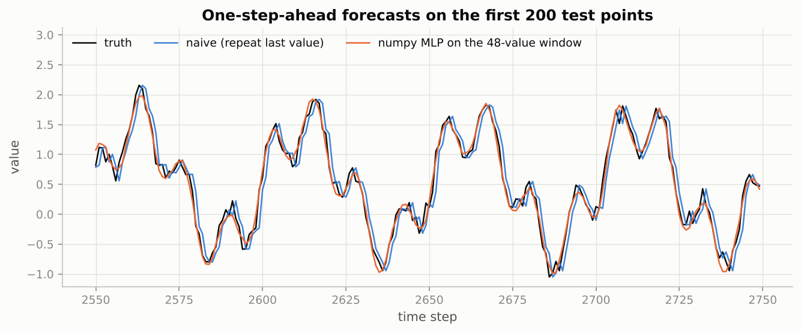

*The naive forecast is the truth shifted right by one step, visibly late at every turn; the MLP's forecast sits on top of the truth except for the noise.*

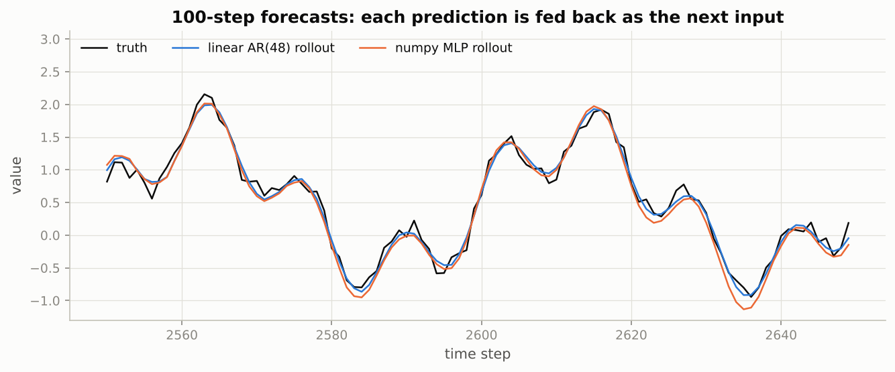

*Both rollouts follow the slow oscillation for the whole horizon but slowly lose amplitude and phase on the fast one, with no new data to correct them.*

### Real-world examples

- Electricity grid operators forecast hourly load a day ahead from the recent load, the calendar and the weather; the daily and weekly periods play the role of the 13-step and 50-step sinusoids.
- Retail demand forecasting (Amazon's DeepAR is the best-known neural example) trains one autoregressive model across thousands of products and rolls it out over the next weeks to plan inventory.
- Predictive maintenance flags a machine when the one-step prediction error of a model trained on healthy sensor data suddenly rises.
- The M4 forecasting competition (2018) was won by a hybrid of exponential smoothing and an LSTM, with every entry judged against simple baselines such as the naive and seasonal-naive forecasts.

### Examples for every subsection

- **7.1 Forecasting as supervised learning.** Window 48, target the 49th value: the 2,100 training points become 2,052 input-target pairs.
- **7.2 Scaling, and the pitfall of fitting it on everything.** Train-only mean $+0.205$ versus all-data mean $+0.298$: the 0.092 gap is the trend leaking.
- **7.3 LSTM versus MLP versus the naive forecast.** Test MAE: naive 0.1947, linear 0.0881, MLP 0.0914, floor 0.0798 (the notebook's LSTM lands near the MLP after the full run).
- **7.4 Multi-step forecasting.** 100-step rollout MAE: linear 0.087, MLP 0.116; error at horizon 100: 0.233 and 0.335.

### Common pitfalls

- A random train/test split on windows reports an accuracy no deployment can achieve, because neighbouring windows overlap in 47 of 48 values.
- A scaler fitted on all data leaks the level; on a trending series this alone can make a useless model look good.
- One-step MSE says nothing about a 30-day forecast; evaluate with the rollout you will actually use.
- A trending series pushes a rollout outside the range of the training inputs; detrend or difference first and add the trend back afterwards.

## 8. Sequence classification with variable-length inputs

### In plain words

Real sequences have different lengths but a tensor must be rectangular, so shorter sequences are padded with a reserved token (id 0) and the true lengths travel with the batch. Padding creates a silent bug: a recurrent layer keeps updating its state on the pad tokens, so its final state no longer describes the real sequence, and a backward-reading layer even starts on the pads. Packing (`pack_padded_sequence`) tells the layer where each sequence ends, so it stops there and returns the state from the true last step. For anything that sums or averages over time, a boolean mask built from the lengths excludes the padded positions. The notebook shows with a direct check that padding changes an untrained LSTM's final state noticeably and that packing restores it exactly, then trains a bidirectional classifier with and without packing.

### Sample data

A batch of five token sequences (ids 1 to 20, generated with seed 42) with lengths 3, 8, 5, 6 and 2, padded to the longest length 8, and the mask derived from the lengths.

| sequence | length | padded ids | mask |
|---|---|---|---|
| 0 | 3 | 2, 16, 14, 0, 0, 0, 0, 0 | 1 1 1 0 0 0 0 0 |
| 1 | 8 | 9, 9, 18, 2, 14, 5, 2, 11 | 1 1 1 1 1 1 1 1 |
| 2 | 5 | 20, 15, 16, 15, 16, 0, 0, 0 | 1 1 1 1 1 0 0 0 |
| 3 | 6 | 11, 3, 17, 10, 11, 8, 0, 0 | 1 1 1 1 1 1 0 0 |
| 4 | 2 | 4, 19, 0, 0, 0, 0, 0, 0 | 1 1 0 0 0 0 0 0 |

### Worked example

1. The batch holds 24 real tokens in 40 cells (60 percent); a mean over time must divide sequence 0 by 3 and sequence 4 by 2, not by 8.
2. The figure script runs a numpy LSTM (4 inputs, 6 units, PyTorch-like random biases) over 5 real inputs, then over the same inputs followed by $k$ zero vectors, which is what a pad token becomes after an embedding with `padding_idx=0`. The largest change in the final hidden state is 0.091 after one pad, 0.111 after two, 0.129 after four and 0.136 after ten. The zero input does not freeze the state, because the gates still have biases and the recurrent weights still mix the previous state.
3. Packing with the true length 5 would return the state after step 5 exactly, so the difference would be 0 (the notebook prints about $10^{-7}$ for `nn.LSTM`, float32 rounding).

### Chart

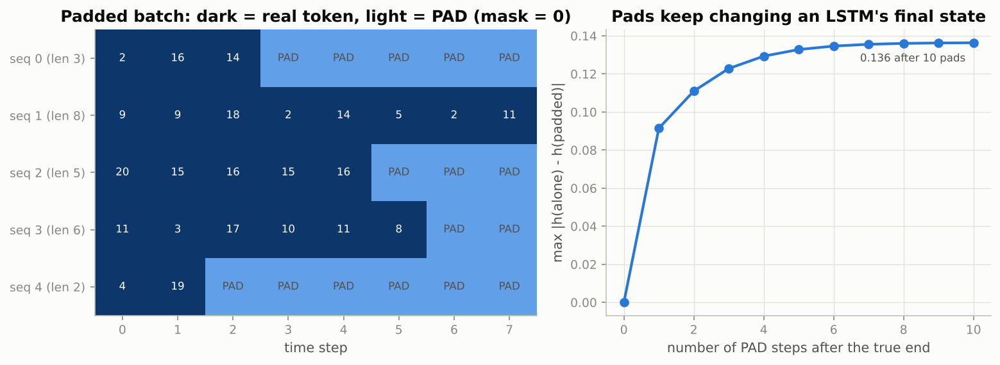

*Left: dark cells are real tokens and light cells are pads the mask removes. Right: each extra pad step moves an LSTM's final state further from the state at the true end.*

### Real-world examples

- Sentiment classifiers on reviews of 5 to 500 words batch sequences of wildly different lengths; without packing, the final state of a short review is the state after hundreds of pad steps.
- Speech utterances of different durations are padded and packed the same way, and the attention masks of Transformer encoders (Notebook 09) are the same boolean mask idea.
- Clinical event sequences (one patient per row, visits as steps) are padded to the longest patient; masked pooling over visits is how the per-patient summary is computed.

### Examples for every subsection

- **8.1 Padding, masking and packing.** The table above: five sequences padded to length 8, with the mask that marks the 24 real positions.
- **8.2 A synthetic classification task.** Twenty token types with hidden scores in $\{-1, 0, +1\}$ (seven negative, six neutral, seven positive); a sequence of 4 to 30 tokens is positive if its scores sum to a positive number, ties are discarded, and ids are shifted by one so that 0 is free for padding.
- **8.3 Why packing matters: a direct check.** Ten pads move the numpy LSTM's final state by 0.136 (largest coordinate); packing with the true length removes the difference.
- **8.4 A bidirectional LSTM classifier, with and without packing.** For a one-layer bidirectional LSTM, `h_n[-2]` is the forward final state (at the true end when packed) and `h_n[-1]` the backward one (at position 0); the notebook concatenates them into a 64-vector for the linear head.
- **8.5 Masked pooling over time.** With the mask above, the pooled vector of sequence 0 is the sum of its outputs at steps 0, 1 and 2 divided by 3; `pad_packed_sequence` guarantees the outputs at steps 3 to 7 are exactly zero.

### Common pitfalls

- `lengths` must be a CPU tensor for `pack_padded_sequence`, even when the data are on the GPU.
- Reading `out[:, -1]` from an unpacked bidirectional LSTM is simply wrong for most sequences: that position is a pad.
- A loss over time must skip pad targets (`ignore_index`), or the model is trained to predict padding.

## 9. Seq2seq and the bottleneck

### In plain words

When the output is a sequence of a different length than the input, one recurrent network (the encoder) reads the whole source into its final state and a second one (the decoder), started from that state, writes the target one token at a time, from a start token until it emits an end token. Training uses teacher forcing: the decoder is fed the true previous token at every step, so the whole target is processed in one pass with an ordinary per-position cross-entropy. At inference it must feed back its own guesses. On the toy task of reversing a digit string, short inputs are reversed perfectly and accuracy falls with length, steeply beyond the lengths seen in training. The cause is the bottleneck: everything about the source must pass through one fixed-size vector, and the early digits, needed last, must survive the longest. Attention, which lets the decoder look back at every encoder state, removes the bottleneck and leads straight to the Transformer.

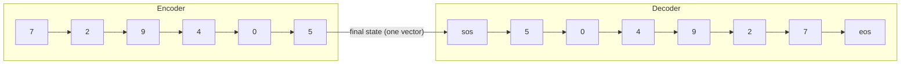

### Sample data

One reversal example in the notebook's format: digits are the tokens, the decoder input starts with `<sos>` and the decoder target ends with `<eos>`, so target position $t$ is always the token that follows input position $t$.

| role | tokens |
|---|---|
| source | 7, 2, 9, 4, 0, 5 |
| target (reversed) | 5, 0, 4, 9, 2, 7 |
| decoder input | `<sos>`, 5, 0, 4, 9, 2, 7 |
| decoder target | 5, 0, 4, 9, 2, 7, `<eos>` |

### Worked example

Training a GRU seq2seq needs PyTorch, so the figure script isolates the bottleneck itself with a toy numpy memory, labelled as such: $L$ digits are stored in one $H$-dimensional vector as a sum of position-specific random rotations of unit digit codes, and each position is read back by undoing its rotation and picking the nearest digit code. Exact-match recall over 2,000 random sequences per length:

| $L$ | $H = 32$ | $H = 64$ | $H = 128$ |
|---|---|---|---|
| 2 | 1.000 | 1.000 | 1.000 |
| 4 | 0.716 | 0.975 | 1.000 |
| 6 | 0.263 | 0.754 | 0.991 |
| 8 | 0.034 | 0.390 | 0.933 |
| 10 | 0.005 | 0.153 | 0.746 |
| 12 | 0.001 | 0.041 | 0.517 |
| 16 | 0.000 | 0.000 | 0.121 |
| 20 | 0.000 | 0.000 | 0.013 |

Doubling the memory postpones the collapse by a few digits and never removes it, which is the shape of the notebook's "accuracy versus length" curve for the trained GRU model (near 100 percent on short sequences, falling with length, steep beyond the training range). The idealised attention map for the sample above puts all of its weight on the anti-diagonal: output step $t$ reads source position $L + 1 - t$ (counting both from one), every row sums to 1.0.

### Chart

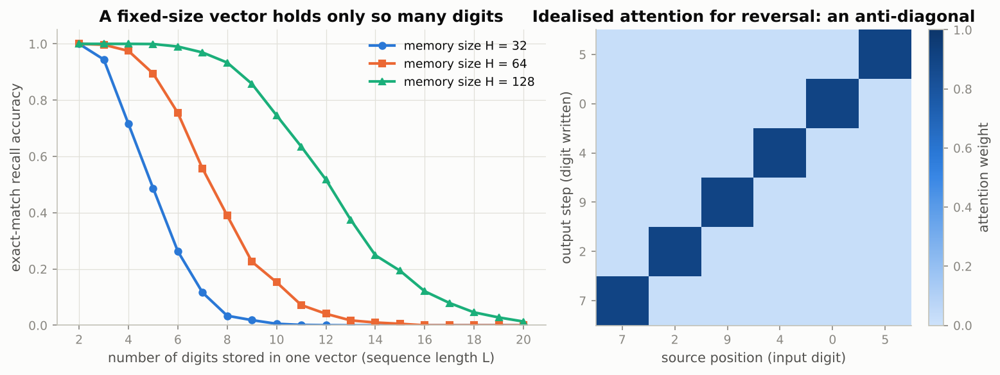

*Left: exact recall from one fixed-size vector drops to zero as more digits are squeezed into it, later for bigger vectors. Right: what an attention decoder learns for reversal, each output step reading one source position.*

### Real-world examples

- The 2014 encoder-decoder translation systems of Sutskever, Vinyals and Le and of Cho and colleagues showed exactly this signature: excellent on short sentences, degrading on long ones, which motivated attention (Bahdanau, Cho and Bengio, 2015).
- Speech-to-text with an encoder over audio frames and a decoder over characters ("Listen, Attend and Spell", 2016) could not work without attention, because an utterance is thousands of frames.
- Text summarisation and the early chatbots built on seq2seq used teacher forcing in training and greedy or beam search decoding at inference; the mismatch between the two (exposure bias) is still a research topic.

### Examples for every subsection

- **9.1 Encoder–decoder models.** The sample above: the encoder reads 7, 2, 9, 4, 0, 5 into one vector; the decoder, started from that vector and `<sos>`, is trained to emit 5, 0, 4, 9, 2, 7, `<eos>` while being fed the true previous digit (teacher forcing).
- **9.2 A toy task: reversing digit sequences.** The notebook trains on random lengths 3 to 10 (fast run) or 3 to 16 with batches of 64 and measures exact-match accuracy with greedy decoding; the figure script's toy memory with $H = 64$ already fails on 8 digits (0.390).
- **9.3 Accuracy versus length: the bottleneck.** Toy memory with $H = 128$: 0.991 at 6 digits, 0.746 at 10, 0.121 at 16; a bigger vector moves the cliff, it does not remove it.

### Common pitfalls

- Teacher forcing makes training loss look better than generation quality; always evaluate with the model's own decoding loop.
- Greedy decoding over a fixed `max_len` never emits `<eos>`; a real system stops at `<eos>` and may use beam search.
- A bigger hidden state postpones the length cliff but does not remove it; attention does.

## Exercises in plain words

- **Exercise 1 (GRU from scratch).** Implement the GRU cell with PyTorch's layout (gates stacked as reset, update, candidate) and check it against `nn.GRUCell` over ten steps. Useful because it forces you to see where the reset gate acts. Hint: multiply $r_t$ with the *recurrent* part of the candidate, including its bias, inside the `tanh`.
- **Exercise 2 (clipping by norm versus by value).** Measure the cosine similarity of each clipped gradient with the original, then train the vanilla RNN on delayed recall at $T = 15$ with SGD and with Adam under three clipping modes. Useful because it shows that clipping matters a lot for SGD and much less for Adam. Hint: norm clipping scales every coordinate by the same factor, so its cosine is exactly 1.
- **Exercise 3 (word-level language model).** Tokenise the corpus into words, keep a vocabulary of 2,000 ids with `<unk>`, train the same `CharLSTM` class on word ids and compare perplexities. Useful because it shows that perplexities are not comparable across tokenisations. Hint: divide the per-word cross-entropy by the mean word length plus one before taking the exponential.
- **Exercise 4 (dropout between LSTM layers).** Train a two-layer model on an 8,000-character slice with dropout 0 and 0.5 and compare training and validation perplexities. Useful because it shows what overfitting looks like for a language model and why dropout is applied only between layers. Hint: the gap between train and validation perplexity is the number to watch.
- **Exercise 5 (Bahdanau attention).** Give the decoder a learned weighted average of the encoder outputs at every step, train it with the same budget as the plain model and plot accuracy versus length for both. Useful because it demonstrates the fix for the bottleneck before Notebook 09 generalises it. Hint: the decoder must now be unrolled step by step in Python, and the attention map for a reversed sequence should be an anti-diagonal.

## Quick reference

| Concept | Formula or rule | In one sentence |
|---|---|---|
| Batch layout | `(batch, time, features)` with `batch_first=True` | Every recurrent layer in the notebook expects this order. |
| Vanilla RNN step | $h_t = \tanh(W_{xh} x_t + W_{hh} h_{t-1} + b)$ | Same three tensors at every step; $HD + H^2 + H$ parameters. |
| Jacobian product | $\partial h_t / \partial h_k = \prod_{i=k+1}^{t} \operatorname{diag}(1 - h_i^2)\, W_{hh}$ | One matrix per step between $k$ and $t$. |
| Vanishing bound | $\|\partial h_t / \partial h_k\| \le (\sigma_{\max}(W_{hh}))^{t-k}$ | Exponential decay whenever the largest singular value is below 1. |
| Error recursion | $\delta_t = (1 - h_t^2) \odot (W_{hy}^\top \partial L_t/\partial \hat y_t + W_{hh}^\top \delta_{t+1})$ | What autograd computes step by step going backwards. |
| Gradient clipping | $g \leftarrow g \cdot \min(1, \tau / \|g\|)$ | Bounds the length of the update, keeps its direction. |
| Truncated BPTT | carry the state, `detach()` it at the chunk boundary | Unlimited forward memory, bounded backward cost. |
| LSTM gates | $i, f, o = \sigma(\cdot)$, $\tilde c = \tanh(\cdot)$, order i, f, g, o in PyTorch | Four stacked affine maps, $4(HD + H^2 + 2H)$ parameters. |
| LSTM memory | $c_t = f_t \odot c_{t-1} + i_t \odot \tilde c_t$, $h_t = o_t \odot \tanh(c_t)$ | Additive update; the gradient along the cell path scales like $\prod f$. |
| Forget-gate bias | set $b_f$ to 1 or 2 ($f \approx 0.73$ to $0.88$) | Start out remembering; the single most useful LSTM trick. |
| GRU | $h_t = (1 - z_t) \odot n_t + z_t \odot h_{t-1}$, $n_t = \tanh(W_{in} x_t + b_{in} + r_t \odot (W_{hn} h_{t-1} + b_{hn}))$ | Two gates, one state, $3(HD + H^2 + 2H)$ parameters. |
| Language model | $p(x_1, \dots, x_T) = \prod_t p(x_t \mid x_{<t})$ | Next-token classification at every position. |
| Perplexity | $\text{PPL} = \exp(\text{mean cross-entropy in nats})$ | Effective number of equally likely choices per token. |
| Temperature | $p_i \propto \exp(z_i / \tau)$ | Below 1 sharpens, above 1 flattens, 0 is greedy. |
| Forecasting scaler | fit mean and std on the training period only | Fitting on all data leaks the future level. |
| Naive forecast | $\hat y_t = y_{t-1}$ | The baseline every forecast must beat. |
| Packing | `pack_padded_sequence(x, lengths.cpu(), batch_first=True, enforce_sorted=False)` | The recurrence stops at each sequence's true end. |
| Masked mean | $\sum_t m_t\, o_t \,/\, \sum_t m_t$ | Pool over real positions only. |
| Teacher forcing | decoder input = `<sos>` + target, decoder target = target + `<eos>` | One parallel pass in training; feed back predictions at inference. |

## Glossary

- **Hidden state**: the fixed-size vector a recurrent network updates at every step to summarise what it has read so far.
- **Unrolling**: drawing the recurrent computation for a specific length as a deep network whose layers share weights.
- **BPTT (backpropagation through time)**: ordinary backpropagation applied to the unrolled network, summing gradients over all time steps.
- **Vanishing / exploding gradient**: the exponential shrinking or growth of the error signal with the lag, caused by multiplying one Jacobian per step.
- **Gradient clipping**: rescaling the whole gradient so its norm is at most a threshold, before the optimizer step.
- **Truncated BPTT**: training on chunks of a long stream while carrying the state forward but cutting the gradient at chunk boundaries.
- **Gate**: a vector of sigmoid outputs in (0, 1) that scales, coordinate by coordinate, how much of a quantity is kept, written or exposed.
- **Cell state**: the LSTM's additively updated memory, separate from the hidden state it exposes.
- **Forget-gate bias**: the initial offset of the forget gate; 1 or 2 makes the cell start out remembering.
- **GRU**: a gated cell with a reset gate and an update gate and no separate cell state.
- **Perplexity**: the exponential of the mean next-token cross-entropy; the effective number of equally likely choices.
- **Temperature**: a divisor applied to the logits before sampling; low is conservative, high is diverse.
- **Padding / packing / mask**: filling sequences to equal length with a reserved token, telling the recurrent layer where each one really ends, and marking the real positions for pooling and losses.
- **Teacher forcing**: feeding the decoder the true previous token during training instead of its own prediction.
- **Bottleneck**: the single fixed-size vector through which a plain encoder-decoder must pass everything about the source.
