# 09 · Attention and Transformers — Companion Guide

> Plain-language companion to [`09_attention_and_transformers.ipynb`](09_attention_and_transformers.ipynb). Read a section here, then run the
> matching section of the notebook. All numbers below were computed with the script
> [`figures/scripts/make_figures_09.py`](figures/scripts/make_figures_09.py); all charts are its output.

## At a glance

**What you learn**

- Attention is a soft dictionary lookup: compare a query with every key, softmax the scores, average the values.
- Why the scores are divided by the square root of the key size, and what goes wrong without it.
- How padding and causal masks block positions, and how several heads let a token look in several directions at once.
- How sinusoidal, learned and rotary encodings put word order back into a mechanism that otherwise ignores it.
- How a Transformer block is built, how many parameters and operations it costs, and how a small GPT is trained on Shakespeare.
- How text is decoded (greedy, temperature, top-k, top-p), why a KV-cache makes generation linear, and how scaling laws and long contexts set the cost of large models.

**Where this is used in the real world**

- Chat assistants (ChatGPT, Claude, Gemini, Llama-based products) are decoder-only Transformers trained with exactly the recipe of Section 6, scaled up; the KV-cache of Section 7 is why they can stream tokens quickly.
- Web search and semantic search: Google introduced BERT-style encoders into query understanding in 2019, and sentence-embedding encoders power most "find similar documents" features.
- Translation and speech recognition: production translation systems and OpenAI's Whisper are encoder-decoder Transformers, the arrangement with cross-attention from Section 5.3.
- Protein structure: AlphaFold 2 uses attention over pairs of amino-acid residues; protein language models such as ESM-2 are BERT-style encoders over amino-acid sequences.
- Code completion (GitHub Copilot and similar tools) is next-token prediction by a decoder-only model, with nucleus sampling and temperature from Section 7.1.
- Vision: the Vision Transformer of Notebook 07 feeds image patches as tokens into the encoder built here; diffusion models use attention inside their U-Nets.

```mermaid
flowchart LR
    A["1. Soft lookup: scores, softmax, values"] --> B["2. Masking: padding, causal"]
    B --> C["3. Multi-head: reshapes, SDPA, FlashAttention"]
    C --> D["4. Position: sinusoidal, learned, RoPE"]
    D --> E["5. Transformer block: pre-LN, params, FLOPs"]
    E --> F["6. Build a GPT: data, module, recipe"]
    F --> G["7. Generation: decoding, KV-cache"]
    G --> H["8. Scaling: power laws, long context"]
    H --> I["9. Family: encoder, decoder, both"]
```

## 1. Attention as a soft dictionary lookup

### In plain words

A Python dictionary answers a query by finding the one key that equals it. Attention answers a query by scoring every key for similarity, turning the scores into weights that add up to one, and returning the weighted average of all the values. When one key matches far better than the rest it gets almost all the weight and you are back to an ordinary lookup; when several match partly you get a blend. Every step is plain arithmetic, so the network can learn what to store as keys and values and what to ask for as queries. The division of the scores by $\sqrt{d_k}$ keeps them at a steady size whatever the width of the model, which keeps the softmax soft and its gradients alive.

### Sample data

Three tokens with two-dimensional queries, keys and values, typed by hand so that every step can be checked on paper:

| token | query $q$ | key $k$ | value $v$ |
|---|---|---|---|
| the | (2, 0) | (1, 0) | (1, 0) |
| cat | (0, 2) | (0, 1) | (0, 1) |
| sat | (1, 1) | (1, 1) | (0.5, 0.5) |

### Worked example

1. Raw scores $QK^{\top}$ (row = query, column = key): the/the $= 2$, the/cat $= 0$, the/sat $= 2$; cat row $= (0, 2, 2)$; sat row $= (1, 1, 2)$.
2. Divide by $\sqrt{d_k} = \sqrt{2}$: the row becomes $(1.414, 0, 1.414)$, the sat row $(0.707, 0.707, 1.414)$.
3. Softmax each row: the $\to (0.446, 0.108, 0.446)$, cat $\to (0.108, 0.446, 0.446)$, sat $\to (0.248, 0.248, 0.503)$. Each row sums to 1.
4. Multiply by $V$: output for "the" $= 0.446 \cdot (1,0) + 0.108 \cdot (0,1) + 0.446 \cdot (0.5,0.5) = (0.669, 0.331)$; for "cat" $(0.331, 0.669)$; for "sat" $(0.5, 0.5)$.
5. Hard lookup limit: scale the query of "the" by 4 and the weights become $(0.499, 0.002, 0.499)$; the softmax has almost become an argmax over the two tied keys.

The scaling matters more as the width grows. With 16 random keys and unit-variance entries the script measures:

| $d_k$ | var(raw score) | var(scaled score) | mean largest weight, raw | mean largest weight, scaled |
|---|---|---|---|---|
| 4 | 4.1 | 1.014 | 0.425 | 0.235 |
| 16 | 16.0 | 0.997 | 0.685 | 0.244 |
| 64 | 63.6 | 0.994 | 0.843 | 0.244 |
| 256 | 256.8 | 1.003 | 0.923 | 0.247 |
| 1024 | 1026.2 | 1.002 | 0.961 | 0.246 |

The raw variance equals $d_k$ (standard deviation 16.02 at $d_k = 256$, and $e^{16} \approx 8.9 \times 10^{6}$), so unscaled attention is nearly one-hot before any learning; scaled scores stay at variance 1 and the largest weight stays near 0.25.

### Chart

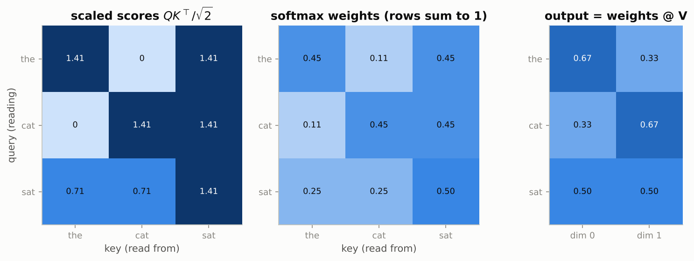

*Read a row left to right: scaled scores become weights that sum to one, and the output row is the matching blend of the value rows.*

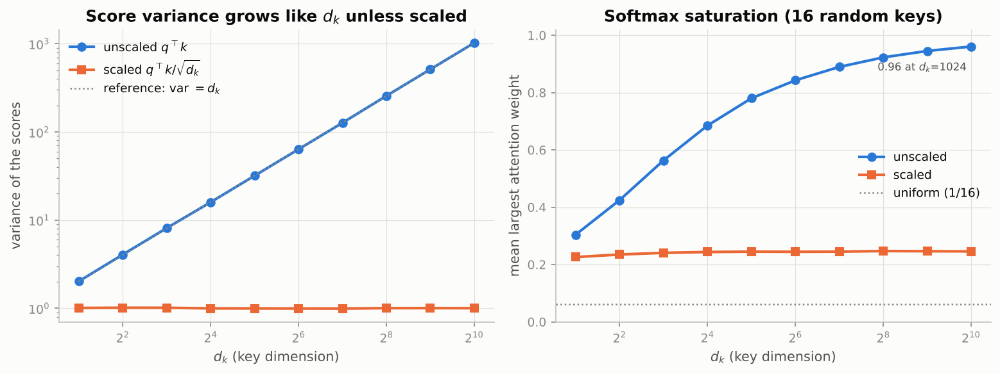

*The unscaled variance climbs along the reference line $\mathrm{var} = d_k$ and the largest weight climbs towards 1, while the scaled curves stay flat.*

### Real-world examples

- A retrieval system embeds a question as a query vector and every passage as a key vector; attention over passages is the differentiable version of "find the most relevant paragraph".
- In a translation model, each target word's query attends over the source words' keys, which is how the model aligns "chat" with "cat" without any alignment labels.
- In a recommendation model over a listening history, the query is "what fits now" and the keys are the previous tracks; the output is a blend of the tracks that resemble the current context.

### Examples for every subsection

- **1.1 From hard lookup to soft lookup.** The dictionary `{"the": v0, "cat": v1, "sat": v2}` returns exactly one value; the soft version with the query of "the" returns $0.446\,v_0 + 0.108\,v_1 + 0.446\,v_2 = (0.669, 0.331)$.
- **1.2 Queries, keys and values from the same sequence.** For a 5-token sentence with $d = 8$, the projections give $Q, K, V$ of shape (5, 8); the score matrix is (5, 5) and each row of the softmax says how much that token reads from each of the five positions.
- **1.3 Why divide by $\sqrt{d_k}$: the variance argument.** At $d_k = 256$ the raw scores have standard deviation 16.02; two scores 16 apart differ by a factor $e^{16} \approx 8.9 \times 10^{6}$ in the softmax, so one key takes everything (mean largest weight 0.923 with 16 random keys). After scaling it is 0.247.
- **1.4 Implementation and a first look at attention weights.** `attention(q, k, v)` with `q` of shape (2, 5, 8), `k` of shape (2, 7, 8) and `v` of shape (2, 7, 6) returns an output of shape (2, 5, 6) and weights of shape (2, 5, 7) whose rows sum to 1.

### Common pitfalls

- Forgetting the scaling and wondering why a wide model's attention is one-hot from step one and never changes.
- Reading the heatmap the wrong way round: rows are queries (who is reading), columns are keys (what is read).
- Expecting an untrained attention map to be meaningful; with random projections the pattern is noise, and only training makes it informative.

## 2. Masking

### In plain words

Sometimes a query must not be allowed to read from certain keys. Padding positions carry no information, and when training a left-to-right language model a position must not see the tokens after it, or it would simply read the answer from the input. Both cases are handled identically: the forbidden scores are set to minus infinity before the softmax, so their weights become exactly zero while the remaining weights still sum to one. A padding mask is one boolean per key, a causal mask is a lower-triangular matrix, and the two are combined with a logical AND. The causal mask is the only thing that makes a GPT block different from a BERT block.

### Sample data

A sequence of real length 4 padded to 6, with the combined padding AND causal mask (1 = may attend; rows are queries, columns are keys):

| query \ key | 0 | 1 | 2 | 3 | 4 | 5 | allowed keys |
|---|---|---|---|---|---|---|---|
| 0 | 1 | 0 | 0 | 0 | 0 | 0 | 1 |
| 1 | 1 | 1 | 0 | 0 | 0 | 0 | 2 |
| 2 | 1 | 1 | 1 | 0 | 0 | 0 | 3 |
| 3 | 1 | 1 | 1 | 1 | 0 | 0 | 4 |
| 4 (pad) | 1 | 1 | 1 | 1 | 0 | 0 | 4 |
| 5 (pad) | 1 | 1 | 1 | 1 | 0 | 0 | 4 |

### Worked example

With random 8-dimensional token vectors (seed 0) the attention weights under the combined mask are:

| query | weights over keys 0..5 |
|---|---|
| 0 | 1.00, 0, 0, 0, 0, 0 |
| 1 | 0.08, 0.92, 0, 0, 0, 0 |
| 2 | 0.10, 0.35, 0.55, 0, 0, 0 |
| 3 | 0.07, 0.21, 0.04, 0.67, 0, 0 |
| 4 (pad) | 0.16, 0.23, 0.40, 0.22, 0, 0 |
| 5 (pad) | 0.33, 0.13, 0.14, 0.40, 0, 0 |

Every masked entry is exactly 0 (not merely small), every row still sums to 1.000000, and query 0 can only read itself. The padded queries (rows 4 and 5) still produce weights: their outputs are garbage that the loss must ignore. No row is fully masked, because right padding guarantees that every query can see key 0.

### Chart

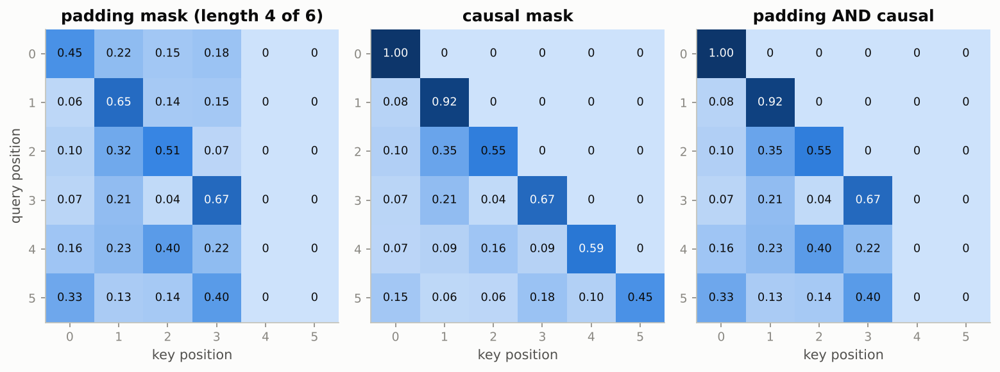

*Blank columns are padded keys nobody reads, the blank upper triangle is the future nobody reads, and the third panel is the AND of the two.*

### Real-world examples

- Every chat assistant is trained with the causal mask: the whole conversation is processed in parallel, yet each token is predicted only from the tokens before it.
- A batch of customer reviews of different lengths is padded to a common length; the padding mask keeps the pads from diluting the sentiment representation of the real words.
- BERT-style search rankers use the padding mask only (no causal mask), because a query-document pair should be read in full in both directions.

### Examples for every subsection

- **Section 2 has no numbered subsections.** Padding mask example: lengths (4, 6) in a batch padded to 6 give the key mask (1, 1, 1, 1, 0, 0) for the first sequence and all ones for the second. Causal mask example: a 6 by 6 lower-triangular matrix of ones, so query 2 may read keys 0, 1, 2 only (3 allowed keys, as in the table above).

### Common pitfalls

- Fully masked rows: left padding plus a causal mask gives the first query nothing to attend to, the softmax returns `nan`, and the `nan` spreads through the whole network.
- Sign convention: the notebook's masks and `F.scaled_dot_product_attention` use `True` for "may attend", while `nn.MultiheadAttention` and `nn.Transformer` use `True` for "masked out".
- Masking the values instead of the scores: zeroing a value does not remove its weight, so the row no longer sums to one over real keys.

## 3. Multi-head attention

### In plain words

One attention operation yields one weighted average per position, so it can only point in one direction at a time. A token often needs several different things at once: the previous word, the subject of the sentence, the matching opening bracket. Multi-head attention runs $h$ smaller attention operations in parallel, each with its own query, key and value projections of width $d/h$, and concatenates their outputs before a final mixing matrix. Because each head works in a narrower space, the total cost equals one full-width head. In code the heads are not a loop but a reshape: a (batch, T, d) projection is viewed as (batch, T, h, d/h) and transposed so that the head axis acts as an extra batch dimension. Fused kernels such as FlashAttention compute the same result without ever writing the $T \times T$ score matrix.

### Sample data

A five-token sentence, $d = 8$, $h = 2$ heads of width $d_h = 4$, random embeddings and projections (seed 0), causal mask:

| quantity | shape |
|---|---|
| projection output $Q$ | (5, 8) |
| viewed as (T, h, d_h) | (5, 2, 4) |
| transposed to (h, T, d_h) | (2, 5, 4) |
| weights (h, T, T) | (2, 5, 5) |
| merged output (T, d) | (5, 8) |

### Worked example

1. Project once, reshape $(5, 8) \to (5, 2, 4) \to (2, 5, 4)$ for $Q$, $K$ and $V$.
2. Run the ordinary attention function; the leading dimension of size 2 is treated like a batch, so both heads are computed at once. Weights have shape (2, 5, 5).
3. Transpose back and merge: output (5, 8). The script checks that this equals an explicit loop over the two heads: `reshape == per-head loop: True`.
4. The two heads disagree about where "book" should look. Head 0 gives the row (0.09, 0.01, 0.07, 0.80, 0.03), almost all on "the"; head 1 gives (0.15, 0.16, 0.13, 0.28, 0.29), a broad blend. The output projection mixes both views.
5. Parameter count for $d = 32$: four $d \times d$ matrices with biases, $4(d^2 + d) = 4224$, which is what `nn.MultiheadAttention(32, 4)` also has.

Memory of the score matrix for one layer with 32 heads of size 128 in float16:

| $T$ | $T \times T$ scores per layer | keys and values per layer (what FlashAttention keeps) |
|---|---|---|
| 1,024 | 0.062 GiB | 0.0156 GiB |
| 4,096 | 1.000 GiB | 0.0625 GiB |
| 16,384 | 16.000 GiB | 0.2500 GiB |
| 131,072 | 1,024.000 GiB | 2.0000 GiB |

In float32 the 4,096-token, 32-head score matrix is 2.0 GiB per sequence, the figure quoted in the notebook.

### Chart

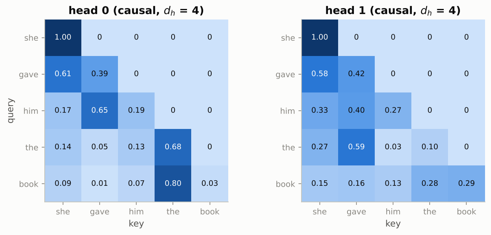

*Both heads obey the causal mask, but head 0 is sharply focused and head 1 is diffuse: the two lookups carry different information.*

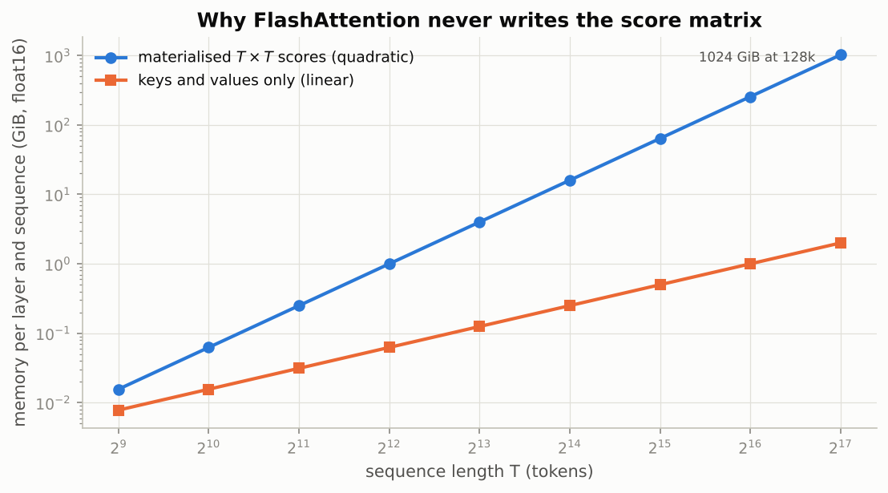

*The materialised score matrix grows four times for every doubling of $T$ (quadratic), while the keys and values that FlashAttention keeps grow only twice (linear).*

### Real-world examples

- Interpretability studies of BERT found individual heads that track the previous token, the next token, the direct object of a verb, or coreference ("her" to "Alice"), which is precisely the "several highlighters" picture.
- FlashAttention is the default kernel inside PyTorch's `F.scaled_dot_product_attention` on modern GPUs; it is what makes contexts of tens of thousands of tokens fit in memory.
- Serving systems such as vLLM build on the same kernels with paged key-value storage so that many chat sessions can share one GPU.

### Examples for every subsection

- **3.1 Motivation.** For the query "book" in "she gave him the book", head 0 reads 0.80 from "the" (the determiner right before it) while head 1 spreads 0.28 and 0.29 over "the" and itself; one softmax could not do both.
- **3.2 Implementation with reshapes.** $(5, 8) \to (5, 2, 4) \to (2, 5, 4)$ for each of $Q, K, V$; attention gives (2, 5, 5) weights; transpose and merge back to (5, 8). The script's reshape result equals the explicit per-head loop.
- **3.3 Verification against `nn.MultiheadAttention`.** PyTorch's `in_proj_weight` has shape (3d, d) with the query, key and value rows stacked in that order; split it into three (d, d) blocks, copy them into the from-scratch module, and the outputs agree to floating-point precision. The notebook passes `attn_mask=~mask` because PyTorch's `True` means blocked.
- **3.4 `F.scaled_dot_product_attention` and FlashAttention.** At $T = 4096$ the score matrix of one 32-head layer is 1.0 GiB in float16, versus 0.0625 GiB of keys and values; at 128k tokens it is 1,024 GiB versus 2 GiB, which is why the fused kernel never writes it.

### Common pitfalls

- Reshaping (batch, T, d) directly into (batch, h, T, d_h) without the transpose: the heads then slice across time instead of across features and the result is silently wrong.
- Expecting `F.scaled_dot_product_attention` to return the weights; it never does, by design.
- Comparing against `nn.MultiheadAttention` with the wrong mask polarity, which makes every row attend only to the future.

## 4. Positional information

### In plain words

Attention scores depend only on the contents of the vectors, never on where they sit, so shuffling the input shuffles the output in the same way and nothing else changes. The MLP and LayerNorm act on each position separately, so a whole Transformer stack is a function of the set of tokens, not the sequence. To restore order, each position receives a signature. Sinusoidal encodings use sine and cosine waves of many frequencies, chosen so that moving $k$ positions ahead is the same rotation whatever the starting position. Learned encodings simply train one vector per position. Rotary embeddings (RoPE) rotate the queries and keys inside every attention layer by an angle proportional to the position, so that scores depend only on the distance between two tokens.

### Sample data

Sinusoidal encoding with $d = 4$ (two frequencies, $\omega_0 = 1$ and $\omega_1 = 10000^{-2/4} = 0.01$):

| position $t$ | $\sin(t)$ | $\cos(t)$ | $\sin(0.01t)$ | $\cos(0.01t)$ |
|---|---|---|---|---|
| 0 | 0 | 1 | 0 | 1 |
| 1 | 0.841 | 0.540 | 0.010 | 1.000 |
| 2 | 0.909 | -0.416 | 0.020 | 1.000 |
| 3 | 0.141 | -0.990 | 0.030 | 1.000 |

The fast pair changes a lot between neighbours; the slow pair has barely moved after three positions.

### Worked example

Sinusoidal, $d = 32$, anchor position 32:

1. Dot products $p_{32}^{\top} p_{32+k}$ for offsets $k = 0, 1, 2, 5, 10$: 16.0, 15.314, 13.73, 11.777, 10.059. The peak $16 = d/2$ sits at $k = 0$.
2. Symmetry: $p_{32}^{\top} p_{37} = 11.7774$ and $p_{32}^{\top} p_{27} = 11.7774$.
3. Offset only: $p_{10}^{\top} p_{15} = 11.7774$ too, and the closed form $\sum_i \cos(\omega_i \cdot 5) = 11.7774$.
4. Shift property: the block-diagonal rotation $M_7$ satisfies $p_{t+7} = M_7\, p_t$ for every $t$ (`True` in the script).

RoPE, $d = 4$ with frequencies (1, 0.01), $q = (1, 0, 1, 0)$ and $k = (0.8, 0.6, 0, 1)$:

1. Pair 0 of $q$ at positions 0, 1, 2, 3 becomes $(1, 0)$, $(0.54, 0.841)$, $(-0.416, 0.909)$, $(-0.99, 0.141)$: the vector rotates by $t$ radians. Its norm stays 1.414214 at every position.
2. Score of the rotated query at $m$ against the rotated key at $n = m - 3$: $-0.6773$ for $(m, n) = (3, 0)$, $(5, 2)$, $(13, 10)$ and $(40, 37)$. For offset 2 it is $0.2327$ at $(2, 0)$, $(5, 3)$ and $(40, 38)$. The spread over $m = 3 \dots 59$ at offset 3 is exactly 0.0.
3. Without RoPE the raw score $q^{\top} k = 0.8$ would be the same for every pair of positions, i.e. no positional information at all.

### Chart

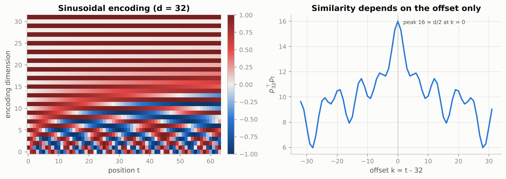

*Low dimensions oscillate quickly along the position axis and high dimensions barely move; the similarity to position 32 is a symmetric function of the offset that peaks at 16.*

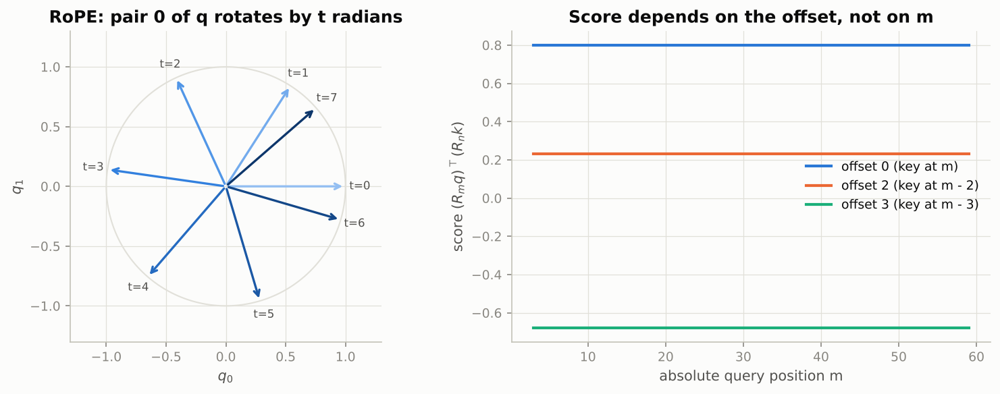

*The arrows are the same query pair at positions 0 to 7; on the right, the score for a fixed offset is a flat line across all absolute positions.*

### Real-world examples

- The original 2017 translation Transformer used sinusoidal encodings; GPT-2 and BERT switched to learned position tables with a hard context limit of 1,024 and 512 tokens respectively.
- Llama, Mistral, Qwen and most open models since 2023 use RoPE, and "long-context" versions of them are made by rescaling RoPE's frequencies (position interpolation, NTK-aware scaling, YaRN) rather than retraining from scratch.
- Vision Transformers add a learned position embedding per image patch; without it the model could not tell a cat's head above its body from the reverse.

### Examples for every subsection

- **4.1 Attention is permutation-equivariant.** Shuffle the five words of "she gave him the book" with any permutation, run the multi-head module, and the output rows are the same five vectors in the shuffled order; the notebook checks `Attention(P x) == P Attention(x)` with `torch.allclose`.
- **4.2 Sinusoidal encodings and the relative-shift property.** $p_{32}^{\top} p_{37} = p_{32}^{\top} p_{27} = p_{10}^{\top} p_{15} = 11.7774$: the similarity depends on the offset 5 only, and $p_{t+7} = M_7 p_t$ for every $t$.
- **4.3 Learned positional embeddings.** The notebook's GPT uses `nn.Embedding(block_size, d_model)`: with `block_size = 256` it has 256 position vectors and asserts that no input is longer than 256.
- **4.4 Rotary position embeddings (RoPE).** Rotating $q$ and $k$ by their own positions gives score $-0.6773$ for every pair three positions apart, and $0.2327$ for every pair two apart; the raw dot product 0.8 is the same for all pairs.

### Common pitfalls

- Believing attention "knows" order because the input is a sequence; it does not, and the notebook's shuffled-input check proves it.
- Running a learned-position model past its training length: the position table has no row for the extra positions and the forward pass fails.
- Applying RoPE to the values as well as the queries and keys; only the scores should be relative, the mixing of information should not be rotated.

## 5. The Transformer block

### In plain words

A Transformer is one block repeated $L$ times. Each block has two sub-layers: multi-head self-attention, the only place where positions exchange information, and a position-wise MLP with hidden width $4d$ that processes what was read. Each sub-layer is wrapped in a residual connection, so the block adds a small update to a running "residual stream", and each is preceded by a LayerNorm (pre-LN), which keeps gradients even across depth and makes training far more stable than the original post-LN ordering. A block has about $12d^2$ parameters, two thirds of them in the MLP, and a forward pass costs about $24d^2$ operations per token for its weight matrices plus $4Td$ for the attention products. The attention term is small at a thousand tokens and dominant at a hundred thousand.

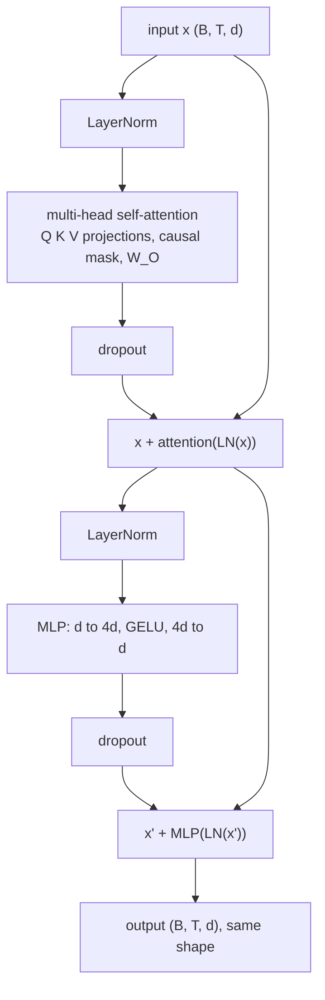

### Sample data

Parameter count of one pre-LN block with $d = 64$ (biases included):

| component | formula | parameters |
|---|---|---|
| attention $W_Q, W_K, W_V, W_O$ | $4d^2 + 4d$ | 16,640 |
| MLP $W_1, W_2$ | $8d^2 + 5d$ | 33,088 |
| two LayerNorms | $4d$ | 256 |
| total | $12d^2 + 13d$ | 49,984 |

### Worked example

1. The MLP holds $33{,}088 / 49{,}984 = 0.662$ of the block, the "two thirds" of the notebook.
2. GPT-2 family by the formula $N = L(12d^2 + 13d) + Vd + T_{\max} d + 2d$ with $V = 50257$ and $T_{\max} = 1024$:

| model | $L$ | $d$ | blocks | embeddings and final LN | total |
|---|---|---|---|---|---|
| GPT-2 small | 12 | 768 | 85.1 M | 39.4 M | 124.4 M |
| GPT-2 medium | 24 | 1024 | 302.3 M | 52.5 M | 354.8 M |
| GPT-2 large | 36 | 1280 | 708.4 M | 65.6 M | 774.0 M |
| GPT-2 XL | 48 | 1600 | 1,475.6 M | 82.1 M | 1,557.6 M |

   For GPT-2 small the formula gives exactly 124,439,808, the published figure. The notebook's own models have 108,352 parameters (FAST: $L = 2$, $d = 64$) and 4,821,248 (full: $L = 6$, $d = 256$).
3. FLOPs per token in the forward pass of GPT-2 small: the weight matrices cost a constant 0.247 GFLOP per token; the attention products cost $4Td$ per block, which is 0.038 GFLOP at $T = 1024$ (share 13.3 %), 0.151 GFLOP at 4,096 (37.9 %), 0.604 GFLOP at 16,384 (71.0 %) and 4.832 GFLOP at 131,072 (95.1 %).
4. The ratio of the two terms is $T/(6d) = 0.222$ at $T = 1024$, so the $6N$ rule is accurate when $T \ll 6d$: $6N$ gives 0.747 GFLOP per training token, and three times the measured forward cost at $T = 1024$ is 0.854 GFLOP.

### Chart

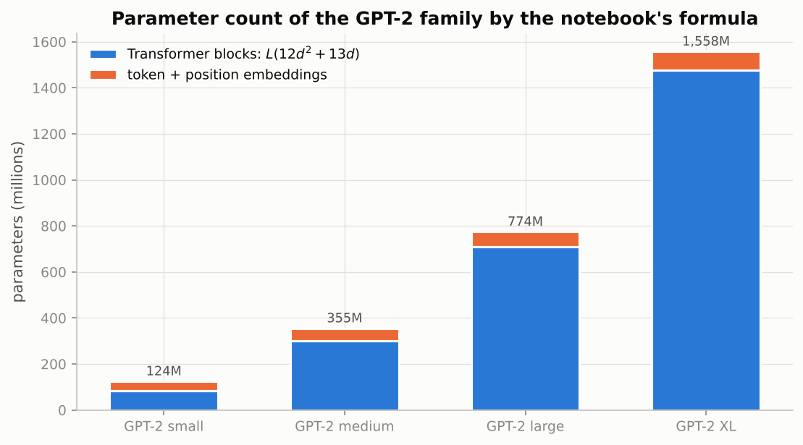

*Almost all parameters sit in the stacked blocks; the token and position embeddings matter only for the smallest model.*

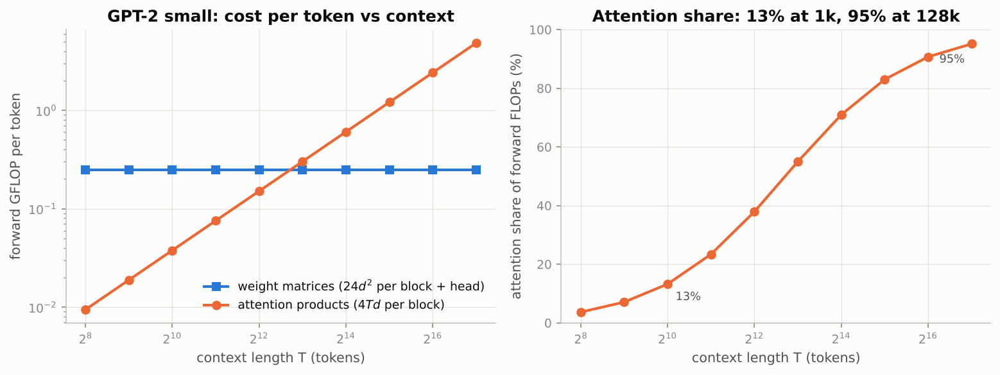

*The weight-matrix cost per token is flat in $T$ while the attention cost per token grows linearly, so attention overtakes the weight matrices between 4,096 tokens (37.9 %) and 8,192 tokens (55.0 %) and takes 95 % of the work at 128k.*

### Real-world examples

- GPT-2, GPT-3, Llama and the models behind chat assistants are literally this block stacked 12 to 100+ times; GPT-3's 175 B parameters come out of the same formula with $L = 96$ and $d = 12288$.
- The "6N" rule is how labs budget training runs: a 7 B-parameter model trained on 2 T tokens needs about $6 \times 7 \times 10^{9} \times 2 \times 10^{12} \approx 8 \times 10^{22}$ FLOPs before attention overhead.
- The pre-LN choice is why `nn.TransformerEncoderLayer` has a `norm_first` flag and why nearly every modern checkpoint sets it to true.

### Examples for every subsection

- **5.1 Anatomy.** For $d = 64$: attention 16,640 parameters, MLP 33,088, LayerNorms 256; the block maps a (2, 10, 64) tensor to a (2, 10, 64) tensor, so blocks can be stacked.
- **5.2 Pre-LN versus post-LN.** The notebook's `Block` computes `x + attn(ln1(x))` then `x + mlp(ln2(x))`; the 2017 post-LN form would be `ln1(x + attn(x))`, which needs a careful warmup to train at depth.
- **5.3 Encoder, decoder and decoder-only.** The same `Block` with `causal=True` is a GPT block; with `causal=False` it is a BERT block (Exercise 4); adding a cross-attention sub-layer that reads an encoder's output turns it into a T5 decoder block.
- **5.4 Counting parameters and FLOPs.** $12 \cdot 64^2 + 13 \cdot 64 = 49{,}984$ matches the real module; GPT-2 small is 85.1 M + 39.4 M = 124.4 M; attention is 13.3 % of forward FLOPs at 1,024 tokens and 95.1 % at 131,072.

### Common pitfalls

- Forgetting the final LayerNorm after the last pre-LN block: the residual stream is never normalised otherwise, and the head sees a drifting scale.
- Confusing parameter count with memory: Adam training needs about 16 bytes per parameter plus activations, not the 4 bytes of the weights alone.
- Quoting "attention is quadratic" without a context length: at 1,024 tokens it is 13 % of the work, at 128k it is 95 %.

## 6. Build a GPT

### In plain words

The pieces become a complete decoder-only language model: a token embedding plus a learned position embedding, $L$ causal blocks, a final LayerNorm and a linear head that shares its weight matrix with the token embedding. It is trained on Tiny Shakespeare at the character level: each example is a random window of characters and the same window shifted one step, and the causal mask lets the model predict every next character in the window at once. The recipe is AdamW with weight decay on matrices only, a learning rate that warms up linearly and then decays along a cosine to a tenth of its peak, and gradient clipping at norm 1. The same recipe, with bigger numbers, trains the largest language models.

### Sample data

A toy corpus and its character tokenizer:

| item | value |
|---|---|
| text | `To be, or not to be` |
| vocabulary (9 chars, sorted) | ` `, `,`, `T`, `b`, `e`, `n`, `o`, `r`, `t` |
| ids | 2, 6, 0, 3, 4, 1, 0, 6, 7, 0, 5, 6, 8, 0, 8, 6, 0, 3, 4 |

Two training windows of `block_size = 5`:

| start | input x | target y | x ids | y ids |
|---|---|---|---|---|
| 0 | `To be` | `o be,` | 2, 6, 0, 3, 4 | 6, 0, 3, 4, 1 |
| 7 | `or no` | `r not` | 6, 7, 0, 5, 6 | 7, 0, 5, 6, 8 |

### Worked example

1. Each window gives five next-character targets at once: position 0 must predict `o` from `T`, position 1 must predict ` ` from `To`, and so on; the causal mask guarantees position $t$ sees only characters $0 \dots t$.
2. Before training, a uniform guess over the notebook's 65-character vocabulary costs $\ln 65 = 4.174$ nats; a correctly initialised GPT prints an initial loss close to this value.
3. The FAST schedule (peak $3 \times 10^{-3}$, 50 warmup steps, 500 steps, floor $3 \times 10^{-4}$) gives these learning rates:

| step | 0 | 24 | 49 | 50 | 162 | 275 | 387 | 499 |
|---|---|---|---|---|---|---|---|---|
| learning rate | 6.00e-05 | 1.50e-03 | 3.00e-03 | 3.00e-03 | 2.61e-03 | 1.65e-03 | 6.99e-04 | 3.00e-04 |

   The peak 0.003 is reached at step 49, the midpoint of the cosine (step 275) sits at 1.65e-03, and the final value equals `min_lr`, a tenth of the peak.
4. Model sizes: 108,352 parameters in the FAST configuration and 4,821,248 in the full one; the full run processes $4000 \times 64 \times 256 \approx 65.5$ M characters.

### Chart

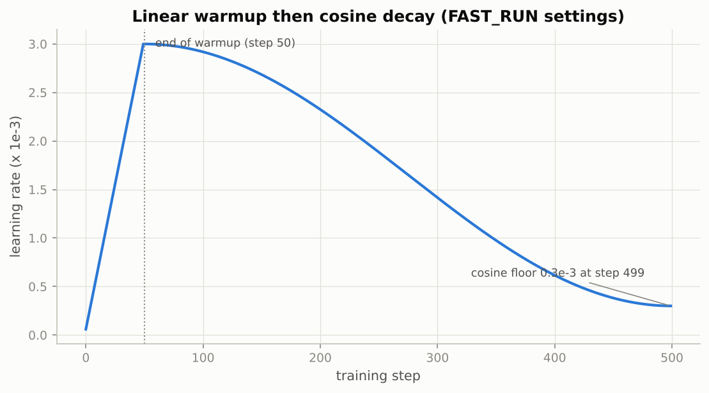

*The rate climbs linearly for 50 steps, then follows half a cosine down to the floor of 0.3e-3 at step 499.*

### Real-world examples

- nanoGPT, the reference reimplementation of GPT-2, uses this exact module layout, weight tying, $1/\sqrt{2L}$ residual scaling, AdamW with $\beta_2 = 0.95$ and warmup-cosine; the notebook's Section 6 is modelled on it.
- GPT-2 was trained on 40 GB of web text with a byte-pair vocabulary of 50,257 instead of 65 characters; the code path is otherwise the same.
- Weight tying matters most for word-level vocabularies: for GPT-2 small it saves $50257 \times 768 \approx 38.6$ M parameters, nearly a third of the model.

### Examples for every subsection

- **6.1 Data and tokenizer.** `To be, or not to be` has 9 distinct characters; the window starting at 7 is `or no` with target `r not`, ids (6, 7, 0, 5, 6) and (7, 0, 5, 6, 8).
- **6.2 The `GPT` module.** The head and the token embedding share one (65, d) matrix, so `gpt.lm_head.weight.data_ptr() == gpt.tok_emb.weight.data_ptr()`; the first loss is near $\ln 65 = 4.174$.
- **6.3 The training recipe.** Learning rate 6.00e-05 at step 0, 3.00e-03 at step 49, 1.65e-03 at step 275 and 3.00e-04 at step 499; weight decay 0.1 on every parameter with two or more dimensions, none on biases and LayerNorm gains.

### Common pitfalls

- Skipping warmup: Adam's second-moment estimate is unreliable in the first steps and a full-size step on a fresh Transformer can blow the loss up.
- Decaying biases and LayerNorm gains: the `dim() >= 2` rule exists to exclude them.
- Evaluating on different random windows each time, which makes the validation curve noisy for no reason; the notebook seeds a generator so the windows are fixed.

## 7. Generation and the KV-cache

### In plain words

A trained model gives a probability for every next token; a decoding strategy turns that into text. Greedy decoding takes the top token every time and loops. Temperature sharpens or flattens the distribution. Top-k keeps the k most likely tokens, top-p keeps the smallest set whose probability reaches p, and both cut off the long tail of unlikely tokens that together hold a lot of mass. Naive generation runs the whole context through the model for every new token, so generating $n$ tokens costs about $n^2/2$ token-positions. Because causal attention guarantees that the keys and values of earlier positions never change, they can be cached: after one pass over the prompt, each new token is processed alone, and the cost becomes linear. The price is memory, which for large models is many gigabytes per conversation.

### Sample data

A toy next-token distribution over eight tokens:

| token | the | a | his | my | an | one | this | zzz |
|---|---|---|---|---|---|---|---|---|
| probability | 0.40 | 0.25 | 0.12 | 0.08 | 0.06 | 0.04 | 0.03 | 0.02 |

### Worked example

1. Greedy picks `the`.
2. Temperature 0.5 sharpens to (0.641, 0.250, 0.058, 0.026, 0.014, 0.006, 0.004, 0.002); temperature 2.0 flattens to (0.251, 0.198, 0.137, 0.112, 0.097, 0.079, 0.069, 0.056).
3. Top-k with $k = 3$ keeps `the`, `a`, `his` and renormalises them to (0.519, 0.325, 0.156).
4. Top-p with $p = 0.8$: cumulative mass (0.40, 0.65, 0.77, 0.85, 0.91, 0.95, 0.98, 1.00); mass *before* each token (0, 0.40, 0.65, 0.77, 0.85, ...). A token is removed when the mass before it exceeds 0.8, so `the`, `a`, `his`, `my` stay (the crossing token `my` is kept) and are renormalised to (0.471, 0.294, 0.141, 0.094).
5. The tempting rule "remove when cumulative > p" fails: for a distribution (0.95, 0.03, 0.02) with $p = 0.9$ it keeps 0 tokens and the softmax returns `nan`.

KV-cache arithmetic for a prompt of $T_0 = 8$ tokens and $n = 56$ new tokens:

| step | 0 | 1 | 2 | 3 | 4 | ... | 55 | total |
|---|---|---|---|---|---|---|---|---|
| naive: positions processed | 8 | 9 | 10 | 11 | 12 | ... | 63 | 1,988 |
| cached: positions processed | 8 | 1 | 1 | 1 | 1 | ... | 1 | 63 |

The totals are $nT_0 + n(n-1)/2 = 1988$ versus $T_0 + n - 1 = 63$, a factor 31.6. The cache for the notebook's full model (6 layers, 8 heads of size 32) at 64 tokens is 768 KiB in float32; for a 70 B model with $L = 80$ and $d = 8192$ it is 20.0 GiB per 8,192-token sequence in float16, on top of 140 GB of weights.

### Chart

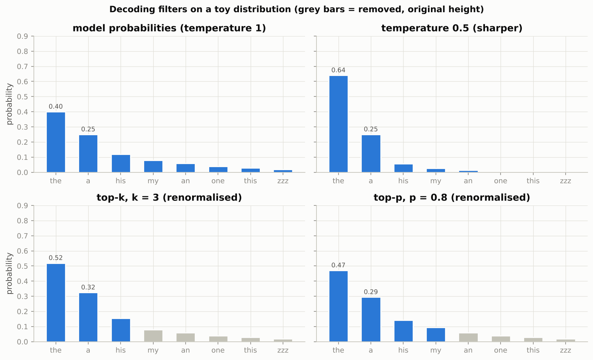

*Temperature reshapes all bars, top-k keeps a fixed number, top-p keeps as many as needed to reach 80 % of the mass; grey bars are removed before renormalising.*

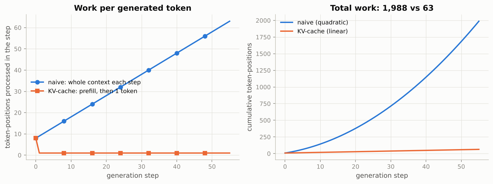

*Without a cache each step re-reads the whole context (left, rising line) and the total grows quadratically (right); with a cache every step after the prefill costs one token.*

### Real-world examples

- The `temperature` and `top_p` settings in chat and completion APIs are exactly the controls of Section 7.1; typical values are a temperature between 0.7 and 1 and a top-p between 0.9 and 1.
- Token streaming in a chat window is possible because of the KV-cache: each new token costs one forward step over one position rather than a pass over the whole conversation.
- Llama 2 70B uses grouped-query attention with 8 key-value heads for 64 query heads, shrinking the cache for a 4,096-token sequence from 10.0 GiB to 1.25 GiB so that more users fit on one GPU.
- Beam search remains standard in machine translation, where the most likely output is wanted; open-ended chat uses sampling because the most likely text is bland and repetitive.

### Examples for every subsection

- **7.1 Decoding strategies.** On the toy distribution greedy returns `the`; top-k = 3 keeps (`the`, `a`, `his`) at (0.519, 0.325, 0.156); top-p = 0.8 keeps four tokens at (0.471, 0.294, 0.141, 0.094); temperature 0.5 raises `the` to 0.641.
- **7.2 Why naive generation is quadratic, and the KV-cache.** Generating 56 tokens after an 8-token prompt touches 1,988 token-positions naively and 63 with the cache (31.6 times fewer); the cache for one 8k-token conversation of a 70 B model is 20 GiB in float16.

### Common pitfalls

- Removing the token that crosses the top-p threshold: a confident model then loses every token and the softmax returns `nan`.
- Using a repetition penalty with a character vocabulary: after a few dozen characters almost every token has appeared, so the penalty applies to nearly everything and changes little.
- Forgetting to give cached tokens their true position: the new token must be embedded at position $T_0 + i$, not at 0.

## 8. Scaling

### In plain words

The toy GPT and the largest models differ in size, data and compute, not in recipe, and the loss falls along smooth power laws as each grows: doubling the model removes a fixed fraction of the excess loss, and the same law holds across many orders of magnitude. For a fixed compute budget $C \approx 6ND$, the Chinchilla result is that parameters and tokens should grow together, about 20 tokens per parameter, which means compute-optimal cost grows with the square of the model size. Long contexts are a separate cost: the attention comparisons grow with $T^2$ per sequence, so at 128k tokens attention is 95 % of the work and the naive score matrices would need hundreds of gigabytes per layer.

### Sample data

Compute-optimal budgets at 20 tokens per parameter on a machine delivering 1 PFLOP/s at 30 % utilisation:

| model (by formula) | $N$ | tokens $D = 20N$ | training FLOPs $C = 6ND$ | days |
|---|---|---|---|---|
| notebook full | 0.0048 B | 0.1 B | 2.79e15 | 0.0 |
| GPT-2 small | 0.1244 B | 2.5 B | 1.86e18 | 0.1 |
| GPT-2 XL | 1.5576 B | 31.2 B | 2.91e20 | 11.2 |
| GPT-3 | 174.6043 B | 3,492.1 B | 3.66e24 | 141,141.9 |
| Chinchilla-like | 64.7120 B | 1,294.2 B | 5.03e23 | 19,387.2 |

### Worked example

1. $C = 6N \cdot 20N = 120 N^2$: ten times the parameters means one hundred times the compute, which is why GPT-2 XL takes 11 days and a GPT-3-sized model 141,142 days on the same machine.
2. GPT-3 was actually trained on 300 B tokens, i.e. $300/175 = 1.71$ tokens per parameter; Chinchilla used $1.4 \times 10^{12} / 70 \times 10^{9} = 20.0$.
3. Kaplan's law $L(N) = (N_c/N)^{0.076}$ with $N_c = 8.8 \times 10^{13}$ gives 3.371 nats at $10^{7}$ parameters, 2.830 at $10^{8}$, 2.376 at $10^{9}$, 1.994 at $10^{10}$ and 1.674 at $10^{11}$: each tenfold step removes a smaller absolute amount.
4. Long context for GPT-2 small (from Section 5): attention share 13.3 % at 1,024 tokens, 37.9 % at 4,096, 71.0 % at 16,384 and 95.1 % at 131,072.

### Chart

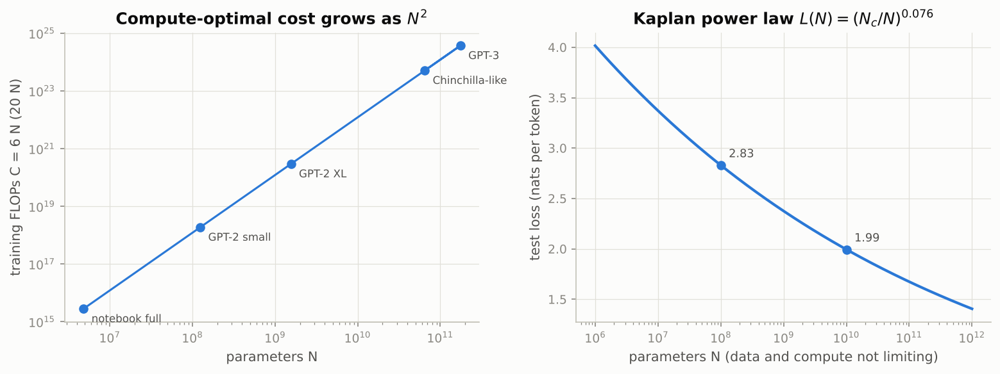

*Left: on log axes the compute-optimal cost is a straight line of slope 2. Right: loss keeps falling with size but each decade buys less.*

### Real-world examples

- The Chinchilla paper (Hoffmann et al., 2022) trained over 400 models to find the 20-tokens-per-parameter frontier; a 70 B model on 1.4 T tokens beat the 280 B Gopher trained with the same compute.
- Llama-style open models are trained on hundreds to thousands of tokens per parameter, deliberately past the compute-optimal point, because inference cost scales with $N$ and a smaller model is cheaper to serve.
- Vendors now advertise contexts of hundreds of thousands of tokens; serving them requires FlashAttention-style kernels and grouped-query caches, since the quadratic term dominates there.

### Examples for every subsection

- **8.1 Parameters, data and compute.** GPT-2 XL compute-optimal: 1.56 B parameters, 31.2 B tokens, $2.91 \times 10^{20}$ FLOPs, 11.2 days at 0.3 PFLOP/s; loss by Kaplan's law falls from 2.830 at $10^{8}$ parameters to 1.994 at $10^{10}$.
- **8.2 Why longer context is quadratic.** For one 32-head layer the float16 score matrices take 1.0 GiB at 4,096 tokens and 1,024 GiB at 131,072; for GPT-2 small the attention share of forward FLOPs rises from 13.3 % to 95.1 % over the same range.

### Common pitfalls

- Reading power laws as "bigger is always better" without the data term: a model starved of tokens is far from the law's prediction.
- Comparing the days column across hardware: it assumes 0.3 PFLOP/s sustained, and real clusters differ by orders of magnitude.
- Quoting the 6N rule for long contexts, where the $12LTd$ attention term is no longer negligible.

## 9. The Transformer family

### In plain words

The same block is arranged in three ways. An encoder stack (BERT) uses unmasked self-attention, so every position sees the whole input; it cannot generate text, so it is pretrained by hiding 15 % of the tokens and predicting them from both sides. An encoder-decoder (T5, BART, the original translation model) reads the source with an encoder and writes the target with a decoder that has causal self-attention and cross-attention to the encoder. A decoder-only model (GPT, Llama) is trained on next-token prediction and handles every task through its prompt, which is why it dominates today. PyTorch ships the block as `nn.TransformerEncoderLayer` and friends, with the inverted mask convention.

### Sample data

Which keys each query may read, for a 6-token input (counts of visible keys per query):

| arrangement | query 0 | query 1 | query 2 | query 3 | query 4 | query 5 |
|---|---|---|---|---|---|---|
| encoder (BERT) | 6 | 6 | 6 | 6 | 6 | 6 |
| decoder (GPT, causal) | 1 | 2 | 3 | 4 | 5 | 6 |
| cross-attention (T5 decoder over 6 source tokens) | 6 | 6 | 6 | 6 | 6 | 6 |

### Worked example

BERT-style masking of a 64-character string with selection probability 0.15 and the 80/10/10 rule (seed 31):

1. Expected number of selected characters: $0.15 \times 64 = 9.6$; the draw selected 10, of which 6 were replaced by `_` (the mask symbol), 1 by a random letter and 3 left unchanged.
2. Original: `the quick brown fox jumps over the lazy dog, and the cat sleeps.`
3. Corrupted: `t_e q_ick brown_foo jumps o_er the lazy dog_ _nd the cat sleeps.` (the `x` of `fox` became a random `o`; three selected characters look untouched but still carry a label).
4. The loss is computed only at the 10 selected positions; the other 54 are labelled `-100` and ignored.
5. Built-in layer check: `nn.TransformerEncoderLayer(d_model=64, nhead=4, dim_feedforward=256)` has 49,984 parameters, exactly the block formula, and a two-layer encoder has 99,968.

### Chart

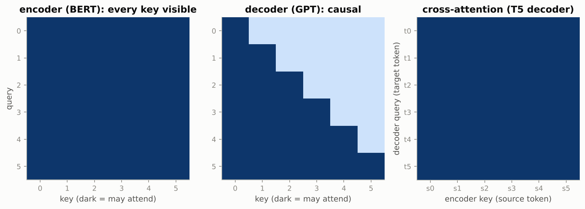

*Dark cells are allowed: the encoder reads everything, the decoder reads only the past, and a T5 decoder's cross-attention reads every source token.*

### Real-world examples

- Google Search has used BERT-style encoders to interpret queries since 2019; sentence-embedding encoders power semantic search and retrieval-augmented generation.
- Translation services and OpenAI's Whisper speech recogniser are encoder-decoder Transformers: an encoder over the source audio or text, a decoder that writes the output with cross-attention.
- ChatGPT, Claude, Gemini and Llama-based assistants are decoder-only; the task is in the prompt and the answer is the continuation, with in-context learning doing the rest.
- Protein language models such as ESM-2 are masked-language-model encoders over amino-acid sequences, the BERT recipe applied to biology.

### Examples for every subsection

- **9.1 Three arrangements, three objectives.** On the 64-character example, 10 positions were selected (6 masked, 1 random, 3 kept) and only those 10 contribute to the loss; a GPT on the same string would instead predict all 63 next characters.
- **9.2 `nn.TransformerEncoderLayer` and friends.** `nn.TransformerEncoderLayer(64, 4, 256, activation="gelu", batch_first=True, norm_first=True)` has 49,984 parameters, equal to one of the notebook's blocks; `nn.Transformer.generate_square_subsequent_mask(10)` gives the float causal mask with $-\infty$ above the diagonal.
- **9.3 Where this leads.** `gpt2` in Notebook 10 is the notebook's `GPT` class with $L = 12$, $d = 768$ and 50,257 subword tokens; DistilBERT is a 6-layer encoder trained with masked language modelling.

### Common pitfalls

- Expecting an encoder to generate text: it sees its own answer, so it was never trained to continue a sequence.
- Passing a boolean mask with the notebook's polarity to `nn.TransformerEncoder`: there `True` means blocked.
- Leaving `enable_nested_tensor` at its default with `norm_first=True`, which only produces a warning but confuses beginners into thinking something is wrong.

## Exercises in plain words

- **Exercise 1 (relative position bias).** Add a learned number per head for each clipped distance between a query and a key, and add it to the scores. Useful because it gives attention a notion of "how far" without touching the embeddings, as T5 does. Hint: build a (T, T) table of offsets `j - i`, clamp it, look it up in an embedding, and combine it with the causal mask into one float mask that `F.scaled_dot_product_attention` adds to the scores.
- **Exercise 2 (dropout on a small corpus).** Train the FAST GPT twice on the first 20,000 characters, with and without dropout, and compare training and validation losses. Useful because it shows when regularisation matters: only when the model can memorise. Hint: evaluate the training loss in `eval` mode so dropout is off for both.
- **Exercise 3 (nucleus sampling edge cases).** Write a slow loop version of top-p and compare it with the vectorised filter, then test $p = 1$, a dominant top token, and the no-empty-row guarantee. Useful because the one-line "cumulative > p" variant looks right and silently produces `nan`. Hint: the crossing token must stay; remove a token only when the mass *before* it already exceeds $p$.
- **Exercise 4 (tiny BERT).** Train the `Block` with `causal=False` as a masked character model using `mask_tokens`, and measure accuracy at masked positions. Useful because it shows the same block solving a fill-in-the-blank objective. Hint: enlarge the vocabulary by one for the mask token and pass `ignore_index=-100` to the loss.
- **Exercise 5 (grouped-query attention).** Implement attention with fewer key-value heads than query heads and compare cache sizes for a Llama-2-70B-like model. Useful because KV-cache memory, not parameters, limits how many users a GPU can serve. Hint: project keys and values to `n_kv_heads * d_head` and `repeat_interleave` them to match the query heads.

## Quick reference

| Concept | Formula or rule | In one sentence |
|---|---|---|
| Attention | $\operatorname{softmax}(QK^{\top}/\sqrt{d_k})\,V$ | Score every key, normalise per query, blend the values. |
| Scaling | $\operatorname{Var}(q^{\top}k) = d_k$ for unit-variance entries | Divide by $\sqrt{d_k}$ so scores keep variance 1. |
| Masking | set score to $-\infty$ before softmax | Weight becomes exactly 0; rows still sum to 1. |
| Causal mask | allow $j \le i$ (lower triangle) | Position $i$ reads only the past; makes a decoder autoregressive. |
| Multi-head | $[\text{head}_1; \dots; \text{head}_h] W_O$, each head width $d/h$ | Several lookups in parallel at the cost of one wide head. |
| Sinusoidal | $p_{t,2i} = \sin(\omega_i t)$, $p_{t,2i+1} = \cos(\omega_i t)$, $\omega_i = 10000^{-2i/d}$ | $p_{t+k} = M_k p_t$ for all $t$; dot products depend on $k$ only. |
| RoPE | $(R_m q)^{\top}(R_n k) = q^{\top} R_{n-m} k$ | Rotate $q$ and $k$ by their positions; scores depend on the offset. |
| Pre-LN block | $x + \text{Attn}(\text{LN}(x))$, then $x + \text{MLP}(\text{LN}(x))$ | Normalise before each sub-layer; add a final LayerNorm. |
| Block parameters | $12d^2 + 13d$ | Attention $4d^2$, MLP $8d^2$, plus biases and LayerNorms. |
| Model parameters | $L(12d^2 + 13d) + Vd + T_{\max}d + 2d$ | Gives exactly 124,439,808 for GPT-2 small. |
| Forward FLOPs per token | $L(24d^2 + 4Td) + 2Vd$ | Weight matrices plus the two attention products. |
| Training FLOPs | $\approx 6N + 12LTd$ per token | The 6N rule holds when $T \ll 6d$. |
| Warmup + cosine | linear to peak over $w$ steps, then $\text{min} + \tfrac{1}{2}(\text{max} - \text{min})(1 + \cos \pi\, \text{progress})$ | Peak at step $w - 1$, floor at the last step. |
| Top-p | remove token when mass *before* it $> p$ | Keeps at least one token and the one that crosses $p$. |
| KV-cache | naive $nT_0 + n(n-1)/2$ positions vs cached $T_0 + n - 1$ | Cache holds $2 L T d$ values per sequence. |
| Chinchilla | $D \approx 20N$, $C = 6ND = 120N^2$ | Ten times the parameters costs a hundred times the compute. |

## Glossary

- **Query, key, value**: the three vectors each position produces; the query asks, the key advertises, the value is handed over.
- **Softmax**: turns a list of scores into positive weights that add up to one.
- **Self-attention**: attention where queries, keys and values all come from the same sequence.
- **Cross-attention**: queries from one sequence (the decoder) read keys and values from another (the encoder).
- **Padding mask**: hides the keys at positions that only exist to make sequences the same length.
- **Causal mask**: hides every key that comes after the query's position.
- **Head**: one attention operation of width $d/h$ with its own projections.
- **FlashAttention**: an exact attention kernel that works in blocks and never writes the full score matrix.
- **Positional encoding**: a per-position signal (fixed waves, a learned table, or a rotation) that restores word order.
- **RoPE**: rotary position embedding; rotates queries and keys so that scores depend on relative distance.
- **Pre-LN**: LayerNorm applied before each sub-layer rather than after the residual sum.
- **Residual stream**: the running representation that each block adds a small update to.
- **Weight tying**: using the token embedding matrix as the output head as well.
- **KV-cache**: stored keys and values of past positions so that each new token is processed alone.
- **Nucleus (top-p) sampling**: sample only from the smallest set of tokens whose probability reaches $p$.
- **Chinchilla-optimal**: the parameter and token split, about 20 tokens per parameter, that gives the lowest loss for a fixed compute budget.
