# 10 · NLP with Pretrained Transformers (Hugging Face) — Companion Guide

> Plain-language companion to [`10_nlp_with_pretrained_transformers.ipynb`](10_nlp_with_pretrained_transformers.ipynb). Read a section here, then run the
> matching section of the notebook. All numbers below were computed with the script
> [`figures/scripts/make_figures_10.py`](figures/scripts/make_figures_10.py); all charts are its output.

## At a glance

- **What you learn**
  - How raw text becomes integers: characters, words and subwords, and how Byte-Pair Encoding learns a vocabulary by merging frequent pairs.
  - How integers become meaning: word2vec learns word vectors from nothing but neighbouring words, and pretrained Transformers turn that into one vector per occurrence.
  - How to use a downloaded model as an ordinary PyTorch module: hidden states, fill-in-the-blank, text generation, sentence embeddings, pipelines.
  - How to fine-tune an encoder for classification, once by hand and once with `Trainer`, and why the recipe (small learning rate, warmup, few epochs) looks the way it does.
  - Why updating every weight is expensive, and how LoRA trains about one percent of the parameters for almost the same accuracy.
  - How today's assistants are built in three stages (pretraining, supervised fine-tuning, preference optimisation) and what the DPO loss actually computes.
- **Where this is used in the real world**
  - Web search: Google announced in 2019 that BERT-style encoders help interpret search queries; the same contextual embeddings from Section 3 are what make "bank" in "river bank" different from "bank account".
  - Code assistants (GitHub Copilot and its relatives) are decoder models of the kind generated with in Section 3.3, trained on code and steered with the sampling knobs shown there.
  - Customer-support tooling classifies incoming tickets by topic and urgency with fine-tuned encoders, the exact workflow of Section 4 with different labels.
  - Domain chatbots (legal, medical, internal IT help desks) are usually a general model plus a small LoRA adapter, swapped in per customer, which is the economics of Section 5.
  - Assistant alignment: InstructGPT and ChatGPT were trained with RLHF, and open models such as Zephyr and Llama 3 used DPO in post-training, the loss implemented in Section 6.3.
  - Multilingual products pay for tokenization: the same sentence costs several times more tokens in Japanese or Hindi than in English under an English-centric tokenizer, which shortens the usable context and raises per-token API bills (Section 1.5).

## 1. Tokenization: from characters to subwords

### In plain words

A model only sees integers, so someone has to decide what one integer stands for. One letter per integer gives a tiny vocabulary but sequences five times longer than words, and attention cost grows with the square of the length. One word per integer gives short sequences but a vocabulary of hundreds of thousands of entries and no way to deal with a word the model has never seen. Subword tokenization is the compromise every modern model uses: common words stay whole, rare words are split into familiar chunks, and the vocabulary size becomes a knob. Byte-Pair Encoding (BPE) learns that vocabulary with a loop so simple you can run it by hand: count how often each pair of neighbouring symbols occurs, glue the most frequent pair into a new symbol, repeat. The ordered list of merges is the tokenizer.

### Sample data

The classic toy corpus from the BPE paper, with word frequencies (every word ends with the marker `</w>`):

| word | frequency | initial symbols |
|---|---|---|
| low | 5 | `l o w </w>` |
| lower | 2 | `l o w e r </w>` |
| newest | 6 | `n e w e s t </w>` |
| widest | 3 | `w i d e s t </w>` |

The initial alphabet has 11 distinct symbols (ten letters plus `</w>`) and the corpus averages 5.94 tokens per word before any merge.

### Worked example

Step 1: count neighbouring pairs, weighted by word frequency. The top six are `es` (9), `st` (9), `t</w>` (9), `we` (8), `lo` (7), `ow` (7). Ties are broken by whichever pair the dictionary returns first, here `e`+`s`.

| step | merge | count | vocabulary | tokens per word |
|---|---|---|---|---|
| 1 | `e` + `s` | 9 | 12 | 5.375 |
| 2 | `es` + `t` | 9 | 13 | 4.812 |
| 3 | `est` + `</w>` | 9 | 14 | 4.250 |
| 4 | `l` + `o` | 7 | 15 | 3.812 |
| 5 | `lo` + `w` | 7 | 16 | 3.375 |

The vocabulary grows by exactly one per merge: after 12 merges it has 23 = 11 + 12 symbols, and the corpus is down to 1.375 tokens per word. Encoding replays the merges in rank order on a new word. The word `lowest` never occurs in the corpus, yet after 5 merges it is `['low', 'est</w>']`, two pieces that both carry meaning; `newest` at that point is still `['n', 'e', 'w', 'est</w>']` and becomes the single token `newest</w>` after merge 8. Decoding simply concatenates and turns `</w>` into a space: `lower newest` encodes to `['low', 'e', 'r', '</w>', 'newest</w>']` and decodes back to `'lower newest'`.

The second chart compares the three schemes on four sentences with a toy BPE trained on 126 words (60 merges, vocabulary 85):

| id | sentence | characters | words | toy-BPE tokens |
|---|---|---|---|---|
| S1 | the model reads the text | 24 | 5 | 6 |
| S2 | new words are split into pieces | 31 | 6 | 18 |
| S3 | the tokenizer learned the merges | 32 | 5 | 7 |
| S4 | retokenization is unpredictable | 31 | 3 | 20 |

S1 and S3 reuse words from the training text and cost about as many tokens as words; S2 and S4 contain words the tokenizer never saw (`pieces`, `unpredictable`) and fall back to small pieces, so they cost almost as many tokens as characters. A real tokenizer trained on billions of words sits much closer to the word count for ordinary text.

### Chart

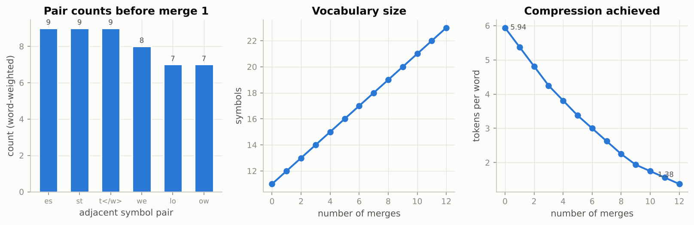

*The vocabulary line is straight by construction (one new symbol per merge) while the tokens-per-word curve is what the merges buy you: it falls fast and then flattens.*

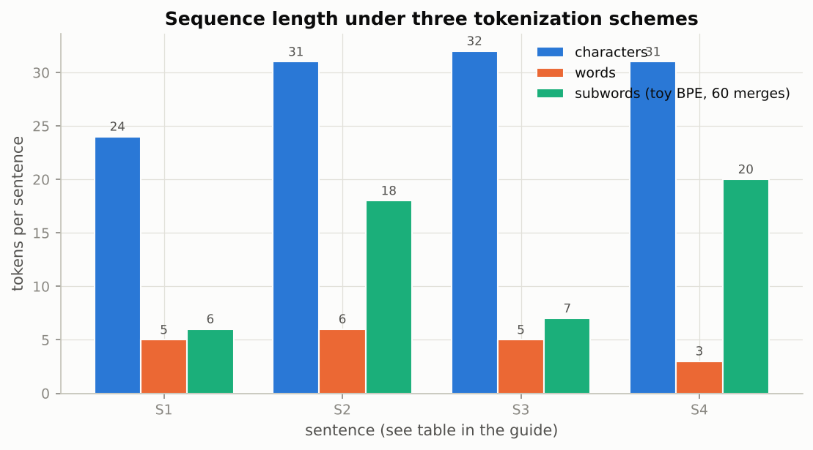

*Subwords are as short as words for familiar text (S1, S3) and degrade gracefully towards characters for unseen words (S2, S4) instead of producing an unknown token.*

### Real-world examples

- GPT-2, GPT-3/4, Llama and Qwen all use byte-level BPE, so any Unicode string (emoji, code, Thai) can be encoded without an unknown token; the price is that rare characters cost several byte tokens.
- BERT and DistilBERT use WordPiece with the `##` continuation marker; their uncased vocabulary maps emoji and some scripts to `[UNK]`, which is why they are poor choices for social-media text in many languages.
- Per-token API pricing makes the tokenizer a cost model: studies of commercial tokenizers show that the same content in Japanese, Hindi or Burmese can need several times more tokens than in English, so non-English users get shorter effective context windows for the same price.

### Examples for every subsection

- **1.1 Characters, words, or something in between?** A 20-word sentence is roughly 100 characters: a character model has to attend over five times more positions, and attention cost grows with the square of that, so it is about 25 times more expensive per sentence than a word model.
- **1.2 Byte-Pair Encoding from scratch.** On the toy corpus the first three merges build `est</w>` in three steps because `es`, `st` and `t</w>` each occur 9 times; after merge 8 the six copies of `newest` are each a single token.
- **1.3 WordPiece, Unigram and SentencePiece.** WordPiece would not simply pick `es` with count 9; it scores each pair by count of the pair divided by the counts of its parts, so a pair of rare symbols that always occur together wins over a pair of common ones that sometimes do.
- **1.4 Hugging Face tokenizers.** Calling the DistilBERT tokenizer on "Transformers make tokenization look easy" wraps the ids in `[CLS]` and `[SEP]`, splits `tokenization` into `token` + `##ization`, and returns an attention mask of ones; a batch call with `padding=True` pads to the longest sentence and marks the padding with zeros.
- **1.5 Tokenization pitfalls.** `12345678` is chopped into chunks such as `123` + `456` + `78` whose digit boundaries carry no arithmetic meaning, which is one reason language models mis-add long numbers; newer tokenizers split numbers into single digits or groups of three on purpose.

### Common pitfalls

- Loading a model with a tokenizer from a different checkpoint runs without error and produces garbage, because the ids index a different embedding table. Always load both from the same name.
- Ending a GPT-2 style prompt with a trailing space: the space belongs to the next word, so `" hello"` and `"hello"` are different tokens with different embeddings.
- Forgetting that an uncased tokenizer folds `HELLO` and `hello` into one token, so the model built on it cannot see shouting.

## 2. Word embeddings: word2vec from scratch

### In plain words

An integer id says nothing about meaning; a one-hot vector for `cat` is exactly as far from `dog` as from `carburettor`. An embedding replaces each id by a short learned vector, and the question is where the similarity between vectors should come from. word2vec's answer is the distributional idea: words that appear in similar company should get similar vectors. The skip-gram model trains two small lookup tables to say "yes" to real (centre, neighbour) pairs and "no" to a few randomly drawn fake neighbours. That binary task (negative sampling) replaces an expensive softmax over the whole vocabulary with a handful of dot products per pair. After training, cosine similarity between the centre vectors finds related words, and the whole thing works only because the corpus is large: the toy corpus below is deliberately clean so that the geometry is visible on 1,800 sentences.

### Sample data

A synthetic corpus of 1,800 three-word sentences, 600 per topic, each of the form *noun verb noun* with both nouns and the verb drawn from one topic (the word `the` is dropped, which mimics the notebook's subsampling of very frequent words):

| topic | nouns | verbs |
|---|---|---|
| royalty | king, queen, prince, princess, duke, lord, lady, knight | rules, crowns, greets, honours |
| animals | dog, cat, puppy, kitten, horse, wolf, rabbit, fox | chases, bites, sniffs, follows |
| food | bread, cheese, apple, soup, butter, honey, pie, stew | flavours, garnishes, sweetens, thickens |

That gives a vocabulary of 36 words and, with a window of 2 positions, 10,800 (centre, context) pairs. The model uses 16-dimensional vectors, K = 5 negatives per pair, batches of 128 pairs and Adam.

### Worked example

First the loss for a single pair by hand, in two dimensions with K = 2 negatives. Take the centre vector $v_c = [0.5, -0.2]$, the true context vector $u_o = [0.4, 0.1]$ and two negative context vectors $[-0.3, 0.2]$ and $[0.1, 0.3]$.

1. Positive score $u_o \cdot v_c = 0.180$, so $\sigma(0.180) = 0.5449$ and the positive term is $-\log 0.5449 = 0.6072$.
2. Negative 1 scores $-0.190$; the model should say "no", so the term is $-\log \sigma(0.190) = -\log 0.5474 = 0.6027$.
3. Negative 2 scores $-0.010$, term $-\log \sigma(0.010) = -\log 0.5025 = 0.6882$.
4. Loss $= 0.6072 + 0.6027 + 0.6882 = 1.8980$. A model that is indifferent to everything (all scores zero) would pay $3 \log 2 = 2.0794$, so these vectors are already slightly better than chance.

Now the training run. Because the context table starts at zero, every score is zero at step 0 and the first loss is exactly $(K+1)\log 2 = 6 \log 2 = 4.1589$. The mean loss per epoch is 2.6659, 1.7213, 1.6933 and 1.6718 over four epochs (85 steps each), and the last 20 steps average 1.6745. The loss does not go to zero: the negatives are drawn from the same 36 words, so some "fake" neighbours are genuinely plausible.

After mean-centering and normalising the centre vectors, nearest neighbours by cosine similarity are:

| query | nearest three (cosine) |
|---|---|
| king | queen (0.96), prince (0.96), knight (0.95) |
| dog | rabbit (0.94), horse (0.87), wolf (0.86) |
| bread | pie (0.95), cheese (0.94), stew (0.92) |

Across topics the cosine is negative: cosine(king, dog) = -0.41 and cosine(king, bread) = -0.14. Projecting the 36 vectors onto their first two principal components keeps 36.9% + 35.0% = 71.9% of the variance, enough to see three clean clusters.

### Chart

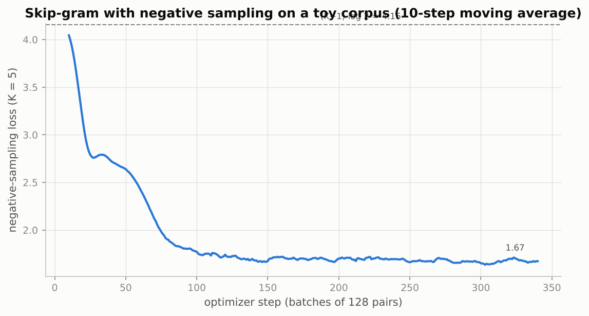

*The curve starts exactly at (K+1) log 2 = 4.16, the price of indifference, and settles near 1.67 once the two tables have organised themselves.*

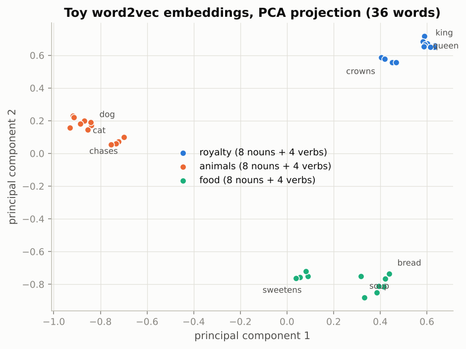

*Words that share contexts end up together; within each topic the nouns and the verbs form two sub-clusters because nouns and verbs never appear in the same slot.*

### Real-world examples

- Airbnb published how it learned listing embeddings from the sequences of listings users click on, treating a browsing session like a sentence and listings like words, exactly the skip-gram objective applied to clicks instead of text.
- Recommendation systems routinely train "item2vec" or "prod2vec" models on purchase and playlist sequences; a song that appears in playlists next to the same songs gets a similar vector, which is how "similar artists" lists are built without any audio analysis.
- The famous analogy king - man + woman is close to queen is the same geometry the notebook probes; it emerges from co-occurrence statistics alone and also surfaces the gender and occupation stereotypes present in the training text.

### Examples for every subsection

- **2.1 From one-hot vectors to dense embeddings.** With a vocabulary of 8 and 4-dimensional embeddings, looking up row 2 of the table is the same number as multiplying the one-hot vector for id 2 by the table, and the cosine between any two different one-hot vectors is exactly 0.
- **2.2 The skip-gram objective with negative sampling.** For the pair (king, queen) the model raises the score of queen's context vector against king's centre vector and lowers the scores of five random words such as `soup` or `bites` drawn in proportion to their frequency to the power 0.75.
- **2.3 Preparing the corpus.** On the toy corpus the 1,800 sentences of three words and a window of 2 give 10,800 pairs: each sentence contributes 6 ordered pairs (every word with both of the others).
- **2.4 The model and the training loop.** Two 36-by-16 tables, batches of 128 pairs, 5 negatives each: the first loss is 4.1589, the fourth-epoch mean is 1.6718.
- **2.5 From static to contextual embeddings.** word2vec gives `bank` one vector; DistilBERT in Section 3.1 gives the `bank` in "deposited the cheque at the bank" and the `bank` in "the bank of the river" different vectors, and the two financial banks come out closer to each other than to the river bank.

### Common pitfalls

- Comparing raw vectors without subtracting the mean on a small corpus: negative sampling gives every vector a large shared component, so all cosines are close to 1 and the neighbours are meaningless.
- Expecting analogies to work on a tiny corpus; a few thousand words cannot pin down 64 dimensions, and the Shakespeare analogies in the notebook are illustrations of the method, not a guaranteed result.
- Using the context table instead of the centre table as the final embedding; the original implementation and the notebook keep the centre table.

## 3. Using pretrained models

### In plain words

Nobody trains a Transformer from nothing for a product feature; they download one that somebody pretrained on billions of tokens. The Hugging Face `Auto` classes build the right architecture from a checkpoint name and load the weights, returning a plain `nn.Module`. The bare model returns one vector per token, the contextual embedding; task variants add a head: a fill-in-the-blank head for masked encoders, a classification head, or a next-token head for generation. Three things are worth taking away. The hidden state at the `[CLS]` position or the mean over real tokens gives you a sentence vector, and cosine similarity between such vectors is a usable notion of "about the same thing". Text generation has knobs (temperature, top-k, top-p, repetition penalty) that reshape the model's own next-token distribution, and none of them adds knowledge the model lacks. And the `pipeline` helper bundles tokenizer, model and post-processing for quick demos, while real training and evaluation use the explicit tokenizer-plus-model code.

### Sample data

A toy next-token distribution over eight candidate tokens, given as logits (the model's raw scores before softmax):

| token | the | a | model | cat | runs | quickly | banana | `<eos>` |
|---|---|---|---|---|---|---|---|---|
| logit | 2.0 | 1.6 | 1.2 | 0.4 | 0.0 | -0.4 | -1.5 | -2.0 |

And five hand-typed sentences for the semantic-search example, embedded with the toy word2vec vectors of Section 2 (mean pooling over the content words, `the` ignored); these are toy vectors, not DistilBERT:

| id | sentence |
|---|---|
| S1 | the king greets the queen |
| S2 | the knight honours the duke |
| S3 | the dog chases the cat |
| S4 | the fox bites the rabbit |
| S5 | the cheese flavours the soup |

### Worked example

**Temperature.** Dividing the logits by a temperature T before the softmax changes the shape of the distribution without changing the order:

| T | the | a | model | cat | runs | quickly | banana | `<eos>` |
|---|---|---|---|---|---|---|---|---|
| 0.5 | 0.581 | 0.261 | 0.117 | 0.024 | 0.011 | 0.005 | 0.001 | 0.000 |
| 1.0 | 0.385 | 0.258 | 0.173 | 0.078 | 0.052 | 0.035 | 0.012 | 0.007 |
| 2.0 | 0.255 | 0.209 | 0.171 | 0.115 | 0.094 | 0.077 | 0.044 | 0.035 |

At T = 0.5 `the` takes 58% of the mass and `banana` is practically impossible; at T = 2.0 `banana` and `<eos>` together get 8%, which is where ungrammatical continuations come from.

**Top-k and top-p.** At T = 1, top-k with k = 3 keeps `the`, `a`, `model` and renormalises them to 0.472, 0.316, 0.212. Top-p with p = 0.8 keeps tokens in order until the cumulative probability passes 0.8: `the` + `a` + `model` reach 0.816, so the same three survive and get the same renormalised probabilities. The two rules differ when the distribution is flat (top-p keeps more tokens) or very peaked (top-p keeps fewer).

**Semantic search.** Cosine similarities between the mean-pooled toy sentence vectors:

| | S1 | S2 | S3 | S4 | S5 |
|---|---|---|---|---|---|
| S1 | 1.00 | 0.99 | -0.48 | -0.52 | -0.49 |
| S2 | 0.99 | 1.00 | -0.49 | -0.52 | -0.48 |
| S3 | -0.48 | -0.49 | 1.00 | 0.98 | -0.50 |
| S4 | -0.52 | -0.52 | 0.98 | 1.00 | -0.47 |
| S5 | -0.49 | -0.48 | -0.50 | -0.47 | 1.00 |

The query "the prince rules the castle" (`castle` is out of vocabulary and ignored) ranks S1 (0.95) and S2 (0.92) first, then S5 (-0.45), S3 (-0.48), S4 (-0.49): the royalty sentences win although the query shares no content word with S2. That is the whole idea of dense retrieval; DistilBERT's 768-dimensional mean-pooled vectors do the same job on real text, and dedicated sentence-embedding models do it much better.

### Chart

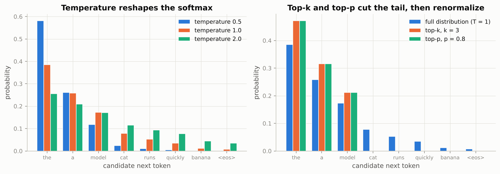

*Temperature flattens or sharpens the same ordering; top-k and top-p remove the tail and renormalise, and here both keep the same three tokens.*

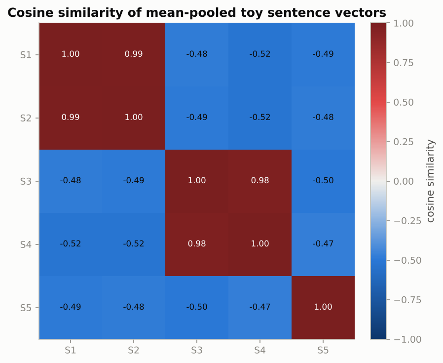

*Sentences about the same topic sit near 1, sentences from different topics are negative after mean-centering; the diagonal is 1 by definition.*

### Real-world examples

- Retrieval-augmented generation (RAG) systems embed every paragraph of a document base with a sentence-embedding model, embed the user's question the same way, and pass the top-ranked paragraphs to a chat model; the ranking step is the cosine search of Section 3.4 at scale.
- Fill-mask probing is a standard way to audit bias: asking a masked model to complete "The man worked as a [MASK]" and "The woman worked as a [MASK]" and comparing the top candidates is a one-line check that DistilBERT's own model card documents.
- Chat assistants expose temperature and top-p to developers; a code-completion product runs near-greedy settings for determinism, while a brainstorming feature raises the temperature to get more varied suggestions.

### Examples for every subsection

- **3.1 `AutoModel`: what a pretrained encoder returns.** For a 10-token sentence DistilBERT returns a (1, 10, 768) tensor of hidden states plus, on request, the 7 intermediate tensors (embeddings and one per layer); the `[CLS]` row or the masked mean over the 10 rows is the sentence vector.
- **3.2 Fill-mask with the pretrained head.** "The capital of France is [MASK]." sends the hidden state at the mask position through a 768-to-30,522 head; softmax over that row gives the candidate list, and `paris` should dominate.
- **3.3 Text generation with DistilGPT-2.** In the toy table, greedy decoding always picks `the`; sampling at T = 0.5 picks `the` 58% of the time; at T = 2.0 it picks `banana` or `<eos>` about one time in twelve.
- **3.4 Sentence embeddings and a tiny semantic search engine.** The query "the prince rules the castle" scores 0.95 against "the king greets the queen" and -0.49 against "the fox bites the rabbit".
- **3.5 The `pipeline` API.** `pipeline("fill-mask", model=mlm, tokenizer=bert_tok)` returns, for "Paris is the [MASK] of France.", a list of dictionaries with `token_str`, `score` and the filled `sequence`, the same computation as Section 3.2 with the bookkeeping hidden.

### Common pitfalls

- Reading `top_p` and `top_k` as adding creativity: they only cut the tail of the distribution the model already has; a model that does not know an answer will not produce it at any temperature.
- Using `max_length` instead of `max_new_tokens` for generation: `max_length` counts the prompt, so a long prompt can leave zero tokens for the answer.
- Treating plain BERT mean-pooled vectors as a strong retrieval model; they are a baseline, and contrastively trained sentence-embedding models are far better with the same pooling code.

## 4. Fine-tuning for classification, by hand and with `Trainer`

### In plain words

Fine-tuning takes the pretrained encoder, puts a fresh linear head on the `[CLS]` vector and trains everything on a labelled dataset. Because the encoder already knows the language, a few thousand labelled sentences routinely beat a model trained from scratch on far more data. The recipe has barely changed since the BERT paper: AdamW with a tiny learning rate (a few hundred-thousandths), a linear warmup over the first tenth of the steps followed by a linear decay to zero, gradient clipping at norm 1, and only two to four epochs. Warmup matters because the pretrained weights sit in a delicate region and large early updates destroy what was learned. Two engineering details make it cheap: tokenize per batch so that each batch is padded only to its own longest sentence (dynamic padding), and let the model compute the loss itself by passing labels. The hand-written loop is about forty lines; `Trainer` is the same recipe behind a configuration object plus mixed precision, checkpointing and logging.

### Sample data

Four toy batches of four sentences each, described only by their token counts, with a maximum length of 32 tokens:

| batch | token counts of the 4 sentences | fixed padding (to 32) | dynamic padding (to the longest) | real tokens |
|---|---|---|---|---|
| 1 | 9, 12, 7, 14 | 128 | 56 | 42 |
| 2 | 21, 8, 10, 11 | 128 | 84 | 50 |
| 3 | 6, 9, 5, 8 | 128 | 36 | 28 |
| 4 | 30, 12, 9, 15 | 128 | 120 | 66 |

### Worked example

**Dynamic padding.** Fixed padding processes 512 tokens for the four batches, dynamic padding 296, and only 186 of those are real. Dynamic padding therefore processes 58% of the fixed-padding tokens, and the share of wasted positions falls from 64% to 37%. Batch 4 shows the remaining waste: one 30-token sentence forces three short ones to be padded to 30, which is what length-grouped batching (`group_by_length`) would fix.

**The schedule.** With 4 warmup steps and 20 steps in total, the learning-rate multiplier is 0.0, 0.25, 0.5, 0.75 during warmup, reaches 1.0 at step 4 and then decays linearly: 0.938, 0.875, 0.812, 0.75, 0.688, 0.625, 0.562, 0.5, 0.438, 0.375, 0.312, 0.25, 0.188, 0.125, 0.062. Note that the very first step uses a multiplier of zero.

**The notebook's full budget.** 3 epochs over 4,000 sentences in batches of 32 give 3 x 125 = 375 optimizer steps; warmup is int(0.1 x 375) = 37 steps. With a base learning rate of 5e-5 the actual learning rate is 1.35e-05 at step 10 (still warming up), exactly 5.00e-05 at step 37 (the peak), and 2.59e-05 at step 200 (halfway down the decay). Under `FAST_RUN` the same recipe runs for 512 sentences in batches of 16, which is 32 steps: a smoke test of the pipeline, not a converged model.

### Chart

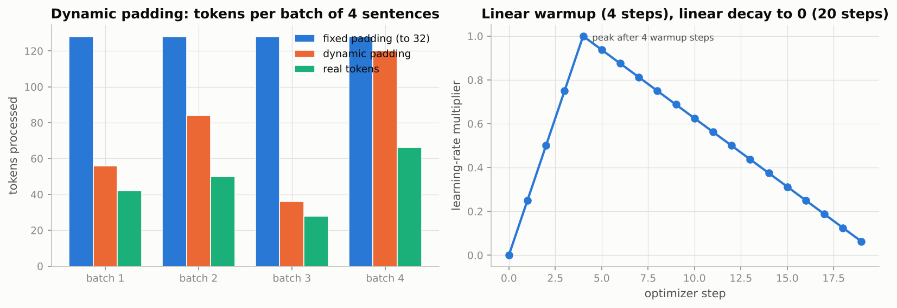

*Left: dynamic padding processes little more than the real tokens except when one long sentence dominates a batch; right: the learning rate ramps up for 4 steps and then decays linearly to zero.*

### Real-world examples

- Sentiment and review classification at e-commerce and app-store scale is a fine-tuned encoder with two or five labels; SST-2, the notebook's dataset, is the standard benchmark for the binary version.
- Content-moderation and toxicity classifiers that flag abusive comments are fine-tuned encoders with a small head, trained on a few tens of thousands of labelled comments, deployed with the `predict`-style function of Section 4.4.
- Support-ticket triage (billing, outage, feature request; urgent or not) is the same pipeline with the labels of a help desk, and dynamic padding is what keeps inference on short tickets cheap.

### Examples for every subsection

- **4.1 The task and the data.** SST-2 has 67k training and 872 validation sentences; the notebook takes 4,000 and 1,000 of them (512 and 256 under `FAST_RUN`), and if the download fails it generates 216 review sentences in the notebook and splits them 172/44.
- **4.2 Datasets, dynamic padding and the collate function.** The four toy batches above process 296 tokens with dynamic padding instead of 512 with fixed padding; the attention mask is what makes the padded positions harmless.
- **4.3 The fine-tuning loop, written by hand.** 375 steps, 37 of them warmup, peak learning rate 5e-5 at step 37 and 2.59e-5 at step 200; the hand-written `LambdaLR` matches `get_linear_schedule_with_warmup` step for step.
- **4.4 Inference on your own sentences.** "The plot is thin but the performances carry it." is deliberately mixed; the label matters less than the confidence the softmax attaches to it, which a model trained on a few hundred sentences tends to overstate.
- **4.5 The same thing with `Trainer`.** The same 375-step budget expressed as `num_train_epochs=3`, `per_device_train_batch_size=32`, `warmup_steps=37`, `learning_rate=5e-5`, `weight_decay=0.01`, with `DataCollatorWithPadding` doing the dynamic padding.

### Common pitfalls

- Using a learning rate meant for training from scratch (1e-3) on a pretrained encoder: the pretrained features are destroyed in the first few steps and accuracy collapses to chance.
- Skipping the attention mask after padding: the model attends to `[PAD]` tokens and the predictions change silently.
- Leaving `Trainer`'s default `save_strategy`: it writes a checkpoint every 500 steps, around 250 MB each for DistilBERT, until the disk is full.

## 5. Parameter-efficient fine-tuning: LoRA from scratch and with `peft`

### In plain words

Updating every weight costs far more memory than storing the model: with AdamW in 32-bit precision each trainable parameter needs 4 bytes for the weight, 4 for its gradient and 8 for the two Adam running averages, 16 bytes in total before activations. That is about 1 GB for DistilBERT and 112 GB for a 7-billion-parameter model, and every task needs its own full copy. LoRA (low-rank adaptation) freezes the pretrained weights and learns a small correction next to each chosen layer, written as the product of two thin matrices B and A scaled by alpha/r. B starts at zero, so training begins at exactly the pretrained model; after training the product can be added into the frozen weight and the adapter disappears, so inference costs nothing extra. The adapter trains about one percent of the parameters, matches full fine-tuning closely on this task, and is a few megabytes on disk. The `peft` library does the same injection, freezing and saving for any Hugging Face model, and the training loop does not change.

### Sample data

The notebook's memory table (weights in the stated precision, gradients and Adam moments in fp32, activations excluded):

| configuration | trainable parameters | weight bytes | weights (GB) | gradients (GB) | Adam (GB) | total (GB) |
|---|---|---|---|---|---|---|
| DistilBERT 66M, full FT (fp32) | 66M | 4 | 0.26 | 0.26 | 0.53 | 1.06 |
| DistilBERT 66M, LoRA r=8 (fp32) | 0.74M | 4 | 0.26 | 0.00 | 0.01 | 0.27 |
| 7B, full FT (fp32) | 7B | 4 | 28.00 | 28.00 | 56.00 | 112.00 |
| 7B, full FT (bf16 weights) | 7B | 2 | 14.00 | 28.00 | 56.00 | 98.00 |
| 7B, LoRA r=16 (bf16 weights) | 40M | 2 | 14.00 | 0.16 | 0.32 | 14.48 |
| 7B, QLoRA r=16 (4-bit weights) | 40M | 0.5 | 3.50 | 0.16 | 0.32 | 3.98 |

### Worked example

**Memory.** 16 bytes per trainable parameter: 66e6 x 16 = 1.06 GB for DistilBERT, 7e9 x 16 = 112 GB for a 7B model. Freezing the 7B weights, storing them in 4 bits and training a 40M-parameter adapter brings the total to 3.98 GB, 28 times less, which is why QLoRA fits on one consumer GPU.

**Parameter count.** For one 768 x 768 projection at rank 8, LoRA trains 8 x (768 + 768) = 12,288 numbers instead of 589,824, 48 times fewer. DistilBERT has 6 blocks; adapting the query and value projections gives 12 layers x 12,288 = 147,456 adapter parameters at r = 8 (0.222% of the 66.4M base parameters); adapting all six linear layers per block gives 663,552, 4.5 times more at every rank. The counts grow linearly with the rank: at r = 64 the query-value adapter has 1,179,648 parameters, still 1.8% of the model.

**The update by hand.** Take a 2 x 3 weight $W = [[1, 0, 2], [0.5, -1, 0]]$, rank 1, $A = [[1, -1, 0.5]]$ and $\alpha / r = 2$.

1. At initialisation $B = 0$, so $\Delta W = 2 \cdot B A = 0$ and the adapted layer is exactly the base layer.
2. Suppose training moved $B$ to $[0.2, -0.4]^\top$. Then $\Delta W = 2 \cdot B A = [[0.4, -0.4, 0.2], [-0.8, 0.8, -0.4]]$.
3. Merging gives $W' = W + \Delta W = [[1.4, -0.4, 2.2], [-0.3, -0.2, -0.4]]$.
4. Check on $x = [1, 2, -1]$: the two-thin-products route $W x + 2 \cdot B (A x)$ gives $[-1.6, -0.3]$, and the merged $W' x$ gives $[-1.6, -0.3]$. Same answer, which is why merged inference is free.

**DoRA's decomposition** of the same $W$: the row norms are $m = [2.236, 1.118]$ and the unit-length direction rows are $[0.447, 0, 0.894]$ and $[0.447, -0.894, 0]$; DoRA applies LoRA to the direction and trains the two numbers in $m$ separately (Exercise 5).

### Chart

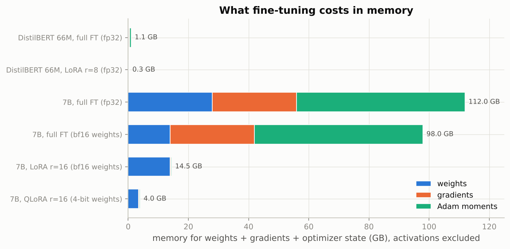

*Gradients and Adam moments, not the weights, dominate full fine-tuning; freezing the weights removes them almost entirely, and quantising the frozen copy shrinks what is left.*

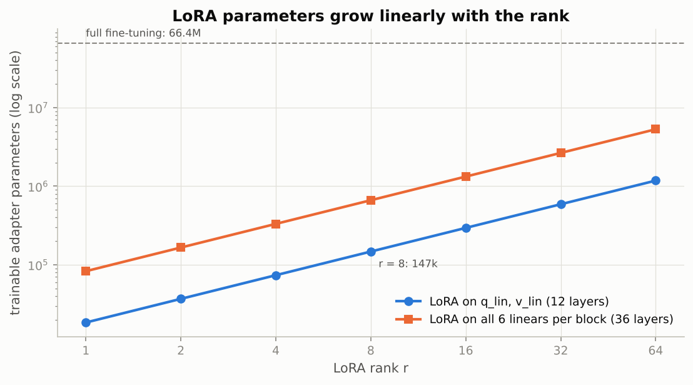

*Both lines are straight on the log scale because the count is linear in r; even at r = 64 the query-value adapter is under 2% of the model.*

### Real-world examples

- Hosting one base model with many LoRA adapters is how multi-tenant LLM services serve per-customer fine-tunes: the adapters are megabytes, can be kept in memory side by side and swapped per request, while a full copy per customer would be tens of gigabytes each.
- QLoRA made fine-tuning 65B-parameter models possible on a single 48 GB GPU, which is why most open-weight community fine-tunes on the Hugging Face Hub are LoRA or QLoRA adapters rather than full checkpoints.
- Image generators such as Stable Diffusion use the same LoRA mechanism for style and character adapters that users share as small files and merge into the base model at load time.

### Examples for every subsection

- **5.1 Why not just fine-tune everything? The memory arithmetic.** 7e9 parameters x 16 bytes = 112 GB with full fine-tuning in fp32 versus 3.98 GB with QLoRA: a 28-fold difference before activations are counted.
- **5.2 LoRA: low-rank adaptation, derived.** With $B = 0$ the hand example's $\Delta W$ is the zero matrix; after training, $W x + 2 B(Ax)$ and the merged $W' x$ both give $[-1.6, -0.3]$ on $x = [1, 2, -1]$.
- **5.3 The `peft` library.** `LoraConfig(r=8, lora_alpha=16, target_modules=["q_lin", "v_lin"], modules_to_save=["pre_classifier", "classifier"])` reproduces the from-scratch adapter: 147,456 LoRA parameters plus the trainable head, the same count the hand-written version reports.
- **5.4 The wider PEFT family.** The DoRA decomposition of the 2 x 3 example keeps two magnitudes (2.236 and 1.118) and two unit-length direction rows; IA3 would keep only per-channel scaling vectors and no low-rank matrices at all.

### Common pitfalls

- Forgetting to keep the new classification head trainable: LoRA matrices alone cannot make a randomly initialised head useful, so `mark_only_lora_trainable(..., also_train=("pre_classifier", "classifier"))` or `modules_to_save` is essential.
- Using the full-fine-tuning learning rate for an adapter: LoRA starts from zero and needs a learning rate ten to a hundred times higher (1e-4 to 1e-3).
- Measuring a LoRA run against full fine-tuning on a 32-step budget and drawing conclusions: at that budget the difference is seed noise.

## 6. How large language models are trained today

### In plain words

A modern assistant is built in three stages with the ingredients of this notebook. Pretraining is next-token prediction scaled up to trillions of tokens; it produces a base model that continues text superbly but, asked a question, may just continue with more questions. Supervised fine-tuning (SFT) shows the model tens of thousands of example conversations; it is still cross-entropy, but the prompt positions get the ignore label so that only the response is scored. Preference optimisation then uses human judgements of which of two answers is better. The classic route, RLHF, fits a reward model and runs reinforcement learning against it with a penalty for drifting from the SFT model; DPO shows that the same objective has a closed-form solution and collapses the whole thing into one logistic loss on the model's own log-probabilities relative to a frozen reference. The coefficient beta sets how far the policy may move, and it is in this stage that most of a model's personality is decided.

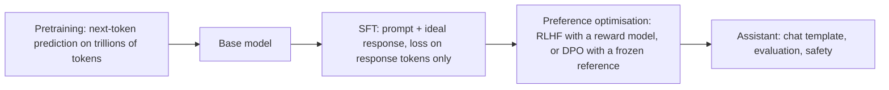

### Sample data

A toy SFT example with a vocabulary of 6 tokens: prompt ids `[1, 4, 2]`, response ids `[5, 0, 3]`, random logits standing in for the model, and the labels with the prompt masked:

| position | 0 | 1 | 2 | 3 | 4 | 5 |
|---|---|---|---|---|---|---|
| input id | 1 | 4 | 2 | 5 | 0 | 3 |
| label | -100 | -100 | -100 | 5 | 0 | 3 |

And one preference pair for DPO, given as log-probabilities of the whole response under the policy and under the frozen reference:

| response | log pi (policy) | log pi_ref (reference) |
|---|---|---|
| chosen y_w | -2.0 | -2.5 |
| rejected y_l | -3.0 | -2.2 |

### Worked example

**SFT masking.** Position t predicts token t+1, so the logits are shifted left and the labels right, giving the shifted labels `[-100, -100, 5, 0, 3]`. The per-position cross-entropies of the random logits are 2.878, 4.301, 1.786, 1.482, 2.890. Averaging all five gives 2.6673; averaging only the three positions whose label is not -100 gives 2.0528, and that is the SFT loss: the model is not rewarded for predicting the prompt.

**DPO on one pair.** The implicit reward of a response is beta times its log-ratio against the reference. For the chosen response the log-ratio is -2.0 - (-2.5) = +0.5, for the rejected one -3.0 - (-2.2) = -0.8, so the margin is 1.3 beta:

| beta | implicit reward chosen | implicit reward rejected | margin | loss = -log sigma(margin) |
|---|---|---|---|---|
| 0.1 | +0.05 | -0.08 | +0.13 | 0.6303 |
| 0.5 | +0.25 | -0.40 | +0.65 | 0.4201 |
| 2.0 | +1.00 | -1.60 | +2.60 | 0.0716 |

At zero margin every beta pays log 2 = 0.6931, the loss of a coin flip. The same log-ratios count for more under a large beta, which is why a large beta is satisfied by small moves away from the reference.

**The tabular experiment.** Four prompts with six candidate answers each, a hidden "true" reward, and 48 preference pairs labelled by a noisy Bradley-Terry annotator (12 per prompt, 60 underlying response pairs in total); the reference policy agrees with the annotator on only 44% of the pairs. Training a free logit per answer with Adam for 150 steps:

| beta | loss at step 1 | final loss | implicit-reward accuracy | KL(policy, reference) | agreement with hidden reward |
|---|---|---|---|---|---|
| 0.1 | 0.693 | 0.280 | 94% | 1.95 | 77% of 60 pairs |
| 0.5 | 0.693 | 0.133 | 94% | 1.91 | 77% of 60 pairs |
| 2.0 | 0.693 | 0.103 | 94% | 0.87 | 75% of 60 pairs |

All three runs rank the winner above the loser on 94% of the training pairs (the remaining 6% are contradictory labels that no policy can satisfy), and all three recover the hidden reward's ordering on about three quarters of all pairs although DPO never saw that reward. What beta changes is the KL price: 1.95 nats at beta = 0.1 versus 0.87 at beta = 2.

### Chart

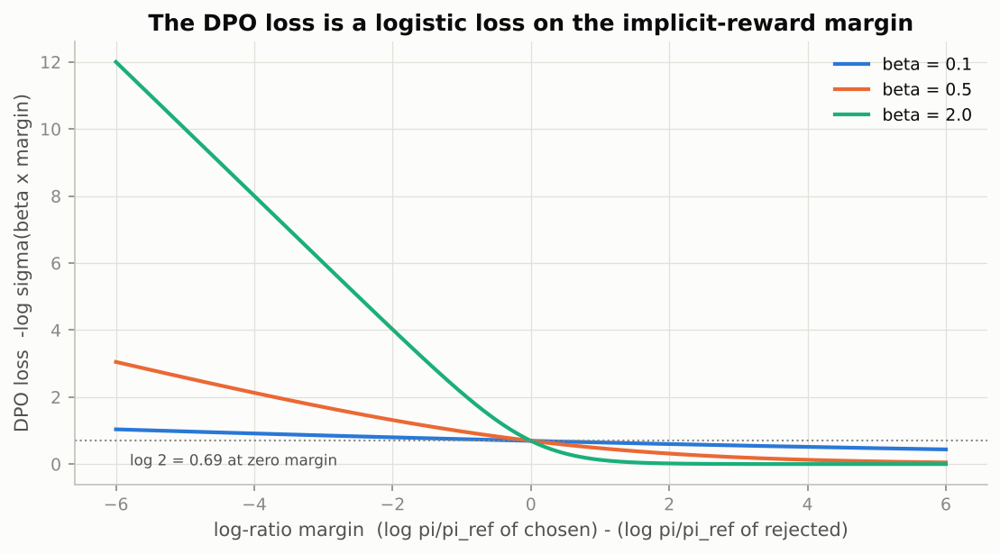

*A logistic loss: all curves pass through log 2 at zero margin, and a larger beta makes the same margin count for more, so it saturates sooner.*

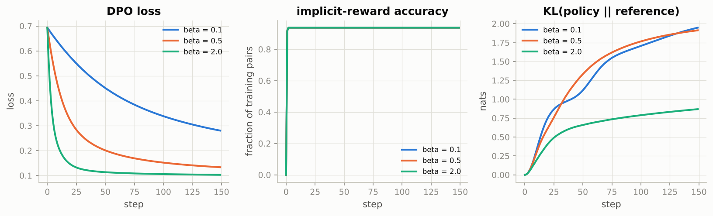

*All three betas fit the consistent preferences, but beta = 2 does so while staying much closer to the reference policy.*

### Real-world examples

- InstructGPT (the model behind the first ChatGPT) was trained with exactly the three stages: pretraining, supervised fine-tuning on demonstrations written by contractors, and RLHF with a reward model and PPO.
- Open models such as Zephyr-7B and Meta's Llama 3 instruct variants used DPO in their post-training, which is why the ten-line loss of Section 6.3 is now the most common way preference data reaches a model.
- Chat templates are a deployment detail with real consequences: serving a model with the wrong system/user/assistant markup silently degrades its answers, which is why every tokenizer on the Hub ships `apply_chat_template`.

### Examples for every subsection

- **6.1 Pretraining.** A base model asked "What is the capital of France?" may answer with another quiz question, because in web text a list of questions is a likely continuation; it is a text predictor, not an assistant.
- **6.2 Supervised fine-tuning (SFT).** On the toy example the loss over all positions would be 2.6673 but the SFT loss is 2.0528, the mean over the three response tokens only.
- **6.3 Preference optimization: from RLHF to DPO.** For the single pair with log-ratios +0.5 and -0.8, the DPO loss is 0.6303 at beta = 0.1 and 0.0716 at beta = 2.0; in the tabular run beta = 2 reaches the same 94% accuracy at less than half the KL.
- **6.4 Instruction following, evaluation and safety.** The optional cell wraps a system message and a user question in Qwen's chat template (special tokens such as `<|im_start|>`) before generating; evaluating such a model on a benchmark that leaked into its pretraining data would overstate its ability.

### Common pitfalls

- Computing the SFT loss over the prompt tokens too: the model then spends capacity on predicting questions instead of answers, and the reported loss is not comparable across prompt lengths.
- Dropping the reference model from DPO "to save memory": without the reference log-ratios the loss turns into plain likelihood of chosen minus rejected, which lets the policy drift arbitrarily far and degrade.
- Reading a high implicit-reward accuracy as a good model: with a small beta the policy can fit the preferences while moving far from the reference, which in a real LLM means forgetting language ability.

## 7. Practical considerations

### In plain words

Before you build on a pretrained model you budget memory, choose a precision and read the paperwork. Each attention layer stores a score table with one entry per pair of positions, so its memory grows with the square of the sequence length: negligible at 128 tokens, impossible at 32 thousand. Fused attention kernels avoid storing the table, but the compute is still quadratic and the feed-forward activations still scale with length, so the practical advice is to look at your token-length distribution, truncate to the shortest length that covers it, pad dynamically and trade batch size for length rather than the reverse. Running in 16-bit precision halves activation memory and doubles throughput; bfloat16 keeps only 7 explicit mantissa bits, so small differences from full precision are normal, not a bug. Finally, a model card tells you what a checkpoint was trained on and where it fails, the licence tells you whether you may use it, and a benchmark score tells you little until you know the test data was not in the training set.

### Sample data

The notebook's attention-memory table for a batch of 8, 12 heads, 6 layers, fp16 scores (2 bytes):

| L (tokens) | score matrices per layer (GB) | all 6 layers (GB) |
|---|---|---|
| 128 | 0.003 | 0.02 |
| 512 | 0.050 | 0.30 |
| 2048 | 0.805 | 4.83 |
| 8192 | 12.885 | 77.31 |
| 32768 | 206.158 | 1236.95 |

### Worked example

**Attention memory.** The formula is 8 x 12 x L^2 x 2 bytes per layer. At L = 512 that is 0.050 GB per layer and 0.30 GB for six layers; doubling L to 1024 multiplies the memory by 4; at L = 32,768 the six layers would need 1,237 GB, which no GPU has, so a long-context model must use kernels that never materialise the table.

**Precision.** A 7B model's weights take 28.0 GB in fp32, 14.0 GB in bf16 or fp16, 7.0 GB in int8 and 3.5 GB in 4-bit NF4. Rounding the float32 values 1.2345678, 0.001234 and 345.678 to bfloat16 gives 1.234375, 0.0012359619 and 346.0, with relative errors of 1.56e-04, 1.59e-03 and 9.31e-04. The spacing between neighbouring bf16 values is 2^-7 = 7.81e-03 of the value, so a single rounding is off by at most 2^-8 = 3.91e-03; after six layers these errors accumulate to the differences of order 1e-2 on hidden states that the notebook's autocast check reports.

### Chart

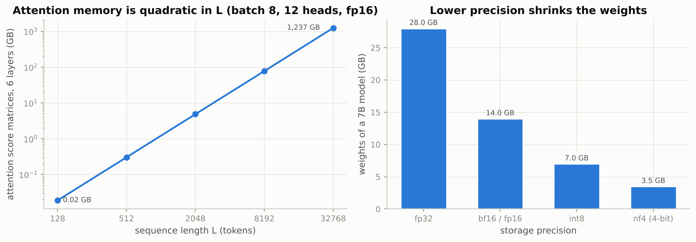

*Left: a straight line of slope 2 on log-log axes, the signature of quadratic growth; right: each halving of the bytes per parameter halves the weight memory.*

### Real-world examples

- Long-context chat models (hundreds of thousands of tokens) exist only because FlashAttention-style kernels compute attention block by block without storing the L x L table; the compute is still quadratic, which is why long prompts are slow and expensive.
- Mixed-precision bf16 training is the default on modern accelerators, and inference services routinely serve int8 or 4-bit weights so that a 7B model fits on a single consumer GPU.
- Model licences are a gating decision in industry: Apache-2.0 and MIT checkpoints can ship in products, "community" licences carry usage conditions, and gated models require accepting terms before download; the training-data licence is a separate question the model licence does not settle.

### Examples for every subsection

- **7.1 Sequence length and memory.** At L = 2048 the six score tables already take 4.83 GB in fp16 for a batch of 8; halving the batch to 4 at the same length is the cheaper trade than keeping the batch and doubling the length (which would cost 4 times more).
- **7.2 Mixed precision.** 345.678 becomes 346.0 in bfloat16, a relative error of 9.31e-04; a hidden state of order 1 therefore carries errors of a few thousandths per layer, and the notebook's six-layer check reports differences of order 1e-2.
- **7.3 Model cards, licenses and data contamination.** DistilBERT's card documents that "The man worked as a [MASK]" and "The woman worked as a [MASK]" get stereotyped completions; the notebook's SST-2 numbers are comparable to the literature only because SST-2's test labels were never released, so nobody could have tuned on them.

### Common pitfalls

- Setting `max_length` far above the 95th percentile of your token lengths "to be safe": you pay quadratically for positions that are padding almost all the time.
- Running fp16 training without a gradient scaler: fp16's narrow exponent range underflows small gradients to zero; bf16 does not need the scaler, fp16 does.
- Reporting a validation score after tuning hyperparameters on the same split: the number is no longer an estimate of anything.

## Exercises in plain words

- **Exercise 1 (BPE decoding edge cases).** Turn the encoder/decoder pair into a class that maps tokens to integer ids, reserves id 0 for unknown symbols, returns empty output for empty input, re-attaches punctuation when decoding and round-trips any in-alphabet lower-case text. It is useful because real tokenizers must be total functions on arbitrary input. Hint: look every token up in a dictionary with default 0, and remove the space before punctuation with one regular expression; watch what happens to `ü` and digits.
- **Exercise 2 (compare tokenizers on multilingual text).** Count tokens per character for sentences in several languages, a line of code and emoji under our BPE, WordPiece and byte-level BPE. It shows which tokenizer is even across languages and which one loses information. Hint: count `[UNK]` tokens for WordPiece; byte-level BPE never produces one but pays in length.
- **Exercise 3 (early stopping).** Extend the fine-tuning loop so that it stops when validation accuracy has not improved for a given number of epochs and restores the best weights. It is the standard defence against the validation loss creeping up after epoch two or three. Hint: store a cloned copy of the best `state_dict` on the CPU, not a reference, and demonstrate on the tiny bag-of-embeddings model so that it runs in seconds.
- **Exercise 4 (LoRA on all linear layers).** Predict the adapter size per block from r x (d_in + d_out) for all six linear layers, verify it in code, then fine-tune and compare with the attention-only run. It teaches you to size an adapter before training. Hint: the two feed-forward layers are 768 to 3072 and back, so they cost more than all four attention projections together.
- **Exercise 5 (DoRA from scratch).** Implement the magnitude-times-direction decomposition with LoRA on the direction, check that it equals the base layer at initialisation, and compare LoRA and DoRA when the target is the pretrained map with its rows rescaled plus a small low-rank change. It shows what a per-row scale buys. Hint: normalise rows of W + (alpha/r) BA and multiply by a trainable vector initialised to the row norms; then try a much larger low-rank change and see which method wins.

## Quick reference

| Concept | Formula or rule | In one sentence |
|---|---|---|
| BPE vocabulary size | $\lvert V \rvert = \#\text{characters} + \#\text{merges}$ | Each merge adds exactly one symbol, so the number of merges sets the vocabulary. |
| BPE encoding | merge the adjacent pair with the lowest rank until none remains | Replay the learned merges in order; unseen words fall apart into smaller known pieces. |
| WordPiece merge score | $\text{count}(ab) / (\text{count}(a)\,\text{count}(b))$ | Prefer pairs whose parts rarely occur apart, not just frequent pairs. |
| Skip-gram with negative sampling | $-\log\sigma(u_o^\top v_c) - \sum_{k=1}^{K}\log\sigma(-u_{w_k}^\top v_c)$ | Say yes to the true neighbour and no to K sampled words; starts at $(K+1)\log 2$. |
| Noise distribution | $P_n(w) \propto \text{count}(w)^{3/4}$ | Flatten the unigram distribution so rare words are sampled a little more often. |
| Subsampling | discard an occurrence with probability $1 - \sqrt{t/f(w)}$ | Thin out very frequent words to remove uninformative pairs. |
| Cosine similarity | $\cos(a, b) = a^\top b / (\lVert a \rVert \lVert b \rVert)$ | Compare directions, not lengths; subtract the mean vector first on small corpora. |
| Temperature | $\text{softmax}(z / T)$ | Below 1 sharpens, above 1 flattens; the order of tokens never changes. |
| Fine-tuning recipe | AdamW, lr $2\text{-}5 \times 10^{-5}$, 10% linear warmup then linear decay, clip at 1, 2-4 epochs | Small careful steps keep the pretrained features intact. |
| Linear warmup/decay | $\text{step}/w$ for step $< w$, else $(T - \text{step})/(T - w)$ | A multiplier on the base learning rate that peaks at step w and reaches 0 at step T. |
| Fine-tuning memory | 16 bytes per trainable parameter (4 weight + 4 grad + 8 Adam) in fp32 | 66M parameters need about 1 GB, 7B need 112 GB, before activations. |
| LoRA update | $W' = W + \frac{\alpha}{r} B A$, $B = 0$ at init, $A$ Kaiming-uniform | A low-rank correction that starts at zero and can be merged into W after training. |
| LoRA parameter count | $r\,(d_{\text{in}} + d_{\text{out}})$ per adapted layer | 12,288 instead of 589,824 for a 768 x 768 layer at r = 8. |
| DoRA | $W' = m \odot \dfrac{W + \frac{\alpha}{r}BA}{\lVert W + \frac{\alpha}{r}BA \rVert_{\text{row}}}$ | Train the row magnitudes separately and apply LoRA to the direction. |
| SFT loss | cross-entropy with prompt labels set to $-100$ | Score only the response tokens. |
| Bradley-Terry | $p(y_w \succ y_l) = \sigma(r(x, y_w) - r(x, y_l))$ | A preference is a logistic function of the reward difference. |
| DPO loss | $-\log\sigma\big(\beta \log\frac{\pi_\theta(y_w)}{\pi_{\text{ref}}(y_w)} - \beta \log\frac{\pi_\theta(y_l)}{\pi_{\text{ref}}(y_l)}\big)$ | Logistic regression on the implicit-reward margin; beta sets how far the policy may move. |
| Attention memory | $B \times H \times L^2 \times \text{bytes}$ per layer | Doubling the sequence length quadruples the score-matrix memory. |
| bfloat16 | 7 explicit mantissa bits, spacing $2^{-7}$ | Differences of order $10^{-2}$ after six layers are expected rounding. |

## Glossary

- **Tokenizer**: the fixed rule that cuts text into pieces from a vocabulary and maps each piece to an integer id; it is part of the model.
- **Byte-Pair Encoding (BPE)**: a subword method that builds its vocabulary by repeatedly merging the most frequent pair of adjacent symbols.
- **End-of-word marker (`</w>`)**: a symbol appended to each word so that a piece at the end of a word is distinct from the same letters inside a word.
- **Attention mask**: a 0/1 tensor marking which positions of a padded batch are real tokens.
- **Dynamic padding**: padding each batch only to its own longest sequence instead of a global maximum.
- **Embedding**: a learned table whose row i is the vector for token id i.
- **Skip-gram**: the word2vec variant that predicts the surrounding words from the centre word.
- **Negative sampling**: replacing the softmax over the vocabulary by a yes/no decision against a few randomly drawn words.
- **Contextual embedding**: the vector a pretrained network produces for one occurrence of a token after reading the whole sentence.
- **Fine-tuning**: continuing to train a pretrained model on a labelled downstream task, usually with a fresh head.
- **Warmup**: starting the learning rate at zero and ramping it up linearly over the first steps so that the pretrained weights are not damaged.
- **LoRA**: low-rank adaptation, a trainable product of two thin matrices added to a frozen weight and mergeable after training.
- **Rank (r)**: the inner dimension of the LoRA factors; the knob that sets adapter size and capacity.
- **QLoRA**: LoRA on top of a frozen base model stored in 4-bit precision.
- **Supervised fine-tuning (SFT)**: training a base model on prompt-response pairs with the loss masked to the response tokens.
- **DPO**: direct preference optimisation, a logistic loss on the policy's log-ratios against a frozen reference that replaces the reward model and RL loop of RLHF.
- **Model card**: the documentation of a checkpoint: intended use, training data, evaluation, known limitations and biases.
