# 11 · Autoencoders and Variational Autoencoders — Companion Guide

> Plain-language companion to [`11_autoencoders_and_vaes.ipynb`](11_autoencoders_and_vaes.ipynb). Read a section here, then run the
> matching section of the notebook. All numbers below were computed with the script
> [`figures/scripts/make_figures_11.py`](figures/scripts/make_figures_11.py); all charts are its output.

## At a glance

- **What you learn**
  - Why natural data such as handwritten digits occupy a thin, curved sheet (a manifold) inside pixel space, and how a PCA spectrum shows it.
  - What an autoencoder is, why a narrow bottleneck forces it to summarize, and why the linear version is exactly PCA.
  - How reconstruction error doubles as a denoiser's training signal and as an anomaly score, and where that score fails.
  - Why a plain autoencoder is a poor generator, and how the variational autoencoder (VAE) fixes it with a prior and noisy codes.
  - The VAE objective (the ELBO), the reparameterization trick, the closed-form KL term, and what the beta weight and KL annealing do.
  - How generators are judged (likelihood bounds, Fréchet feature distance), and how VAE ideas power VQ-VAE, latent diffusion and linear probes.
- **Where this is used in the real world**
  - Manufacturing and fraud: an autoencoder trained only on normal parts or transactions flags inputs it cannot reconstruct (the MVTec AD defect benchmark is attacked this way; card-fraud and network-intrusion systems use the same recipe).
  - Medical imaging and astronomy: denoising networks trained to recover clean scans from noisy ones reduce radiation dose in low-dose CT and clean up faint telescope images.
  - Drug discovery: VAEs trained on molecular strings (SMILES) give a continuous latent space in which candidate molecules can be optimized (Gómez-Bombarelli et al., 2018).
  - Image generation: Stable Diffusion does its denoising inside the latent space of a lightly regularized VAE, 48 times smaller than pixel space.
  - Recommenders and biology: Mult-VAE models user-item interactions for collaborative filtering, and scVI uses a VAE to integrate single-cell gene-expression data.
  - Interpretability: sparse autoencoders are the main tool for decomposing the internal activations of large language models into readable features.

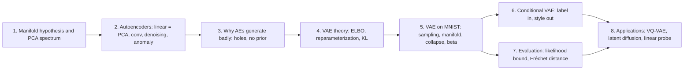

## 1. Representation learning and the manifold hypothesis

### In plain words

A 28 by 28 image is a list of 784 numbers, but almost every list of 784 numbers is static, not a digit. The digits you can actually draw form a thin, curved sheet inside that huge space: you can move along the sheet (thicken a stroke, slant it) and stay a digit, but step off it and you get noise. That is the manifold hypothesis. Representation learning looks for a few coordinates on the sheet, so that "which digit, how slanted, how thick" become explicit numbers. The notebook tests the idea with PCA: if digits filled all 784 directions evenly, you would need nearly all components to explain the variance; instead a few dozen do most of the work. The script reproduces both halves of the argument on toy data: a curve in the plane that a straight PCA line cannot follow, and a 50-dimensional dataset whose variance lives in 5 directions.

### Sample data

Points sampled on a semicircle of radius 1 (parameter $t$ in $[0, \pi]$) plus Gaussian noise of standard deviation 0.03. The first six rows printed by the script:

| $t$ | $x_1$ | $x_2$ |
|-----|-------|-------|
| 2.00 | -0.400 | 0.900 |
| 0.85 | 0.671 | 0.712 |
| 0.13 | 1.017 | 0.164 |
| 0.05 | 1.018 | 0.069 |
| 2.55 | -0.946 | 0.561 |
| 2.87 | -0.963 | 0.266 |

Every point is described by one number $t$, yet it lives in a 2-D space. That is a 1-D manifold.

### Worked example

1. Covariance eigenvalues of the 300 arc points: 0.5174 and 0.1051, so the first principal component explains a fraction 0.831 of the variance. Linear PCA cannot do better than that with one coordinate.
2. Reconstruct each point with one *linear* coordinate (project onto the first principal axis): the mean squared distance to the PCA line is 0.1048.
3. Reconstruct each point with one *curved* coordinate (snap to the nearest point of the arc): the mean squared distance is 0.0007, essentially the noise floor (the total noise variance is 0.0018).
4. Spectrum test: a 50-dimensional dataset built from 5 hidden factors needs 5 components for 95 % of its variance; isotropic noise of the same size needs 47 of 50. On MNIST the notebook finds "a few dozen for most, about 150 for 95 %", the same shape of curve.

The lesson: a straight line through curved data wastes a lot (0.1048 versus 0.0007), which is exactly the gap that non-linear autoencoders close.

### Chart

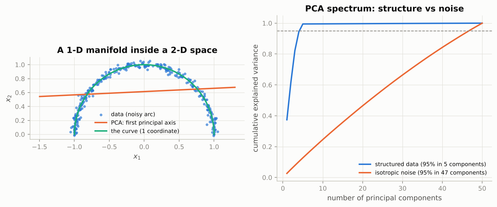

*Left: one curved coordinate follows the data, the best straight line does not. Right: structured data reach 95 % of their variance after 5 components, noise only after 47.*

### Real-world examples

- Face recognition in the 1990s used "eigenfaces": PCA on face images showed that a few dozen components capture most of the variation, an early manifold argument.
- Single-cell biology routinely compresses tens of thousands of gene-expression values per cell to a handful of coordinates (PCA, then UMAP or a VAE) because the cells lie near a low-dimensional manifold of cell types.
- Image compression standards work because natural images have most of their energy in a few low-frequency components; the "PCA spectrum" of photos falls off steeply.

### Common pitfalls

- PCA finds *flat* subspaces. The number of components for 95 % variance overstates the intrinsic dimension of curved data; the notebook's 2-D convolutional code beats PCA with 2 components by a wide margin.
- Explained variance is not the same as usefulness: the components that carry the least variance can still carry the class label.

## 2. Autoencoders

### In plain words

An autoencoder is two networks trained together: the encoder squeezes an input into a short code, the decoder rebuilds the input from the code, and the loss is the difference between the rebuild and the original. With a narrow bottleneck the code must keep what matters most, like describing a face over the phone in ten words. The section proves that a linear autoencoder cannot beat PCA, then shows what non-linearity buys: convolutional autoencoders that beat PCA at every code size, a 2-D map of the digits, a denoiser that recognizes digits under noise, and an anomaly detector that needs no anomalies at training time. The script reproduces the three experiments that do not need PyTorch: the linear-AE-equals-PCA result by gradient descent, denoising on a curve, and anomaly detection with a PCA autoencoder.

### Sample data

A synthetic Gaussian dataset with $N = 400$ points in $D = 12$ dimensions and a known spectrum (the sample eigenvalues of its covariance are 5.5838, 3.2146, 1.9685, 1.1711, 0.8498, 0.5953, 0.3028, 0.1924, 0.1396, 0.0866, 0.0853, 0.0425). A linear autoencoder with bottleneck $k$ (no biases, no activations) is trained by full-batch Adam for 1,500 steps with cosine decay, exactly as in the notebook, and compared with PCA using $k$ components:

| $k$ | linear AE MSE | PCA-$k$ MSE | ratio |
|-----|---------------|-------------|-------|
| 1 | 0.71889 | 0.71889 | 1.0000 |
| 2 | 0.45167 | 0.45167 | 1.0000 |
| 3 | 0.28805 | 0.28805 | 1.0000 |
| 4 | 0.19070 | 0.19070 | 1.0000 |
| 6 | 0.07058 | 0.07058 | 1.0000 |
| 8 | 0.02942 | 0.02942 | 1.0000 |

### Worked example

**Linear autoencoder = PCA (2.1).** Take $k = 3$. The cosines of the three principal angles between the subspace spanned by the decoder columns and the top-3 PCA subspace are 1, 1, 1, and the relative gap between the two projection matrices is 2.11e-05: the subspaces coincide. Yet the first decoder column is *not* the first principal component (the absolute correlation between them is only 0.416): the autoencoder found a rotated basis of the same subspace, exactly as the notebook warns. The Eckart-Young optimum is the sum of the trailing eigenvalues divided by $D$: 0.28877 with the $N - 1$ normalization of the sample covariance, which times $399/400$ gives the 0.28805 reached by both methods.

**Denoising (2.5).** Points on the curve $x_2 = \sin x_1$ are corrupted with Gaussian noise of standard deviation 0.35. The optimal denoiser for Gaussian noise is the posterior mean of the clean point given the noisy one, computed by weighting dense curve samples. Mean distance to the curve: 0.271 before, 0.029 after. Mean squared error to the true clean point: 0.229 before, 0.110 after (the denoiser cannot know *where along the curve* the point was, only that it lies on it). Example 0: clean (2.11, 0.86), noisy (1.89, 0.50), denoised (1.99, 0.85). Each arrow in the chart points from a noisy point back onto the manifold, the "vector field" the notebook describes and the seed of diffusion models.

**Anomaly detection (2.7).** Normal data: rank-3 structure in 10 dimensions plus noise; a PCA-3 autoencoder is fitted on 500 normal training points. Scores are squared reconstruction errors. Four sample scores: normal 0.1212, 0.1772, 0.1916, 0.0988; anomalous (a different 3-D subspace) 48.3799, 1.9844, 11.1786, 3.7131; low-energy anomalous (the same anomalies scaled by 0.25) 0.3679, 0.3589, 1.5614, 1.6053. Means: 0.163, 16.644 and 1.188. The threshold at the 95th percentile of training errors is 0.318; it flags 0.052 of normal points, 0.998 of the anomalies and only 0.846 of the low-energy anomalies. ROC-AUC: 0.9987 for the anomalies, 0.9549 for the low-energy ones. The second number is the notebook's pitfall in miniature: simple, low-energy inputs are easy to reconstruct even when they are anomalous (the thin trousers and sandals of FashionMNIST).

### Chart

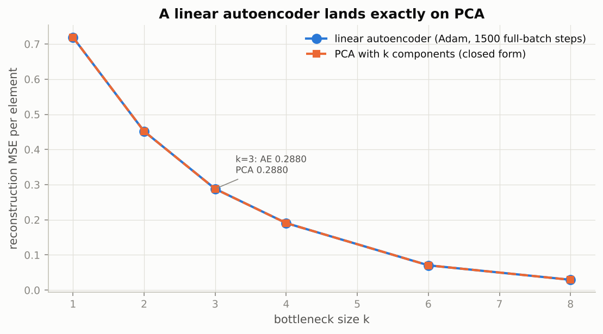

*The two curves lie on top of each other at every bottleneck size: a linear autoencoder with squared error learns the PCA subspace and nothing more.*

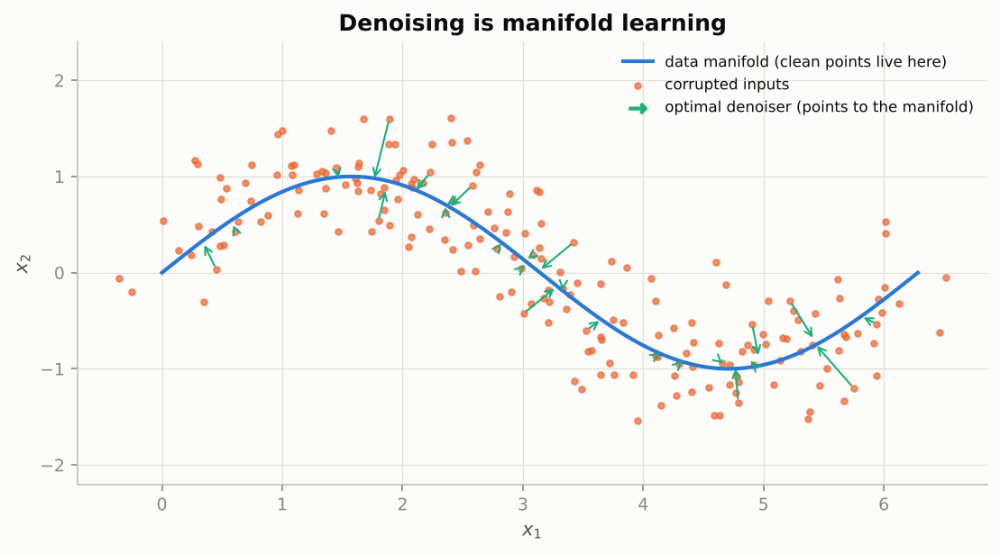

*Every arrow points from an off-manifold point back onto the data curve; a denoiser learns this vector field.*

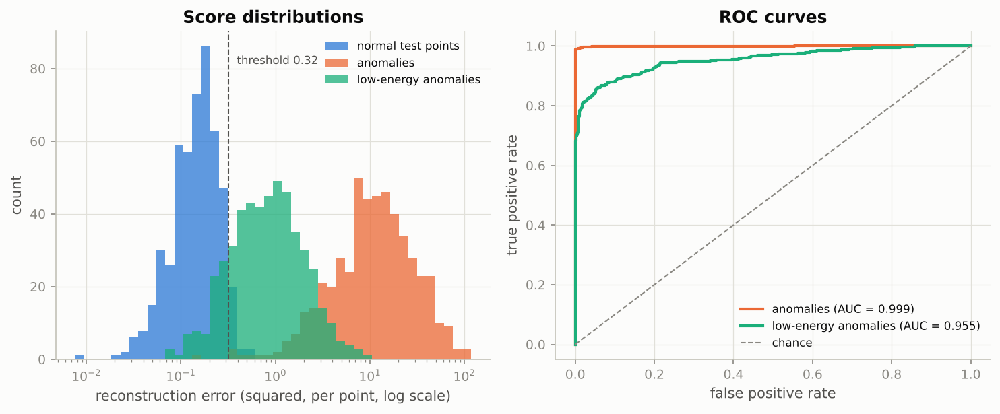

*Anomalies with the same energy as the data are separated almost perfectly (AUC 0.999); low-energy anomalies slide under the threshold (AUC 0.955).*

### Real-world examples

- Visual inspection on production lines: an autoencoder trained on photos of good parts highlights scratches and missing components as regions of high reconstruction error; the MVTec AD benchmark was built for this setting.
- Credit-card fraud and network intrusion detection use reconstruction error on transaction or packet features, because fraudulent examples are rare and keep changing.
- Low-dose CT denoising: networks trained to map noisy low-radiation scans to clean full-dose scans let hospitals lower the dose, a denoising autoencoder at scale.
- Learned image compression (Ballé et al.) is an autoencoder with an entropy penalty on the code; its descendants compete with JPEG and HEVC.

### Examples for every subsection

- **2.1 The linear autoencoder recovers PCA.** On the 12-dimensional toy dataset with $k = 3$, gradient descent reaches MSE 0.28805, PCA reaches 0.28805, and the three principal-angle cosines are all 1; the decoder columns are a rotated basis (correlation 0.416 with PC1), not the components themselves.
- **2.2 A convolutional autoencoder on MNIST.** The notebook's encoder halves 28 to 14 to 7 with two stride-2 convolutions; the decoder doubles back with kernel 4, stride 2, padding 1, which maps $(7 - 1) \cdot 2 - 2 + 4 = 14$ and then 28. The per-pixel binary cross-entropy treats each pixel as a probability of ink.
- **2.3 Reconstruction quality versus bottleneck size.** In the toy table the error falls from 0.71889 at $k = 1$ to 0.02942 at $k = 8$; on MNIST the non-linear autoencoder beats PCA at every $d$, most at $d = 2$.
- **2.4 Looking into the latent space: a 2-D map of MNIST.** A 2-D code turns every test digit into a dot; clusters appear without labels, with gaps between them (see Section 3's chart for a toy version).
- **2.5 Denoising autoencoders.** With noise of standard deviation 0.35 the optimal denoiser brings the mean distance to the curve from 0.271 down to 0.029.
- **2.6 Sparse and contractive autoencoders (in prose).** A sparse code lets only a few units fire per input; this is the design used to split a language model's activations into interpretable features. A contractive penalty flattens the encoder in every direction except along the manifold.
- **2.7 Autoencoders for anomaly detection.** A 95th-percentile threshold (0.318) catches 99.8 % of the full-energy anomalies at a 5.2 % false alarm rate, but only 84.6 % of the low-energy anomalies.

### Common pitfalls

- Comparing autoencoder weights with principal components element by element: only the *subspaces* agree; compare principal angles or projection matrices.
- Averaging the loss over pixels in one place and summing in another makes numbers incomparable between models; the notebook reports per-image sums in nats.
- Reconstruction error as an anomaly score rewards low-energy inputs; normalize by input energy or use a likelihood-based score when anomalies can be simpler than the normal data.

## 3. Why plain autoencoders are poor generators

### In plain words

A decoder turns codes into images, so why not feed it random codes and call the outputs new digits? Because the training images map to small clusters in code space with large holes in between, and the decoder was never trained on the holes. A random point in the bounding box lands in a hole about half the time, and the decoder's output there is anyone's guess: smeared hybrids, blobs. In higher dimensions the empty volume grows explosively, so even a Gaussian fitted to 32-dimensional codes produces almost no readable digits. Two things are missing, a *prior* that says where codes should live and *smoothness* that makes nearby codes decode to similar images. The VAE adds both.

### Sample data

Two toy latent spaces with 2,000 codes each: an autoencoder-style one made of 10 tight clusters at random centres in $[-4, 4]^2$ (spread 0.25), and a VAE-style one drawn from a standard normal. Forty random points are drawn uniformly in the bounding box of the first and from the prior for the second. The first three random points in the autoencoder box and their distance to the nearest code:

| $z_1$ | $z_2$ | distance to nearest code |
|-------|-------|--------------------------|
| -0.964 | -0.328 | 0.199 |
| -1.950 | -3.622 | 0.226 |
| 2.547 | 0.641 | 0.828 |

### Worked example

1. Call a random point "in a hole" when it is farther than 0.5 from every training code. In the autoencoder-style space a fraction 0.50 of the random points are in a hole; in the VAE-style space the fraction is 0.00.
2. The notebook's grid statistic (fraction of empty cells in a 30 by 30 grid over the bounding box) is 0.74 for the clustered codes and 0.56 for the Gaussian codes; the Gaussian number is not zero only because the grid also covers the thin tails of the bell. The nearest-code statistic is the fairer test, and it is 0.50 against 0.00.
3. The third sample point above (distance 0.828) is the kind of code that decodes to garbage: no training image ever placed a code there.

### Chart

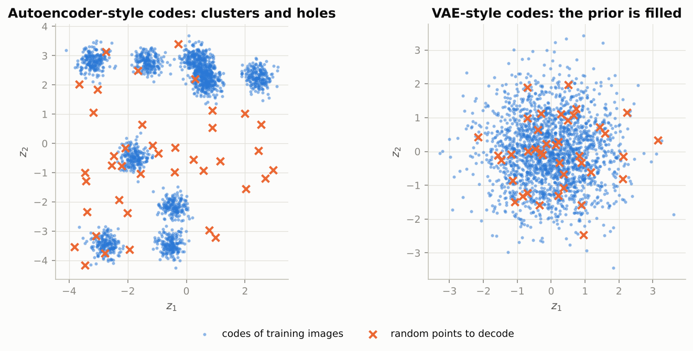

*Half of the random crosses on the left fall into holes between clusters; on the right every prior sample lands where the decoder has seen codes.*

### Real-world examples

- Early "face morphing" demos with plain autoencoders produced ghostly doubles when the interpolation path left the data clusters, the same hole problem.
- Generative models for molecules must produce *valid* molecules; sampling codes outside the trained region of a plain autoencoder yields invalid strings, which is why molecule generators use VAEs with a prior.
- Any system that decodes user-adjustable sliders (avatar generators, voice style controls) needs a latent space with no holes, otherwise some slider positions produce garbage.

### Common pitfalls

- Fitting a Gaussian to the codes after training does not fix the problem: in 32 dimensions the fitted Gaussian still puts most of its mass in regions no training image occupied.
- A lower-dimensional latent space is denser and interpolates better, but it reconstructs worse; the VAE is designed to escape this trade-off rather than pick a point on it.

## 4. Variational autoencoders: the theory

### In plain words

A VAE starts from a story: draw a hidden code $z$ from a standard normal prior, then draw the image from a distribution computed by the decoder. Fitting this story by maximum likelihood requires averaging the decoder's probability over *every* code, which is impossible. The way out is a lower bound, the ELBO, built with a second network (the encoder) that guesses which codes could have produced each image. The bound has two readable parts: rebuild the image well from codes sampled near the encoder's guess, and keep the encoder's cloud close to the prior. The gap between the bound and the truth is exactly how wrong the encoder's guess is. Two technical devices make this trainable: the reparameterization trick, which writes a random sample as mean plus spread times fixed noise so gradients can flow, and a closed-form KL penalty that needs no sampling at all. Finally the choice of output distribution (coin-flip pixels versus Gaussian pixels) *is* the choice of reconstruction loss.

### Sample data

The notebook's three test cases for the KL term, one latent dimension each (means and log-variances from cell 36):

| $\mu$ | $\log \sigma^2$ | $\sigma$ | KL to $\mathcal{N}(0, 1)$ in nats |
|-------|-----------------|----------|-----------------------------------|
| 0.50 | 0.00 | 1.000 | 0.1250 |
| -1.00 | -1.00 | 0.607 | 0.6839 |
| 2.00 | 0.50 | 1.284 | 2.0744 |

### Worked example

**KL in closed form (4.4).** For the first row: $\tfrac{1}{2}(\mu^2 + \sigma^2 - 1 - \log\sigma^2) = \tfrac{1}{2}(0.25 + 1 - 1 - 0) = 0.1250$. The third row costs the most (2.0744) because $\mu = 2$ is far from the origin. With $\mu = 0$ the penalty is 1.8076 at $\sigma = 0.1$, 0.3181 at $\sigma = 0.5$, exactly 0 at $\sigma = 1$ and 0.8069 at $\sigma = 2$: both very narrow and very wide clouds are punished, and $\mu = 1, \sigma = 1$ costs $\mu^2 / 2 = 0.5000$.

**Reparameterization (4.3).** Draw $\epsilon$ from $\mathcal{N}(0, 1)$: the first four draws are 0.4159, -0.6586, 1.4973, 2.5111. With $\mu = 1.5$ and $\sigma = 0.5$ the samples $z = \mu + \sigma\epsilon$ are 1.708, 1.1707, 2.2486, 2.7556; over 200,000 draws their mean is 1.501 and standard deviation 0.501, as required. Now the gradient test on $f(z) = z^2$ with $z \sim \mathcal{N}(\mu, 1)$, $\mu = 1$, whose exact derivative is $2\mu = 2.000$. The reparameterization estimator $2z$ has mean 2.003 and single-sample standard deviation 2.004 (analytic value 2). The score-function estimator $z^2(z - \mu)$ has mean 2.007 and standard deviation 5.505 (analytic value $\sqrt{30} = 5.477$). The standard-deviation ratio is 2.75 and the variance ratio 7.55: the notebook's "almost three times" and "seven-fold".

**The ELBO and its gap (4.2).** A 1-D model where everything is exact: $z \sim \mathcal{N}(0, 1)$, $x \mid z \sim \mathcal{N}(1.5 z, 0.7^2)$, observed $x = 2$. The true posterior is $\mathcal{N}(1.0949, 0.1788)$ and the evidence is $\log p(x) = -2.1528$. For several choices of the approximate posterior $q$:

| $q$ mean | $q$ variance | expected $\log p(x \mid z)$ | KL($q$, prior) | ELBO | KL($q$, true posterior) | ELBO + gap |
|----------|--------------|-----------------------------|----------------|------|-------------------------|------------|
| 1.095 | 0.179 | -1.1034 | 1.0495 | -2.1528 | 0.0000 | -2.1528 |
| 0.300 | 0.179 | -3.4244 | 0.4951 | -3.9194 | 1.7666 | -2.1528 |
| 0.300 | 0.500 | -4.1618 | 0.1416 | -4.3033 | 2.1505 | -2.1528 |
| 0.000 | 1.000 | -6.9398 | 0.0000 | -6.9398 | 4.7870 | -2.1528 |

Every row satisfies the boxed identity of Section 4.2: ELBO plus the KL to the true posterior equals $\log p(x)$ to four decimals. When $q$ is the exact posterior the gap is zero; when $q$ equals the prior (last row, "posterior collapse") the ELBO is 4.787 nats below the evidence.

### Chart

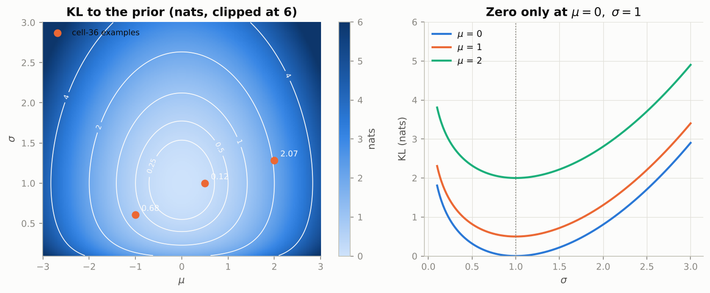

*The penalty is zero only at the centre point (mean 0, spread 1) and grows in every direction, fastest for large means and tiny spreads.*

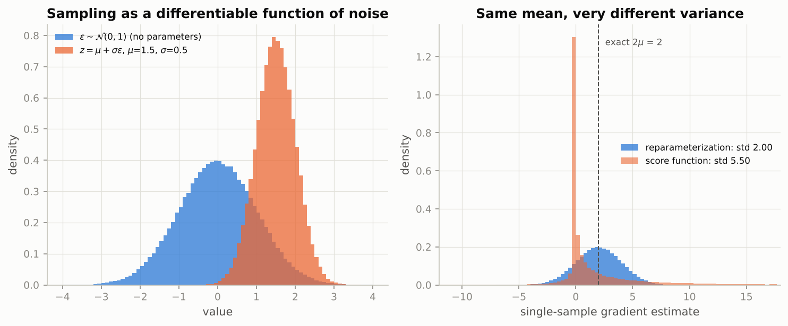

*Both estimators are centred on the exact gradient 2, but the score-function estimates are spread almost three times wider.*

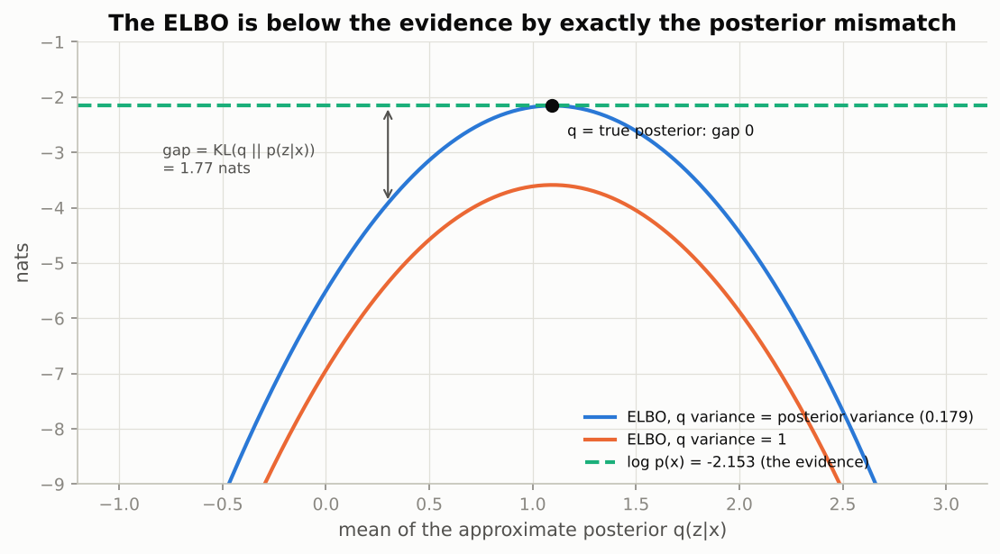

*The ELBO touches the evidence exactly when the approximate posterior equals the true one; everywhere else the gap is the KL between them.*

### Real-world examples

- Variational inference is how large Bayesian models are fitted in practice; the VAE's amortized encoder is the same idea with a neural network producing the approximate posterior for every input in one pass.
- The reparameterization trick is used far beyond VAEs: Bayesian neural networks, variational dropout and stochastic policies in reinforcement learning all backpropagate through sampled Gaussians this way.
- The score-function estimator (REINFORCE) is what policy-gradient methods use when the sample is discrete (an action), which is why they need variance-reduction baselines.
- Text-to-speech models such as VITS are conditional VAEs whose objective is this same ELBO with a Gaussian posterior.

### Examples for every subsection

- **4.1 A latent-variable model of images.** In the 1-D toy model the evidence $\log p(x) = -2.1528$ has a formula only because everything is Gaussian; with a convolutional decoder the integral over $z$ has no closed form.
- **4.2 Variational inference and the evidence lower bound.** With $q = \mathcal{N}(0.3, 0.5)$ the ELBO is -4.3033 and the gap to the evidence is 2.1505 nats, the KL between $q$ and the true posterior.
- **4.3 The reparameterization trick.** $\epsilon = 0.4159$ becomes $z = 1.5 + 0.5 \cdot 0.4159 = 1.708$; the estimator built this way has standard deviation 2.004 against 5.505 for the score-function estimator.
- **4.4 The KL term in closed form.** $\mu = -1$, $\log\sigma^2 = -1$ gives $\sigma = 0.607$ and KL 0.6839 nats.
- **4.5 The decoder distribution: Bernoulli versus Gaussian.** A Gaussian decoder with variance $\sigma^2$ weights the summed squared error by $1 / (2\sigma^2)$: the plain "squared error plus KL" recipe silently assumes $\sigma^2 = 1/2$, far too noisy for pixels in $[0, 1]$.
- **4.6 The full objective.** Per image: reconstruction NLL of one reparameterized sample plus the closed-form KL; both in nats, both summed (not averaged) over their dimensions.

### Common pitfalls

- Averaging the reconstruction term over 784 pixels while summing the KL over latent dimensions makes the KL dominate by a factor of 784 and collapses the model.
- The encoder outputs the log-variance, not the standard deviation; $\sigma = \exp(\ell / 2)$, and the KL formula uses $\log\sigma^2 = \ell$ directly.
- The ELBO is a *lower* bound: a better ELBO can come from a better decoder or from a better encoder, and only the IWAE bound of Exercise 4 separates the two.

## 5. A VAE on MNIST

### In plain words

The theory becomes a model by reusing the convolutional encoder and decoder, with two changes: the encoder outputs a mean and a log-variance per latent dimension, and a noisy sample is decoded instead of a fixed code. During training the KL term starts near zero and rises while the reconstruction term falls: the encoder learns that sending information costs nats but pays off. The payoff is generation: prior samples decode to digits, the 2-D latent plane is a smooth sheet of morphing digits, and interpolations stay clean. Two practical problems follow. Posterior collapse, where the encoder sends nothing and the decoder draws the average digit, is treated with KL annealing. The beta weight on the KL term sets the exchange rate between information sent (rate) and reconstruction quality (distortion). The script reproduces the beta sweep and the annealing experiment on a toy linear-Gaussian VAE whose objective has a closed form, so every point on its rate-distortion curve is exact.

### Sample data

The toy VAE: data $x \sim \mathcal{N}(0, 4)$ (one dimension), encoder $q(z \mid x) = \mathcal{N}(a x, v)$, decoder $p(x \mid z) = \mathcal{N}(w z, 0.5^2)$, prior $\mathcal{N}(0, 1)$. For each beta the three parameters $(a, v, w)$ are optimized by Adam on the exact expected objective $D + \beta R$:

| beta | rate $R$ (KL) | distortion $D$ | $R + D$ | encoder slope $a$ | encoder variance $v$ | decoder weight $w$ |
|------|---------------|----------------|---------|-------------------|----------------------|--------------------|
| 0.10 | 2.5375 | 0.2758 | 2.8133 | 0.4987 | 0.0063 | 1.9928 |
| 0.25 | 2.0794 | 0.3508 | 2.4302 | 0.4961 | 0.0156 | 1.9843 |
| 0.50 | 1.7329 | 0.4758 | 2.2087 | 0.4921 | 0.0313 | 1.9685 |
| 1.00 | 1.3863 | 0.7258 | 2.1121 | 0.4841 | 0.0625 | 1.9365 |
| 2.00 | 1.0397 | 1.2258 | 2.2655 | 0.4677 | 0.1250 | 1.8708 |
| 4.00 | 0.6930 | 2.2262 | 2.9192 | 0.4329 | 0.2500 | 1.7320 |
| 8.00 | 0.3466 | 4.2258 | 4.5724 | 0.3536 | 0.5000 | 1.4142 |
| 16.00 | 0.0000 | 8.2251 | 8.2251 | 0.0047 | 0.9999 | 0.0187 |

### Worked example

**The beta sweep as rate-distortion (5.7).** Read the table top to bottom: as beta grows the rate falls (2.5375 to 0.0000 nats) and the distortion rises (0.2758 to 8.2251 nats), exactly the notebook's prediction. The sum $R + D$, which is the negative ELBO, is smallest at beta = 1 (2.1121 nats), because only beta = 1 optimizes the bound itself. At beta = 16 the model has collapsed: the encoder variance is 0.9999 (the prior), the decoder weight is 0.0187 (it ignores $z$), the rate is 0, and the distortion 8.2251 equals the cost of a decoder that outputs the data mean, $4 / (2 \cdot 0.25) + \tfrac{1}{2}\log(2\pi \cdot 0.25) = 8.2258$. In between, the encoder variance $v$ doubles every time beta doubles (0.0625 at beta = 1, 0.1250 at 2, 0.2500 at 4): a larger beta means noisier codes.

**KL annealing (5.6).** The warm-up schedule rises linearly from 0 to 1 over the first half of 3,000 steps: beta is 0.0 at step 0, 0.2 at step 300, 0.5 at step 750, 1.0 at steps 1,500 and 2,250. Starting the toy VAE almost exactly at the prior, the constant-beta run has KL 1.4323 nats at step 200 and 1.3854 at step 1,000; the annealed run shoots to 2.8297 at step 200 (it transmits freely while the penalty is weak), is still at 1.5965 at step 1,000, and both end at the same KL 1.3863 and distortion 0.7258. Both runs leave the prior within 20 steps (first step with KL above 0.1: 19 and 18), so on this toy there is no collapse to rescue; annealing changes the path, not the destination, the same conclusion the notebook draws for its small convolutional model.

### Chart

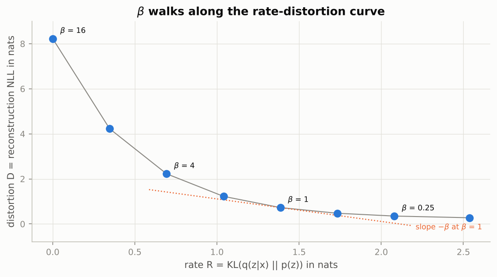

*Each beta is one point on the same rate-distortion curve; beta is the slope of the tangent, and beta = 16 sits at the collapsed corner with zero rate.*

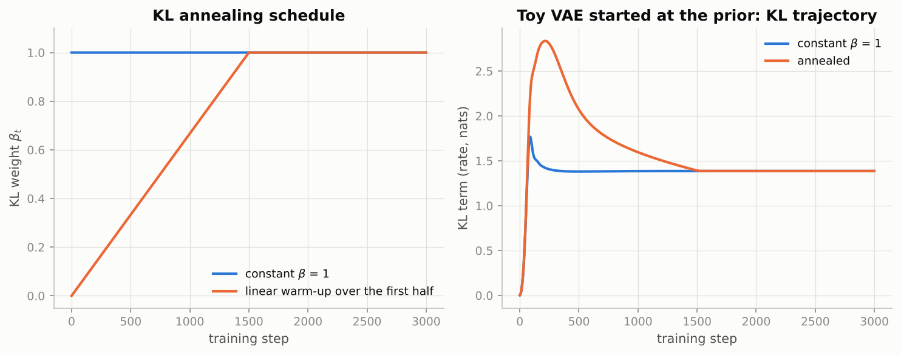

*The annealed run overshoots to a KL of 2.83 nats while the penalty is weak, then is squeezed back to the same 1.39 nats the constant run reaches.*

### Real-world examples

- Learned image and video codecs are trained with exactly this rate-distortion objective; the beta (or lambda) chosen at training time selects the bitrate of the resulting codec.
- Text VAEs with strong autoregressive decoders collapse without KL annealing or free bits; this was the original motivation of Bowman et al. (2016) for sentence generation.
- beta-VAE style objectives with beta above 1 are used to learn disentangled factors (lighting, pose, identity) for controllable image editing.
- The VAE inside Stable Diffusion is trained with a tiny KL weight, the far left of the rate-distortion curve: sharp reconstructions, a weakly regularized latent space.

### Examples for every subsection

- **5.1 Implementation.** The encoder's output is split in two halves (mean, log-variance); the decoder receives $\mu + \exp(\ell / 2)\,\epsilon$; the loss function returns reconstruction and KL separately so that both can be plotted.
- **5.2 Training and the two loss curves.** In the toy run with constant beta the KL rises from 0 to 1.4323 nats within 200 steps as the decoder learns to use $z$.
- **5.3 Sampling from the prior.** Generation is "draw $z \sim \mathcal{N}(0, I)$, decode, sigmoid"; in the toy with beta = 1 a prior sample decodes to $1.9365\,z$ plus noise, covering the data range because $w \approx 2 = \sqrt{4}$.
- **5.4 The two-dimensional latent manifold.** Placing the grid at the quantiles of the prior (from 0.02 to 0.98) shows what the model actually generates rather than the far tails.
- **5.5 Interpolation.** Linear interpolation between posterior means stays inside the filled region; between two prior samples in 16 dimensions the midpoint has norm about $\sqrt{8} = 2.83$ rather than $\sqrt{16} = 4$, which is why slerp is preferred there.
- **5.6 Posterior collapse and KL annealing.** At beta = 16 the toy VAE collapses completely (rate 0.0000, decoder weight 0.0187); the warm-up schedule keeps beta at 0.2 at step 300 so that the code is used before the penalty bites.
- **5.7 The beta-VAE and the rate–distortion view.** beta = 0.25 gives rate 2.0794 and distortion 0.3508; beta = 4 gives 0.6930 and 2.2262; the negative ELBO is minimal (2.1121) at beta = 1.

### Common pitfalls

- Judging a beta-VAE by its ELBO: only beta = 1 optimizes the ELBO, so any other beta looks worse on that number even when it is the right choice for the application.
- Counting latent dimensions as capacity: the active-units diagnostic often shows that half the dimensions of a 64-dimensional VAE sit at the prior.
- Plotting only the per-epoch summary hides the overshoot and recovery that annealing produces per step.

## 6. Conditional VAE

### In plain words

A conditional VAE gives both the encoder and the decoder the class label. Since the decoder already knows which digit to draw, the code only has to carry *style*, and the KL term shrinks by roughly the information content of the label. Decoding one code with all ten labels produces ten digits in the same handwriting, the simplest form of a disentangled representation: identity supplied, style latent. The script reproduces the information argument on a toy with four classes and a one-dimensional style factor.

### Sample data

Four classes with centres at -6, -2, 2 and 6, and a style factor drawn from $\mathcal{N}(0, 1)$; the observation is $x = \text{centre}_y + \text{style}$. The within-class (style) variance is 0.990 and the total variance of $x$ is 21.455. Five sample rows:

| class $y$ | style | $x$ |
|-----------|-------|-----|
| 0 | -0.14 | -6.14 |
| 0 | -0.67 | -6.67 |
| 1 | -0.09 | -2.09 |
| 3 | 0.63 | 6.63 |
| 2 | 1.19 | 3.19 |

### Worked example

1. The unconditional toy VAE must encode $x$ itself (variance 21.455). At beta = 1 and decoder noise 0.5 its optimum has rate 2.228 nats and distortion 0.725 nats.
2. The conditional toy VAE sees the label, so the decoder adds the class centre for free and the code only carries the style (variance 0.990). Its optimum has rate 0.688 nats and distortion 0.726 nats.
3. The distortion is the same to three decimals; the label saved 2.228 - 0.688 = 1.540 nats of rate. The information content of a uniform label over four classes is $\log 4 = 1.386$ nats, so the saving is of the expected size (a little larger here because the Gaussian code also pays for the spread *between* centres). For MNIST the notebook predicts a drop of about $\log 10 = 2.303$ nats.

### Chart

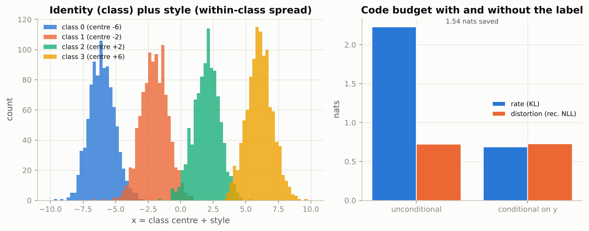

*Giving the decoder the class removes 1.54 nats from the rate while the distortion stays at 0.73 nats: the code no longer pays for identity.*

### Real-world examples

- Class-conditional image generation ("draw a 7", "draw a cat") is the same mechanism, and text-conditional diffusion models extend it from a one-hot label to a text embedding.
- Structured prediction, the setting of Sohn et al. (2015): predicting a segmentation mask given an image, where the latent captures the ambiguity of the output.
- Speech synthesis: conditional VAEs produce many natural-sounding readings of the same sentence, with the text as the condition and the latent as prosody.
- Molecule generation conditioned on desired properties (solubility, activity) uses the property vector where the notebook uses the digit label.

### Common pitfalls

- Feeding the label only to the decoder: the encoder then wastes rate encoding identity that the decoder already knows; condition both networks.
- Expecting perfect style transfer: the latent captures whatever the label does not explain, which includes stroke thickness and slant but also noise.

## 7. Evaluating generative models

### In plain words

There is no single ground truth for a generator: a model that memorizes the training set and a model that draws one perfect digit over and over are both bad in different ways. Likelihood bounds are principled but only comparable within a model family and track visual quality poorly; reconstruction error measures compression, not generation. The practical standard, the Fréchet Inception Distance, embeds real and generated images with a pretrained classifier, fits a Gaussian to each feature cloud, and measures the distance between the two Gaussians: both the means (realism) and the covariances (diversity) must match. The notebook builds an MNIST version with a small CNN; the script reproduces the formula on 2-D feature clouds where you can see what each failure mode looks like.

### Sample data

"Real" features: 3,000 points from a mixture of three Gaussian clusters centred at (-3, 0), (3, 0) and (0, 3.5) with unit spread. Four sets are scored against them with the Fréchet distance (FD) and the entropy of a nearest-centroid class histogram (maximum $\log 3 = 1.099$):

| set | Fréchet distance | class entropy |
|-----|------------------|---------------|
| real (a second sample) | 0.006 | 1.098 |
| good generator (same mixture) | 0.003 | 1.099 |
| mode collapse (one cluster only, spread 0.6) | 16.692 | 0.000 |
| blurry, shrunk towards the mean (spread 1.8, centres scaled by 0.4) | 0.758 | 1.091 |

### Worked example

1. Two independent samples of real data give FD 0.006, the floor of the metric; a generator that scores near it is doing very well (the good generator: 0.003).
2. Mode collapse: all samples come from the first cluster. The mean moves from the real (0.0677, 1.1488) to (-3.0116, 0.0181) and the covariance shrinks, so FD jumps to 16.692 while the class entropy drops to 0.000. High "confidence", zero diversity, large distance: the notebook's pitfall exactly.
3. The blurry generator keeps the overall mean near the real one ((0.054, 0.5305)) and still covers all three classes (entropy 1.091), but its covariance is wrong (one wide blob instead of three tight ones), and FD rises to 0.758. The covariance term of the formula, $\mathrm{tr}(\Sigma_r + \Sigma_g - 2(\Sigma_r\Sigma_g)^{1/2})$, is what catches it.

### Chart

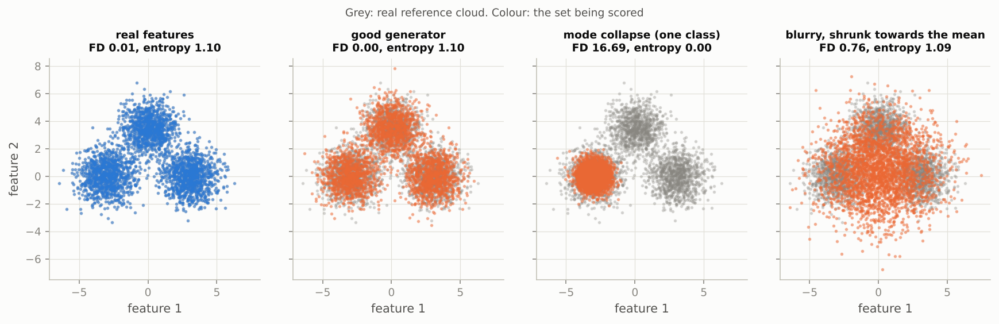

*Grey is the real reference cloud; the collapsed generator sits in one corner (FD 16.69, entropy 0), the blurry one covers everything but with the wrong shape (FD 0.76).*

### Real-world examples

- Every GAN and diffusion paper since 2017 reports FID on datasets such as CIFAR-10, FFHQ and ImageNet; leaderboards are ranked by it.
- Precision/recall metrics for generative models (Sajjadi et al., 2018; Kynkäänniemi et al., 2019) were introduced because a single FID hides whether a model fails on fidelity or on diversity.
- Speech and music generators use Fréchet distances on audio embeddings (Fréchet Audio Distance) for the same reason.
- Likelihood bounds such as the negative ELBO or the IWAE bound remain the standard for comparing VAEs, flows and diffusion models in bits per dimension.

### Common pitfalls

- FID depends on the feature extractor and on the number of samples (it is biased upward for small sets); compare only numbers computed the same way.
- A model can have excellent reconstructions and poor samples (the beta = 0.25 model in the notebook); only a sample-based metric sees the difference.
- Always look at samples alongside the numbers: a collapsed generator can have high classifier confidence.

## 8. Applications and modern context

### In plain words

Autoencoders and VAEs are rarely the final product, but they sit underneath several of the most important systems. Replacing the continuous code by a learned dictionary of discrete symbols gives the VQ-VAE, whose grids of integers can be modelled by a Transformer; that two-stage recipe is how image and audio tokenizers work. Latent diffusion runs its denoising process inside the compressed latent space of a lightly regularized VAE, which is what makes high-resolution generation affordable. And learned codes are features in their own right: a linear classifier on a handful of latent coordinates can approach one on all raw pixels. The script reproduces vector quantization in 2-D and a linear probe on scikit-learn's bundled 8 by 8 digits.

### Sample data

Vector quantization: 300 encoder outputs $z_e$ in 2-D drawn around three blobs, a codebook of $K = 8$ vectors initialized uniformly in $[-1/8, 1/8]$ as in the notebook, commitment weight beta = 0.25. Linear probe: 1,797 digit images of 64 pixels, split 1,200 / 597, softmax regression trained for 400 Adam steps on raw pixels and on PCA coordinates:

| features | probe accuracy |
|----------|----------------|
| raw pixels (64) | 0.963 |
| PCA (2) | 0.625 |
| PCA (4) | 0.809 |
| PCA (8) | 0.884 |
| PCA (16) | 0.958 |

### Worked example

**VQ-VAE codebook (8.1).** With the tiny initial codebook only 3 of 8 codes are ever the nearest neighbour, and the codebook loss and commitment loss are both 2.990 (they are the same squared distance, only the gradient targets differ), giving a total VQ loss of $2.990 + 0.25 \cdot 2.990 = 3.737$. After 400 steps of the codebook update (each code is pulled towards the encoder outputs assigned to it) the losses fall to 0.155 and the total to 0.194; usage counts are 51, 40, 37, 24, 36, 52, 34, 26, so all 8 codes are in use with usage perplexity 7.74 out of a maximum of 8. Example: the encoder output (2.33, -3.22) is snapped to code 2 at (0.97, -2.67), a squared distance of 2.171; in the forward pass the decoder receives the code, in the backward pass the gradient at the code is copied unchanged to the encoder output (straight-through). With the notebook's 7 by 7 grid and 64 codes an image becomes $49 \log_2 64 = 294$ bits.

**Linear probe (8.3).** Softmax regression on raw pixels reaches 0.963 accuracy. On 2 PCA coordinates it reaches only 0.625, on 8 it reaches 0.884, and on 16 it reaches 0.958, within half a point of the raw pixels with a fourfold smaller input. The notebook's point is that a 16-dimensional VAE code does on MNIST what 16 PCA coordinates cannot: it is far more linearly separable than PCA with the same size, and approaches the 784 raw pixels with a fiftyfold smaller input.

**Latent diffusion (8.2).** A 512 by 512 colour image holds $512 \cdot 512 \cdot 3 = 786{,}432$ numbers; the latent is $64 \cdot 64 \cdot 4 = 16{,}384$, a factor of 48 fewer, which is why running diffusion in latent space is affordable.

### Chart

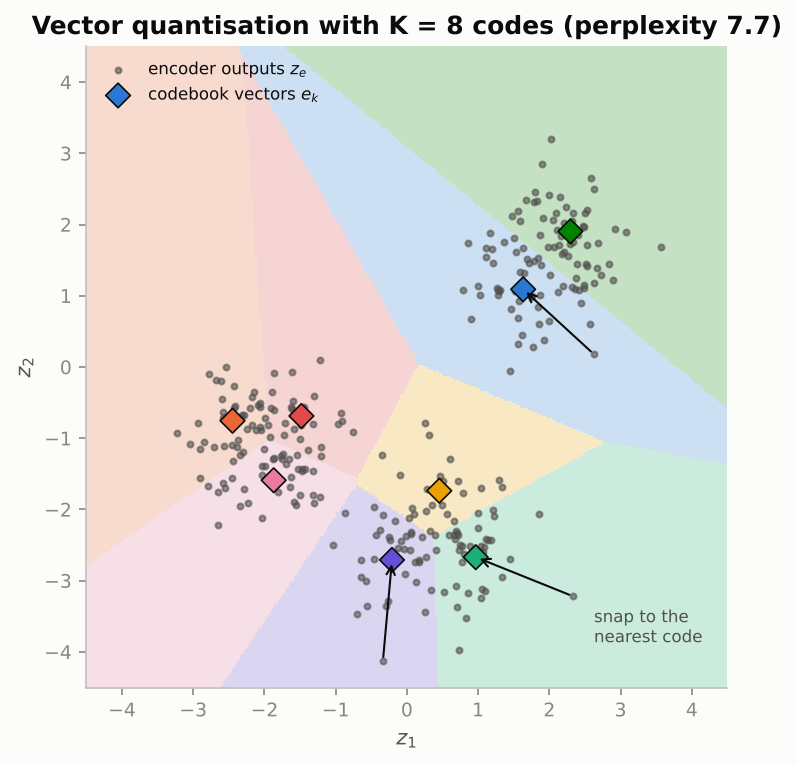

*Every encoder output is replaced by the codebook vector whose region it falls in; all eight codes are used (perplexity 7.7), so there is no codebook collapse here.*

### Real-world examples

- DALL·E 1 and VQGAN turn images into grids of discrete tokens and model them with a Transformer; neural audio codecs (SoundStream, EnCodec) do the same for sound with residual vector quantization.
- Stable Diffusion and its successors generate inside the 48-fold compressed latent space of a KL-regularized autoencoder, decoded to pixels only at the end.
- Self-supervised vision methods (SimCLR, DINO) are compared by linear-probe accuracy on ImageNet, the same test the notebook runs on MNIST.
- Sparse autoencoders trained on the residual stream of language models decompose their activations into thousands of interpretable features.

### Examples for every subsection

- **8.1 Discrete latents: the VQ-VAE idea.** The toy codebook goes from 3 of 8 codes in use (VQ loss 3.737) to all 8 (VQ loss 0.194, perplexity 7.74); the notebook's exercise reports the same statistics on MNIST with 64 codes.
- **8.2 Latent spaces as the substrate of latent diffusion.** 786,432 pixel values become 16,384 latent values, a 48-fold compression, before any diffusion step runs.
- **8.3 Representations for downstream tasks: a linear probe.** On the 8 by 8 digits, 16 PCA coordinates reach 0.958 against 0.963 for all 64 pixels; 2 coordinates reach only 0.625.

### Common pitfalls

- Codebook collapse: codes that are never the nearest neighbour receive no gradient and stay dead; exponential-moving-average updates or re-initialization from recent encoder outputs are the usual fixes.
- A VQ-VAE alone is a compressor, not a generator; sampling needs a second model over the code indices.
- Linear-probe accuracy measures linear separability, not everything a representation knows; a non-linear probe can tell a different story.

## Exercises in plain words

- **Exercise 1 (latent dimension sweep).** Train VAEs with 4 and 64 latent dimensions, reuse the 2 and 16 ones, and plot reconstruction, KL, negative ELBO and the number of active units against $d$. Useful because it shows the VAE choosing its own effective dimensionality. Hint: the KL price of an extra dimension eventually exceeds its reconstruction gain, so watch where the active-unit count flattens.
- **Exercise 2 (likelihood-based anomaly scores).** Score MNIST versus FashionMNIST with the VAE's reconstruction NLL, its KL term and their sum, and compare ROC-AUCs with the autoencoder's squared error. Useful because the KL term measures how out-of-distribution a *code* is, independently of pixels. Hint: encode with the posterior mean and reuse `recon_bce` and `kl_standard_normal`.
- **Exercise 3 (Gaussian decoder with learned variance).** Replace the Bernoulli decoder by a Gaussian with one learned $\sigma$, write its per-image NLL and train through the `rec_fn` argument. Useful because it shows that the observation noise acts as an automatic beta. Hint: the optimal $\sigma^2$ for a fixed decoder is the mean squared pixel error, so expect the learned $\sigma$ near the reconstruction RMSE.
- **Exercise 4 (importance-weighted bound).** Implement the IWAE bound with $K$ posterior samples in log space and check that it increases with $K$ and matches the ELBO at $K = 1$. Useful because the increase measures the posterior approximation gap. Hint: `torch.logsumexp` over the $K$ log-weights minus $\log K$.
- **Exercise 5 (VQ-VAE on MNIST).** Build the encoder to a 7 by 7 grid of 16-dimensional vectors, a codebook of 64 entries, nearest-neighbour quantization, the straight-through estimator and the two VQ losses, then report codes in use and perplexity. Useful because discrete tokens are what modern image and audio generators model. Hint: `z_e + (z_q - z_e).detach()` passes the quantized value forward and the gradient backward.

## Quick reference

| Concept | Formula or rule | In one sentence |
|---------|-----------------|-----------------|
| Autoencoder loss | $\mathcal{L} = \frac{1}{N}\sum_i \ell(x_i, g(f(x_i)))$ | Rebuild the input through a bottleneck; the bottleneck forces a summary. |
| Linear AE = PCA | $W_d W_e = V_k V_k^\top$ at the optimum | With squared error and no non-linearity the best rank-$k$ map is the projection on the top-$k$ principal subspace. |
| Principal angles | singular values of $Q^\top V_k$ | All equal to 1 exactly when two subspaces coincide. |
| Denoising objective | $\mathbb{E}\,\ell(x, g(f(\tilde{x})))$ with $\tilde{x} = C(x)$ | Corrupt the input, reconstruct the clean target; the optimal denoiser points back onto the manifold. |
| Anomaly score | reconstruction error above a threshold | Works without anomalous training data; fails on low-energy inputs. |
| ELBO | $\log p(x) \ge \mathbb{E}_q[\log p(x \mid z)] - \mathrm{KL}(q(z \mid x)\,\|\,p(z))$ | Reconstruction term minus a pull towards the prior. |
| The gap | $\log p(x) = \mathrm{ELBO} + \mathrm{KL}(q(z \mid x)\,\|\,p(z \mid x))$ | The bound is tight exactly when the encoder matches the true posterior. |
| Reparameterization | $z = \mu + \sigma \odot \epsilon$, $\epsilon \sim \mathcal{N}(0, I)$ | Moves the randomness into parameter-free noise so gradients reach the encoder. |
| KL in closed form | $\frac{1}{2}\sum_j(\mu_j^2 + \sigma_j^2 - 1 - \log\sigma_j^2)$ | Zero only at $\mu = 0$, $\sigma = 1$; computed from the log-variance. |
| Bernoulli decoder | $\log p(x \mid z) = -\mathrm{BCE}(x, \sigma(\text{logits}))$ summed over pixels | Per-pixel cross-entropy is the Bernoulli negative log-likelihood. |
| Gaussian decoder | $-\log p = \frac{\|x - \hat{x}\|^2}{2\sigma^2} + \frac{D}{2}\log(2\pi\sigma^2)$ | The observation noise sets the weight of the reconstruction term; a learned $\sigma$ acts as beta $= 2\sigma^2$. |
| beta-VAE | $\mathrm{NLL}_{\text{rec}} + \beta\,\mathrm{KL}$ | beta is the exchange rate between rate (KL) and distortion; only beta = 1 optimizes the ELBO. |
| KL annealing | $\beta_t = \min(1, t / (0.5\,T))$ | Start as an autoencoder, then switch the penalty on. |
| Active units | $\mathrm{Var}_x[\mu_j(x)] > 0.01$ | Counts latent dimensions that actually vary across inputs. |
| Conditional VAE | $\mathbb{E}_{q(z \mid x, y)}[\log p(x \mid z, y)] - \mathrm{KL}$ | Both networks see the label; the code carries only what the label does not explain. |
| Fréchet distance | $\|\mu_r - \mu_g\|^2 + \mathrm{tr}(\Sigma_r + \Sigma_g - 2(\Sigma_r\Sigma_g)^{1/2})$ | Distance between Gaussians fitted to real and generated features. |
| IWAE bound | $\mathbb{E}\log\frac{1}{K}\sum_k \frac{p(x \mid z_k)p(z_k)}{q(z_k \mid x)}$ | Tighter than the ELBO, increasing in $K$. |
| VQ-VAE loss | $-\log p(x \mid z_q) + \|\mathrm{sg}[z_e] - e_k\|^2 + \beta\|z_e - \mathrm{sg}[e_k]\|^2$ | Codebook loss moves the codes, commitment loss keeps the encoder near them, straight-through copies the gradient. |

## Glossary

- **Manifold hypothesis.** Natural data concentrate near a low-dimensional curved surface inside their high-dimensional input space.
- **Autoencoder.** Encoder plus decoder trained to reconstruct the input through a bottleneck.
- **Bottleneck / latent code.** The short vector $z$ between encoder and decoder; its size is the latent dimension $d$.
- **Principal component analysis (PCA).** The best flat subspace for reconstruction under squared error; the linear autoencoder's optimum.
- **Denoising autoencoder.** Trained on corrupted inputs with clean targets; learns a vector field pointing back onto the data manifold.
- **Anomaly score.** A number such as the reconstruction error that is large for inputs unlike the training data.
- **Evidence (log-likelihood).** $\log p(x)$, the log-probability the model assigns to an image; intractable for a VAE.
- **ELBO.** Evidence lower bound: reconstruction term minus KL to the prior; what a VAE maximizes.
- **Posterior / approximate posterior.** The true distribution of codes given an image, and the encoder's Gaussian guess of it.
- **Reparameterization trick.** Writing a Gaussian sample as mean plus spread times standard noise so that gradients flow to the encoder.
- **KL divergence.** A measure of how far one distribution is from another; here the penalty pulling each code cloud to the prior.
- **Posterior collapse.** The encoder sends nothing (KL zero) and the decoder ignores $z$; inactive units are the mild form.
- **Rate and distortion.** The KL term (nats transmitted) and the reconstruction term; beta sets the exchange rate between them.
- **Fréchet Inception Distance (FID).** Distance between Gaussians fitted to classifier features of real and generated images.
- **Vector quantization (VQ).** Snapping a continuous vector to the nearest entry of a learned codebook; the basis of discrete tokenizers.
- **Linear probe.** A logistic regression trained on frozen features to measure how linearly separable they are.
