# 15 · Deployment and Model Optimization — Companion Guide

> Plain-language companion to [`15_deployment_and_model_optimization.ipynb`](15_deployment_and_model_optimization.ipynb). Read a section here, then run the
> matching section of the notebook. All numbers below were computed with the script
> [`figures/scripts/make_figures_15.py`](figures/scripts/make_figures_15.py); all charts are its output.

## At a glance

- **What you learn**
  - What changes when a model stops training and starts answering: eval mode, no autograd, one request at a time, and speed measured as a distribution (p50, p99) instead of an average.
  - How to save a model so that it can be reloaded years later: `state_dict` plus a manifest with the preprocessing, the metrics, the versions and a hash, with a version number that tells clients whether they must change.
  - How to export a model out of Python with `torch.export`, TorchScript and ONNX, run it with ONNX Runtime, and prove numerically that the export is correct.
  - Three ways to make a model smaller or faster: quantization (fewer bits per weight), pruning (fewer weights) and distillation (a smaller architecture taught by the big one), and which of them actually reduces latency.
  - How a model becomes a service (FastAPI + ONNX Runtime, batching, containers) and how it is operated afterwards: drift monitoring with PSI, staged roll-outs, rollbacks, cost estimates and a model card.
- **Where this is used in the real world**
  - Phone keyboards predict the next word with a small on-device model, and phone cameras run portrait segmentation and night-mode networks on the device: both need exported, quantized, static-shape models that run without Python.
  - Mobile vision apps ship int8 models (LiteRT, Core ML, ONNX Runtime Mobile): a quarter of the memory of float32 and faster integer arithmetic on the phone's CPU or neural engine, with almost no accuracy loss.
  - DistilBERT is the textbook distillation success: a student with 40 % fewer parameters that keeps about 97 % of BERT's language-understanding score and runs about 60 % faster, which is what lets search and ranking systems afford a Transformer under a latency budget.
  - Microsoft runs its own products (Bing, Office, Windows features) on ONNX Runtime, and many companies use it as the Python-free CPU runtime for exported PyTorch and other models.
  - Banks monitor credit-scoring models with the Population Stability Index: PSI was born in credit-risk scorecard monitoring, and a PSI above 0.25 on an input variable is a classic trigger for a model review.
  - Model cards are standard documentation for models in regulated domains (medical devices, hiring, credit): intended use, evaluation data, known failure modes and the groups on which the model was not tested.

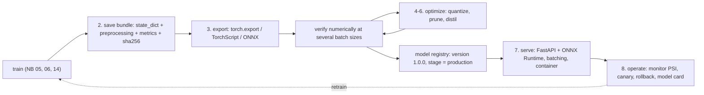

The eight sections follow one small MNIST classifier from a trained `nn.Module` to a monitored service. Section 1 measures it, Section 2 packages it, Section 3 exports it, Sections 4 to 6 shrink it, Section 7 serves it and Section 8 keeps it healthy.

## 1. From training to inference

### In plain words

Training and inference run the same forward pass, but almost everything around it is different. At inference the model must be in `eval()` mode (dropout off, BatchNorm using its running statistics), no gradients are needed (`torch.inference_mode()`), requests arrive one at a time instead of in big batches, and the number that matters is not a loss but a latency. Latency is how long one request waits; throughput is how many requests the machine finishes per second. Running several requests together in a batch raises throughput but makes each request wait, which is the central trade-off of serving. And because users notice the slowest requests, a benchmark must report percentiles: the p99 is the time that 99 % of requests beat. A mean hides the tail.

### Sample data

Simulated latencies of one small model call (milliseconds), generated by the figure script as a log-normal around 2 ms with a 3 % chance of a 3 to 9 ms stall (a garbage-collection pause, a cache miss). The first 8 of 2,000 draws:

| request | 1 | 2 | 3 | 4 | 5 | 6 | 7 | 8 |
|---|---|---|---|---|---|---|---|---|
| latency (ms) | 2.11 | 2.26 | 2.10 | 10.38 | 2.29 | 2.14 | 1.85 | 2.18 |

### Worked example

**Percentiles.** Over the 2,000 simulated requests: mean 2.22 ms, p50 2.01 ms, p90 2.49 ms, p99 9.61 ms, maximum 11.42 ms. Only 3.2 % of the requests are slower than twice the median, but they drag the p99 to almost five times the p50. The mean sits at the 73rd percentile of the distribution, so "average 2.2 ms" describes neither the typical request nor the slow ones. A service-level objective is therefore written as "p99 below 10 ms", never as "mean below 3 ms".

**Latency versus throughput.** The notebook fits the measured per-call time with the linear model $\ell(b) = a + c\,b$. The guide uses $a = 0.3$ ms of fixed overhead per call and $c = 0.012$ ms per image, numbers of the right shape for a small CNN on a CPU:

| batch $b$ | latency $\ell(b)$ (ms) | per image (µs) | throughput (images/s) |
|---|---|---|---|
| 1 | 0.312 | 312.0 | 3,205 |
| 4 | 0.348 | 87.0 | 11,494 |
| 16 | 0.492 | 30.8 | 32,520 |
| 64 | 1.068 | 16.7 | 59,925 |
| 256 | 3.372 | 13.2 | 75,919 |

At batch 1 the per-image cost is 26 times the arithmetic cost $c$: the call is almost all overhead. Throughput cannot exceed $1/c = 83{,}333$ images/s, and the batch $a/c = 25$ reaches half of that ceiling. That is the knee of the curve: below it the hardware is mostly idle, above it every extra image adds latency for little extra throughput.

### Chart

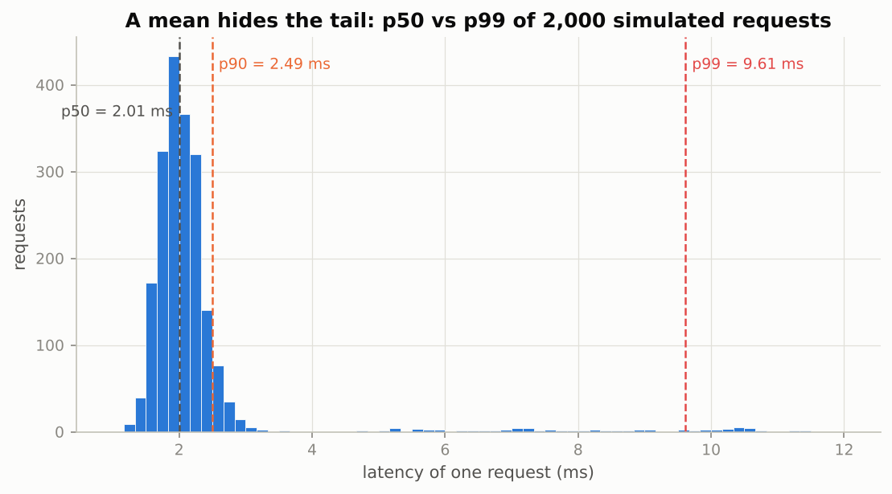

*The bulk of the requests sits near 2 ms, but a thin tail of stalls pushes the p99 to 9.6 ms; the mean (2.2 ms) tells you about neither.*

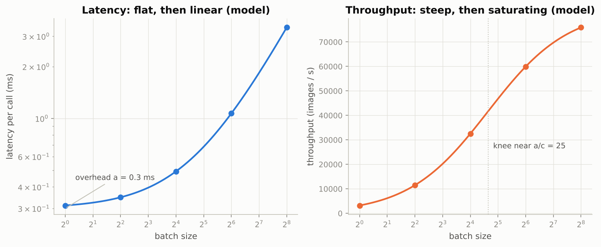

*Latency is flat until the arithmetic overtakes the fixed overhead, and throughput mirrors it: steep, then saturating near $1/c$.*

### Real-world examples

- Real-time ad bidding gives a click-prediction model a budget of roughly 100 ms end to end, including network hops, so the model itself must answer in a few milliseconds at p99, not on average.
- Chat assistants stream tokens because a language model's per-token latency is what the user feels; serving systems batch many users' requests together to keep the GPU busy while holding that latency.
- Load-testing tools for web services (and model servers like Triton) report p50/p95/p99 histograms, because an upstream timeout fires on the tail, not on the mean.

### Examples for every subsection

- **1.1 What changes at inference time.** The notebook runs the same image twice in `train()` mode and gets two different outputs (dropout resamples its mask), then twice in `eval()` mode and gets identical outputs; it then times a batch of 64 with autograd, under `no_grad` and under `inference_mode`, and the last is fastest because no graph is recorded at all.
- **1.2 The running example: a CNN on MNIST.** The classifier is two 3x3 convolutions (16 and 32 channels), a 128-unit hidden layer with dropout 0.25 and a 10-way output; 206,922 parameters. Two copies of the images are kept: raw pixels in $[0, 1]$ (what a client sends) and normalized pixels (what the network consumes).
- **1.3 Latency versus throughput.** Measuring batch sizes 1, 4, 16, 64 and 256 gives the two curves above; the notebook stores the batch-1 p50 as `PYTORCH_LAT_B1` and reuses it in the model bundle and the cost estimate of Section 8.

### Common pitfalls

- Forgetting `model.eval()`: the service becomes non-deterministic (dropout) or its answer for one image depends on the other images in the batch (BatchNorm).
- Timing without warm-up or without `torch.cuda.synchronize()`: the first calls include kernel compilation and the GPU timings measure only the launch, not the work.
- Reporting a mean latency: a 3 % tail of slow requests can be invisible in the mean and still break the p99 objective.

## 2. Saving and versioning models

### In plain words

The trained weights are a dictionary of tensors, the `state_dict`, and that is the right thing to save: it is pure data, loading it needs only the model class from your versioned code, and nothing untrusted gets executed. Pickling the whole model object with `torch.save(model)` is convenient but fragile (the class must be importable under the same name) and unsafe (pickle can run arbitrary code), which is why PyTorch 2.6 made `weights_only=True` the default of `torch.load`. A deployable artifact needs more than weights: the architecture sizes, the exact normalization constants, the training data and metrics, the library versions, and a checksum, all stored as plain numbers and strings so the safe loader accepts them. Give every bundle a semantic version (MAJOR for contract changes, MINOR for a better model with the same contract, PATCH for metadata), and record it in a registry so that "which version is serving right now?" has one answer.

### Sample data

The float32 `state_dict` of the notebook's `MNISTCNN`, tensor by tensor (counted from the layer shapes by the figure script):

| tensor | shape | values | bytes (float32) | share |
|---|---|---|---|---|
| `conv1.weight` | (16, 1, 3, 3) | 144 | 576 | 0.1 % |
| `conv1.bias` | (16,) | 16 | 64 | 0.0 % |
| `conv2.weight` | (32, 16, 3, 3) | 4,608 | 18,432 | 2.2 % |
| `conv2.bias` | (32,) | 32 | 128 | 0.0 % |
| `fc1.weight` | (128, 1568) | 200,704 | 802,816 | 97.0 % |
| `fc1.bias` | (128,) | 128 | 512 | 0.1 % |
| `fc2.weight` | (10, 128) | 1,280 | 5,120 | 0.6 % |
| `fc2.bias` | (10,) | 10 | 40 | 0.0 % |

### Worked example

1. The eight tensors hold 206,922 values, which is 808.3 KB as float32. The two linear layers hold 97.7 % of them; `fc1.weight` alone is 97.0 % of the file. (Keep this number in mind for Section 4: whatever shrinks `fc1` shrinks the file.)
2. If the linear weights were stored as int8 and everything else stayed float32, the file would be 216.6 KB, 3.73 times smaller: this is the "close to the ideal factor of four" the notebook observes after dynamic quantization.
3. The bundle's integrity check is a SHA-256 of the file. The figure script hashes a one-line stand-in manifest `mnist_cnn 1.0.0 mean=0.1307 std=0.3081` and gets `7831293b350a1ae9...`; changing one digit of the std (`0.3080`) gives `a7b34bc113939f11...`. Any corruption or silent edit changes the hash completely, so `load_bundle(path, expected_sha)` refuses it.
4. Versioning in words: retraining on more data with the same inputs and outputs is `1.1.0` (clients should re-validate but need not change); switching the input to 0 to 255 integers would be `2.0.0` (clients must change); fixing a typo in the notes is `1.0.1`.

### Chart

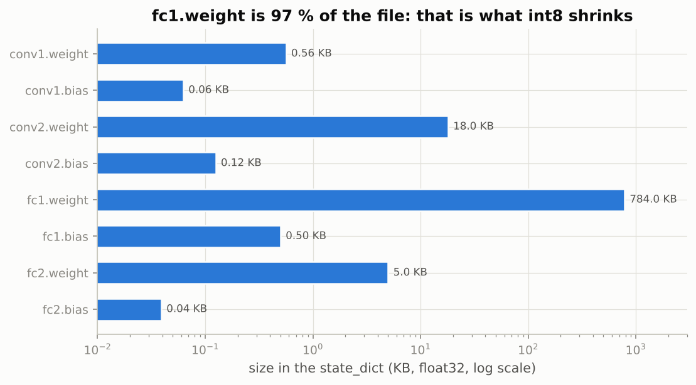

*On a log scale `fc1.weight` (784 KB) towers over everything else: compressing it is compressing the model file.*

### Real-world examples

- Hugging Face distributes model weights as safetensors files: a JSON header plus raw bytes, no code execution on load, and lazy or memory-mapped loading of individual tensors, which is exactly the "data only" property the notebook's bundle imitates.
- MLflow, SageMaker and Vertex AI model registries store, for every version, the artifact location, the metrics, the training lineage and a stage such as staging or production; promotion and rollback are edits to that record.
- Semantic versioning of models is how an API team knows whether a new release of a classifier can be swapped in silently (minor) or requires client changes (major), the same rule software libraries use.

### Examples for every subsection

- **2.1 `state_dict`, whole-model pickling and safetensors.** The notebook saves the `state_dict`, reloads it into a fresh `MNISTCNN` and shows a maximum output difference of zero; it then pickles the whole model and shows that the default `torch.load` refuses it (the file contains a class), while `weights_only=False` loads it only if `MNISTCNN` is importable.
- **2.2 A versioned model bundle with preprocessing and provenance.** `save_bundle` writes name, version `1.0.0`, architecture widths, the normalization constants, metrics, training facts, framework versions and the weights into one file that loads under `weights_only=True`; `ServingModel` then bakes the normalization and the softmax into the forward pass so the exported model takes raw pixels.

### Common pitfalls

- Storing a `TorchVersion` or any custom object in the bundle: the safe loader refuses it. Convert to `str` first, as the notebook does.
- Saving weights but not the normalization constants: a mismatch of mean or std at serving time silently ruins accuracy with no error message.
- Trusting a file by its name: the hash is what proves the bytes are the ones the registry recorded.

## 3. Export: `torch.export`, TorchScript, ONNX and ONNX Runtime

### In plain words

A PyTorch module is Python code plus tensors, and a phone, a browser or a C++ service cannot run Python. Exporting turns the module into a self-contained graph of operators with known shapes and dtypes that a runtime executes without the original class. `torch.export` is the modern route: it traces the module into ATen operators with guards that state for which shapes the trace is valid, and marks a dimension you declare as dynamic (the batch). TorchScript is the older route (kept in maintenance; tracing bakes in whichever branch the example took). ONNX is the vendor-neutral format consumed by ONNX Runtime, TensorRT, OpenVINO and Core ML converters, and ONNX Runtime is often faster than eager PyTorch on CPUs for small models because it fuses operators and has no per-operator Python overhead. Whatever the route, an export is trusted only after running original and exported model on the same inputs and comparing the probabilities, at more than one batch size.

### Sample data

A toy 784 -> 64 -> 10 softmax network with random weights, run two ways by the figure script: a float64 "eager" reference, and a float32 "runtime" that sums the first matrix product in 7 chunks (a different accumulation order, which is what a real export or a fused kernel does). Inputs are random images with batch sizes 1, 3, 8, 64 and 256.

### Worked example

| batch used for the check | max abs. difference of probabilities | argmax agreement |
|---|---|---|
| 1 | 1.85e-08 | 100 % |
| 3 | 8.92e-08 | 100 % |
| 8 | 1.69e-07 | 100 % |
| 64 | 1.70e-07 | 100 % |
| 256 | 3.18e-07 | 100 % |

The correct "export" agrees with the reference to about $10^{-7}$, far below the notebook's `assert_allclose(rtol=1e-3, atol=1e-5)`, and every output row still sums to 1.000000. Now the trap: a "broken export" whose inputs are scaled by 0.9 (the kind of preprocessing mismatch Section 2 warned about) differs by 5.87e-02, yet its argmax agrees with the reference on 100 % of the 64 test rows. Comparing predicted labels would have passed a broken model; comparing probabilities catches it. The second lesson is the batch column: the agreement must be checked at a batch size the export never saw (the notebook exports with a batch of 8 and tests 3 and 1), because a trace with a hard-coded `.view(8, -1)` works at 8 and fails everywhere else.

### Chart

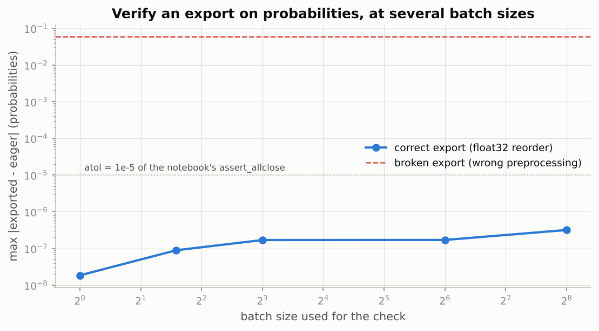

*The correct export sits five orders of magnitude below the tolerance line at every batch size; the broken one sits far above it even though its labels agree.*

### Real-world examples

- ONNX Runtime is the Python-free CPU runtime behind many production classifiers and rankers; Microsoft runs it inside its own products, and its WebAssembly/WebGPU build runs exported models in the browser.
- ExecuTorch takes a `torch.export` program to Android, iOS and embedded hardware, and AOTInductor compiles the same program to a shared library callable from C++ without a Python interpreter.
- TensorRT and OpenVINO consume ONNX graphs and compile them for NVIDIA GPUs and Intel CPUs respectively, with their own fusion and int8 calibration.

### Examples for every subsection

- **3.1 Why export at all.** The notebook's table compares the three routes: `torch.export` gives an `ExportedProgram` (`.pt2`, the input of ExecuTorch, AOTInductor and the new ONNX exporter), TorchScript gives a `ScriptModule` for libtorch and TorchServe, ONNX gives a `.onnx` protobuf for the runtime ecosystem.
- **3.2 `torch.export`.** `torch.export.export(serving, (example,), dynamic_shapes={"pixels": {0: Dim("batch", min=1, max=4096)}})` with an example batch of 8 (never 1, because of 0/1 specialization); the program runs at batch 3, agrees to float rounding, and survives `torch.export.save`/`load` without the class.
- **3.3 TorchScript: trace versus script.** `SignDependent` returns `2x` for positive sums and `-x` otherwise; tracing it on `torch.ones(3)` and calling it on `-torch.ones(3)` returns the positive branch's answer (wrong), while scripting keeps the `if` and returns the right one.
- **3.4 ONNX export and ONNX Runtime.** The dynamo exporter (`dynamo=True`, same dynamic batch) is tried first, then the legacy exporter with `dynamic_axes`; `onnx.checker` validates the file, the operator list shows `Sub`/`Div`, `Conv`, `Gemm`, `Softmax`, and ONNX Runtime reproduces PyTorch to about $10^{-6}$ with the same accuracy and a 1.5 to 4x CPU speed-up at batch 1.

### Common pitfalls

- Verifying an export on the example input only, or on labels only (see the worked example).
- Exporting a dynamic batch from an example with batch 1: the exporter specializes the dimension and the model only accepts batch 1.
- Expecting a traced TorchScript model to honour data-dependent `if` statements: only scripting does.

## 4. Quantization

### In plain words

Quantization stores and computes with small integers instead of 32-bit floats. The mapping is affine: a scale $s$ is the real-valued size of one integer step and a zero-point $z$ is the integer that represents 0 exactly, so $q = \mathrm{round}(x/s) + z$ clipped to the integer range, and $\hat{x} = s\,(q - z)$. The asymmetric form (unsigned, 0 to 255) uses all levels for one-sided data such as ReLU outputs; the symmetric form (signed, -128 to 127, $z = 0$) suits weights centred on zero. Rounding error is uniform in one step, so its mean square is $s^2/12$: one more bit halves the step and halves the error, and giving every output channel its own scale (per-channel) beats one scale per tensor. Eight bits are nearly free; at four bits and below the model must be trained with the rounding in the loop (quantization-aware training) using the straight-through estimator for the backward pass. The lesson of the section: size follows the parameters, speed follows the arithmetic, and in a CNN those live in different layers.

### Sample data

Eight weights, typed by hand, quantized by the figure script with the notebook's `quantize_affine` logic:

| $x$ | -0.62 | -0.31 | -0.05 | 0.00 | 0.08 | 0.27 | 0.45 | 0.93 |
|---|---|---|---|---|---|---|---|---|

### Worked example

**Symmetric int8.** The largest magnitude is 0.93, so $s = 0.93 / 127 = 0.007323$ and $z = 0$.

| $x$ | $q$ | $\hat{x}$ | error |
|---|---|---|---|
| -0.620 | -85 | -0.62244 | -0.00244 |
| -0.310 | -42 | -0.30756 | 0.00244 |
| -0.050 | -7 | -0.05126 | -0.00126 |
| 0.000 | 0 | 0.00000 | 0.00000 |
| 0.080 | 11 | 0.08055 | 0.00055 |
| 0.270 | 37 | 0.27094 | 0.00094 |
| 0.450 | 61 | 0.44669 | -0.00331 |
| 0.930 | 127 | 0.93000 | 0.00000 |

The largest error is 0.00331, below the bound $s/2 = 0.00366$; the RMS error is 0.00179, close to the theory $s/\sqrt{12} = 0.00211$.

**Asymmetric uint8.** The range is $[-0.62, 0.93]$, so $s = 1.55 / 255 = 0.006078$ and $z = -\mathrm{round}(-0.62 / s) = 102$. Zero maps to $q = 102$ and back to exactly 0.000; -0.62 maps to 0 and 0.93 to 255. The step is smaller because no levels are wasted on the empty part of the symmetric range: max error 0.00255 (bound 0.00304), RMS error 0.00108.

**Four bits.** With 16 levels, $s = 0.93 / 7 = 0.1329$; the codes become $[-5, -2, 0, 0, 1, 2, 3, 7]$ and the reconstructions $[-0.664, -0.266, 0.0, 0.0, 0.133, 0.266, 0.399, 0.93]$: the two smallest weights collapse onto zero and -0.62 becomes -0.664. That is the 4-bit degradation the notebook measures on `fc1`.

**Error versus bits** on a 64 x 256 Gaussian weight matrix (std 0.05, each row scaled by a factor between 0.25 and 1.0, one outlier of 0.35 that sets the per-tensor range):

| bits | per-tensor relative RMS error | per-channel |
|---|---|---|
| 2 | 0.9967 | 0.8109 |
| 3 | 0.8057 | 0.3158 |
| 4 | 0.4237 | 0.1346 |
| 5 | 0.2016 | 0.0630 |
| 6 | 0.0973 | 0.0305 |
| 7 | 0.0478 | 0.0150 |
| 8 | 0.0238 | 0.0076 |

From 3 bits on, each extra bit divides the per-tensor error by 1.9 to 2.1 (ratios 1.24, 1.9, 2.1, 2.07, 2.04, 2.01), as $s^2/12$ predicts; per-channel scales are about three times more accurate at every bit width because the rows with small weights no longer share the outlier's scale.

**Straight-through estimator.** Fake-quantizing $x \in [-1, 1]$ to 3 bits gives a staircase with step $s = 0.3333$ and levels $[-1.0, -0.667, -0.333, 0.0, 0.333, 0.667, 1.0]$; its true derivative is zero almost everywhere, so the backward pass uses the slope 1 of the identity instead. In code this is `x + (x_hat - x).detach()`.

### Chart

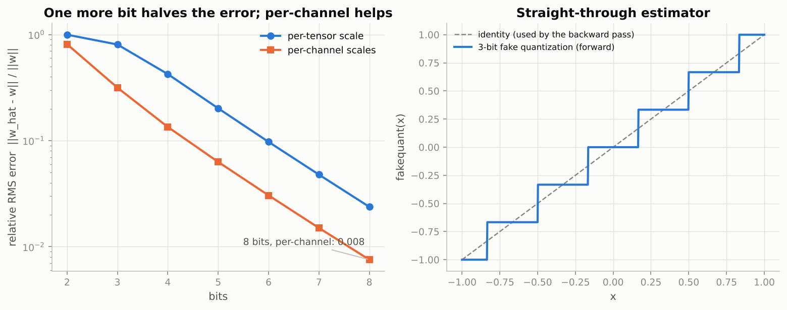

*Left: a straight line on a log axis, one bit per halving, with per-channel scales a constant factor below per-tensor. Right: the forward staircase and the identity the gradient pretends it is.*

### Real-world examples

- Large language models run on laptops because 4-bit weight quantization (GGUF files in llama.cpp, NF4 in QLoRA) cuts a 7-billion-parameter model from 28 GB of float32 to under 4 GB; non-uniform codebooks exist precisely because uniform 4-bit levels waste resolution on the bulk of near-zero weights.
- Mobile vision models (MobileNet-class classifiers and detectors) ship as int8 in LiteRT and Core ML; static post-training quantization with calibration is what makes the convolutions themselves run in integer arithmetic on phone hardware.
- Intel VNNI/AMX instructions and NVIDIA tensor cores execute int8 matrix products several times faster than float32, which is where ONNX Runtime's and TensorRT's int8 speed-ups come from.

### Examples for every subsection

- **4.1 Affine quantization, derived.** The eight-weight table above is the derivation in numbers; the notebook applies the same function to the trained `fc1.weight` (per-tensor symmetric, per-tensor asymmetric, per-channel symmetric at 8, 4 and 3 bits) and then computes `fc1` as an integer matmul with one float rescale, reproducing the float output to within a fraction of a percent.
- **4.2 Dynamic int8 quantization with `torch.ao.quantization`.** `quantize_dynamic(model, {nn.Linear}, dtype=torch.qint8)` turns the two linear layers into packed int8 layers: the file shrinks almost 4x (97.7 % of the parameters are in those layers), accuracy is unchanged, and latency barely moves because the convolutions still run in float32.
- **4.3 Fake quantization and quantization-aware training by hand.** A float32 MLP quantized post hoc to 8, 4 and 3 bits loses little, some and a lot of accuracy respectively; one epoch of training with fake-quantized 3-bit weights and the straight-through estimator recovers most of the 3-bit loss.
- **4.4 Quantization inside ONNX Runtime.** Each `Gemm` is split into `MatMul` + `Add` with `onnx.helper`, then `onnxruntime.quantization.quantize_dynamic(..., op_types_to_quantize=["MatMul"])` rewrites the matmuls into `MatMulInteger` with a `DynamicQuantizeLinear` in front; size drops, accuracy holds, speed gain is modest for the same reason as in 4.2.

### Common pitfalls

- Expecting a speed-up from quantizing the layer that holds the parameters: `fc1` is 97 % of the bytes but a small share of the FLOPs at 28 x 28; the convolutions set the latency.
- Using one scale for a tensor with an outlier: the outlier sets the range and the bulk of the weights lands on a handful of levels (the 4-bit example above).
- Forgetting that `ConvInteger` on the ONNX Runtime CPU provider exists only for unsigned weights: quantize `MatMul` only for a like-for-like comparison.

## 5. Pruning

### In plain words

Trained networks are redundant: many weights are so close to zero that removing them changes almost nothing. Magnitude pruning ranks weights by $|w|$ and zeroes the smallest fraction $s$, the sparsity. Done globally across layers it prunes the big redundant linear layer much harder than the small convolutions, which is the right allocation. The notebook's CNN keeps its accuracy up to about 70 to 80 % sparsity with no retraining, and a short fine-tuning repairs most of the damage even at 95 %. The catch is hardware: a dense matrix multiply handles a zero as fast as any other number, so unstructured sparsity shrinks storage but not latency on ordinary CPUs and GPUs, unless a special pattern such as NVIDIA's 2:4 is used. Removing whole channels (structured pruning) leaves a smaller dense network that is genuinely faster, at a higher accuracy cost per removed weight.

### Sample data

A toy network with two layers, generated by the figure script: a "fc" layer of 2,000 weights drawn from a Gaussian with std 0.02 (many small weights) and a "conv" layer of 200 weights with std 0.12 (few, large weights). The first 8 fc weights: -0.016, -0.0265, -0.005, 0.0084, 0.0227, 0.0022, -0.0111, -0.0157.

### Worked example

1. **Global 80 % magnitude pruning.** Sorting all 2,200 magnitudes, the 80th percentile is 0.0294, so every weight with $|w| \le 0.0294$ is zeroed: 1,760 of 2,200 weights. All eight sample fc weights are below the threshold and are removed (kept: 0, 0, 0, 0, 0, 0, 0, 0).
2. **Where the zeros land.** The fc layer ends up 86.2 % sparse and the conv layer only 17.5 % sparse; overall exactly 80.0 %. Per-layer pruning at 80 % each would instead have used thresholds 0.0250 for fc and 0.1654 for conv, removing many large, important conv weights. This is why `prune.global_unstructured` is preferred.
3. **Iterative schedule (Exercise 3).** Because repeated `global_unstructured` calls interpret `amount` relative to the still-unpruned weights, reaching 50 %, 80 % and 95 % sparsity in three rounds means removing 50.0 %, then 60.0 %, then 75.0 % of the remaining weights.
4. **The accuracy cliff (schematic, not measured).** The right panel of the chart is the logistic model $99 - 88 / (1 + e^{-(s - 0.86)/0.035})$ for one-shot pruning and the same shape with the cliff moved to 0.965 for fine-tuned pruning. It reads: at 50 % sparsity 99.0 % either way; at 80 % one-shot 85.6 % vs fine-tuned 99.0 %; at 90 % 32.3 % vs 98.6 %; at 95 % 17.2 % vs 79.4 %. The notebook measures the real curve for the CNN; expect the same shape with the cliff near 80 to 90 %.

### Chart

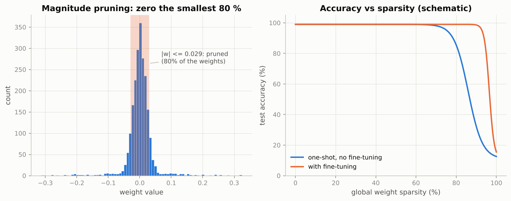

*Left: the shaded band around zero is what 80 % global pruning removes; the wide tails (the conv weights) survive. Right: accuracy stays flat and then falls off a cliff, and fine-tuning moves the cliff to the right.*

### Real-world examples

- NVIDIA Ampere and later tensor cores execute 2:4 semi-structured sparsity (two zeros in every four consecutive weights) at up to twice the dense rate, the one widely deployed case where pruning buys latency on a GPU.
- Han et al.'s 2015 iterative prune-and-retrain pipeline removed about 90 % of the weights of AlexNet and VGG on ImageNet with no accuracy loss, the result that started the modern compression literature.
- Structured pruning of channels and attention heads is how vendors derive "small" variants of a trained model family for edge devices, because the result is an ordinary smaller dense network every runtime can speed up.

### Examples for every subsection

- **5.1 Magnitude pruning, unstructured and structured.** The notebook prunes the CNN globally to 0, 30, 50, 70, 80, 90, 95 and 98 % and prints the per-layer sparsities (fc1 pruned far more than conv1), fine-tunes a 95 %-sparse copy for one or two epochs, makes the masks permanent with `prune.remove`, zeroes half of `conv2`'s channels with `prune.ln_structured(..., n=2, dim=0)`, and finally shows that the 95 %-sparse model in dense format runs in exactly the same time as the dense one while a CSR sparse matmul is often slower.

### Common pitfalls

- Pruning each layer by the same fraction: the small convolutions lose weights that matter while the big linear layer keeps weights that do not.
- Expecting a latency gain from an unstructured mask: the zeros are still multiplied.
- Forgetting `prune.remove` before export: the exported graph would carry `weight_orig` and `weight_mask` instead of one `weight`.

## 6. Knowledge distillation

### In plain words

A big, accurate teacher knows more than its top-1 answer: its whole output distribution says which classes look alike. Distillation trains a small student to match that distribution, not just the hard label. Because a trained classifier's softmax is very peaked, the logits are first divided by a temperature $T$ to reveal the runner-up classes. The loss is $\alpha\,T^2\,\mathrm{KL}(p_\text{teacher}^{(T)}\,\|\,p_\text{student}^{(T)}) + (1 - \alpha)\,\mathrm{CE}$; the $T^2$ compensates for the gradient of the soft term shrinking like $1/T^2$, so that $\alpha$ keeps its meaning when $T$ is tuned. In the notebook a 784 -> 64 -> 10 MLP (50,890 parameters, a quarter of the CNN) taught by the CNN consistently beats the same MLP trained on labels alone. Among the three compression methods, distillation is the one that reliably cuts latency, because it shrinks the architecture itself.

### Sample data

Five-class teacher logits typed by hand, with class `c0` correct, and a student that confuses `c0` with `c1`:

| | c0 | c1 | c2 | c3 | c4 |
|---|---|---|---|---|---|
| teacher logits $z_t$ | 6.0 | 3.0 | 1.0 | 0.0 | -1.0 |
| student logits $z_s$ | 4.0 | 3.5 | 0.5 | 0.0 | -0.5 |

### Worked example

**Softening.** The teacher's probabilities at four temperatures:

| $T$ | c0 | c1 | c2 | c3 | c4 |
|---|---|---|---|---|---|
| 1 | 0.943 | 0.047 | 0.006 | 0.002 | 0.001 |
| 2 | 0.722 | 0.161 | 0.059 | 0.036 | 0.022 |
| 5 | 0.406 | 0.223 | 0.149 | 0.122 | 0.100 |
| 10 | 0.295 | 0.218 | 0.179 | 0.162 | 0.146 |

At $T = 1$ the teacher says "c0, 94 %" and the rest is invisible; at $T = 5$ it says "c0, but c1 is the runner-up at 22 % and c2 at 15 %", which is the similarity information the student is meant to absorb. At $T = 10$ the distribution is nearly flat and carries little.

**The loss** with the notebook's defaults $T = 4$, $\alpha = 0.7$:

1. Softened teacher $[0.464, 0.219, 0.133, 0.104, 0.081]$; softened student $[0.334, 0.295, 0.139, 0.123, 0.109]$.
2. $\mathrm{KL}(\text{teacher}\,\|\,\text{student})$ at $T = 4$ is 0.0388; times $T^2 = 16$ gives the soft term 0.6214.
3. Cross-entropy of the student at $T = 1$ against the hard label c0 is 0.5105.
4. Loss $= 0.7 \times 0.6214 + 0.3 \times 0.5105 = 0.5881$.
5. The gradient of the scaled soft term with respect to the student logits is $T\,(p_s^{(T)} - p_t^{(T)}) = [-0.5185, 0.3034, 0.0257, 0.0778, 0.1116]$: push c0 up, push c1 down hard, nudge the rest, in proportion to how far the student's soft distribution is from the teacher's.

**The compression menu**, illustrative numbers shaped like the notebook's results (not measured):

| option | size (KB) | accuracy (%) | relative CPU latency, batch 1 |
|---|---|---|---|
| CNN float32 | 808 | 99.1 | 1.00 |
| CNN int8 dynamic | 217 | 99.1 | 0.98 |
| CNN 90 % pruned (sparse storage) | 162 | 98.6 | 1.00 |
| CNN structured, half the channels | 420 | 98.5 | 0.70 |
| distilled MLP float32 | 199 | 97.9 | 0.25 |
| distilled MLP int8 | 52 | 97.9 | 0.15 |

Quantization shrinks bytes but not time, pruning shrinks the weight count but not time, structured pruning and distillation shrink time; distillation followed by int8 is the smallest and fastest point, at the price of the accuracy a convolution-free student can reach.

### Chart

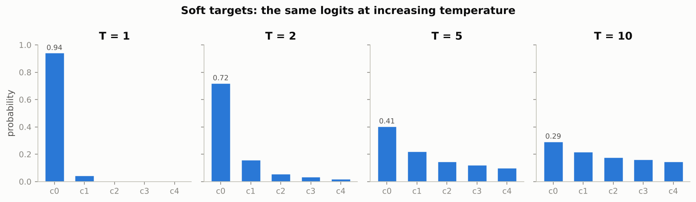

*The same five logits: certain at T = 1, informative about the runner-ups at T = 2 and 5, almost flat at T = 10.*

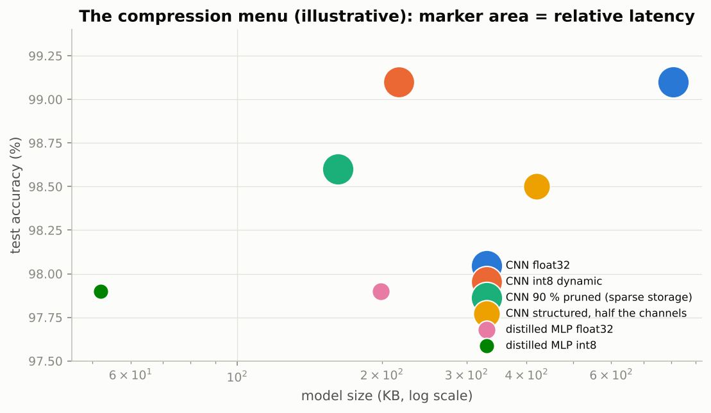

*Marker area is relative latency: only the structured and distilled options get smaller markers, because only they change the arithmetic.*

### Real-world examples

- DistilBERT (Sanh et al., 2019) was distilled from BERT with soft targets: 40 % fewer parameters, about 97 % of BERT's score on the GLUE benchmark, about 60 % faster, which is why it became a default for latency-sensitive search and classification services.
- On-device speech and keyboard models are routinely students of large server-side teachers, trained on the teacher's soft outputs over huge unlabeled corpora.
- Modern "small" language models are frequently distilled from larger ones in the same family, matching intermediate representations and attention maps as well as output distributions.

### Examples for every subsection

- **6.1 Soft targets and temperature.** The notebook plots the CNN's softened probabilities for one test digit at $T = 1, 2, 5, 10$ (the runner-up digits that share strokes appear at $T = 5$), then trains two identical MLP students on identical mini-batch order, one on hard labels and one with `distillation_loss(T=4, alpha=0.7)` against the CNN's stored logits; the distilled student leads by about 0.3 to 1 point from the first epoch.

### Common pitfalls

- Dropping the $T^2$ factor: the soft term's gradient then shrinks by $1/T^2$ and the hard-label term silently takes over.
- Computing the KL in the wrong direction or with `reduction="mean"`: the notebook uses `F.kl_div(log_softmax(student/T), softmax(teacher/T), reduction="batchmean")`, which is $\mathrm{KL}(\text{teacher}\,\|\,\text{student})$ averaged over the batch.
- Drawing conclusions about the best $T$ from one seed (Exercise 4): differences of a few tenths of a point are within run-to-run noise.

## 7. Serving

### In plain words

A model becomes a product through an API: an endpoint that accepts a validated batch of inputs, returns predictions with the model version, and exposes a health check for the orchestrator to poll. The notebook writes a complete service to disk (FastAPI + ONNX Runtime, a client, a Dockerfile, pinned requirements) and explains its decisions: load the model once per worker in the lifespan handler, validate with pydantic schemas so bad input gets a 422 before it reaches the model, accept a list of images so clients can batch, reject oversized batches, report the model version and the server-side latency. At scale a dynamic batcher holds requests for up to `max_wait` milliseconds or until `max_batch` are waiting, runs them together and splits the results; the right settings come from the latency/throughput curve and the SLO. Dedicated servers (Triton, TorchServe, vLLM) and edge runtimes (ExecuTorch, Core ML, ONNX Runtime Mobile, LiteRT) industrialize all of this.

### Sample data

The batching simulation of Exercise 5 run by the figure script on the latency model $\ell(b) = 0.3 + 0.012\,b$ ms with `max_wait = 2` ms and 4,000 Poisson arrivals. A hand trace of one batch with `max_batch = 4`: requests arrive at 0.00, 0.40, 0.90 and 2.60 ms and the server is free at 0.

### Worked example

**One batch by hand.** The server becomes free at 0.00 and sets its deadline at 2.00 ms. Requests 1 to 3 arrive before the deadline, request 4 (2.60 ms) does not, and the batch is not full, so the batch of 3 launches at the deadline, 2.00 ms. It takes $\ell(3) = 0.336$ ms and finishes at 2.336 ms. The three latencies are completion minus arrival: 2.336, 1.936 and 1.436 ms. Most of each latency is the wait for companions, not the compute: that is the cost of batching at low load.

**Low load** (0.5x the unbatched capacity of $1000 / a = 3{,}333$ req/s, i.e. 1,667 req/s):

| max_batch | throughput (req/s) | mean latency (ms) | p99 (ms) |
|---|---|---|---|
| 1 | 1,635 | 0.47 | 1.35 |
| 2 | 1,634 | 0.63 | 2.31 |
| 4 | 1,635 | 1.17 | 2.59 |
| 8 | 1,634 | 1.62 | 2.68 |
| 16 | 1,634 | 1.65 | 2.68 |
| 64 | 1,634 | 1.65 | 2.68 |

Throughput is simply the arrival rate (the server keeps up either way) and every increase of `max_batch` only adds waiting: `max_batch = 1` wins.

**High load** (3x capacity, 10,000 req/s):

| max_batch | throughput (req/s) | mean latency (ms) | p99 (ms) |
|---|---|---|---|
| 1 | 3,205 | 419.93 | 831.33 |
| 2 | 6,172 | 120.03 | 237.50 |
| 4 | 9,799 | 0.69 | 1.57 |
| 8 | 9,803 | 0.75 | 1.62 |
| 16 | 9,762 | 1.26 | 2.62 |
| 64 | 9,773 | 1.93 | 3.25 |

At `max_batch = 1` the server can only do 3,205 req/s, the queue grows for the whole run and the p99 is 831 ms; at `max_batch = 4` the server finally absorbs the load and the p99 collapses to 1.57 ms. A production batcher therefore adapts: it launches at once when the queue is short and batches aggressively when it is long.

### Chart

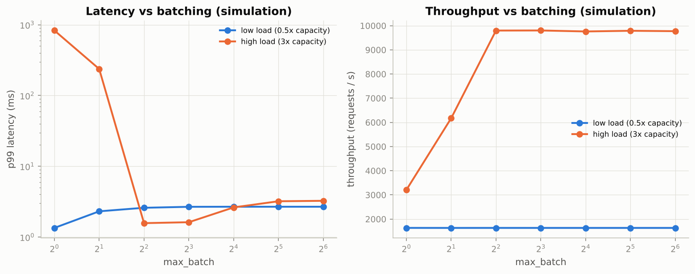

*At low load batching only adds waiting; above the unbatched capacity, batches of 4 or more bring the p99 from hundreds of milliseconds down to a few.*

### Real-world examples

- NVIDIA Triton serves ONNX, TensorRT and PyTorch models side by side on GPU fleets with dynamic batching, model ensembles and Prometheus metrics; it is the standard server for GPU inference.
- vLLM and TensorRT-LLM serve language models with continuous batching (new requests join at every decoding step) and paged attention for the KV cache, because sequences finish at different times.
- Kubernetes liveness and readiness probes call exactly the kind of `/health` endpoint the notebook's service exposes; a worker that fails it is restarted or taken out of rotation.

### Examples for every subsection

- **7.1 An inference service with FastAPI and ONNX Runtime.** `app.py` loads the ONNX session once per worker in `lifespan`, answers `/health` with the version and an image counter, and in `/predict` reshapes the batch to `(-1, 1, 28, 28)`, rejects values outside $[0, 1]$ (the classic "0 to 255 bytes" integration bug) and returns typed predictions with the server latency; the Dockerfile starts two single-threaded workers.
- **7.2 Batching, GPUs and the serving landscape.** The simulation tables above are the dynamic-batching trade-off in numbers; on a GPU the knee sits at hundreds of images, so batching is mandatory, and Triton, TorchServe, vLLM and the edge runtimes are the tools that implement it.

### Common pitfalls

- Loading the model inside the request handler: every request pays the load time and memory.
- One multi-threaded worker instead of several single-threaded ones for CPU inference: the thread pools fight each other.
- Measuring only server-side latency: for small models the JSON serialization and the network often cost more than the inference itself.

## 8. Operating models: monitoring, drift, rollback and model cards

### In plain words

A deployed model has no test set: labels arrive late or never, so its live accuracy is unknown when it matters. What can be watched immediately are the inputs and the outputs, and a shift in their distributions is the early warning. The Population Stability Index compares the histogram of a statistic on a production window with the histogram on a reference (deciles of the reference): below 0.1 stable, 0.1 to 0.25 investigate, above 0.25 act. Releases are staged (shadow, canary, A/B) so that a bad model touches few users, and rollback is a registry switch to the previous version kept warm. The measured latencies turn into a capacity plan and a monthly bill, and a model card documents what the model is for, how it was evaluated and where it fails.

### Sample data

A monitored input statistic (mean image intensity): 5,000 reference values drawn from a Gaussian with mean 0.13 and std 0.03, and a production window of 5,000 values from a dimmer, lower-contrast camera, mean 0.145 and std 0.036. The reference deciles define 10 bins.

### Worked example

**PSI, bin by bin** (shifted scenario):

| bin | reference $p_k$ | production $q_k$ | $q_k - p_k$ | $\ln(q_k / p_k)$ | contribution |
|---|---|---|---|---|---|
| 1 | 0.100 | 0.065 | -0.035 | -0.434 | 0.0153 |
| 2 | 0.100 | 0.058 | -0.042 | -0.538 | 0.0224 |
| 3 | 0.100 | 0.065 | -0.035 | -0.434 | 0.0153 |
| 4 | 0.100 | 0.068 | -0.032 | -0.383 | 0.0122 |
| 5 | 0.100 | 0.068 | -0.032 | -0.386 | 0.0123 |
| 6 | 0.100 | 0.082 | -0.018 | -0.203 | 0.0037 |
| 7 | 0.100 | 0.095 | -0.005 | -0.051 | 0.0003 |
| 8 | 0.100 | 0.105 | 0.005 | 0.053 | 0.0003 |
| 9 | 0.100 | 0.133 | 0.033 | 0.284 | 0.0093 |
| 10 | 0.100 | 0.261 | 0.161 | 0.959 | 0.1545 |

Every contribution is non-negative (a bin that gains and a bin that loses both add), the top decile alone contributes 0.1545, and the sum is PSI = 0.2455: "moderate shift, investigate". An unchanged production window drawn from the same distribution gives PSI = 0.0082. As a check, $\mathrm{KL}(q\,\|\,p) + \mathrm{KL}(p\,\|\,q) = 0.2455$ too: PSI is the symmetrized KL divergence of the two histograms.

**Capacity and cost** from the latency model (2x headroom, 0.05 USD per worker-hour): one worker does 3,205 req/s at batch 1 (0.312 ms per request) or 59,925 req/s at batch 64 (1.068 ms per batch).

| load (req/s) | batch | workers | USD per month |
|---|---|---|---|
| 100 | 1 | 1 | 36 |
| 100 | 64 | 1 | 36 |
| 2,000 | 1 | 2 | 72 |
| 2,000 | 64 | 1 | 36 |
| 50,000 | 1 | 32 | 1,152 |
| 50,000 | 64 | 2 | 72 |

At 50,000 req/s batching replaces 32 workers by 2, for a few milliseconds of queueing. A model that is twice as fast halves the batch-1 column.

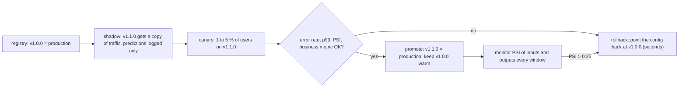

### Chart

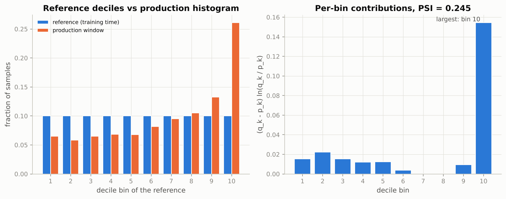

*The production window piles into the top reference decile; that single bin contributes 0.15 of the 0.25 total.*

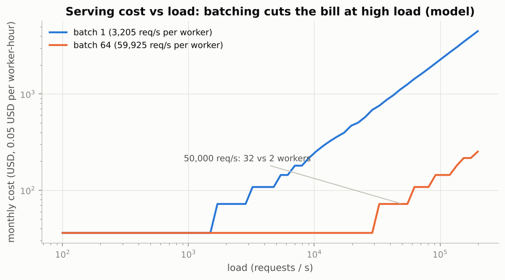

*Both curves are staircases (whole workers), and the gap between them widens with load: batching is a cost lever.*

### Real-world examples

- Credit-scoring teams in banks compute PSI on every input variable and on the score distribution each month; it is the standard scorecard-monitoring statistic, and a PSI above 0.25 triggers a review of the model.
- Streaming and e-commerce platforms roll out a new recommendation model as a canary and then an A/B test with sticky user assignment, measuring a business metric with enough users for statistical power before promoting it.
- Drift-monitoring products (Evidently, WhyLabs, Arize and the cloud vendors' monitors) log exactly these input and output statistics per window and alert on PSI or similar distances.
- Model cards (Mitchell et al., 2019) are published by model providers and expected by regulators for high-stakes uses: medical device submissions and the EU's AI rules both require documentation of intended use, evaluation and limitations.

### Examples for every subsection

- **8.1 Monitoring inputs and outputs.** The notebook logs mean intensity, fraction of bright pixels, confidence and predicted class for a reference half of the test set, then for three production scenarios: unchanged (PSI near zero), low contrast plus noise, and inverted images; the shifted scenarios are flagged by the input statistics before any label exists, and the inverted one drives accuracy to chance.
- **8.2 Rolling out and rolling back.** The Mermaid diagram above is the staged path: shadow, canary, A/B, promote or roll back by editing the registry entry; it requires that every version can be traced to its data snapshot, commit and configuration.
- **8.3 Cost estimates.** The notebook runs the table above with its own measured batch-1 and batch-64 latencies (ONNX Runtime if available, eager PyTorch otherwise) for loads of 100, 2,000 and 50,000 req/s.
- **8.4 The model card.** `MODEL_CARD.md` is generated from the measured numbers: architecture and parameter count, training setup, test accuracy with per-class accuracy and the weakest class, latencies, the ONNX and int8 notes, intended and non-intended uses, known limitations (inverted or unnormalized inputs, rotations, no "not a digit" class) and recommendations (monitor PSI, roll back above 0.25).

### Common pitfalls

- Waiting for labels to detect a problem: most production incidents are pipeline changes visible in the input statistics within minutes.
- Comparing a production window with last week instead of a fixed reference: slow drift then never shows.
- Treating the model card as marketing: its value is in the limitations and the groups on which the model was not evaluated.

## Exercises in plain words

- **Exercise 1 (warm-up): export a ResNet to ONNX with a dynamic batch.** Build a tiny ResNet with BatchNorm (random weights are fine), export it with a dynamic batch, and check with ONNX Runtime that batches of 1 and 5 match PyTorch. Useful because BatchNorm and residual additions are the first things that go wrong in exports. Hint: export in `eval()` mode and look at the operator list; BatchNorm either appears as `BatchNormalization` or is folded into the preceding `Conv`.
- **Exercise 2: quantize the student and measure.** Apply dynamic int8 quantization to the distilled MLP and compare size, accuracy and latency with the CNN's numbers. Useful because it shows the "speed follows the FLOPs" rule from the other side: in an all-linear model every multiply-accumulate becomes int8. Hint: reuse `state_dict_bytes`, `evaluate` and `benchmark_latency` exactly as in Section 4.2.
- **Exercise 3: iterative magnitude pruning with fine-tuning.** Reach 95 % sparsity in three rounds (50, 80, 95 %) with one fine-tuning epoch after each, and compare with one-shot 95 % plus three epochs. Useful because iterative pruning is what the literature actually does. Hint: `prune.global_unstructured` counts `amount` relative to the weights still alive, so the relative amounts are 50 %, 60 % and 75 % (see the Section 5 worked example).
- **Exercise 4: distillation temperature.** Repeat the distillation at $T = 1, 2, 4, 8$ and plot the final accuracy against $T$. Useful because $T$ is the one hyperparameter of distillation everyone tunes. Hint: `train_student` takes `T` directly; the runs share seeds and batch order, but differences of a few tenths of a point need several seeds before you believe them.
- **Exercise 5 (challenge): a request-batching simulation.** Write a discrete-event simulation of a server with dynamic batching under Poisson arrivals and the linear latency model, and report throughput, mean and p99 latency against `max_batch` for a load below and above the unbatched capacity. Useful because it is the arithmetic every serving system's batcher is built on. Hint: keep one clock (when the server is next free); the Section 7 hand trace shows one batch step by step.

## Quick reference

| Concept | Formula or rule | In one sentence |
|---|---|---|
| Latency vs throughput | $\ell(b) = a + c\,b$; throughput $= b / \ell(b)$ | Overhead $a$ dominates small batches, arithmetic $c$ dominates large ones; the knee is near $a/c$. |
| Percentiles | p99 = value that 99 % of requests beat | SLOs are stated on p50/p99 because the mean hides the tail. |
| Safe loading | `torch.load(..., weights_only=True)` (default since 2.6) | Only tensors, numbers, strings and containers are unpickled; no code runs. |
| Semantic model version | MAJOR.MINOR.PATCH | Contract change / better model, same contract / metadata only. |
| Export verification | `assert_allclose(exported, eager, rtol=1e-3, atol=1e-5)` at several batch sizes | Compare probabilities, not labels; test a batch size the export never saw. |
| Affine quantization | $q = \mathrm{clamp}(\mathrm{round}(x/s) + z)$, $\hat{x} = s\,(q - z)$ | $s$ is the step, $z$ the integer that is exactly zero. |
| Symmetric / asymmetric | $s = \max\lvert x\rvert / (2^{b-1} - 1)$, $z = 0$ / $s = (x_{\max} - x_{\min}) / (2^b - 1)$, $z = -\mathrm{round}(x_{\min}/s)$ | Symmetric for weights, asymmetric for one-sided activations. |
| Quantization error | mean square $s^2 / 12$ | One more bit halves the RMS error; per-channel scales shrink $s$ where weights are small. |
| Integer matmul | $y \approx s_x s_w\,(q_x - z_x)^\top (q_w - z_w)$ | int8 products, int32 accumulation, one float rescale. |
| Straight-through estimator | forward $\hat{x}$, backward $\partial\hat{x}/\partial x := 1$; code `x + (x_hat - x).detach()` | Lets gradients pass through rounding so QAT can train. |
| Magnitude pruning | zero the fraction $s$ of weights with the smallest $\lvert w\rvert$ | Global ranking prunes redundant layers harder; unstructured zeros do not speed up dense kernels. |
| Iterative pruning step | remove $(s_\text{new} - s_\text{cur}) / (1 - s_\text{cur})$ of the remaining weights | `amount` is relative to what is still unpruned. |
| Soft targets | $p_i^{(T)} = \exp(z_i/T) / \sum_j \exp(z_j/T)$ | Higher $T$ flattens the distribution and reveals runner-up classes. |
| Distillation loss | $\alpha\,T^2\,\mathrm{KL}(p_t^{(T)} \| p_s^{(T)}) + (1-\alpha)\,\mathrm{CE}$ | $T^2$ keeps the soft term's gradient, which scales as $1/T^2$, comparable to the hard term. |
| PSI | $\sum_k (q_k - p_k)\ln(q_k/p_k)$ over reference deciles | Symmetrized KL between histograms; 0.1 and 0.25 are the usual thresholds. |
| Capacity plan | workers $= \lceil 2 \cdot \text{load} / \text{throughput per worker} \rceil$ | Cost per month = workers x price per hour x 720. |

## Glossary

- **p99 latency**: the time within which 99 % of requests complete; the tail statistic that service-level objectives are written on.
- **Throughput**: requests (or images) completed per second; rises with batch size until the hardware saturates.
- **`state_dict`**: the ordered dictionary of a model's parameter and buffer tensors, the safe unit of persistence.
- **safetensors**: a weights file format (JSON header plus raw bytes) that cannot execute code on load and supports lazy, memory-mapped loading.
- **Model registry**: the record of every model version with its artifact, metrics, lineage and stage (staging, production, archived).
- **`torch.export` / ExportedProgram**: the modern capture of a module into an ATen graph with shape guards, the input of AOTInductor, ExecuTorch and the ONNX exporter.
- **ONNX / ONNX Runtime**: a vendor-neutral graph format and the cross-platform engine that executes it, often faster than eager PyTorch on CPUs.
- **Scale and zero-point**: the two numbers of affine quantization; the real size of one integer step and the integer that represents zero exactly.
- **Per-channel quantization**: one scale per output channel of a weight tensor instead of one for the whole tensor; much lower error at the same bit width.
- **Quantization-aware training (QAT)**: training with fake quantization in the forward pass and the straight-through estimator in the backward pass so the weights adapt to rounding.
- **Sparsity**: the fraction of weights that are exactly zero after pruning; unstructured sparsity shrinks storage, structured sparsity shrinks compute.
- **Knowledge distillation**: training a small student to match a large teacher's softened output distribution.
- **Temperature**: the divisor applied to logits before the softmax; larger values flatten the distribution.
- **Dynamic batching**: collecting requests for up to `max_wait` or until `max_batch` and running them together.
- **Population Stability Index (PSI)**: a histogram distance between a reference and a production window used to detect drift.
- **Canary release**: serving a new model version to a small fraction of traffic before promoting it, with the old version kept ready for rollback.
- **Model card**: a short standard report of a model's purpose, evaluation, limitations and ethical considerations.
